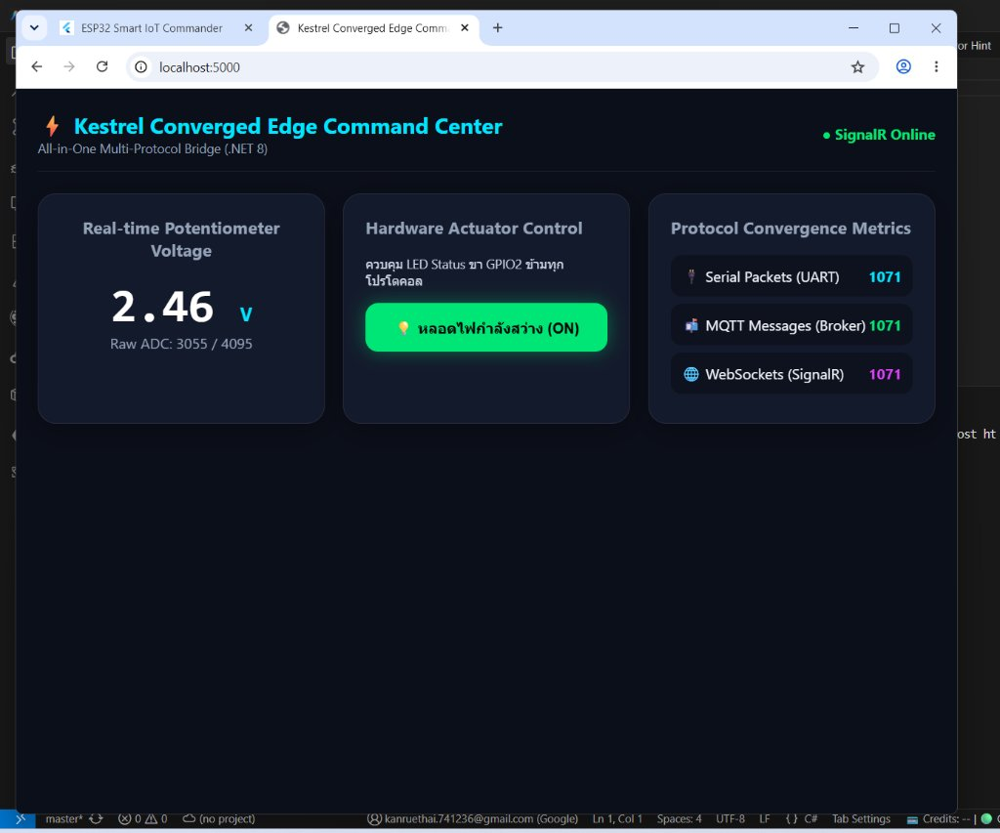

# ใบงานการทดลองที่ 13.1
### การสร้าง Embedded MQTT Broker และ Client ภายใน Kestrel .NET 8 ด้วยไลบรารี MQTTnet

> [!NOTE] **คำชี้แจง**
> ในใบงานนี้นักศึกษาจะได้เปลี่ยนเว็บเซิร์ฟเวอร์ ASP.NET Core Kestrel ให้กลายเป็น **Embedded MQTT Broker** แบบเบ็ดเสร็จในตัวเอง โดยใช้ไลบรารี **`MQTTnet`** ทำให้แอปพลิเคชัน C# เพียงตัวเดียวสามารถรับการเชื่อมต่อจาก MQTT Client ภายนอกผ่านพอร์ต 1883 และสามารถดักจับ (Intercept) ข้อความเพื่อนำมาประมวลผลภายในได้อย่างมีประสิทธิภาพ โดยไม่ต้องติดตั้ง Mosquitto ภายนอก

---

## 1. วัตถุประสงค์การทดลอง
1. สามารถสร้างโปรเจกต์ ASP.NET Core Web Application (.NET 8) และติดตั้งแพ็กเกจ `MQTTnet.AspNetCore` ได้
2. สามารถกำหนดค่า Kestrel ให้เปิดพอร์ต TCP 1883 สำหรับให้บริการ Embedded MQTT Server ได้
3. สามารถเขียน Event Interceptor เพื่อดักจับข้อความ Inbound และบันทึก Log ลงในระบบได้
4. สามารถทดสอบการเชื่อมต่อ การ Publish และการ Subscribe ผ่านเครื่องมือ Mosquitto CLI หรือ MQTTX ได้

---

## 2. โครงสร้างสถาปัตยกรรม (Architecture Diagram)

<p align="center"></p>
<p align="center"><b></b>โครงสร้างสถาปัตยกรรม (Architecture Diagram)</p>

---

## 3. ขั้นตอนการทดลอง (Step-by-Step Activities)

### กิจกรรมที่ 13-1.1: การสร้างโปรเจกต์และติดตั้งแพ็กเกจ

#### 1. สร้างโปรเจกต์ .NET 8 Web ใหม่
เปิด PowerShell ในโฟลเดอร์สำหรับทำงาน:
```powershell
dotnet new web -n ConvergedEdgeGateway
cd ConvergedEdgeGateway
```

#### 2. ติดตั้งแพ็กเกจ `MQTTnet` และ `MQTTnet.AspNetCore`
```powershell
dotnet add package MQTTnet --version 4.3.7.1207
dotnet add package MQTTnet.AspNetCore --version 4.3.7.1207
```

---

### กิจกรรมที่ 13-1.2: การเขียนโค้ดตั้งค่าเซิร์ฟเวอร์ (`Program.cs`)

เปิดไฟล์ `Program.cs` และแทนที่ด้วยโค้ดต่อไปนี้:

```csharp
using MQTTnet;
using MQTTnet.AspNetCore;
using MQTTnet.Server;

var builder = WebApplication.CreateBuilder(args);

// 1. กำหนดค่า Kestrel ให้เปิดทั้งพอร์ต HTTP (5000) และ MQTT TCP (1883)
builder.WebHost.ConfigureKestrel(options =>
{
    // พอร์ตสำหรับ HTTP REST APIs และเว็บแดชบอร์ด
    options.ListenAnyIP(5000);

    // พอร์ตสำหรับ Embedded MQTT Broker
    options.ListenAnyIP(1883, listenOptions =>
    {
        listenOptions.UseMqtt();
    });
});

// 2. ลงทะเบียนบริการ MQTT Server
builder.Services.AddMqttServer(options =>
{
    options.WithDefaultEndpoint();
});

var app = builder.Build();

// 3. ผูก Event Handlers สำหรับจัดการข้อความใน Broker
app.UseMqttServer(server =>
{
    // ตรวจสอบการเชื่อมต่อ: กรณี Client ไม่ได้ระบุ ClientId (เช่น mosquitto CLI ที่ไม่ได้ใส่ -i)
    // ให้ Broker สุ่ม ClientId ให้โดยอัตโนมัติ เพื่อป้องกัน Connection Refused: identifier rejected
    server.ValidatingConnectionAsync += args =>
    {
        if (string.IsNullOrEmpty(args.ClientId))
        {
            args.AssignedClientIdentifier = Guid.NewGuid().ToString("N");
        }
        return Task.CompletedTask;
    };

    // เมื่อมี Client เชื่อมต่อเข้ามา
    server.ClientConnectedAsync += args =>
    {
        Console.ForegroundColor = ConsoleColor.Green;
        Console.WriteLine($"[MQTT Server] 🟢 Client เชื่อมต่อ: {args.ClientId} (จาก Endpoint: {args.Endpoint})");
        Console.ResetColor();
        return Task.CompletedTask;
    };

    // เมื่อ Client ตัดการเชื่อมต่อ
    server.ClientDisconnectedAsync += args =>
    {
        Console.ForegroundColor = ConsoleColor.DarkYellow;
        Console.WriteLine($"[MQTT Server] 🔴 Client ตัดการเชื่อมต่อ: {args.ClientId}");
        Console.ResetColor();
        return Task.CompletedTask;
    };

    // ดักจับและอ่านข้อความที่ถูก Publish ทุกฉบับ
    server.InterceptingPublishAsync += args =>
    {
        var topic = args.ApplicationMessage.Topic;
        var payload = args.ApplicationMessage.ConvertPayloadToString();
        var qos = args.ApplicationMessage.QualityOfServiceLevel;

        Console.ForegroundColor = ConsoleColor.Cyan;
        Console.WriteLine($"[MQTT Message] 📩 หัวข้อ: {topic} | QoS: {qos} | ข้อความ: {payload}");
        Console.ResetColor();

        return Task.CompletedTask;
    };
});

// 4. จุดทดสอบ REST Endpoint เบื้องต้น
app.MapGet("/", () => "🚀 Kestrel Converged Edge Gateway with Embedded MQTTnet Broker is RUNNING!");

app.Run();
```

---

### กิจกรรมที่ 13-1.3: การสั่งรันและทดสอบด้วยเครื่องมือ CLI

#### 1. สั่งรัน Kestrel Edge Gateway
```powershell
dotnet run
```
*สังเกตข้อความบนคอนโซลว่าเซิร์ฟเวอร์กำลังฟังที่พอร์ต 5000 (HTTP) และ 1883 (MQTT)*

#### 2. เปิดหน้าต่าง PowerShell ที่สอง: ทดสอบ Subscribe หัวข้อ
ใช้คำสั่ง `mosquitto_sub` เพื่อดักฟังข้อความจาก Embedded Broker ของเรา (ระบุพารามิเตอร์ `-i` เพื่อกำหนด Client ID):
```powershell
mosquitto_sub -h 127.0.0.1 -p 1883 -t "test/edge/topic" -i "sub_client" -v
```
> **ข้อสังเกต:** มาตรฐาน MQTT กำหนดให้ Client ต้องมี Client ID เสมอ สำหรับเครื่องมือ `mosquitto_sub` บน Windows หากไม่ระบุออปชัน `-i` มันจะส่ง Client ID ว่างเปล่ามา ซึ่งในโค้ดฝั่ง Broker เราได้ตั้งค่า `ValidatingConnectionAsync` ให้สุ่ม Client ID ให้โดยอัตโนมัติแล้ว

*สังเกตหน้าต่างคอนโซลของ Kestrel จะขึ้นข้อความสีเขียวว่ามี Client เชื่อมต่อเข้ามา!*

#### 3. เปิดหน้าต่าง PowerShell ที่สาม: ทดสอบ Publish ข้อความ
ส่งข้อความผ่าน `mosquitto_pub`:
```powershell
mosquitto_pub -h 127.0.0.1 -p 1883 -t "test/edge/topic" -m "Hello from CLI via Kestrel Embedded MQTT!" -i "pub_client"
```

#### 4. สังเกตผลลัพธ์
* หน้าต่าง Kestrel จะพิมพ์ Log สีฟ้าว่าดักจับข้อความได้ถูกต้อง
* หน้าต่าง `mosquitto_sub` จะได้รับข้อความที่ถูกส่งต่อผ่าน Broker สำเร็จทันที

---

### 4. สังเกตผลลัพธ์และภาพการทดลอง
* หน้าต่างคอนโซล Kestrel ตรวจพบและแสดงสถานะการเชื่อมต่อของ Client และดักจับข้อความได้ถูกต้อง
* หน้าต่าง Web Dashboard ในส่วนของ **Protocol Convergence Metrics** แสดงค่า **MQTT Messages (Broker)** นับขึ้นอย่างต่อเนื่อง ยืนยันว่า Embedded MQTT Broker ภายใน Kestrel (.NET 8) ให้บริการรับส่งและกระจายข้อมูลสำเร็จจริง

<p align="center">
  
</p>
<p align="center"><b>ภาพที่ 13-1.1:</b> การทำงานของ Embedded MQTT Broker บน Kestrel โดยนับจำนวนแพ็กเกจ MQTT สำเร็จ</p>

---

## 4. คำถามท้ายการทดลอง (Review Questions)

**1. การรัน Embedded MQTT Broker ภายใน Kestrel มีข้อได้เปรียบกว่าการติดตั้งซอฟต์แวร์ Mosquitto แยกต่างหากอย่างไรในแง่ของการกระจายงาน (Deployment) และการประมวลผลข้อมูลในหน่วยความจำ?**

* **ด้านการกระจายงาน (Deployment):** การฝังโบรกเกอร์เข้ากับ Kestrel ทำให้ระบบกลายเป็น Single Binary / Single Process ตัวเดียว นำไปรันบน Edge Device หรือแพ็กใส่ Docker Container ได้ง่ายมาก ไม่ต้องติดตั้ง Mosquitto daemon แยก ไม่ต้องคอยดูแล configuration หรือ service หลายตัว ลด dependency และลดความเสี่ยงที่ระบบจะหยุดทำงานจาก service ภายนอก
* **ด้านการประมวลผลในหน่วยความจำ (In-Memory Processing):** เมื่อมี Client ส่งข้อความเข้ามา ตัวแอป C# สามารถดักจับ (Intercept) ผ่านอีเวนต์ `InterceptingPublishAsync` ได้โดยตรงในระดับ In-Memory (Zero-copy) ไม่ต้องวนส่งผ่าน TCP loopback เข้า network stack อีกรอบ ทำให้ดึงข้อมูลส่งต่อเข้า In-memory State Store หรือยิงต่อไปยัง SignalR Hub ได้ทันทีแบบ Real-time ลด Latency และลดภาระ CPU อย่างชัดเจน

**2. ฟังก์ชัน `InterceptingPublishAsync` ใน MQTTnet สามารถนำไปประยุกต์ใช้ในการกรองข้อมูลที่ผิดปกติ (Edge Validation) ก่อนส่งต่อให้ Client อื่นได้อย่างไร?**

* `InterceptingPublishAsync` ทำงานเป็นตัวดักกรอง (Interceptor) ก่อนที่ Broker จะ Forward ข้อความไปให้ Subscriber ตัวอื่น
* เราสามารถเขียนโค้ดตรวจสอบ Data Validation เช่น เช็คว่า Payload เป็นไปตาม JSON Schema หรือไม่ หรือตรวจสอบช่วงค่า (Range Check) ของเซนเซอร์ เช่น ค่าแรงดันต้องอยู่ในช่วง 0.0V - 3.3V หากข้อมูลผิดปกติหรือหลุดช่วง เราสามารถตั้งค่า `args.ProcessPublish = false` เพื่อตัดทิ้ง (Drop) ข้อความนั้นทันทีที่ขอบ (Edge) ป้องกันไม่ให้ข้อมูลขยะแพร่กระจายไปในระบบ พร้อมทั้งบันทึก Security/Anomaly Alert ลง Log ได้ทันที
