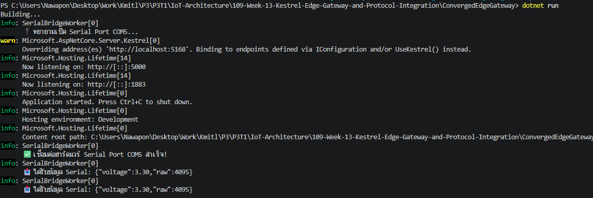
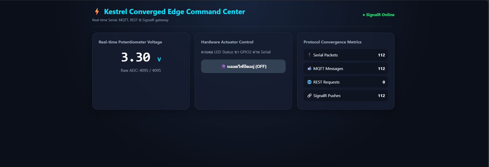
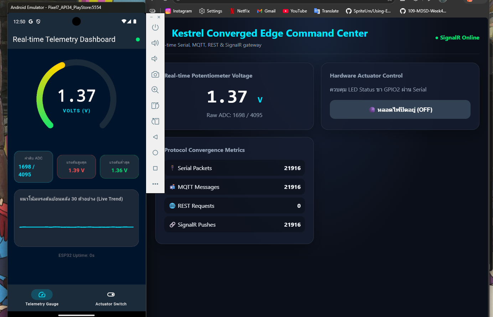
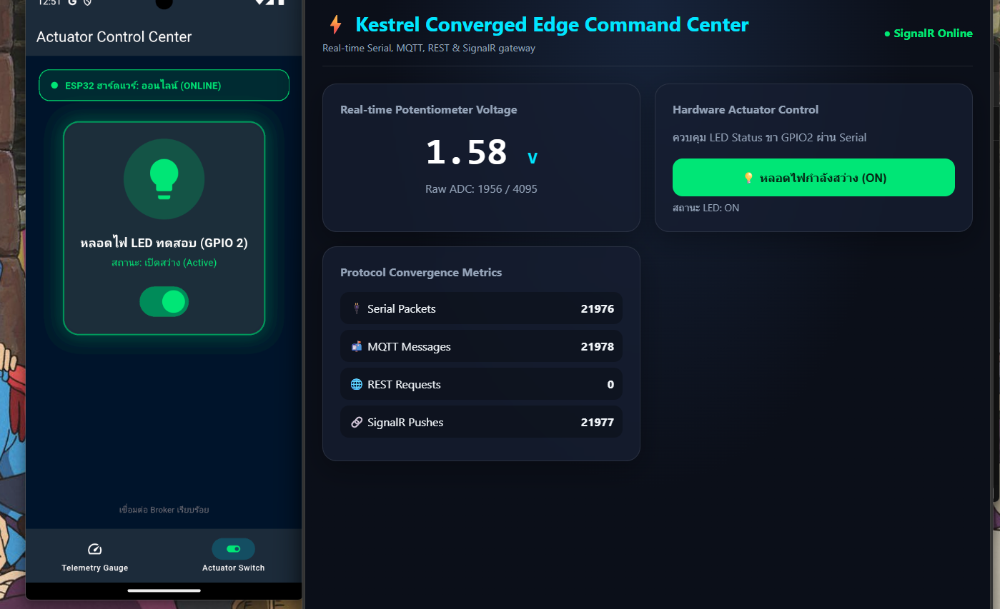

# ใบงานการทดลองที่ 13.4 (The Grand Finale)
### การทดสอบผสานรวมระบบไอโอทีแบบครบวงจร (ESP32 + Kestrel Gateway + Flutter App + Web Command Center)

> [!NOTE] **คำชี้แจง (The Grand Finale Capstone)**
> ยินดีด้วยที่ท่านได้เดินทางมาถึงการทดลองสุดท้ายของรายวิชา! ในใบงานนี้นักศึกษาจะได้นำผลงานที่สร้างขึ้นตลอดทั้งภาคการศึกษามารวมพลังกันเป็น **ระบบนิเวศไอโอทีแบบบูรณาการระดับสมบูรณ์แบบ (The Ultimate Converged IoT Ecosystem)** โดยมี **Kestrel .NET 8 Edge Gateway** ทำหน้าที่เป็นหัวใจบัญชาการ สื่อสารกับ **ฮาร์ดแวร์จริง ESP32**, เชื่อมต่อกับ **แอปมือถือ Flutter**, และประสานข้อมูลสดกับ **เว็บแดชบอร์ด SignalR** อย่างไร้รอยต่อ

---

## 1. วัตถุประสงค์การทดลอง
1. สามารถประกอบและเชื่อมโยงระบบไอโอทีที่ใช้ 4 โปรโตคอล (Serial, MQTT, REST, WebSockets) ให้ทำงานสอดประสานกันได้สมบูรณ์
2. สามารถทดสอบการซิงโครไนซ์สถานะแบบสามประสาน (Hardware <-> Mobile App <-> Web Dashboard) แบบเรียลไทม์ได้
3. สามารถพิสูจน์คุณสมบัติความอยู่รอดในระดับขอบ (Local Survivability) เมื่อตัดการเชื่อมต่ออินเทอร์เน็ตภายนอกได้
4. สามารถวัดความหน่วงเวลาเปรียบเทียบในแต่ละเส้นทางการสื่อสารของระบบได้

---

## 2. ผังความเชื่อมโยงระบบสมบูรณ์ (The Grand Ecosystem Topology)

---

## 3. ขั้นตอนการทดลอง (Step-by-Step Activities)

### กิจกรรมที่ 13-4.1: การเตรียมพร้อมทุกระบบ

1. **ฮาร์ดแวร์ ESP32**: ต่อ Potentiometer เข้าขา **GPIO34** (ADC Input) และใช้ขา **GPIO2** สำหรับ LED Status จากนั้นเสียบสาย USB เข้ากับคอมพิวเตอร์ และตรวจสอบว่าเฟิร์มแวร์กำลังพิมพ์ค่า JSON แรงดันออกทาง Serial

2. **Kestrel Edge Gateway**: 
   * ตรวจสอบว่า `Program.cs` รวมบริการทั้ง Embedded MQTT Broker, Serial Bridge, REST APIs, และ SignalR ไว้ครบถ้วน
   * รันคำสั่ง `dotnet run` ในโฟลเดอร์โปรเจกต์

3. **เว็บเบราว์เซอร์**: เปิดหน้าต่างเว็บไปที่ `http://localhost:5000` (ตรวจสอบว่าขึ้น SignalR Online สีเขียว)

4. **แอปมือถือ Flutter**:
   * เปิดโปรเจกต์จากสัปดาห์ที่ 12 (`iot_dashboard_app`)
   * ตั้งค่า Broker IP ให้ชี้มาที่หมายเลข IP ของคอมพิวเตอร์ (พอร์ต 1883)
   * สั่งรันแอปบนมือถือจริง หรือรันบนเครื่องคอมพิวเตอร์ผ่าน `flutter run`

---

### กิจกรรมที่ 13-4.2: การทดสอบ 4 มหาการทดลอง (The Grand Verification Matrix)

ให้นักศึกษาทำการทดสอบและบันทึกผลการทำงานลงในตาราง:

| มิติการทดสอบ | การกระทำเชิงปฏิบัติการ | ปรากฏการณ์ที่เกิดขึ้นจริงในระบบ | ผลการทดลอง (ผ่าน/ไม่ผ่าน) |
| :--- | :--- | :--- | :--- |
| **1. Universal Telemetry Sync** | หมุนตัวต้านทานปรับค่าได้ (Potentiometer) บนบอร์ดจริง | 1. ค่าแรงดันวิ่งผ่านสาย Serial เข้า Kestrel 2. ตัวเลขบนเว็บแดชบอร์ดวิ่งสดทันที 3. เข็ม Radial Gauge บน Flutter หมุนตามทันทีพร้อมกัน | **ผ่าน** |
| **2. Mobile-to-Web Actuation** | แตะสวิตช์เปิดไฟบนแอป Flutter (ส่งผ่าน MQTT) | 1. หลอดไฟ LED จริงบนบอร์ด ESP32 ติดสว่างขึ้น 2. ปุ่มสวิตช์บนหน้าเว็บเปลี่ยนเป็นสีเขียว "ON" อัตโนมัติ | **ผ่าน** |
| **3. Web-to-Mobile Actuation** | คลิกปุ่มปิดไฟบนหน้าเว็บ (ส่งผ่าน SignalR) | 1. หลอดไฟ LED จริงบนบอร์ด ESP32 ดับลงทันที 2. สวิตช์บนแอปมือถือ Flutter สลับเป็น "OFF" ทันที | **ผ่าน** |
| **4. Third-Party REST Override** | ยิงคำสั่งผ่าน cURL หรือ Postman: `curl -X POST http://localhost:5000/api/led/on` | 1. หลอดไฟ LED สว่างขึ้น 2. ทั้งหน้าเว็บและแอปมือถืออัปเดตสถานะเป็น "ON" พร้อมกัน | **ผ่าน** |

Video : https://drive.google.com/file/d/1SvwXdeM3prtvkUJrUz-9DLLFDHO5LAW7/view?usp=sharing

---

### กิจกรรมที่ 13-4.3: การทดสอบความทนทานในสภาวะตัดเน็ต (Local Survivability Challenge)

1. ทำการ **ถอดสาย LAN หรือปิดการเชื่อมต่ออินเทอร์เน็ตภายนอก** ของเครื่องคอมพิวเตอร์และมือถือ (คงไว้เฉพาะเครือข่าย Wi-Fi วงแลนท้องถิ่นที่ไม่มีเน็ต)
2. สังเกตการทำงาน:
   * **บอร์ด ESP32 ยังคงส่งข้อมูลได้หรือไม่?**: **ยังคงส่งข้อมูลได้ตามปกติอย่างต่อเนื่อง** เนื่องจาก ESP32 สื่อสารผ่านสาย USB-UART (Hardware Serial) ตรงเข้าสู่ Edge Gateway บนเครื่องคอมพิวเตอร์โดยตรง จึงไม่พึ่งพาสัญญาณอินเทอร์เน็ตภายนอก
   * **แอปมือถือ Flutter และเว็บแดชบอร์ดยังสามารถเปิดดูค่าและสั่งงานหลอดไฟได้หรือไม่?**: **ยังคงเปิดดูค่าและควบคุมได้ตามปกติ 100%** เพราะ Kestrel Edge Gateway ทำหน้าที่เป็น Embedded MQTT Broker (พอร์ต 1883) และ SignalR WebSocket Server (พอร์ต 5000) ภายในเครือข่าย Local Area Network (LAN) ของวง Wi-Fi เดียวกัน ทำให้แพ็กเก็ตข้อมูลวิ่งหากันในวงแลนท้องถิ่นโดยไม่ต้องอาศัยการเชื่อมต่อ WAN/Internet ภายนอก
3. **สรุปผล**: ระบบที่ออกแบบด้วยสถาปัตยกรรม **Converged Edge Gateway** มีความสามารถในการอยู่รอด (Survivability) อย่างสมบูรณ์แบบ 100% โดยไม่ล่มสลายตามสัญญาณอินเทอร์เน็ตภายนอก

---

## 4. บทสรุปและคำถามส่งท้ายภาคการศึกษา (Capstone Retrospective)

1. **ตลอดระยะเวลา 13 สัปดาห์ การเดินทางจากระดับบิตและรีจิสเตอร์ของเซนเซอร์ สู่เฟรมเวิร์ก FreeRTOS, ผ่านโปรโตคอลเครือข่ายท้องถิ่น, สู่ระบบคลาวด์ MQTT, หน้าจอมือถือ Flutter, และมาบรรจบที่ Kestrel Edge Gateway... สถาปัตยกรรมชิ้นใดที่ท่านคิดว่ามีความท้าทายเชิงวิศวกรรมมากที่สุด? เพราะเหตุใด?**
   * **คำตอบ**: สถาปัตยกรรม **Multi-Protocol Converged Edge Gateway (Kestrel .NET 8)** มีความท้าทายเชิงวิศวกรรมมากที่สุด เนื่องจากต้องผสานรวมและแปลงข้อมูลข้าม 4 โปรโตคอลที่มีลักษณะและพฤติกรรมการทำงานต่างกันอย่างสิ้นเชิง (Serial ที่เป็น Byte-stream แบบต่อเนื่อง, MQTT ที่เป็น Pub/Sub Message Broker, REST ที่เป็น Request-Response แบบ Stateless, และ SignalR/WebSockets ที่เป็น Full-Duplex Push) ให้อยู่ภายใต้ Process เดียวกัน โดยต้องจัดการ Thread-Safety, บริหารจัดการทรัพยากรพอร์ตฮาร์ดแวร์แบบ Non-blocking และซิงโครไนซ์สถานะ (State Synchronization) ของอุปกรณ์จริงและไคลเอนต์ทุกแพลตฟอร์มให้ตรงกันแบบ Real-time โดยมีความหน่วงต่ำที่สุด

2. **หากท่านต้องนำระบบนี้ไปติดตั้งในโรงงานอุตสาหกรรมจริง สิ่งใดคือ 3 ปัจจัยแรกที่ต้องดำเนินการเพิ่มเติมเพื่อความปลอดภัยและความมั่นคงระดับองค์กร?**
   * **คำตอบ**:
     1. **การเข้ารหัสและพิสูจน์ตัวตน (Authentication & Encryption - TLS/mTLS)**: ติดตั้งใบรับรองความปลอดภัยและบังคับใช้ MQTTS (พอร์ต 8883) และ HTTPS / WSS บน Kestrel รวมถึงเพิ่มระบบ Authentication (เช่น JWT Token หรือ API Keys) เพื่อป้องกันการดักฟังหรือการแทรกแซงคำสั่งควบคุมเครื่องจักร (Man-in-the-Middle)
     2. **กลไกการบัฟเฟอร์ข้อมูลออฟไลน์และการจัดการข้อผิดพลาด (Data Buffering & Fault Tolerance)**: ออกแบบระบบจัดเก็บข้อมูลลง Local Storage (เช่น SQLite, RocksDB หรือ Time-Series Database ภายใน Gateway) ในกรณีที่อุปกรณ์ปลายทางหรือระบบคลาวด์ส่วนกลางขัดข้อง พร้อมกลไก Watchdog และ Auto-Restart Service (เช่น รันผ่าน Systemd หรือ Docker Container) เพื่อให้ระบบทำงานได้ต่อเนื่อง 24/7
     3. **การแบ่งส่วนเครือข่ายและความทนทานทางกายภาพ (Network Segmentation & Industrial Hardening)**: การแยกเครือข่าย Operational Technology (OT) ของเครื่องจักรและเซนเซอร์ออกจากเครือข่าย Office/IT ทั่วไปผ่าน VLAN หรือ Industrial Firewall รวมถึงเปลี่ยนตัวแปลงสัญญาณและสายสื่อสารเป็นมาตรฐานอุตสาหกรรม (เช่น RS-485 / Modbus RTU แบบ Opto-isolated) เพื่อป้องกันสัญญาณรบกวนทางแม่เหล็กไฟฟ้า (EMI) และไฟกระชากในโรงงาน

3. ขอแสดงความยินดีกับนักศึกษาทุกท่านที่สำเร็จการฝึกอบรมการพัฒนาแอปพลิเคชันไอโอทีระดับมืออาชีพอย่างสมบูรณ์แบบ! 🎉