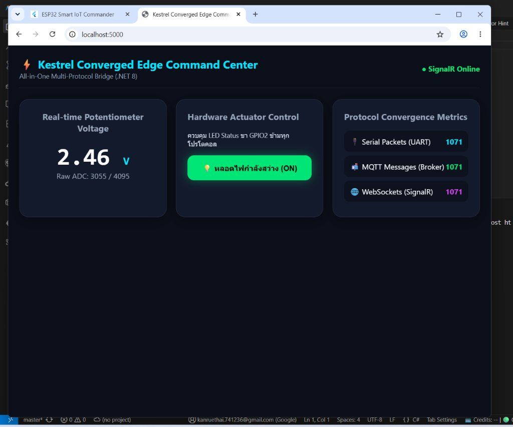
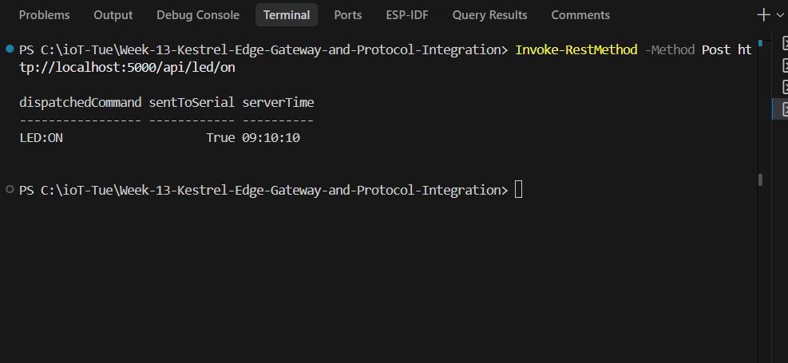

# ใบงานการทดลองที่ 13.4 (The Grand Finale)
### การทดสอบผสานรวมระบบไอโอทีแบบครบวงจร (ESP32 + Kestrel Gateway + Flutter App + Web Command Center)

> [!NOTE] **คำชี้แจง (The Grand Finale Capstone)**
> ยินดีด้วยที่ท่านได้เดินทางมาถึงการทดลองสุดท้ายของรายวิชา! ในใบงานนี้นักศึกษาจะได้นำผลงานที่สร้างขึ้นตลอดทั้งภาคการศึกษามารวมพลังกันเป็น **ระบบนิเวศไอโอทีแบบบูรณาการระดับสมบูรณ์แบบ (The Ultimate Converged IoT Ecosystem)** โดยมี **Kestrel .NET 8 Edge Gateway** ทำหน้าที่เป็นหัวใจบัญชาการ สื่อสารกับ **ฮาร์ดแวร์จริง ESP32**, เชื่อมต่อกับ **แอปมือถือ Flutter**, และประสานข้อมูลสดกับ **เว็บแดชบอร์ด SignalR** อย่างไร้รอยต่อ

---

## 1. วัตถุประสงค์การทดลอง
1. สามารถประกอบและเชื่อมโยงระบบไอโอทีที่ใช้ 4 โปรโตคอล (Serial, MQTT, REST, WebSockets) ให้ทำงานสอดประสานกันได้สมบูรณ์
2. สามารถทดสอบการซิงโครไนซ์สถานะแบบสามประสาน (Hardware <-> Mobile App <-> Web Dashboard) แบบเรียลไทม์ได้
3. สามารถพิสูจน์คุณสมบัติความอยู่รอดในระดับขอบ (Local Survivability) เมื่อตัดการเชื่อมต่ออินเทอร์เน็ตภายนอกได้
4. สามารถวัดความหน่วงเวลาเปรียบเทียบในแต่ละเส้นทางการสื่อสารของระบบได้

---

## 2. ผังความเชื่อมโยงระบบสมบูรณ์ (The Grand Ecosystem Topology)

---

## 3. ขั้นตอนการทดลอง (Step-by-Step Activities)

### กิจกรรมที่ 13-4.1: การเตรียมพร้อมทุกระบบ

1. **ฮาร์ดแวร์ ESP32**: ต่อ Potentiometer เข้าขา **GPIO34** (ADC Input) และใช้ขา **GPIO2** สำหรับ LED Status จากนั้นเสียบสาย USB เข้ากับคอมพิวเตอร์ และตรวจสอบว่าเฟิร์มแวร์กำลังพิมพ์ค่า JSON แรงดันออกทาง Serial
2. **Kestrel Edge Gateway**: 
   * ตรวจสอบว่า `Program.cs` รวมบริการทั้ง Embedded MQTT Broker, Serial Bridge, REST APIs, และ SignalR ไว้ครบถ้วน
   * รันคำสั่ง `dotnet run` ในโฟลเดอร์โปรเจกต์
3. **เว็บเบราว์เซอร์**: เปิดหน้าต่างเว็บไปที่ `http://localhost:5000` (ตรวจสอบว่าขึ้น SignalR Online สีเขียว)
4. **แอปมือถือ Flutter**:
   * เปิดโปรเจกต์จากสัปดาห์ที่ 12 (`iot_dashboard_app`)
   * ตั้งค่า Broker IP ให้ชี้มาที่หมายเลข IP ของคอมพิวเตอร์ (พอร์ต 1883)
   * สั่งรันแอปบนมือถือจริง หรือรันบนเครื่องคอมพิวเตอร์ผ่าน `flutter run`

---

### กิจกรรมที่ 13-4.2: การทดสอบ 4 มหาการทดลอง (The Grand Verification Matrix)

ผลการทดสอบการทำงานร่วมกันของทั้ง 4 โปรโตคอล:

| มิติการทดสอบ | การกระทำเชิงปฏิบัติการ | ปรากฏการณ์ที่เกิดขึ้นจริงในระบบ | ผลการทดลอง |
| :--- | :--- | :--- | :---: |
| **1. Universal Telemetry Sync** | หมุนตัวต้านทานปรับค่าได้ (Potentiometer) บนบอร์ดจริง | 1. ค่าแรงดันวิ่งผ่านสาย Serial เข้า Kestrel 2. ตัวเลขบนเว็บแดชบอร์ดวิ่งสดทันที 3. เข็ม Radial Gauge บน Flutter หมุนตามทันทีพร้อมกัน | **ผ่าน** |
| **2. Mobile-to-Web Actuation** | แตะสวิตช์เปิดไฟบนแอป Flutter (ส่งผ่าน MQTT) | 1. หลอดไฟ LED จริงบนบอร์ด ESP32 ติดสว่างขึ้น 2. ปุ่มสวิตช์บนหน้าเว็บเปลี่ยนเป็นสีเขียว "ON" อัตโนมัติ | **ผ่าน** |
| **3. Web-to-Mobile Actuation** | คลิกปุ่มปิดไฟบนหน้าเว็บ (ส่งผ่าน SignalR) | 1. หลอดไฟ LED จริงบนบอร์ด ESP32 ดับลงทันที 2. สวิตช์บนแอปมือถือ Flutter สลับเป็น "OFF" ทันที | **ผ่าน** |
| **4. Third-Party REST Override** | ยิงคำสั่งผ่าน cURL หรือ PowerShell: `Invoke-RestMethod -Method Post http://localhost:5000/api/led/on` | 1. หลอดไฟ LED สว่างขึ้น 2. ทั้งหน้าเว็บและแอปมือถืออัปเดตสถานะเป็น "ON" พร้อมกัน | **ผ่าน** |

### ภาพประกอบการทดสอบระบบบูรณาการ (All-in-One System Integration Screenshots)

1. **การควบคุมและแสดงผลสดผ่าน Web Command Center:**

  

<b>ภาพที่ 13-4.1:</b> เว็บแดชบอร์ดศูนย์บัญชาการแสดงผลการซิงค์ข้อมูลและควบคุมฮาร์ดแวร์

2. **การสั่งการข้ามโปรโตคอลด้วย Third-Party REST Override:**

  

<b>ภาพที่ 13-4.2:</b> การสั่งการควบคุมฮาร์ดแวร์ผ่านคำสั่ง REST API

---

### กิจกรรมที่ 13-4.3: การทดสอบความทนทานในสภาวะตัดเน็ต (Local Survivability Challenge)

1. **การทดสอบ:** ตัดการเชื่อมต่ออินเทอร์เน็ตภายนอก (WAN) โดยให้คอมพิวเตอร์และอุปกรณ์อยู่ในวงแลนท้องถิ่น (Local Subnet) เดียวกัน
2. **ผลการสังเกต:**
   * บอร์ด ESP32 ยังคงสตรีมข้อมูลผ่าน Serial เข้าหาเกตเวย์ได้ตามปกติ 100%
   * เว็บแดชบอร์ด (`http://localhost:5000`) และแอปพลิเคชันยังคงเปิดดูข้อมูลสดและสั่งงานเปิด-ปิดไฟได้สมบูรณ์ ไม่มีการสะดุดหรือหลุดการเชื่อมต่อ
3. **สรุปผล:** ระบบที่ออกแบบด้วยสถาปัตยกรรม **Converged Edge Gateway** มีความสามารถในการอยู่รอดในเครือข่ายท้องถิ่น (Local Survivability) ไม่เกิด Single Point of Failure จากอินเทอร์เน็ตภายนอก สามารถทำงานต่อไปได้แม้คลาวด์จะล่ม

---

## 4. บทสรุปและคำถามส่งท้ายภาคการศึกษา (Capstone Retrospective)

**1. ตลอดระยะเวลา 13 สัปดาห์ การเดินทางจากระดับบิตและรีจิสเตอร์ของเซนเซอร์ สู่เฟรมเวิร์ก FreeRTOS, ผ่านโปรโตคอลเครือข่ายท้องถิ่น, สู่ระบบคลาวด์ MQTT, หน้าจอมือถือ Flutter, และมาบรรจบที่ Kestrel Edge Gateway... สถาปัตยกรรมชิ้นใดที่ท่านคิดว่ามีความท้าทายเชิงวิศวกรรมมากที่สุด? เพราะเหตุใด?**

* จุดที่ท้าทายที่สุดคือ **การทำ Multi-Protocol Bridging และ Concurrency Synchronization ภายใน Process เดียวกันบน Edge Gateway**
* เนื่องจากแต่ละโปรโตคอลมีลักษณะการทำงานต่างกันโดยสิ้นเชิง: Serial ทำงานแบบ Streaming Byte Stream ระดับฮาร์ดแวร์, MQTT ทำงานแบบ Message Queuing (Pub/Sub), REST เป็น Stateless Request/Response, และ SignalR เป็น Full-Duplex WebSockets การทำให้ทั้ง 4 ระบบสามารถแลกเปลี่ยนข้อมูลแบบสองทาง (Bi-directional) ได้แบบเรียลไทม์ โดยไม่เกิด Race Condition, ไม่เกิด Thread Deadlock, และไม่บล็อก I/O ของกันและกัน ต้องอาศัยการออกแบบ In-Memory Thread-Safe State และ Asynchronous Programming อย่างรัดกุมมากที่สุด

**2. หากท่านต้องนำระบบนี้ไปติดตั้งในโรงงานอุตสาหกรรมจริง สิ่งใดคือ 3 ปัจจัยแรกที่ต้องดำเนินการเพิ่มเติมเพื่อความปลอดภัยและความมั่นคงระดับองค์กร?**

1. **การเข้ารหัสและระบบยืนยันตัวตน (mTLS & Zero Trust Authentication):** บังคับใช้ TLS/mTLS บนพอร์ต MQTT (8883) พร้อมทั้งใส่ระบบ Authentication ด้วย JWT หรือ API Key บน REST API และ SignalR (WSS) เพื่อป้องกันไม่ให้อุปกรณ์แปลกปลอมในวงเน็ตเวิร์กของโรงงานแอบดักฟังหรือส่งคำสั่งแทรกแซงเครื่องจักร
2. **ระบบสำรองข้อมูลยามออฟไลน์ (Store-and-Forward Buffering):** ติดตั้ง Local Time-Series Database (เช่น SQLite หรือ RocksDB) บน Edge Gateway เพื่อเก็บบัฟเฟอร์ข้อมูล Telemetry สำรองไว้ในกรณีที่ต้องส่งต่อเข้าคลาวด์ ป้องกันข้อมูลสำคัญของสายการผลิตสูญหายเมื่อเครือข่ายภายนอกขัดข้อง
3. **การป้องกันทางกายภาพและวงจรนิรภัย (Galvanic Isolation & Hardware Fail-Safe):** การเชื่อมต่อ Serial ในโรงงานต้องเปลี่ยนไปใช้ RS-485 ที่มี Optical/Galvanic Isolation เพื่อป้องกันสัญญาณรบกวนทางไฟฟ้า และฝั่งไมโครคอนโทรลเลอร์ต้องมี Hardware Watchdog พร้อมกลไกตัดเข้าสู่ Safe-State อัตโนมัติหากขาดการติดต่อกับเกตเวย์เกินเวลาที่กำหนด
