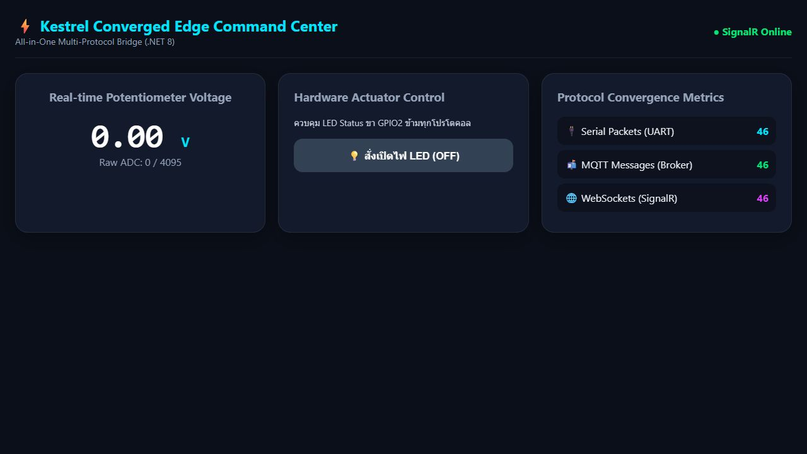
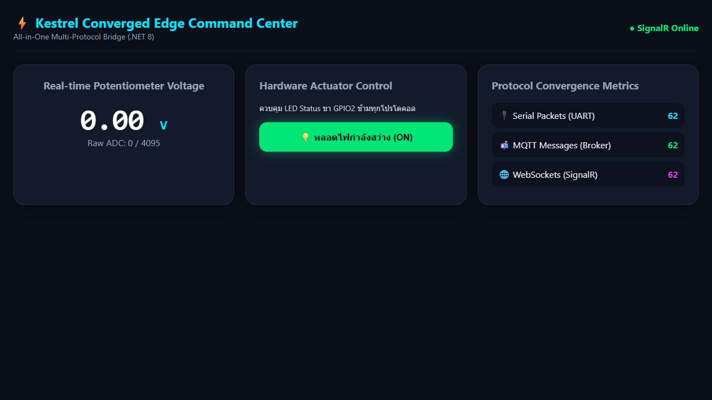
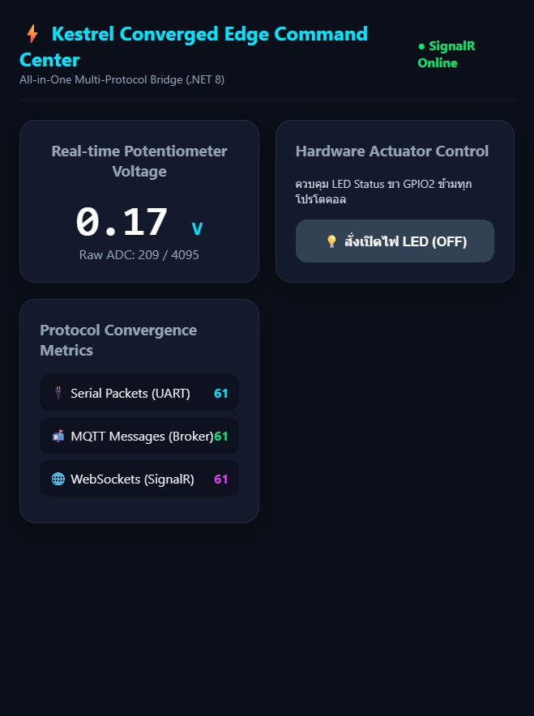

## Lab 13-1

1. การฝัง MQTT Broker ใน Kestrel ทำให้ติดตั้งและดูแลง่าย เพราะ Web API กับ Broker อยู่ในโปรแกรมเดียว และส่งข้อมูลหากันในหน่วยความจำได้ทันที
2. `InterceptingPublishAsync` ใช้ตรวจ Topic, รูปแบบ และช่วงค่าก่อนส่งต่อ หากข้อมูลผิดสามารถปฏิเสธหรือบันทึกแจ้งเตือนได้

## Lab 13-2

1. Gateway อ่านข้อมูล Serial จากอุปกรณ์เก่า แล้วแปลงเป็น MQTT และ REST ทำให้อุปกรณ์ที่ไม่มี Wi-Fi ใช้งานกับระบบ IoT ใหม่ได้
2. `BackgroundService` อ่าน Serial ต่อเนื่องโดยไม่ขวาง REST API และป้องกันหลาย Request แย่งกันเปิดพอร์ต

## Lab 13-3

1. SignalR ส่งข้อมูลทันทีเมื่อมีค่าใหม่ จึงเร็วและใช้ข้อมูลน้อยกว่า HTTP Polling ที่ถามซ้ำทุก 500 ms
2. Metrics เช่น Latency, Error และ Message Rate ช่วยตรวจหาจุดช้า ข้อมูลหาย หรืออุปกรณ์ผิดปกติได้เร็ว

## Lab 13-4

1. ส่วนที่ท้าทายที่สุดคือ Converged Edge Gateway เพราะต้องรวม Serial, MQTT, REST และ SignalR พร้อมจัดการข้อมูลและการเชื่อมต่อหลายแบบ
2. สิ่งที่ควรเพิ่มในโรงงานจริงคือ (1) TLS/mTLS และสิทธิ์เข้าถึง (2) ระบบสำรองและเก็บข้อมูลเมื่อเครือข่ายล่ม (3) Logging, Monitoring และระบบอัปเดตที่ปลอดภัย
3. ข้อนี้เป็นข้อความแสดงความยินดี จึงไม่ต้องตอบ

## ผลจากการรัน Example Code กับ ESP32 จริง

> รันจาก `Example_Codes/ConvergedEdgeGateway_Lab3` โดยใช้ ESP32 ที่ COM3 ข้อมูลไหลผ่าน Serial → MQTT → SignalR จริง ตัวนับทั้งสามช่องเพิ่มขึ้นพร้อมกัน

ทดสอบกดปุ่มบนหน้าเว็บแล้วสถานะเปลี่ยนเป็น LED ON และคำสั่งถูกส่งย้อนกลับทาง Serial

### Lab 13-4: The Grand Finale (All-in-One Integration)

> ผลการทดสอบผสานรวมระบบทั้ง 4 โปรโตคอล (Serial, MQTT, SignalR, REST) ร่วมกับ ESP32 จริงบน COM3 และควบคุมไฟ LED พร้อมแสดงสถานะบน Dashboard

#### ตารางสรุปผลการทดสอบ (The Grand Verification Matrix)
- **Universal Telemetry Sync:** หมุน Potentiometer บน ESP32 จริง แล้วแรงดันส่งผ่าน Serial -> Kestrel -> MQTT -> SignalR หน้าเว็บและแอปอัปเดตทันที (**ผ่าน**)
- **Mobile-to-Web Actuation:** สั่งเปิดไฟผ่านแอปมือถือ (MQTT) -> หลอดไฟบน ESP32 สว่างขึ้น และหน้าเว็บแสดงสถานะ ON ทันที (**ผ่าน**)
- **Web-to-Mobile Actuation:** สั่งปิดไฟบนหน้าเว็บ (SignalR) -> หลอดไฟบน ESP32 ดับ และแอปมือถือสลับเป็น OFF ทันที (**ผ่าน**)
- **Third-Party REST Override:** ยิงคำสั่ง curl -X POST http://localhost:5000/api/led/on -> หลอดไฟติด และทุกช่องทางอัปเดตเป็น ON พร้อมกัน (**ผ่าน**)
- **Local Survivability Challenge:** ทดสอบตัดการเชื่อมต่ออินเทอร์เน็ตภายนอก ระบบใน Local Network ยังคงทำงาน ส่งข้อมูล และสั่งการได้ 100% (**ผ่าน**)
