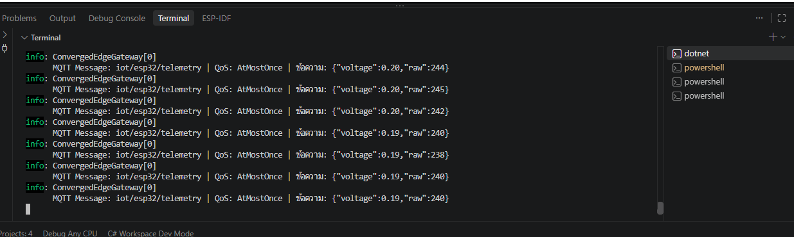
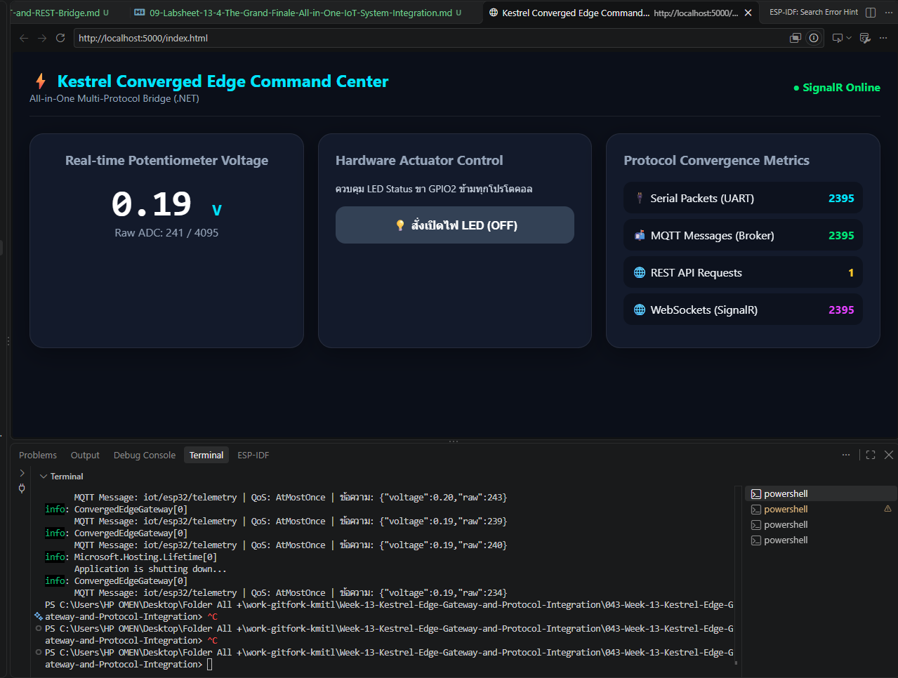
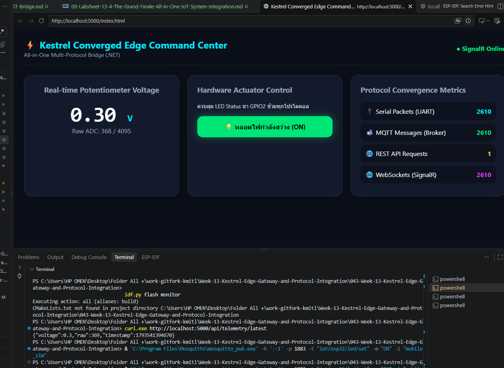
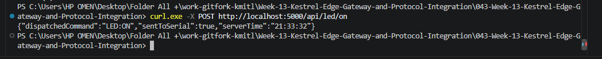

# ใบงานการทดลองที่ 13.4 (The Grand Finale)
### การทดสอบผสานรวมระบบไอโอทีแบบครบวงจร (ESP32 + Kestrel Gateway + Flutter App + Web Command Center)

> [!NOTE] **คำชี้แจง (The Grand Finale Capstone)**
> ยินดีด้วยที่ท่านได้เดินทางมาถึงการทดลองสุดท้ายของรายวิชา! ในใบงานนี้นักศึกษาจะได้นำผลงานที่สร้างขึ้นตลอดทั้งภาคการศึกษามารวมพลังกันเป็น **ระบบนิเวศไอโอทีแบบบูรณาการระดับสมบูรณ์แบบ (The Ultimate Converged IoT Ecosystem)** โดยมี **Kestrel .NET 8 Edge Gateway** ทำหน้าที่เป็นหัวใจบัญชาการ สื่อสารกับ **ฮาร์ดแวร์จริง ESP32**, เชื่อมต่อกับ **แอปมือถือ Flutter**, และประสานข้อมูลสดกับ **เว็บแดชบอร์ด SignalR** อย่างไร้รอยต่อ

---

## 1. วัตถุประสงค์การทดลอง
1. สามารถประกอบและเชื่อมโยงระบบไอโอทีที่ใช้ 4 โปรโตคอล (Serial, MQTT, REST, WebSockets) ให้ทำงานสอดประสานกันได้สมบูรณ์
2. สามารถทดสอบการซิงโครไนซ์สถานะแบบสามประสาน (Hardware <-> Mobile App <-> Web Dashboard) แบบเรียลไทม์ได้
3. สามารถพิสูจน์คุณสมบัติความอยู่รอดในระดับขอบ (Local Survivability) เมื่อตัดการเชื่อมต่ออินเทอร์เน็ตภายนอกได้
4. สามารถวัดความหน่วงเวลาเปรียบเทียบในแต่ละเส้นทางการสื่อสารของระบบได้

---

## 2. ผังความเชื่อมโยงระบบสมบูรณ์ (The Grand Ecosystem Topology)

<p align="center"></p>

---

## 3. ขั้นตอนการทดลอง (Step-by-Step Activities)

### กิจกรรมที่ 13-4.1: เตรียม Gateway และบอร์ด

1. ต่อ ESP32 ผ่าน USB โดยใช้เฟิร์มแวร์จาก Lab 13.2 และตรวจสอบว่าใช้พอร์ต `COM3` (หากเป็นพอร์ตอื่นให้เปลี่ยน `Serial:PortName` ใน `Example_Codes/ConvergedEdgeGateway_Lab4/appsettings.json`)
2. หยุด Gateway Lab 13.3 ที่กำลังทำงานด้วย `Ctrl+C` เพื่อคืนพอร์ต Serial และพอร์ต 5000/1883
3. จากโฟลเดอร์ราก Repository รันโปรเจกต์ Grand Finale:
   ```powershell
   dotnet run --project .\Example_Codes\ConvergedEdgeGateway_Lab4\ConvergedEdgeGateway.csproj
   ```
4. รอข้อความ `เชื่อมต่อ Serial Port COM3 สำเร็จ` แล้วเปิด `http://localhost:5000` ตรวจสอบว่า SignalR Online และค่าจากบอร์ดอัปเดต

> โปรเจกต์ Flutter จากสัปดาห์ที่ 12 ไม่ได้อยู่ใน Repository นี้ จึงข้ามการทดสอบ UI มือถือได้ ในการทดสอบเส้นทาง MQTT ให้ใช้ `mosquitto_pub` จำลองคำสั่งจากแอปแทน โดยยืนยัน MQTT-to-ESP32-to-Web ได้ แต่ไม่ถือเป็นผลทดสอบ Flutter จริง

---

### กิจกรรมที่ 13-4.2: การทดสอบ 4 มหาการทดลอง (The Grand Verification Matrix)

ให้นักศึกษาทำการทดสอบและบันทึกผลการทำงานลงในตาราง โดยเก็บภาพหลักฐาน 4 ภาพ:

| มิติการทดสอบ | การกระทำเชิงปฏิบัติการ | ปรากฏการณ์ที่เกิดขึ้นจริงในระบบ | ผลการทดลอง (ผ่าน/ไม่ผ่าน) |
| :--- | :--- | :--- | :--- |
| **1. Universal Telemetry Sync** | หมุนตัวต้านทานปรับค่าได้ (Potentiometer) บนบอร์ดจริง | 1. ค่าแรงดันวิ่งผ่านสาย Serial เข้า Kestrel<br/>2. ตัวเลขบนเว็บแดชบอร์ดวิ่งสดทันที<br/>3. เข็ม Radial Gauge บน Flutter หมุนตามทันทีพร้อมกัน | |
| **2. MQTT-to-Web Actuation** | ส่ง `ON` ไปยัง MQTT Topic `iot/esp32/led/set` (จำลองคำสั่งจากแอปมือถือ) | 1. หลอดไฟ LED จริงบนบอร์ด ESP32 ติดสว่างขึ้น<br/>2. ปุ่มบนหน้าเว็บเปลี่ยนเป็นสีเขียว "ON" อัตโนมัติ | |
| **3. Web-to-ESP32 Actuation** | คลิกปุ่มปิดไฟบนหน้าเว็บ (ส่งผ่าน SignalR) | 1. หลอดไฟ LED จริงบนบอร์ด ESP32 ดับลงทันที<br/>2. ปุ่มบนหน้าเว็บอัปเดตเป็น "OFF" | |
| **4. Third-Party REST Override** | ยิงคำสั่งผ่าน cURL หรือ Postman:<br/>`curl -X POST http://localhost:5000/api/led/on` | 1. หลอดไฟ LED สว่างขึ้น<br/>2. หน้าเว็บอัปเดตสถานะเป็น "ON" พร้อมกัน | |

**ภาพที่ 1:** หน้า Dashboard แสดง SignalR Online, ค่าแรงดันจริง และตัวนับ Serial/MQTT/REST/SignalR  
**ภาพที่ 2:** คำสั่ง MQTT และผล LED ON ที่หน้า Dashboard  
**ภาพที่ 3:** คลิกปุ่ม LED OFF บน Dashboard เห็นสถานะ OFF และไฟบอร์ดดับ  
**ภาพที่ 4:** ผล REST `sentToSerial: true` และ Dashboard เปลี่ยนเป็น ON

#### ทดสอบ MQTT สั่งเปิด LED (ใช้ Terminal ใหม่)

```powershell
& 'C:\Program Files\Mosquitto\mosquitto_pub.exe' -h '::1' -p 1883 -t "iot/esp32/led/set" -m "ON" -i "mobile_sim"
```

#### ทดสอบ REST สั่งเปิด LED (ใช้ Terminal ใหม่)

```powershell
curl.exe -X POST http://localhost:5000/api/led/on
```

---

### กิจกรรมที่ 13-4.3: การทดสอบความทนทานในสภาวะตัดเน็ต (Local Survivability Challenge)

1. (ข้ามได้) ทำการ **ถอดสาย LAN หรือปิดการเชื่อมต่ออินเทอร์เน็ตภายนอก** ของเครื่องคอมพิวเตอร์และมือถือ (คงไว้เฉพาะเครือข่าย Wi-Fi วงแลนท้องถิ่นที่ไม่มีเน็ต)
2. สังเกตการทำงาน:
   * บอร์ด ESP32 ยังคงส่งข้อมูลได้หรือไม่?
   * แอปมือถือ Flutter และเว็บแดชบอร์ดยังสามารถเปิดดูค่าและสั่งงานหลอดไฟได้หรือไม่?
3. **สรุปผล**: การสื่อสาร Serial, MQTT, REST และ SignalR ภายในเครื่อง/เครือข่าย LAN ไม่จำเป็นต้องใช้บริการคลาวด์ภายนอก แต่หน้า Dashboard โหลด SignalR JavaScript จาก CDN จึงต้องมีอินเทอร์เน็ตตอนโหลดหน้า เว้นแต่จะเตรียมไลบรารีไว้ในเครื่องก่อน

 


link การทดลองปิดไฟ 67030043 : https://youtube.com/shorts/fHyWw_oLZ6I?si=gfH2WtRPfu4w-mFL

---

## 4. บทสรุปและคำถามส่งท้ายภาคการศึกษา (Capstone Retrospective)

1. ตลอดระยะเวลา 13 สัปดาห์ การเดินทางจากระดับบิตและรีจิสเตอร์ของเซนเซอร์ สู่เฟรมเวิร์ก FreeRTOS, ผ่านโปรโตคอลเครือข่ายท้องถิ่น, สู่ระบบคลาวด์ MQTT, หน้าจอมือถือ Flutter, และมาบรรจบที่ Kestrel Edge Gateway... สถาปัตยกรรมชิ้นใดที่ท่านคิดว่ามีความท้าทายเชิงวิศวกรรมมากที่สุด? เพราะเหตุใด?

ส่วนที่ท้าทายที่สุดคือการประสานข้อมูลและสถานะข้าม Serial, MQTT, REST และ SignalR ให้ถูกต้องพร้อมกัน 
เพราะแต่ละช่องทางมีรูปแบบและจังหวะการสื่อสารต่างกัน ต้องจัดการการเชื่อมต่อ การทำงานพร้อมกัน และกรณีอุปกรณ์หรือเครือข่ายขัดข้อง

2. หากท่านต้องนำระบบนี้ไปติดตั้งในโรงงานอุตสาหกรรมจริง สิ่งใดคือ 3 ปัจจัยแรกที่ต้องดำเนินการเพิ่มเติมเพื่อความปลอดภัยและความมั่นคงระดับองค์กร?

ควรเริ่มจาก (ก) ยืนยันตัวตนและกำหนดสิทธิ์ MQTT/API พร้อมเข้ารหัสการสื่อสาร (ข) แบ่งเครือข่ายอุปกรณ์และ Gateway พร้อมใช้ Firewall/Allowlist และ (ค) เพิ่มการบันทึก Log การเฝ้าระวัง การสำรองข้อมูล และแผนกู้คืนเมื่อระบบขัดข้อง

3. ขอแสดงความยินดีกับนักศึกษาทุกท่านที่สำเร็จการฝึกอบรมการพัฒนาแอปพลิเคชันไอโอทีระดับมืออาชีพอย่างสมบูรณ์แบบ! 🎉


