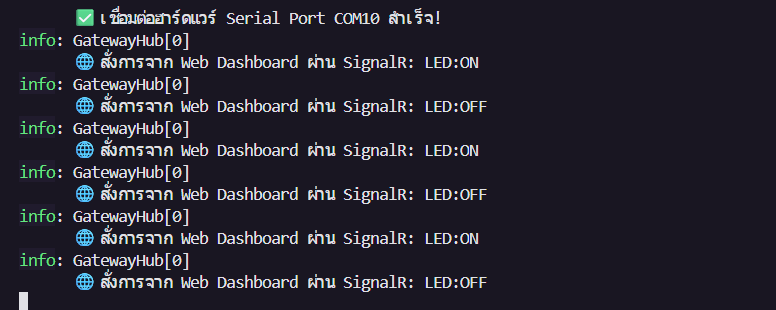

# ใบงานการทดลองที่ 13.3
### การสร้าง SignalR Realtime Hub และเว็บแดชบอร์ดศูนย์บัญชาการ (Converged Web Dashboard) สไตล์ Glassmorphism

> [!NOTE] **คำชี้แจง**
> ในใบงานนี้นักศึกษาจะได้ผสานเทคโนโลยี **ASP.NET Core SignalR (WebSockets)** เข้าสู่ Kestrel Edge Gateway เพื่อส่งผ่านข้อมูลเซนเซอร์ขึ้นสู่หน้าเว็บเบราว์เซอร์แบบสดๆ ในเสี้ยววินาที พร้อมทั้งสร้างหน้าเว็บ **ศูนย์บัญชาการระบบขอบ (Converged Edge Command Center)** สไตล์ Glassmorphism ที่สวยงามทันสมัย โฮสต์อยู่บน Kestrel โดยตรง เพื่อแสดงผลมาตรวัดเข็ม, สถิติทราฟฟิกของทั้ง 4 โปรโตคอล, และแผงควบคุมสวิตช์สั่งการแบบเรียลไทม์

---

## 1. วัตถุประสงค์การทดลอง
1. สามารถติดตั้งและกำหนดค่า SignalR Hub ใน ASP.NET Core (.NET 8) ได้
2. สามารถเขียนโค้ดผลักดันข้อมูลจากงานเบื้องหลัง (`SerialBridgeWorker`) ไปยังหน้าเว็บผ่าน `IHubContext` ได้
3. สามารถพัฒนาเว็บแดชบอร์ด HTML5/JavaScript ที่เชื่อมต่อกับ SignalR เพื่อแสดงผลมาตรวัดเข็มสด และสลับสวิตช์ไฟได้
4. สามารถติดตามและนับสถิติการรับส่งข้อมูลของทั้ง 4 โปรโตคอล (Protocol Traffic Counters) ได้

---

## 2. ผังการทำงานของ SignalR Realtime Push

<p align="center"></p>
<p align="center"><b></b>ผังการทำงานของ SignalR Realtime Push</p>

---

## 3. ขั้นตอนการทดลอง (Step-by-Step Activities)

### กิจกรรมที่ 13-3.1: การสร้างคลาส SignalR Hub และตัวนับสถิติ

สร้างไฟล์ `Hubs.cs` ในโปรเจกต์ `ConvergedEdgeGateway`:

```csharp
using Microsoft.AspNetCore.SignalR;

// 1. คลาส SignalR Hub สำหรับการสื่อสารสองทาง
public class GatewayHub : Hub
{
    private readonly SerialBridgeWorker _serialWorker;
    private readonly ILogger<GatewayHub> _logger;

    public GatewayHub(SerialBridgeWorker serialWorker, ILogger<GatewayHub> logger)
    {
        _serialWorker = serialWorker;
        _logger = logger;
    }

    // เมื่อหน้าเว็บกดปุ่มสลับสถานะสวิตช์
    public async Task ToggleLed(bool state)
    {
        string cmd = state ? "LED:ON" : "LED:OFF";
        _logger.LogInformation("🌐 สั่งการจาก Web Dashboard ผ่าน SignalR: {Cmd}", cmd);
        
        // ส่งคำสั่งเข้าสู่พอร์ต Serial
        _serialWorker.SendSerialCommand(cmd);

        // กระจายสถานะใหม่หาทุกหน้าที่เปิดอยู่
        await Clients.All.SendAsync("LedStateUpdated", state);
    }
}

// 2. คลาสนับสถิติทราฟฟิกของแต่ละโปรโตคอล
public class ProtocolMetrics
{
    public long SerialPackets { get; set; } = 0;
    public long MqttMessages { get; set; } = 0;
    public long RestRequests { get; set; } = 0;
    public long SignalRPushes { get; set; } = 0;
}
```

---

### กิจกรรมที่ 13-3.2: ปรับปรุง Worker ให้ผลักข้อมูลเข้าสู่ Hub

ในไฟล์ `Services.cs` ให้เพิ่ม `using Microsoft.AspNetCore.SignalR;` ที่ด้านบนสุดของไฟล์ และปรับปรุงคลาส `SerialBridgeWorker` ให้รับ `IHubContext<GatewayHub>` ผ่าน Dependency Injection:

```csharp
using Microsoft.AspNetCore.SignalR; // เพิ่มด้านบนสุดของ Services.cs

// ... ภายในคลาส SerialBridgeWorker ...
private readonly IHubContext<GatewayHub> _hubContext;
private readonly ProtocolMetrics _metrics;


public SerialBridgeWorker(
    GatewayStateStore store, 
    MqttServer mqttServer, 
    IHubContext<GatewayHub> hubContext,
    ProtocolMetrics metrics,
    ILogger<SerialBridgeWorker> logger)
{
    _store = store;
    _mqttServer = mqttServer;
    _hubContext = hubContext;
    _metrics = metrics;
    _logger = logger;
}

// ในฟังก์ชัน HandleIncomingSerialLine:
private async Task HandleIncomingSerialLine(string line)
{
    try
    {
        using var doc = JsonDocument.Parse(line);
        var root = doc.RootElement;
        double v = root.GetProperty("voltage").GetDouble();
        int r = root.GetProperty("raw").GetInt32();

        _metrics.SerialPackets++;

        // 1. ผลักเข้า MQTT
        _metrics.MqttMessages++;
        var mqttMsg = new MqttApplicationMessageBuilder()
            .WithTopic("iot/esp32/telemetry")
            .WithPayload(line)
            .Build();
        await _mqttServer.InjectApplicationMessage(new InjectedMqttApplicationMessage(mqttMsg));

        // 2. ผลักเข้า SignalR หาหน้าเว็บทันที!
        _metrics.SignalRPushes++;
        await _hubContext.Clients.All.SendAsync("ReceiveTelemetry", new
        {
            voltage = v,
            raw = r,
            metrics = _metrics
        });
    }
    catch { }
}
```

---

### กิจกรรมที่ 13-3.3: การสร้างหน้าเว็บศูนย์บัญชาการ (`wwwroot/index.html`)

สร้างโฟลเดอร์ `wwwroot` และสร้างไฟล์ `index.html` สไตล์ Dark Glassmorphism ที่สมบูรณ์แบบ:

```html
<!DOCTYPE html>
<html lang="th">
<head>
    <meta charset="UTF-8">
    <meta name="viewport" content="width=device-width, initial-scale=1.0">
    <title>Kestrel Converged Edge Command Center</title>
    <script src="https://cdnjs.cloudflare.com/ajax/libs/microsoft-signalr/8.0.0/signalr.min.js"></script>
    <style>
        :root {
            --bg: #0b0f19;
            --card-bg: rgba(22, 30, 49, 0.75);
            --primary: #00E5FF;
            --accent: #00E676;
            --danger: #FF5252;
            --border: rgba(255, 255, 255, 0.08);
        }
        body {
            margin: 0; padding: 24px;
            background: var(--bg);
            color: #f1f5f9;
            font-family: 'Segoe UI', system-ui, sans-serif;
        }
        .header {
            display: flex; justify-content: space-between; align-items: center;
            margin-bottom: 24px; padding-bottom: 16px; border-bottom: 1px solid var(--border);
        }
        .title { font-size: 24px; font-weight: 700; color: var(--primary); }
        .grid {
            display: grid; grid-template-columns: repeat(auto-fit, minmax(280px, 1fr)); gap: 20px;
        }
        .card {
            background: var(--card-bg);
            backdrop-filter: blur(16px);
            border: 1px solid var(--border);
            border-radius: 20px; padding: 24px;
            box-shadow: 0 8px 32px rgba(0, 0, 0, 0.3);
        }
        .gauge-val {
            font-size: 52px; font-weight: 800; font-family: monospace; color: white;
            text-align: center; margin-top: 10px;
        }
        .metric-badge {
            display: flex; justify-content: space-between; padding: 12px;
            background: rgba(0,0,0,0.3); border-radius: 12px; margin-bottom: 8px;
        }
        .btn-toggle {
            width: 100%; padding: 16px; font-size: 16px; font-weight: bold;
            border: none; border-radius: 14px; cursor: pointer; transition: 0.2s;
            background: #334155; color: white; margin-top: 16px;
        }
        .btn-active {
            background: var(--accent); color: black; box-shadow: 0 0 20px rgba(0,230,118,0.4);
        }
    </style>
</head>
<body>
    <div class="header">
        <div>
            <div class="title">⚡ Kestrel Converged Edge Command Center</div>
            <div style="color: #94a3b8; font-size: 14px;">All-in-One Multi-Protocol Bridge (.NET 8)</div>
        </div>
        <div id="connStatus" style="color: var(--accent); font-weight: bold;">● SignalR Online</div>
    </div>

    <div class="grid">
        <!-- การ์ด 1: มาตรวัดเซนเซอร์ -->
        <div class="card" style="text-align: center;">
            <h3 style="margin-top:0; color:#94a3b8;">Real-time Potentiometer Voltage</h3>
            <div class="gauge-val" id="voltageText">0.00 <span style="font-size:24px; color:var(--primary);">V</span></div>
            <div style="color: #94a3b8;" id="rawText">Raw ADC: 0 / 4095</div>
        </div>

        <!-- การ์ด 2: สวิตช์ควบคุมฮาร์ดแวร์ -->
        <div class="card">
            <h3 style="margin-top:0; color:#94a3b8;">Hardware Actuator Control</h3>
            <div style="color: #cbd5e1; font-size: 14px;">ควบคุม LED Status ขา GPIO2 ข้ามทุกโปรโตคอล</div>
            <button id="ledBtn" class="btn-toggle" onclick="toggleLed()">💡 สั่งเปิดไฟ LED (OFF)</button>
        </div>

        <!-- การ์ด 3: ตัวนับทราฟฟิก 4 โปรโตคอล -->
        <div class="card">
            <h3 style="margin-top:0; color:#94a3b8;">Protocol Convergence Metrics</h3>
            <div class="metric-badge"><span>🔌 Serial Packets (UART)</span><b id="mSerial" style="color:var(--primary);">0</b></div>
            <div class="metric-badge"><span>📬 MQTT Messages (Broker)</span><b id="mMqtt" style="color:var(--accent);">0</b></div>
            <div class="metric-badge"><span>🌐 WebSockets (SignalR)</span><b id="mSignalR" style="color:#e040fb;">0</b></div>
        </div>
    </div>

    <script>
        let isLedOn = false;
        const connection = new signalR.HubConnectionBuilder()
            .withUrl("/hubs/gateway")
            .withAutomaticReconnect()
            .build();

        connection.on("ReceiveTelemetry", function (data) {
            document.getElementById("voltageText").innerHTML = data.voltage.toFixed(2) + ' <span style="font-size:24px; color:var(--primary);">V</span>';
            document.getElementById("rawText").innerText = "Raw ADC: " + data.raw + " / 4095";
            if (data.metrics) {
                document.getElementById("mSerial").innerText = data.metrics.serialPackets;
                document.getElementById("mMqtt").innerText = data.metrics.mqttMessages;
                document.getElementById("mSignalR").innerText = data.metrics.signalRPushes;
            }
        });

        connection.on("LedStateUpdated", function (state) {
            isLedOn = state;
            updateLedButton();
        });

        function toggleLed() {
            isLedOn = !isLedOn;
            connection.invoke("ToggleLed", isLedOn);
            updateLedButton();
        }

        function updateLedButton() {
            const btn = document.getElementById("ledBtn");
            if (isLedOn) {
                btn.className = "btn-toggle btn-active";
                btn.innerText = "💡 หลอดไฟกำลังสว่าง (ON)";
            } else {
                btn.className = "btn-toggle";
                btn.innerText = "🌑 หลอดไฟปิดอยู่ (OFF)";
            }
        }

        connection.start().catch(err => {
            document.getElementById("connStatus").innerText = "○ Disconnected";
            document.getElementById("connStatus").style.color = "var(--danger)";
        });
    </script>
</body>
</html>
```

---

### กิจกรรมที่ 13-3.4: ผูก Static Files และ SignalR ใน `Program.cs`

```csharp
builder.Services.AddSignalR();
builder.Services.AddSingleton<ProtocolMetrics>();

var app = builder.Build();

app.UseDefaultFiles();
app.UseStaticFiles(); // ให้บริการไฟล์ใน wwwroot

app.MapHub<GatewayHub>("/hubs/gateway");
```

รันเซิร์ฟเวอร์ด้วย `dotnet run` และเปิดเบราว์เซอร์ไปที่ `http://localhost:5000`:
* คุณจะพบหน้าจอศูนย์บัญชาการที่ตัวเลขแรงดันไฟฟ้าวิ่งสดๆ ตามการหมุนตัวต้านทานบนบอร์ด!
* ตัวเลขนับทราฟฟิกของทั้ง Serial, MQTT และ SignalR จะวิ่งขึ้นพร้อมๆ กันในเสี้ยววินาที!
* เมื่อคลิกปุ่มเปิดไฟบนหน้าเว็บ หลอดไฟ LED จริงบนบอร์ด ESP32 จะสว่างขึ้นทันที!



Link : https://drive.google.com/file/d/177oeuAppDCdCZ_X1sDxW6AORB-bfqPGM/view?usp=drive_link
---

## 4. คำถามท้ายการทดลอง (Review Questions)
1. เพราะเหตุใด SignalR จึงให้ประสบการณ์การใช้งาน (UX) บนหน้าเว็บที่ดีกว่าการใช้คำสั่ง JavaScript `setInterval()` เพื่อทำ HTTP GET Polling ซ้ำๆ ทุก 500 ms?
   * **สถาปัตยกรรม Server Push (Event-driven) ที่มีความหน่วงเวลาต่ำมาก (Low Latency):**
     * **SignalR:** ใช้การเชื่อมต่อแบบ Persistent Connection ผ่าน **WebSockets** แบบสองทาง (Full-duplex) เมื่อมีข้อมูลเซนเซอร์ใหม่ส่งมาจากฮาร์ดแวร์ เกตเวย์จะผลักดัน (Push) ข้อมูลออกไปยังหน้าเว็บทันทีในเสี้ยววินาที (Latency ต่ำกว่า 1–5 ms) ทำให้ตัวเลขและเข็มมาตรวัดบนแดชบอร์ดขยับได้อย่างราบรื่น (Smooth & Instantaneous) โดยไม่มีอาการสะดุด
     * **HTTP GET Polling (`setInterval`):** เป็นการดึงข้อมูลแบบ Client Pull ที่ต้องวนส่งคำขอไปถามเซิร์ฟเวอร์ทุกๆ 500 ms แม้ข้อมูลจะไม่มีการเปลี่ยนแปลง ส่งผลให้ข้อมูลบนหน้าจอมีอาการกระตุก (Jitter), มีความหน่วงเวลาเฉลี่ยสูงกว่า และหากเน็ตเวิร์กเกิดความล่าช้า การตอบกลับอาจมาสลับลำดับกันได้
   * **ลดภาระเครือข่ายและ Bandwidth Overhead:**
     * การทำ HTTP Polling จะต้องสร้าง HTTP Request Header (Cookie, User-Agent, Accept ฯลฯ) ขนาดประมาณ 500–1,000 ไบต์ในทุกๆ 500 ms แม้ข้อมูลตัวเลขแรงดันจะมีขนาดเพียงไม่กี่ไบต์
     * ในทางกลับกัน SignalR ทำการ Handshake เพียงครั้งเดียว หลังจากนั้นจะส่งข้อมูลผ่าน WebSocket Frame ที่มีขนาด Header เพียง **2–10 ไบต์** เท่านั้น ทำให้ประหยัดแบนด์วิดท์และลดภาระ CPU ของ Kestrel Gateway ได้อย่างมหาศาล

2. การคำนวณและแสดงผล Protocol Convergence Metrics ส่งผลดีต่อการตรวจสอบสุขภาพของระบบเครือข่ายไอโอทีในระดับโรงงานอย่างไร?
   * **มองเห็นเส้นทางข้อมูลได้ครบวงจร (End-to-End Pipeline Observability):** ในระบบไอโอทีระดับอุตสาหกรรม ข้อมูลต้องแปลงข้ามหลายโปรโตคอล (Serial ➔ MQTT ➔ SignalR) การมีตัวนับสถิติ (Traffic Counters) ในแต่ละช่วง จะช่วยให้วิศวกรระบุจุดผิดพลาดได้ทันที เช่น หากตัวเลข Serial Packets เพิ่มขึ้น แต่ SignalR หรือ MQTT ไม่ขยับ แสดงว่าเกิดปัญหาที่คอร์แปลงข้อมูลภายในเกตเวย์ ไม่ใช่ที่ตัวฮาร์ดแวร์ภายนอก
   * **ตรวจจับการสูญหายของข้อมูลและคอขวด (Data Loss & Bottleneck Detection):** สามารถเปรียบเทียบอัตราส่วนข้อมูลขาเข้าและขาออกได้ หากอัตรา Serial สูงกว่าการ Push อย่างผิดปกติ อาจบ่งบอกถึงปัญหา Buffer เต็ม, Thread Starvation หรือเครือข่ายติดขัด (Backpressure)
   * **ตรวจสอบสถานะฮาร์ดแวร์จริงหน้างาน (Hardware Liveness & Fail-Safe Monitoring):** หากตัวเลข Serial Packets หยุดนิ่ง ผู้ดูแลระบบจะทราบได้ทันทีว่าสายสัญญาณหลุด บอร์ดไมโครคอนโทรลเลอร์ค้าง หรือเซนเซอร์ในไลน์การผลิตมีปัญหา ทำให้เข้าแก้ไขได้ทันท่วงทีโดยไม่ต้องรอให้เกิดความเสียหายในกระบวนการผลิต
