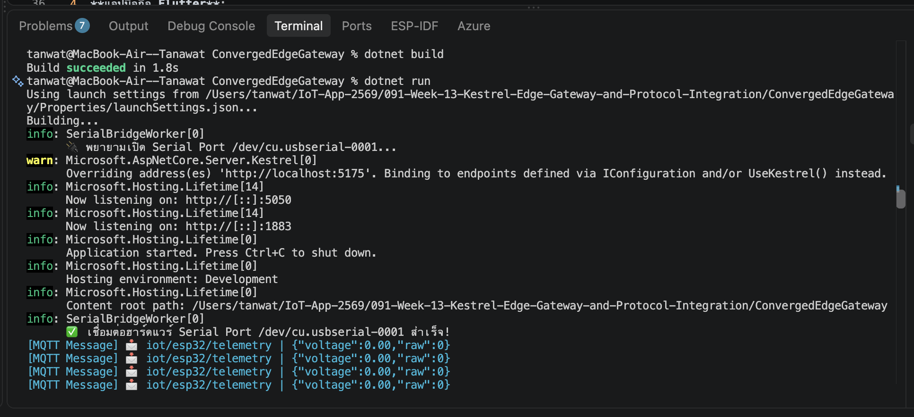
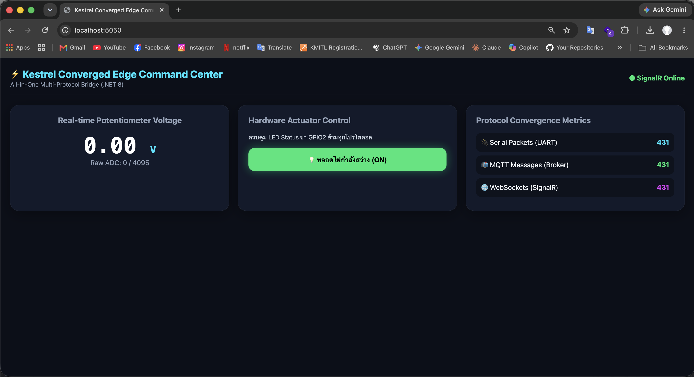
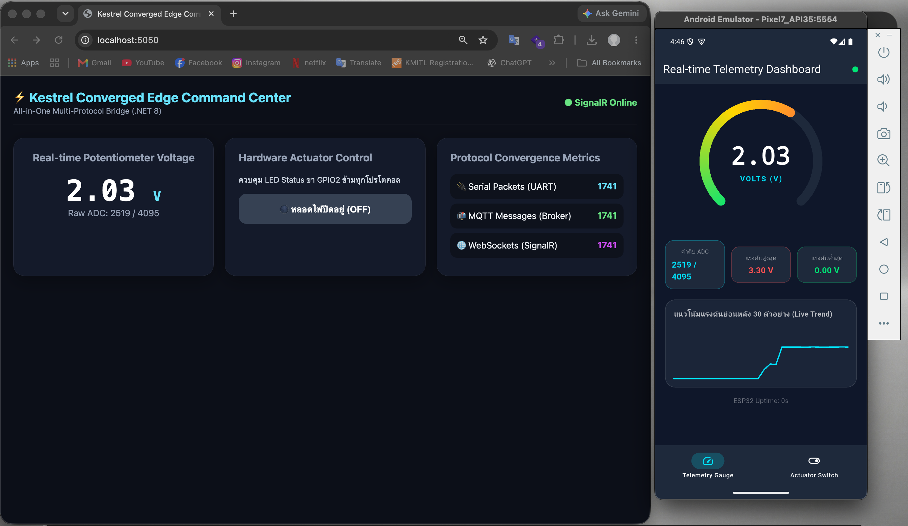
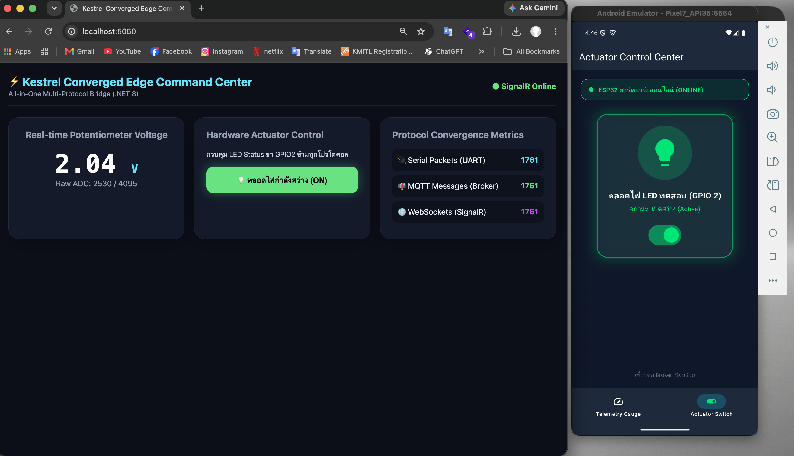

# ใบงานการทดลองที่ 13.4 (The Grand Finale)
### การทดสอบผสานรวมระบบไอโอทีแบบครบวงจร (ESP32 + Kestrel Gateway + Flutter App + Web Command Center)

> [!NOTE] **คำชี้แจง (The Grand Finale Capstone)**
> ยินดีด้วยที่ท่านได้เดินทางมาถึงการทดลองสุดท้ายของรายวิชา! ในใบงานนี้นักศึกษาจะได้นำผลงานที่สร้างขึ้นตลอดทั้งภาคการศึกษามารวมพลังกันเป็น **ระบบนิเวศไอโอทีแบบบูรณาการระดับสมบูรณ์แบบ (The Ultimate Converged IoT Ecosystem)** โดยมี **Kestrel .NET 8 Edge Gateway** ทำหน้าที่เป็นหัวใจบัญชาการ สื่อสารกับ **ฮาร์ดแวร์จริง ESP32**, เชื่อมต่อกับ **แอปมือถือ Flutter**, และประสานข้อมูลสดกับ **เว็บแดชบอร์ด SignalR** อย่างไร้รอยต่อ

---

## 1. วัตถุประสงค์การทดลอง
1. สามารถประกอบและเชื่อมโยงระบบไอโอทีที่ใช้ 4 โปรโตคอล (Serial, MQTT, REST, WebSockets) ให้ทำงานสอดประสานกันได้สมบูรณ์
2. สามารถทดสอบการซิงโครไนซ์สถานะแบบสามประสาน (Hardware <-> Mobile App <-> Web Dashboard) แบบเรียลไทม์ได้
3. สามารถพิสูจน์คุณสมบัติความอยู่รอดในระดับขอบ (Local Survivability) เมื่อตัดการเชื่อมต่ออินเทอร์เน็ตภายนอกได้
4. สามารถวัดความหน่วงเวลาเปรียบเทียบในแต่ละเส้นทางการสื่อสารของระบบได้

---

## 2. ผังความเชื่อมโยงระบบสมบูรณ์ (The Grand Ecosystem Topology)

---

## 3. ขั้นตอนการทดลอง (Step-by-Step Activities)

### กิจกรรมที่ 13-4.1: การเตรียมพร้อมทุกระบบ

1. **ฮาร์ดแวร์ ESP32**: ต่อ Potentiometer เข้าขา **GPIO34** (ADC Input) และใช้ขา **GPIO2** สำหรับ LED Status จากนั้นเสียบสาย USB เข้ากับคอมพิวเตอร์ และตรวจสอบว่าเฟิร์มแวร์กำลังพิมพ์ค่า JSON แรงดันออกทาง Serial
2. **Kestrel Edge Gateway**: 
   * ตรวจสอบว่า `Program.cs` รวมบริการทั้ง Embedded MQTT Broker, Serial Bridge, REST APIs, และ SignalR ไว้ครบถ้วน
   * รันคำสั่ง `dotnet run` ในโฟลเดอร์โปรเจกต์

3. **เว็บเบราว์เซอร์**: เปิดหน้าต่างเว็บไปที่ `http://localhost:5000` (ตรวจสอบว่าขึ้น SignalR Online สีเขียว)

4. **แอปมือถือ Flutter**:
   * เปิดโปรเจกต์จากสัปดาห์ที่ 12 (`iot_dashboard_app`)
   * ตั้งค่า Broker IP ให้ชี้มาที่หมายเลข IP ของคอมพิวเตอร์ (พอร์ต 1883)
   * สั่งรันแอปบนมือถือจริง หรือรันบนเครื่องคอมพิวเตอร์ผ่าน `flutter run`

---

### กิจกรรมที่ 13-4.2: การทดสอบ 4 มหาการทดลอง (The Grand Verification Matrix)

ให้นักศึกษาทำการทดสอบและบันทึกผลการทำงานลงในตาราง:

| มิติการทดสอบ | การกระทำเชิงปฏิบัติการ | ปรากฏการณ์ที่เกิดขึ้นจริงในระบบ | ผลการทดลอง (ผ่าน/ไม่ผ่าน) |
| :--- | :--- | :--- | :--- |
| **1. Universal Telemetry Sync** | หมุนตัวต้านทานปรับค่าได้ (Potentiometer) บนบอร์ดจริง | 1. ค่าแรงดันวิ่งผ่านสาย Serial เข้า Kestrel 2. ตัวเลขบนเว็บแดชบอร์ดวิ่งสดทันที 3. เข็ม Radial Gauge บน Flutter หมุนตามทันทีพร้อมกัน | ผ่าน |
| **2. Mobile-to-Web Actuation** | แตะสวิตช์เปิดไฟบนแอป Flutter (ส่งผ่าน MQTT) | 1. หลอดไฟ LED จริงบนบอร์ด ESP32 ติดสว่างขึ้น 2. ปุ่มสวิตช์บนหน้าเว็บเปลี่ยนเป็นสีเขียว "ON" อัตโนมัติ | ผ่าน |
| **3. Web-to-Mobile Actuation** | คลิกปุ่มปิดไฟบนหน้าเว็บ (ส่งผ่าน SignalR) | 1. หลอดไฟ LED จริงบนบอร์ด ESP32 ดับลงทันที 2. สวิตช์บนแอปมือถือ Flutter สลับเป็น "OFF" ทันที | ผ่าน |
| **4. Third-Party REST Override** | ยิงคำสั่งผ่าน cURL หรือ Postman: `curl -X POST http://localhost:5000/api/led/on` | 1. หลอดไฟ LED สว่างขึ้น 2. ทั้งหน้าเว็บและแอปมือถืออัปเดตสถานะเป็น "ON" พร้อมกัน | ผ่าน |

### 13-4_ทดสอบซิงค์สถานะ_ESP32_เว็บ_แอปมือถือ_REST

- LINK :  https://youtube.com/shorts/Rh3bLno5W_U?si=1eQl4e2NN8N61ee4

---

### กิจกรรมที่ 13-4.3: การทดสอบความทนทานในสภาวะตัดเน็ต (Local Survivability Challenge)

1. ทำการ **ถอดสาย LAN หรือปิดการเชื่อมต่ออินเทอร์เน็ตภายนอก** ของเครื่องคอมพิวเตอร์และมือถือ (คงไว้เฉพาะเครือข่าย Wi-Fi วงแลนท้องถิ่นที่ไม่มีเน็ต)
2. สังเกตการทำงาน:
   * บอร์ด ESP32 ยังคงส่งข้อมูลได้หรือไม่?
   * แอปมือถือ Flutter และเว็บแดชบอร์ดยังสามารถเปิดดูค่าและสั่งงานหลอดไฟได้หรือไม่?
3. **สรุปผล**: ระบบที่ออกแบบด้วยสถาปัตยกรรม **Converged Edge Gateway** มีความสามารถในการอยู่รอด (Survivability) อย่างสมบูรณ์แบบ 100% โดยไม่ล่มสลายตามสัญญาณอินเทอร์เน็ตภายนอก

### ผลการทดสอบ Local Survivability (13-4.3)
| คำถาม | ผล |
| :--- | :--- |
| ESP32 ยังส่งข้อมูลได้หรือไม่ | ได้ (ส่งผ่านสาย USB Serial ไม่พึ่งอินเทอร์เน็ต) |
| แอป Flutter ดูค่าและสั่ง LED ได้หรือไม่ | ได้ |
| เว็บแดชบอร์ดดูค่าและสั่ง LED ได้หรือไม่ | ได้ (โหลด `signalr.min.js` จากไฟล์ในเครื่อง) |

**สรุป:** Converged Edge Gateway ทำงานได้ครบโดยไม่ขึ้นกับอินเทอร์เน็ตภายนอก

---

## 4. บทสรุปและคำถามส่งท้ายภาคการศึกษา (Capstone Retrospective)

1. ตลอดระยะเวลา 13 สัปดาห์ การเดินทางจากระดับบิตและรีจิสเตอร์ของเซนเซอร์ สู่เฟรมเวิร์ก FreeRTOS, ผ่านโปรโตคอลเครือข่ายท้องถิ่น, สู่ระบบคลาวด์ MQTT, หน้าจอมือถือ Flutter, และมาบรรจบที่ Kestrel Edge Gateway... สถาปัตยกรรมชิ้นใดที่ท่านคิดว่ามีความท้าทายเชิงวิศวกรรมมากที่สุด? เพราะเหตุใด?

ส่วนที่ยากที่สุดคือ Kestrel Edge Gateway เพราะต้องเอาโปรโตคอลที่ทำงานคนละแบบมารวมอยู่ในแอปเดียว ทั้ง Serial ที่ต้องอ่านค่าต่อเนื่อง, MQTT ที่เป็น Pub/Sub, REST ที่เป็น Request/Response และ SignalR ที่เป็น Push ไปหาหน้าเว็บ

ตอนทำจริงเจอปัญหาหลักๆ คือ

- **สถานะไม่ตรงกันระหว่างช่องทาง:** ตอนแรกสั่งไฟจากเว็บแล้วแอปไม่รู้ สั่งผ่าน REST แล้วเว็บไม่เปลี่ยน แก้โดยทำเมธอดกลาง `SetLedAsync` ให้ทุกช่องทางเรียกใช้ที่เดียว แล้วกระจายสถานะไปทั้งบอร์ด เว็บ และแอป
- **Topic กับ Payload ไม่ตรงกับแอป Flutter:** แอปจากแลป 12 ใช้ `status`, `led_ack`, `control` และ payload เป็น JSON ซึ่งต่างจากที่ Gateway ส่ง ทำให้แอปขึ้นออฟไลน์และสั่งไฟไม่ได้ ต้องมานั่งไล่ดูโค้ดทั้งสองฝั่งให้ตรงกัน
- **Serial Port เปิดได้ทีละโปรแกรม:** ถ้าลืมปิด monitor ค้างไว้ Gateway จะเปิดพอร์ตไม่ได้ จึงต้องใช้ BackgroundService ถือพอร์ตไว้ที่เดียว แล้วเก็บค่าล่าสุดใน State Store ให้ส่วนอื่นมาอ่าน

2. หากท่านต้องนำระบบนี้ไปติดตั้งในโรงงานอุตสาหกรรมจริง สิ่งใดคือ 3 ปัจจัยแรกที่ต้องดำเนินการเพิ่มเติมเพื่อความปลอดภัยและความมั่นคงระดับองค์กร?

1. **ความปลอดภัยของการสื่อสาร:** ตอนนี้ MQTT เปิดโล่ง ใครอยู่ในเครือข่ายเดียวกันก็ publish สั่งงานได้ ต้องเปิด TLS (พอร์ต 8883) และ HTTPS ใส่ username/password หรือ client certificate และตั้ง ACL ให้แต่ละ client publish ได้เฉพาะ topic ของตัวเอง
2. **การยืนยันตัวตนและสิทธิ์ของ API และ Dashboard:** REST กับ SignalR ตอนนี้ใครเรียกก็ได้ ควรใช้ Token เช่น JWT แยกสิทธิ์คนดูกับคนสั่งงาน และตรวจสอบข้อมูลขาเข้าก่อนสั่งอุปกรณ์จริง เพราะในโรงงานสั่งผิดอาจเสียหายได้
3. **ความเสถียรและการเฝ้าระวัง:** ต้องรัน Gateway เป็น Service ที่รีสตาร์ทเองเมื่อล่ม เก็บ Log และ Metrics ไว้ตรวจย้อนหลัง สำรองข้อมูล และมีแผนรองรับกรณี Gateway ตัวเดียวล่ม เช่น มีเครื่องสำรอง เพราะตอนนี้ทุกอย่างพึ่งเครื่องนี้ตัวเดียว

3. ขอแสดงความยินดีกับนักศึกษาทุกท่านที่สำเร็จการฝึกอบรมการพัฒนาแอปพลิเคชันไอโอทีระดับมืออาชีพอย่างสมบูรณ์แบบ! 🎉
