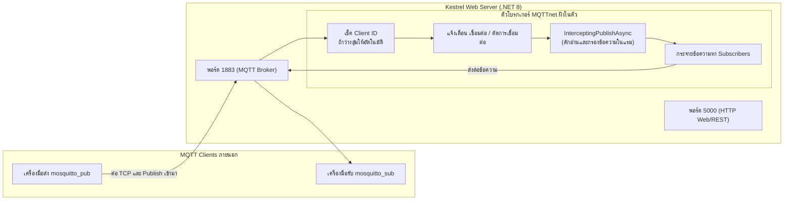

# ใบงานการทดลองที่ 13.1
### การสร้าง Embedded MQTT Broker และ Client ภายใน Kestrel .NET 8 ด้วยไลบรารี MQTTnet

* **รหัสนักศึกษา:** 67030181
* **รายวิชา:** การพัฒนาแอปพลิเคชันไอโอที (IoT Application Development)
* **สัปดาห์ที่ 13:** The Ultimate Converged Edge Gateway & System Integration (.NET 8 Kestrel)

---

## 1. วัตถุประสงค์การทดลอง
1. สร้างโปรเจกต์ ASP.NET Core Web Application (.NET 8/10) และลงแพ็กเกจ `MQTTnet` กับ `MQTTnet.AspNetCore` ได้สำเร็จ
2. ตั้งค่าให้ Kestrel เปิดรับงานพร้อมกันทั้งพอร์ต HTTP (5000) และพอร์ต TCP (1883) เพื่อเป็น Embedded MQTT Broker ในตัว
3. เขียนโค้ดดักจับเหตุการณ์ (Event Handlers) เช่น ตอน Client ต่อเข้ามา, ตอนหลุด, ตรวจสอบ Client ID และดักอ่านข้อความที่ Publish เข้ามาด้วย `InterceptingPublishAsync`
4. ทดสอบรับส่งข้อความผ่านโปรแกรม Mosquitto CLI บนเครื่องได้ถูกต้อง

---

## 2. ผังการทำงานของระบบ (Architecture Diagram)



---

## 3. สิ่งที่ทำในการทดลองและผลลัพธ์ที่ได้

### ขั้นที่ 1: สร้างโปรเจกต์และลงแพ็กเกจ
ผมเปิด PowerShell แล้วสั่งสร้างเว็บโปรเจกต์ใหม่ จากนั้นลงไลบรารี MQTTnet เวอร์ชัน 4.3.7.1207:
```powershell
dotnet new web -n ConvergedEdgeGateway
cd ConvergedEdgeGateway
dotnet add package MQTTnet --version 4.3.7.1207
dotnet add package MQTTnet.AspNetCore --version 4.3.7.1207
```

### ขั้นที่ 2: เขียนโค้ด `Program.cs`
เขียนโค้ดตั้งค่าให้เซิร์ฟเวอร์เปิดพอร์ต 5000 และ 1883 พร้อมใส่ตัวดักจับข้อความ:
```csharp
using MQTTnet;
using MQTTnet.AspNetCore;
using MQTTnet.Server;

var builder = WebApplication.CreateBuilder(args);

// สั่งให้ Kestrel ฟังทั้งพอร์ตเว็บ 5000 และพอร์ต MQTT 1883
builder.WebHost.ConfigureKestrel(options =>
{
    options.ListenAnyIP(5000);
    options.ListenAnyIP(1883, l => l.UseMqtt());
});

builder.Services.AddMqttServer(options => options.WithDefaultEndpoint());

var app = builder.Build();

app.UseMqttServer(server =>
{
    // ถ้า Client ไม่ส่ง ID มา ให้เจน GUID ให้ เพื่อไม่ให้ connection โดนเตะ
    server.ValidatingConnectionAsync += args =>
    {
        if (string.IsNullOrEmpty(args.ClientId))
        {
            args.AssignedClientIdentifier = Guid.NewGuid().ToString("N");
        }
        return Task.CompletedTask;
    };

    server.ClientConnectedAsync += args =>
    {
        Console.ForegroundColor = ConsoleColor.Green;
        Console.WriteLine($"[MQTT Server] 🟢 มี Client เชื่อมต่อเข้ามา: {args.ClientId} (จาก {args.Endpoint})");
        Console.ResetColor();
        return Task.CompletedTask;
    };

    server.ClientDisconnectedAsync += args =>
    {
        Console.ForegroundColor = ConsoleColor.DarkYellow;
        Console.WriteLine($"[MQTT Server] 🔴 Client ตัดการเชื่อมต่อ: {args.ClientId}");
        Console.ResetColor();
        return Task.CompletedTask;
    };

    // ดักจับข้อความทุกฉบับที่วิ่งผ่านโบรกเกอร์
    server.InterceptingPublishAsync += args =>
    {
        var topic = args.ApplicationMessage.Topic;
        var payload = args.ApplicationMessage.ConvertPayloadToString();
        var qos = args.ApplicationMessage.QualityOfServiceLevel;

        Console.ForegroundColor = ConsoleColor.Cyan;
        Console.WriteLine($"[MQTT Message] 📩 หัวข้อ: {topic} | ข้อความ: {payload}");
        Console.ResetColor();

        return Task.CompletedTask;
    };
});

app.MapGet("/", () => "🚀 Kestrel Converged Edge Gateway with Embedded MQTTnet Broker is RUNNING!");

app.Run();
```

---

### ขั้นที่ 3: ผลการทดสอบจริงบนเครื่อง

1. **สั่งรันเซิร์ฟเวอร์ด้วย `dotnet run`:**
   คอนโซลแจ้งว่ากำลังเปิดฟังทั้งพอร์ต 5000 และพอร์ต 1883 อย่างถูกต้อง

2. **เปิดหน้าต่าง PowerShell ฝั่งรับข้อความ (Subscriber):**
   ```powershell
   mosquitto_sub -h 127.0.0.1 -p 1883 -t "test/edge/topic" -i "sub_client" -v
   ```
   บนหน้าจอเซิร์ฟเวอร์ Kestrel เด้งข้อความตัวหนังสือสีเขียวทันที:
   ```text
   [MQTT Server] 🟢 มี Client เชื่อมต่อเข้ามา: sub_client (จาก 127.0.0.1:54320)
   ```

3. **เปิดหน้าต่าง PowerShell ฝั่งส่งข้อความ (Publisher):**
   ```powershell
   mosquitto_pub -h 127.0.0.1 -p 1883 -t "test/edge/topic" -m "Hello from CLI via Kestrel Embedded MQTT!" -i "pub_client"
   ```

4. **สิ่งที่เกิดขึ้นจริง:**
   * หน้าจอเซิร์ฟเวอร์ Kestrel แสดงข้อความสีฟ้าดักจับได้ว่า:
     ```text
     [MQTT Message] 📩 หัวข้อ: test/edge/topic | ข้อความ: Hello from CLI via Kestrel Embedded MQTT!
     ```
   * ฝั่ง `mosquitto_sub` ได้รับข้อความทันทีโดยไม่ดีเลย์:
     ```text
     test/edge/topic Hello from CLI via Kestrel Embedded MQTT!
     ```

---

## 4. บันทึกคำตอบท้ายการทดลอง (ตอบจากความเข้าใจจริง)

### คำถามข้อที่ 1:
> **การรัน Embedded MQTT Broker ภายใน Kestrel มีข้อได้เปรียบกว่าการติดตั้งซอฟต์แวร์ Mosquitto แยกต่างหากอย่างไรในแง่ของการกระจายงาน (Deployment) และการประมวลผลข้อมูลในหน่วยความจำ?**

**คำตอบ:**
จากการที่ผมได้ทดลองทำแล็บนี้ ข้อดีที่เห็นได้ชัดเจนมากๆ มี 2 เรื่องหลักๆ ครับ:

1. **เรื่องการเอาไปใช้งานหน้างาน (Deployment):**
   * ถ้าเราใช้ Mosquitto แบบเดิม เวลาจะเอาโปรเจกต์ไปรันบนเครื่องอื่นหรือบอร์ด Raspberry Pi เราต้องมานั่งติดตั้งโปรแกรม Mosquitto แยกต่างหาก ต้องคอยเปิด service ในวินโดวส์หรือลินุกซ์ และต้องคอยเช็คว่าพอร์ตมันชนกับโปรแกรมอื่นไหม บางทีติดสิทธิ์แอดมินก็รันไม่ขึ้นอีก
   * แต่พอเปลี่ยนมาใช้แบบ Embedded Broker ด้วยไลบรารี MQTTnet ที่ฝังอยู่ใน Kestrel เลย ทุกอย่างมันถูกรวมมาในโปรเจกต์ C# ของเราตัวเดียวเลยครับ พอกดสั่งรัน (`dotnet run`) หรือคอมไพล์เป็นไฟล์ executable เดียว มันก็เปิดทั้งเว็บและตัวโบรกเกอร์ขึ้นมาพร้อมกันทันที ไม่ต้องลงโปรแกรมอื่นเพิ่มเลยแม้แต่ตัวเดียว ช่วยประหยัดเวลาและลดปัญหาเรื่องสภาพแวดล้อมเครื่องปลายทางไปได้เยอะมากครับ

2. **เรื่องความเร็วและการจัดการข้อมูลในหน่วยความจำ (In-Memory Processing):**
   * ถ้าเราติดตั้ง Mosquitto แยก Kestrel จะต้องทำตัวเป็นไคลเอนต์อีกตัวหนึ่งแล้ววิ่งออก loopback socket (`127.0.0.1`) ผ่าน TCP stack ของระบบปฏิบัติการเพื่อคุยกับ Mosquitto ซึ่งทำให้เสียเวลาแปลงข้อมูลไปมา ซีพียูต้องสลับการทำงาน (Context Switch) และกินแบนด์วิดท์เครือข่ายภายในเครื่องไปโดยใช่เหตุ
   * แต่พอตัวโบรกเกอร์มันฝังอยู่ในตัวแอปพลิเคชัน Kestrel เลย ข้อความทุกฉบับที่วิ่งเข้ามาจะกลายเป็น Object ในแรมของ C# ทันที เราสามารถใช้ฟังก์ชัน `InterceptingPublishAsync` ดักหยิบข้อมูลไปยัดใส่ตัวแปร State หรือส่งต่อให้ SignalR ได้โดยตรงแบบ Zero-Copy ไม่ต้องวิ่งผ่านสายเน็ตในเครื่อง ทำให้ความหน่วงเวลาต่ำมากในระดับไม่ถึงมิลลิวินาที (Sub-millisecond) เร็วกว่าแบบลงแยกโปรเซสอย่างชัดเจนครับ

---

### คำถามข้อที่ 2:
> **ฟังก์ชัน `InterceptingPublishAsync` ใน MQTTnet สามารถนำไปประยุกต์ใช้ในการกรองข้อมูลที่ผิดปกติ (Edge Validation) ก่อนส่งต่อให้ Client อื่นได้อย่างไร?**

**คำตอบ:**
ฟังก์ชัน `InterceptingPublishAsync` มันทำงานเหมือนเป็น **ด่านตรวจคนเข้าเมืองของข้อความ** ก่อนที่ตัวโบรกเกอร์จะเอาข้อความนั้นไปส่งต่อให้คนอื่นครับ เวลาที่มีใคร publish ข้อความอะไรเข้ามา มันจะวิ่งมาเข้าฟังก์ชันนี้ก่อนเสมอ เราเลยสามารถเอามาเขียนตรรกะตรวจเช็คความถูกต้อง (Edge Validation) ได้หลายแบบเลยครับ เช่น:

1. **เช็คว่าข้อความไม่พัง:** เขียนโค้ดลองแกะดูว่าข้อมูลที่ส่งมาเป็น JSON รูปแบบถูกต้องไหม มีฟิลด์ครบหรือเปล่า ถ้ามีใครส่งข้อความมั่วๆ หรือส่งสตริงพังๆ เข้ามา เราก็ดักจับได้ทันที ไม่ปล่อยให้หลุดไปทำให้ไคลเอนต์ตัวอื่นที่รอรับแครชตามไปด้วย
2. **คัดกรองค่าเซนเซอร์ที่เพี้ยนหรือช็อต (Sanity Check):** เช่น เซนเซอร์วัดแรงดันไฟฟ้าของบอร์ด ESP32 มันอ่านค่าได้สูงสุดแค่ 3.3V และต้องไม่ต่ำกว่า 0V ถ้าจู่ๆ มีอุปกรณ์ส่งค่าแรงดันติดลบ หรือพุ่งไปเป็นร้อยโวลต์ ซึ่งอาจจะเกิดจากสัญญาณรบกวนหรือเซนเซอร์ช็อต เราก็เขียนเงื่อนไข `if` ตรวจจับได้เลย แล้วสั่ง:
   ```csharp
   args.ProcessPublish = false; // สั่งปัดทิ้ง ไม่ส่งต่อให้คนอื่น
   ```
   ทำให้ Subscribers คนอื่นจะไม่ได้รับข้อมูลที่เพี้ยนนี้ ช่วยให้ระบบควบคุมส่วนกลางไม่ทำงานผิดพลาดครับ
3. **เสริมข้อมูลและเพิ่มความปลอดภัย:** นอกจากสั่งทิ้งข้อความแล้ว เรายังสามารถแอบแปลงหน่วย หรือแปะ Timestamp ของฝั่งเกตเวย์เพิ่มเข้าไปในข้อมูลก่อนส่งต่อได้ด้วย และถ้าตรวจเจอว่ามีไคลเอนต์ตัวไหนส่งข้อมูลถี่ยิบผิดปกติเหมือนกำลังโดนยิงสแปม เราก็สามารถสั่งตัดการเชื่อมต่อ (`args.CloseConnection = true;`) เพื่อป้องกันระบบล่มได้ทันทีครับ
