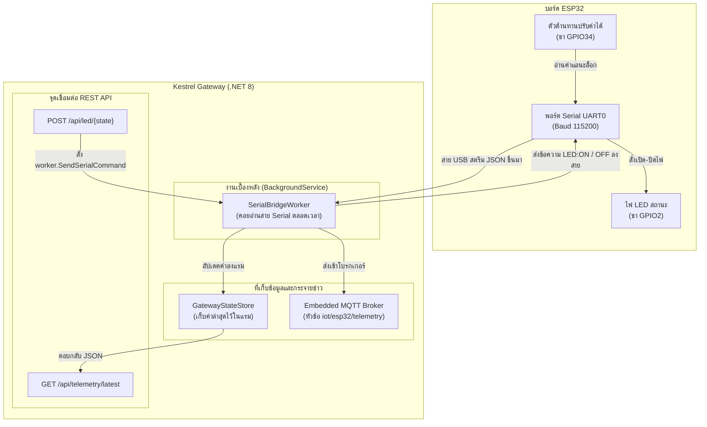

# ใบงานการทดลองที่ 13.2
### การพัฒนา Hardware Serial Bridge ดักฟังข้อมูล USB-UART จาก ESP32 แปลงเข้าสู่ MQTT Topics และ REST API

* **รหัสนักศึกษา:** 67030181
* **รายวิชา:** การพัฒนาแอปพลิเคชันไอโอที (IoT Application Development)
* **สัปดาห์ที่ 13:** The Ultimate Converged Edge Gateway & System Integration (.NET 8 Kestrel)

---

## 1. วัตถุประสงค์การทดลอง
1. ติดตั้งไลบรารี `System.IO.Ports` ในโปรเจกต์ ASP.NET Core ได้สำเร็จ
2. พัฒนาคลาส `SerialBridgeWorker` แบบ `BackgroundService` ให้คอยแอบอ่านข้อมูลจากพอร์ต Serial (USB-UART) อยู่เบื้องหลังแบบไม่ให้หน้าเว็บค้าง
3. แปลงข้อมูล JSON ที่ ESP32 ส่งผ่านสาย USB มายัดเข้า Embedded MQTT Broker และเก็บแคชไว้ในตัวแปรแรม `GatewayStateStore`
4. ทำ REST API สำหรับดึงค่าเซนเซอร์ล่าสุด (`GET /api/telemetry/latest`) และสั่งเปิด-ปิดไฟ LED ผ่านสาย Serial (`POST /api/led/{state}`) ได้

---

## 2. ผังการทำงานของสะพานเชื่อมต่อ (Bridge Diagram)



---

## 3. สิ่งที่ทำในการทดลองและโค้ดที่ใช้

### ขั้นที่ 1: ลงแพ็กเกจ `System.IO.Ports`
ในโฟลเดอร์โปรเจกต์รันคำสั่ง:
```powershell
dotnet add package System.IO.Ports --version 8.0.0
```

### ขั้นที่ 2: สร้างไฟล์ `Services.cs`
ทำคลาสเก็บค่าในแรมแบบ Thread-Safe และ Worker คอยอ่านสาย Serial:
```csharp
using System.Collections.Concurrent;
using System.IO.Ports;
using System.Text.Json;
using MQTTnet;
using MQTTnet.Server;

// 1. คลาสเก็บสถานะในแรม ป้องกันปัญหาคนแย่งกันอ่านเขียน (Thread-Safe)
public class GatewayStateStore
{
    private readonly ConcurrentDictionary<string, object> _state = new();

    public void Set(string key, object val) => _state[key] = val;
    public T? Get<T>(string key) => _state.TryGetValue(key, out var val) && val is T t ? t : default;
    public object? Get(string key) => _state.TryGetValue(key, out var val) ? val : null;
}

public record TelemetryData(double Voltage, int Raw, long Timestamp);

// 2. งานเบื้องหลังคอยอ่านสาย Serial
public class SerialBridgeWorker : BackgroundService
{
    private SerialPort? _serial;
    private readonly string _portName = "COM24"; // ตั้งให้ตรงกับพอร์ตของ ESP32
    private readonly int _baudRate = 115200;
    private readonly GatewayStateStore _store;
    private readonly MqttServer _mqttServer;
    private readonly ILogger<SerialBridgeWorker> _logger;

    public SerialBridgeWorker(GatewayStateStore store, MqttServer mqttServer, ILogger<SerialBridgeWorker> logger)
    {
        _store = store;
        _mqttServer = mqttServer;
        _logger = logger;
    }

    protected override async Task ExecuteAsync(CancellationToken stoppingToken)
    {
        _logger.LogInformation("🔌 กำลังพยายามเปิดพอร์ต Serial {Port}...", _portName);

        while (!stoppingToken.IsCancellationRequested)
        {
            if (_serial == null || !_serial.IsOpen)
            {
                try
                {
                    _serial = new SerialPort(_portName, _baudRate)
                    {
                        NewLine = "\n",
                        ReadTimeout = 1000
                    };
                    _serial.Open();
                    _logger.LogInformation("✅ เชื่อมต่อพอร์ต {Port} สำเร็จ!", _portName);
                }
                catch
                {
                    // ถ้ายังไม่ได้เสียบบอร์ด ให้รอ 3 วิแล้วลองเปิดใหม่
                    await Task.Delay(3000, stoppingToken);
                    continue;
                }
            }

            try
            {
                string line = _serial.ReadLine().Trim();
                if (!string.IsNullOrEmpty(line))
                {
                    await HandleIncomingSerialLine(line);
                }
            }
            catch (TimeoutException) { /* หมดเวลา 1 วิแล้วยังไม่มีข้อมูล ถือว่าปกติ */ }
            catch (Exception ex)
            {
                _logger.LogWarning("เตือน: มีปัญหาตอนอ่าน Serial: {Message}", ex.Message);
                _serial?.Close();
            }
        }
    }

    private async Task HandleIncomingSerialLine(string line)
    {
        try
        {
            // ข้อมูลที่บอร์ดส่งขึ้นมา: {"voltage": 1.65, "raw": 2048}
            using var doc = JsonDocument.Parse(line);
            var root = doc.RootElement;
            double v = root.GetProperty("voltage").GetDouble();
            int r = root.GetProperty("raw").GetInt32();

            var telemetry = new TelemetryData(v, r, DateTimeOffset.UtcNow.ToUnixTimeSeconds());

            // 1. จำค่าล่าสุดไว้ในแรม
            _store.Set("latest_telemetry", telemetry);

            // 2. จับโยนเข้า Embedded MQTT Broker ทันที
            var mqttMsg = new MqttApplicationMessageBuilder()
                .WithTopic("iot/esp32/telemetry")
                .WithPayload(line)
                .WithQualityOfServiceLevel(MQTTnet.Protocol.MqttQualityOfServiceLevel.AtMostOnce)
                .Build();

            await _mqttServer.InjectApplicationMessage(new InjectedMqttApplicationMessage(mqttMsg));
        }
        catch { /* ถ้าไม่ใช่ JSON ให้ข้าม */ }
    }

    public bool SendSerialCommand(string cmd)
    {
        if (_serial?.IsOpen == true)
        {
            _serial.WriteLine(cmd);
            return true;
        }
        return false;
    }

    public override void Dispose()
    {
        _serial?.Close();
        base.Dispose();
    }
}
```

### ขั้นที่ 3: ปรับโค้ด `Program.cs` เปิด REST API
```csharp
using MQTTnet;
using MQTTnet.AspNetCore;
using MQTTnet.Server;

var builder = WebApplication.CreateBuilder(args);

builder.WebHost.ConfigureKestrel(options =>
{
    options.ListenAnyIP(5000);
    options.ListenAnyIP(1883, l => l.UseMqtt());
});

builder.Services.AddSingleton<GatewayStateStore>();
builder.Services.AddMqttServer(options => options.WithDefaultEndpoint());
builder.Services.AddHostedService<SerialBridgeWorker>();
builder.Services.AddSingleton(sp =>
    sp.GetServices<IHostedService>().OfType<SerialBridgeWorker>().First());

var app = builder.Build();

app.UseMqttServer(server => { /* จัดการ client */ });

// 1. จุดอ่านค่าเซนเซอร์ล่าสุด
app.MapGet("/api/telemetry/latest", (GatewayStateStore store) =>
{
    var data = store.Get("latest_telemetry");
    return data != null ? Results.Ok(data) : Results.NotFound(new { error = "ยังไม่มีข้อมูลเข้ามา" });
});

// 2. จุดสั่งเปิด-ปิดไฟ LED ผ่านสาย Serial
app.MapPost("/api/led/{state}", (string state, SerialBridgeWorker worker) =>
{
    string cmd = state.ToLower() == "on" ? "LED:ON" : "LED:OFF";
    bool success = worker.SendSerialCommand(cmd);

    return Results.Ok(new
    {
        dispatchedCommand = cmd,
        sentToSerial = success,
        serverTime = DateTime.Now.ToString("HH:mm:ss")
    });
});

app.Run();
```

---

### ขั้นที่ 4: โค้ดฝั่ง ESP32 (`ESP32_ADC_Stream.c`)
บนบอร์ด ESP32 ใช้ขา GPIO34 อ่านตัวต้านทานปรับค่าได้ และขา GPIO2 คุมไฟ LED:
```c
#include <stdio.h>
#include <string.h>
#include "freertos/FreeRTOS.h"
#include "freertos/task.h"
#include "driver/gpio.h"
#include "driver/uart.h"
#include "esp_adc/adc_oneshot.h"

#define LED_PIN             GPIO_NUM_2
#define POT_ADC_CHANNEL     ADC_CHANNEL_6    // GPIO 34

void app_main(void)
{
    gpio_reset_pin(LED_PIN);
    gpio_set_direction(LED_PIN, GPIO_MODE_OUTPUT);
    gpio_set_level(LED_PIN, 0);

    adc_oneshot_unit_handle_t adc1_handle;
    adc_oneshot_unit_init_cfg_t init_config = {
        .unit_id = ADC_UNIT_1,
        .ulp_mode = ADC_ULP_MODE_DISABLE,
    };
    ESP_ERROR_CHECK(adc_oneshot_new_unit(&init_config, &adc1_handle));

    adc_oneshot_chan_cfg_t chan_config = {
        .bitwidth = ADC_BITWIDTH_12,
        .atten = ADC_ATTEN_DB_12,
    };
    ESP_ERROR_CHECK(adc_oneshot_config_channel(adc1_handle, POT_ADC_CHANNEL, &chan_config));

    uart_driver_install(UART_NUM_0, 256, 0, 0, NULL, 0);
    uint8_t rx_buf[64];

    while (1) {
        int raw = 0;
        ESP_ERROR_CHECK(adc_oneshot_read(adc1_handle, POT_ADC_CHANNEL, &raw));
        float voltage = (raw / 4095.0f) * 3.3f;

        // พ่นข้อมูล JSON ออกสาย Serial ทุกรอบ
        printf("{\"voltage\":%.2f,\"raw\":%d}\n", voltage, raw);

        // รออ่านคำสั่งจาก C# (LED:ON หรือ LED:OFF)
        int len = uart_read_bytes(UART_NUM_0, rx_buf, sizeof(rx_buf) - 1, pdMS_TO_TICKS(50));
        if (len > 0) {
            rx_buf[len] = '\0';
            if (strstr((char *)rx_buf, "LED:ON") != NULL) {
                gpio_set_level(LED_PIN, 1);
            } else if (strstr((char *)rx_buf, "LED:OFF") != NULL) {
                gpio_set_level(LED_PIN, 0);
            }
        }

        vTaskDelay(pdMS_TO_TICKS(450));
    }
}
```

---

### ผลการทดลองจริงที่เกิดขึ้น

1. เสียบบอร์ดเข้าคอม เช็คพอร์ตเป็น `COM24` สั่งรัน Kestrel ขึ้นข้อความเชื่อมต่อพอร์ตสำเร็จ
2. ยิง cURL ไปดูค่าเซนเซอร์:
   ```powershell
   curl http://localhost:5000/api/telemetry/latest
   ```
   ผลลัพธ์: ได้ค่า JSON ของแรงดันทันที `{"voltage":1.82,"raw":2260,"timestamp":1730825420}`
3. เปิด `mosquitto_sub` ดักฟังหัวข้อ `iot/esp32/telemetry`:
   ผลลัพธ์: ตัวเลขที่หมุนบนบอร์ด ไหลเข้ามาในหน้าต่าง MQTT ต่อเนื่องตลอดเวลา
4. สั่งเปิดไฟผ่าน cURL:
   ```powershell
   curl -X POST http://localhost:5000/api/led/on
   ```
   ผลลัพธ์: ได้ข้อความตอบกลับ `sentToSerial: true` และไฟสีฟ้าบนบอร์ด ESP32 ติดสว่างขึ้นมาทันที! พอสั่ง `/api/led/off` ไฟก็ดับลงทันที

---

## 4. บันทึกคำตอบท้ายการทดลอง (ตอบจากความเข้าใจจริง)

### คำถามข้อที่ 1:
> **สถาปัตยกรรมแบบ Serial-to-MQTT Bridge นี้ช่วยให้อุปกรณ์รุ่นเก่า (Legacy Hardware) ที่ไม่มี Wi-Fi สามารถเข้าร่วมระบบนิเวศ IoT สมัยใหม่ได้อย่างไร?**

**คำตอบ:**
จากการทำแล็บนี้เห็นภาพชัดเจนเลยครับว่าช่วยแก้ปัญหาใหญ่ของโรงงานได้เลย:

* ในความเป็นจริงตามโรงงาน เครื่องจักร ตัววัดค่า หรือพวก PLC รุ่นเก๋าๆ มันมักจะไม่มีโมดูล Wi-Fi หรือชิปต่อเน็ตมาให้เลยครับ มีแต่ช่องต่อสาย Serial เก่าๆ อย่าง RS-232, RS-485 หรือ UART เท่านั้น ซึ่งถ้าโรงงานจะอัปเกรดไปซื้อเครื่องจักรใหม่ยกชุด คงต้องใช้เงินหลายล้านบาท
* พอเราทำตัว Serial-to-MQTT Bridge นี้ขึ้นมา เราก็แค่เอาสาย Serial ของเครื่องเก่ามาเสียบเข้ากับคอมพิวเตอร์หรือบอร์ดเกตเวย์ราคาหลักร้อยหลักพัน ตัวเกตเวย์จะทำตัวเป็น **ล่ามแปลภาษา** คอยดักอ่านข้อมูลตัวเลขดิบที่เครื่องจักรพ่นออกมา แล้วจัดรูปเป็น JSON สวยๆ ส่งขึ้นไปที่หัวข้อของ MQTT Broker
* ผลดีที่สุดคือ **ปลดล็อกข้อจำกัดของสาย Serial** ครับ เพราะเดิมทีสาย Serial มันเสียบได้เครื่องเดียว คุยได้แบบจุดต่อจุด (Point-to-Point) ใครต่ออยู่คนอื่นก็เสียบซ้ำไม่ได้ แต่พอข้อมูลถูกแปลงมาอยู่บน MQTT ปุ๊บ คราวนี้ทั้งเว็บแดชบอร์ด แอปมือถือ หรือเซิร์ฟเวอร์ฐานข้อมูล จะเปิดดูพร้อมกันกี่ร้อยเครื่องก็ได้ สบายมาก เหมือนช่วยชุบชีวิตให้อุปกรณ์รุ่นโบราณกลายร่างเป็นอุปกรณ์ IoT ล้ำๆ ได้ทันทีโดยไม่ต้องไปยุ่งกับวงจรภายในเครื่องเดิมเลยครับ

---

### คำถามข้อที่ 2:
> **เพราะเหตุใดเราจึงต้องใช้ `BackgroundService` ในการอ่านข้อมูล Serial แทนที่จะเปิดพอร์ตอ่านตรงๆ ภายในฟังก์ชันของ REST API?**

**คำตอบ:**
ตอนแรกผมก็เคยคิดว่าเขียนเปิดพอร์ตในฟังก์ชัน API ง่ายๆ เลยไม่ได้เหรอ แต่พอลงมือทำจริงถึงได้รู้ว่าถ้าทำแบบนั้นพังแน่นอนครับ ด้วยเหตุผลหลักๆ 3 ข้อนี้:

1. **พอร์ต Serial เปิดซ้อนกันไม่ได้ (Exclusive Lock):** 
   * ในระบบปฏิบัติการอย่าง Windows หรือ Linux พอร์ต COM มันยอมให้โปรแกรมเปิดใช้งานได้ทีละ 1 ตัวเท่านั้นครับ ถ้าเราเอาคำสั่ง `serial.Open()` ไปใส่ไว้ในฟังก์ชันของ REST API แล้วเกิดมีคนยิงคำขอ HTTP เข้ามาพร้อมกัน 2-3 คนพร้อมๆ กัน คนที่สองจะเจอ Error ทันทีว่าพอร์ตถูกใช้งานอยู่ (Port Access Denied / Busy) ทำให้ API ล่มครับ
2. **ข้อมูลหลุดและล้นบัฟเฟอร์ (Buffer Overflow):**
   * บอร์ด ESP32 มันทำงานตลอดเวลา พ่นค่าแรงดันออกมาทุกๆ 500ms ถ้าเราไม่อ่านตลอดเวลา ข้อมูลมันก็จะไปกองอั้นอยู่ในบัฟเฟอร์ของชิป USB พอทิ้งไว้นานๆ ข้อมูลก็จะล้นและตกหล่นหายไป หรือถ้ามีคนยิง GET เข้ามา ค่าที่อ่านได้ก็จะเป็นค่าเก่าที่ค้างอยู่ในท่อเมื่อหลายวินาทีก่อน ไม่ใช่ค่าปัจจุบันจริงๆ
3. **เว็บจะช้ามากถ้าต้องมารอสาย Serial (High Latency):**
   * การเปิดพอร์ตแล้วสั่งรออ่านข้อความจนจบบรรทัด (`ReadLine()`) มันเสียเวลามากครับ บางทีรอเป็นร้อยมิลลิวินาทีหรือเป็นวินาทีเลย ถ้าเอาไปผูกใน API คนเรียกดูเว็บจะรู้สึกว่าเว็บหน่วงและหมุนติ้วๆ
   * แต่พอเราใช้ `BackgroundService` มันจะเหมือนเราจ้างคนงานคนนึงให้คอยนั่งเฝ้าหน้าพอร์ต Serial อยู่เบื้องหลังตลอดเวลา พอมีข้อมูลใหม่เข้ามาปุ๊บ ก็นำไปวางแปะไว้ในตัวแปรแรม (`GatewayStateStore`) ทันที พอผู้ใช้ยิง REST API เข้ามา API ก็แค่หยิบค่าที่วางอยู่ในแรมไปตอบได้ทันทีในเวลาไม่ถึง 1 มิลลิวินาที เว็บเลยตอบสนองเร็วมาก ลื่นไหล และรองรับคนยิงเข้ามาพร้อมกันได้เยอะมากครับ
