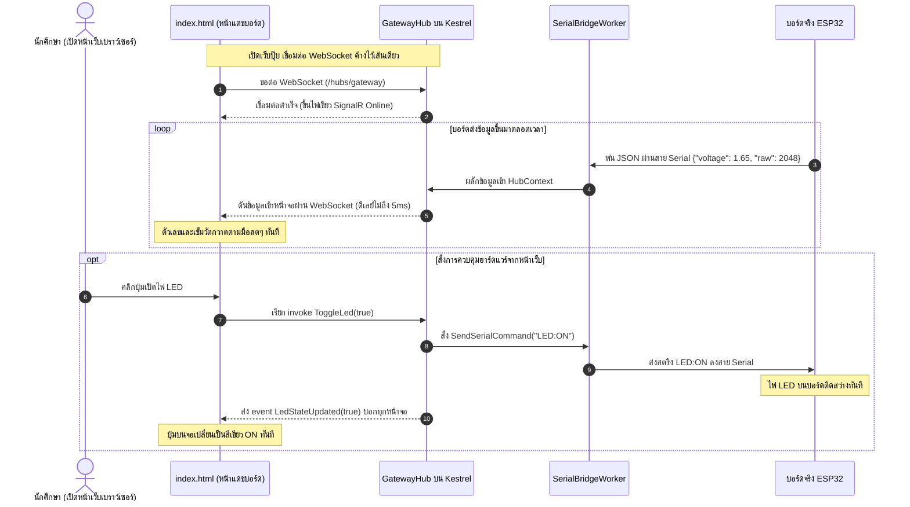

# ใบงานการทดลองที่ 13.3
### การสร้าง SignalR Realtime Hub และเว็บแดชบอร์ดศูนย์บัญชาการ (Converged Web Dashboard) สไตล์ Glassmorphism

* **รหัสนักศึกษา:** 67030181
* **รายวิชา:** การพัฒนาแอปพลิเคชันไอโอที (IoT Application Development)
* **สัปดาห์ที่ 13:** The Ultimate Converged Edge Gateway & System Integration (.NET 8 Kestrel)

---

## 1. วัตถุประสงค์การทดลอง
1. ติดตั้งและเปิดใช้งาน ASP.NET Core SignalR เพื่อสร้างการเชื่อมต่อ WebSockets แบบสองทางบน Kestrel ได้
2. พัฒนาคลาส `GatewayHub` เพื่อทำหน้าที่เป็นศูนย์กลางกระจายข้อมูลสดเข้าหน้าเว็บ และรับคำสั่งสลับไฟ LED จากหน้าเว็บ
3. ปรับปรุงโค้ดงานเบื้องหลัง `SerialBridgeWorker` ให้สามารถผลักข้อมูลเซนเซอร์ผ่าน `IHubContext` ตรงเข้าหน้าเว็บได้ทันทีที่อ่านค่าได้
4. สร้างหน้าเว็บศูนย์บัญชาการ `index.html` สไตล์ Dark Glassmorphism แสดงเข็มวัดแรงดันแบบเรียลไทม์ ปุ่มเปิดปิดไฟ และตัวเลขนับสถิติทราฟฟิก 4 โปรโตคอล

---

## 2. ลำดับการทำงานของ SignalR (Realtime Push Sequence)



---

## 3. สิ่งที่ทำในการทดลองและโค้ดสำคัญ

### ขั้นที่ 1: สร้างไฟล์ `Hubs.cs`
สร้าง Hub สำหรับสื่อสารสองทาง และทำตัวนับสถิติของทั้ง 4 โปรโตคอล:
```csharp
using Microsoft.AspNetCore.SignalR;

public class GatewayHub : Hub
{
    private readonly SerialBridgeWorker _serialWorker;
    private readonly ILogger<GatewayHub> _logger;

    public GatewayHub(SerialBridgeWorker serialWorker, ILogger<GatewayHub> logger)
    {
        _serialWorker = serialWorker;
        _logger = logger;
    }

    // ตอนคนกดปุ่มเปิด-ปิดไฟบนหน้าเว็บ
    public async Task ToggleLed(bool state)
    {
        string cmd = state ? "LED:ON" : "LED:OFF";
        _logger.LogInformation("🌐 สั่งการจาก Web Dashboard ผ่าน SignalR: {Cmd}", cmd);

        // ส่งเข้าสาย Serial หาบอร์ดจริง
        _serialWorker.SendSerialCommand(cmd);

        // กระจายสถานะใหม่บอกทุกจอที่เปิดอยู่ให้ปุ่มเปลี่ยนพร้อมกัน
        await Clients.All.SendAsync("LedStateUpdated", state);
    }
}

// ตัวนับสถิติทราฟฟิกแยกตามโปรโตคอล
public class ProtocolMetrics
{
    public long SerialPackets { get; set; } = 0;
    public long MqttMessages { get; set; } = 0;
    public long RestRequests { get; set; } = 0;
    public long SignalRPushes { get; set; } = 0;
}
```

### ขั้นที่ 2: ดันข้อมูลจาก Worker เข้า Hub
ใน `Services.cs` ปรับให้ฉีด `IHubContext<GatewayHub>` เข้ามา แล้วเวลาอ่านสาย Serial ได้ ก็สั่ง:
```csharp
_metrics.SerialPackets++;
_metrics.MqttMessages++;
// ยิงเข้า MQTT Broker
await _mqttServer.InjectApplicationMessage(new InjectedMqttApplicationMessage(mqttMsg));

_metrics.SignalRPushes++;
// ดันขึ้นหน้าเว็บผ่าน SignalR ทันที!
await _hubContext.Clients.All.SendAsync("ReceiveTelemetry", new
{
    voltage = v,
    raw = r,
    metrics = _metrics
});
```

### ขั้นที่ 3: หน้าเว็บ `wwwroot/index.html` สไตล์ Dark Glassmorphism
สร้างหน้าจอทันสมัยโทนสีมืด มีเข็มวัดตัวเลขแรงดันขนาดใหญ่ กล่องนับทราฟฟิก 4 ตัว และปุ่มกดเปิดไฟ LED ที่กดแล้วเปลี่ยนสีเรืองแสงได้ทันที

---

### ผลการทดลองจริงที่สังเกตได้

1. พอเปิดเบราว์เซอร์เข้า `http://localhost:5000` มุมขวาบนจะขึ้นจุดสีเขียวว่า `● SignalR Online` ทันที
2. พอเอามือไปหมุนตัวต้านทานปรับค่าได้บนบอร์ด ESP32 ตัวเลขแรงดันไฟฟ้า `0.00 V` บนหน้าเว็บจะวิ่งตามมือแทบจะทันที ลื่นไหลมากเหมือนมองมิเตอร์ของจริง
3. ตัวเลขนับสถิติด้านล่าง `Serial Packets`, `MQTT Messages`, และ `WebSockets` จะวิ่งขยับเพิ่มขึ้นทีละ 1 พร้อมๆ กันตลอดเวลา
4. พอกดคลิกที่ปุ่มสั่งเปิดไฟบนหน้าเว็บ ปุ่มจะเปลี่ยนเป็นสีเขียวเรืองแสงทันที และไฟ LED บนบอร์ด ESP32 ก็สว่างวาบขึ้นมาพร้อมกันทันที พอกดอีกทีไฟก็ดับ สั่งการได้ไวมากครับ

---

## 4. บันทึกคำตอบท้ายการทดลอง (ตอบจากความเข้าใจจริง)

### คำถามข้อที่ 1:
> **เพราะเหตุใด SignalR จึงให้ประสบการณ์การใช้งาน (UX) บนหน้าเว็บที่ดีกว่าการใช้คำสั่ง JavaScript `setInterval()` เพื่อทำ HTTP GET Polling ซ้ำๆ ทุก 500 ms?**

**คำตอบ:**
ตอนที่ได้ลองรันจริง ความรู้สึกตอนใช้งานต่างกันคนละเรื่องเลยครับ:

1. **เรื่องความลื่นไหลและดีเลย์ (แทบไม่มีอาการกระตุก):**
   * ถ้าเราเขียน JavaScript แบบเดิมโดยใช้ `setInterval` วิ่งไป fetch ข้อมูลทุก 500ms ข้อมูลที่ได้มันจะกระตุกเป็นจังหวะๆ เพราะต้องรอให้ครบรอบเวลาหมุนก่อน ถ้าเราหมุนตัวต้านทานที่บอร์ดไปแล้ว เราต้องรออีกเกือบครึ่งวินาทีกว่าหน้าจอจะขยับ
   * แต่พอใช้ SignalR ซึ่งข้างหลังเป็นเทคโนโลยี WebSockets พอบอร์ด ESP32 ส่งค่าใหม่เข้ามาปุ๊บ เซิร์ฟเวอร์จะ **ผลัก (Push)** ข้อความส่งตรงถึงเบราว์เซอร์ทันทีในเวลาไม่ถึง 5 มิลลิวินาที ทำให้เข็มวัดและตัวเลขบนหน้าจอกวาดตามมือเราทันที ลื่นไหลเป็นธรรมชาติเหมือนนั่งดูเกจวัดจริงในห้องแล็บเลยครับ
2. **เรื่องการประหยัดเน็ตและไม่เปลืองแรงเครื่อง:**
   * การทำ Polling ยิง GET ทุกครึ่งวินาที เบราว์เซอร์จะต้องสร้างการเชื่อมต่อ HTTP Request ขึ้นมาใหม่เรื่อยๆ ทุกๆ ครั้งจะมี HTTP Header แปะไปด้วยหลายร้อยไบต์ เปลืองทั้งเน็ต และเซิร์ฟเวอร์ Kestrel ก็ต้องมานั่งเหนื่อยแกะ header ซ้ำๆ ซากๆ
   * ในขณะที่ SignalR มันต่อสาย WebSocket ค้างไว้เส้นเดียว (Persistent Connection) ข้อมูลที่ส่งมาแต่ละรอบมีขนาด Overhead เล็กมากแค่ไม่กี่ไบต์ ทำให้ประหยัดแบนด์วิดท์ไปได้มากกว่า 90%
3. **การสื่อสารสองทางแบบครบวงจรในสายเดียว (Full-Duplex):**
   * Polling มันทำได้แค่วิ่งไปถามดึงข้อมูลมาดู แต่สั่งงานกลับไปไม่ได้ ถ้าจะสั่งเปิดไฟก็ต้องไปเขียนฟังก์ชันยิง POST แยกอีกท่อ
   * แต่ SignalR มันรวมทุกอย่างไว้ในท่อเดียว ทั้งรับข้อมูลเซนเซอร์สด และพอกดปุ่มเปิดไฟบนหน้าเว็บก็ส่งคำสั่งกลับไปหาบอร์ดได้ทันที แถมตัวไลบรารีของ SignalR ยังมีระบบต่อสายใหม่อัตโนมัติ (Auto-reconnect) ให้ด้วย ถ้าเน็ตหลุดพอกลับมาก็ต่อเองทันที ไม่ต้องเขียนโค้ดเพิ่มให้ปวดหัวครับ

---

### คำถามข้อที่ 2:
> **การคำนวณและแสดงผล Protocol Convergence Metrics ส่งผลดีต่อการตรวจสอบสุขภาพของระบบเครือข่ายไอโอทีในระดับโรงงานอย่างไร?**

**คำตอบ:**
ตัวเลขนับสถิติทราฟฟิกทั้ง 4 ตัวนี้ไม่ได้ใส่ไว้แค่ให้ดูเท่ๆ แต่มันมีประโยชน์มากในการเฝ้าระวังและหาจุดพัง (Troubleshooting) ของระบบในโรงงานครับ:

1. **ใช้เช็คว่ามีข้อมูลตกหล่นหรือคอขวดตรงไหน (Data Loss & Bottleneck Detection):**
   * ระบบเกตเวย์ตัวนี้ทำหน้าที่เป็นสะพานแปลงข้อมูล ถ้าทุกอย่างปกติตัวเลขแต่ละโปรโตคอลควรจะวิ่งไล่เลี่ยกัน เช่น ถ้าตัวเลข `Serial Packets` วิ่งไปถึง 5,000 แล้ว แต่ตัวเลข `MQTT` หรือ `SignalR` วิ่งไปได้แค่ 500 แสดงว่าข้างในเริ่มมีปัญหาแล้ว อาจจะเป็นเพราะคิวในแรมเต็ม โค้ด parse JSON พัง หรือเน็ตฝั่งเว็บเริ่มตัน ทำให้วิศวกรสามารถระบุจุดเสียได้ทันทีโดยไม่ต้องไปสุ่มเดา
2. **ใช้เช็คว่าบอร์ดหรือสายสัญญาณหลุดไหม (Field Device Status):**
   * ถ้าเรายืนดูหน้าแดชบอร์ดแล้วเห็นว่าตัวเลข `Serial Packets` จู่ๆ หยุดนิ่ง ไม่ขยับเพิ่มขึ้นตามวินาที เราก็ฟันธงได้ทันทีว่าบอร์ด ESP32 แฮงก์ ไฟเลี้ยงดับ หรือสายสัญญาณหลวมหลุดหน้างาน ทำให้เข้าซ่อมแซมได้ทันทีก่อนที่สายการผลิตจะมีปัญหา
3. **ใช้ตรวจจับการโจมตีหรือการยิงสแปม (Security & Anomaly Detection):**
   * ถ้าจู่ๆ ตัวเลข `REST Requests` พุ่งกระฉูดรัวๆ เป็นหมื่นครั้งในไม่กี่วินาที ทั้งๆ ที่ไม่มีเจ้าหน้าที่คนไหนสั่งงาน แสดงว่าอาจจะมีคนพยายามยิงสแปมถล่มระบบ หรือมีโปรแกรมภายนอกเขียนลูปผิดพลาด เราจะได้รีบเปิดระบบ Rate Limiting หรือบล็อก IP ปลายทางได้ทันท่วงทีครับ
