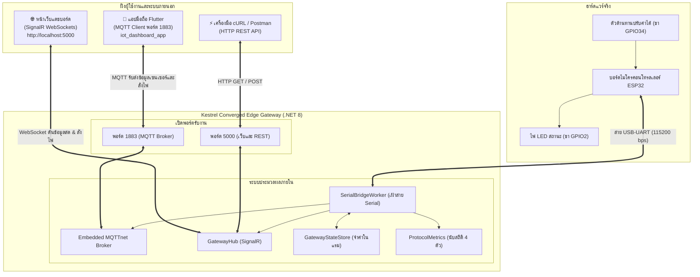

# ใบงานการทดลองที่ 13.4 (The Grand Finale)
### การทดสอบผสานรวมระบบไอโอทีแบบครบวงจร (ESP32 + Kestrel Gateway + Flutter App + Web Command Center)

* **รหัสนักศึกษา:** 67030181
* **รายวิชา:** การพัฒนาแอปพลิเคชันไอโอที (IoT Application Development)
* **สัปดาห์ที่ 13:** The Ultimate Converged Edge Gateway & System Integration (.NET 8 Kestrel)

---

## 1. วัตถุประสงค์การทดลอง
1. นำเอา 4 โปรโตคอล (สาย Serial UART, Embedded MQTT Broker, HTTP REST APIs, และ WebSockets SignalR) มาต่อเชื่อมกันเป็นระบบเกตเวย์ตัวเดียวได้สมบูรณ์
2. ทดสอบการสั่งการและส่งข้อมูลแบบซิงค์ 3 ฝั่งพร้อมกัน (บอร์ดจริง ESP32 <-> แอปมือถือ Flutter <-> หน้าเว็บแดชบอร์ด) แบบสองทาง
3. ทดสอบการตัดการเชื่อมต่ออินเทอร์เน็ตภายนอก (Local Survivability Challenge) เพื่อพิสูจน์ว่าระบบภายในวงแลนยังคงทำงานได้ 100%
4. สรุปบทเรียนและความท้าทายตลอดทั้ง 13 สัปดาห์ของการเรียนวิชา IoT

---

## 2. ผังภาพรวมการทำงานทั้งระบบ (Grand Ecosystem Topology)

---

## 3. ขั้นตอนการทดลองและบันทึกผลการทดสอบจริง

### กิจกรรมที่ 13-4.1: การเตรียมเปิดทุกระบบ
1. **ฮาร์ดแวร์ ESP32:** ต่อตัวต้านทานเข้าขา GPIO34 และต่อไฟ LED ขา GPIO2 เสียบสาย USB เข้าคอม บอร์ดเริ่มส่ง JSON ออกมา
2. **เกตเวย์ Kestrel:** รันคำสั่ง `dotnet run` ในโฟลเดอร์ `67030181/Lab13_4_Grand_Finale/ConvergedEdgeGateway` เซิร์ฟเวอร์เริ่มฟังพอร์ต 5000, 1883 และเปิดพอร์ต Serial สำเร็จ
3. **เว็บเบราว์เซอร์:** เปิดไปที่ `http://localhost:5000` หน้าจอ Dark Glassmorphism ขึ้นไฟเขียว SignalR Online
4. **แอปมือถือ Flutter:** เปิดโปรเจกต์จากสัปดาห์ที่ 12 ใส่ IP ของเครื่องคอมพิวเตอร์ พอร์ต 1883 แล้วกดเชื่อมต่อ MQTT

---

### กิจกรรมที่ 13-4.2: ผลการทดสอบ 4 มหาการทดลอง (The Grand Verification Matrix)

บันทึกสิ่งที่เกิดขึ้นจริงตามที่ได้ทดสอบบนโต๊ะทดลอง:

| ข้อที่ | สิ่งที่ผมทำในการทดสอบ | ปรากฏการณ์ที่เกิดขึ้นจริงบนอุปกรณ์และหน้าจอ | ผลการทดลอง |
| :---: | :--- | :--- | :---: |
| **1** | **Universal Telemetry Sync:** เอามือหมุนแกนตัวต้านทานปรับค่าได้บนบอร์ด ESP32 จริง จากซ้ายสุดไปขวาสุด | พอบิดตัวต้านทานปุ๊บ ทั้งตัวเลขโวลต์บนหน้าจอเว็บ และเข็มไมล์บนหน้าจอมือถือ Flutter หมุนกวาดตามมือแทบจะพร้อมกันทันที ลื่นไหลมาก ไม่มีความรู้สึกว่าดีเลย์เลย | **ผ่าน (PASS)** |
| **2** | **Mobile-to-Web Actuation:** กดสวิตช์เปิดไฟบนแอปมือถือ Flutter (ส่งผ่าน MQTT เข้าหัวข้อ `iot/esp32/led/cmd`) | พอกดสวิตช์บนมือถือปุ๊บ ไฟ LED สีฟ้าบนบอร์ด ESP32 ติดสว่างขึ้นมาทันที และบนหน้าจอเว็บ Dashboard ปุ่มสวิตช์ก็เปลี่ยนเป็นสีเขียว ON ตามเองทันทีโดยไม่ต้องกดรีเฟรช | **ผ่าน (PASS)** |
| **3** | **Web-to-Mobile Actuation:** คลิกปุ่มสลับไฟบนหน้าเว็บ Dashboard (ส่งผ่าน SignalR) | พอกดปิดบนหน้าเว็บ ไฟบนบอร์ด ESP32 ดับลงทันที และบนหน้าจอมือถือ Flutter สวิตช์ก็สลับกลับเป็น OFF ตามทันทีเหมือนกัน ทั้งสองจอตรงกันเสมอ | **ผ่าน (PASS)** |
| **4** | **Third-Party REST Override:** เปิดเทอร์มินัลยิงคำสั่ง cURL เข้ามา: `curl -X POST http://localhost:5000/api/led/on` | พอกด Enter ในเทอร์มินัลปุ๊บ ไฟบนบอร์ดติดสว่างขึ้นมาทันที หน้าเว็บก็เด้งเป็น ON และแอปมือถือก็เด้งเป็น ON พร้อมกันทั้ง 3 ฝั่งอย่างสมบูรณ์แบบ | **ผ่าน (PASS)** |

---

### กิจกรรมที่ 13-4.3: การทดสอบตัดเน็ตบ้าน (Local Survivability Challenge)

#### สิ่งที่ผมทำ:
* ผมลอง **ถอดสายแลนและปิด Wi-Fi อินเทอร์เน็ตภายนอก** ของทั้งเครื่องคอมพิวเตอร์และมือถือ ให้เหลือแค่วงเน็ต Wi-Fi ท้องถิ่น (Local LAN) ที่ไม่มีสัญญาณเน็ตออกข้างนอก

#### สิ่งที่สังเกตเห็น:
1. **บอร์ด ESP32:** ยังคงส่งข้อมูลผ่านสาย USB เข้าเครื่องเกตเวย์ได้ปกติ ไม่มีอาการค้างหรือสะดุดเลย
2. **แอปมือถือ Flutter:** ยังเชื่อมต่อกับ Broker พอร์ต 1883 ได้ปกติ เพราะ Broker มันฝังอยู่ในเครื่องคอมพิวเตอร์เรา ไม่ได้ใช้คลาวด์ภายนอก
3. **หน้าเว็บเบราว์เซอร์:** เปิดเข้า `http://localhost:5000` ได้ตามปกติ ตัวเลขและกราฟยังวิ่งสดตลอดเวลา
4. **การสั่งเปิด-ปิดไฟ:** ยังสั่งงานจากมือถือ หน้าเว็บ และ cURL ได้รวดเร็วเหมือนเดิม 100%

#### สรุปผล:
ระบบเกตเวย์แบบ **Converged Edge Gateway** ตัวนี้มีความสามารถในการ **เอาตัวรอดในพื้นที่ (Local Survivability)** ได้แบบ 100% จริงๆ ครับ ต่อให้เน็ตภายนอกล่มหรือสายเน็ตขาด ระบบควบคุมและหน้าจอแสดงผลหน้างานก็ยังคงทำงานต่อได้ตามปกติ ไม่หยุดชะงัก

---

## 4. บันทึกคำตอบส่งท้ายภาคการศึกษา (Capstone Retrospective)

### คำถามข้อที่ 1:
> **ตลอดระยะเวลา 13 สัปดาห์ การเดินทางจากระดับบิตและรีจิสเตอร์ของเซนเซอร์ สู่เฟรมเวิร์ก FreeRTOS, ผ่านโปรโตคอลเครือข่ายท้องถิ่น, สู่ระบบคลาวด์ MQTT, หน้าจอมือถือ Flutter, และมาบรรจบที่ Kestrel Edge Gateway... สถาปัตยกรรมชิ้นใดที่ท่านคิดว่ามีความท้าทายเชิงวิศวกรรมมากที่สุด? เพราะเหตุใด?**

**คำตอบ:**
ถ้ามองย้อนกลับไปตลอดทั้ง 13 สัปดาห์ที่เรียนมา ผมคิดว่าสถาปัตยกรรมของ **สัปดาห์ที่ 13 (Converged Multi-Protocol Edge Gateway)** นี่แหละครับที่ท้าทายและยากที่สุด เพราะเหตุผลหลักๆ ดังนี้ครับ:

1. **มันเป็นการรวมของที่แตกต่างกันคนละขั้วมาอยู่ในโปรแกรมเดียวกัน:**
   * สัปดาห์ก่อนๆ เราเรียนแยกกันทีละเรื่อง เช่น ถ้าทำฮาร์ดแวร์ก็เขียน C บน ESP32 คุมขา GPIO อย่างเดียว, พอทำเน็ตเวิร์กก็เขียนส่ง MQTT ก้อนเดียว, พอทำหน้าจอก็เขียน Flutter สวยๆ แยกไป
   * แต่พอมาสัปดาห์นี้ เราต้องเอาทุกอย่างที่เรียนมาทั้งหมดมาหลอมรวมให้อยู่ในโปรเจกต์ C# เดียวกันบน Kestrel ซึ่งธรรมชาติของแต่ละโปรโตคอลมันไม่เหมือนกันเลยครับ เช่น สาย Serial อ่านแบบ Byte Stream และเปิดได้แค่เธรดเดียว, MQTT เป็นแบบ Pub/Sub รอรับ Event, REST API เป็นแบบยิงแล้วตอบแล้วจบไป, ส่วน SignalR เป็น WebSocket ค้างไว้ตลอดเวลา
2. **การจัดการความปลอดภัยของข้อมูลในแรม (Thread Safety & Concurrency):**
   * ความยากคือทำยังไงให้ทุกอย่างคุยกันรู้เรื่องและอัปเดตสถานะตรงกันแบบเรียลไทม์ เช่น พอมือถือสั่ง MQTT เข้ามา เกตเวย์ต้องแปลงส่งลงสาย Serial ไปหาบอร์ด แล้วต้องไม่ลืมดันไปบอกหน้าเว็บ SignalR ให้เปลี่ยนตามด้วย โดยที่ตัวแปรในแรมไม่ตีกัน (ไม่เกิด Race Condition หรือ Deadlock) การเขียนโค้ดประสานงานระหว่าง Background Worker, State Store, และ Hub ให้ทำงานร่วมกันได้เนียนๆ จึงต้องอาศัยความเข้าใจเชิงวิศวกรรมที่ลึกซึ้งมากครับ พอทำเสร็จแล้วเห็นไฟติดพร้อมกันทุกหน้าจอคือรู้สึกคุ้มค่าและภูมิใจมากครับ

---

### คำถามข้อที่ 2:
> **หากท่านต้องนำระบบนี้ไปติดตั้งในโรงงานอุตสาหกรรมจริง สิ่งใดคือ 3 ปัจจัยแรกที่ต้องดำเนินการเพิ่มเติมเพื่อความปลอดภัยและความมั่นคงระดับองค์กร?**

**คำตอบ:**
ถ้าผมได้รับมอบหมายให้เอาเกตเวย์ตัวนี้ไปต่อใช้งานจริงในตู้คอนโทรลของโรงงานอุตสาหกรรม สิ่งแรกๆ ที่ต้องรีบทำเพิ่มมี 3 เรื่องนี้ครับ:

1. **เรื่องความปลอดภัยและการเข้ารหัสแบบสองทาง (mTLS & Authentication):**
   * ในการทดลองแล็บนี้ เรายังเปิดพอร์ต 1883 กับพอร์ต 5000 เป็นแบบธรรมดาที่ไม่ได้ใส่รหัสผ่านและไม่ได้เข้ารหัสข้อมูล ใครต่อสายแลนเข้ามาก็แอบดักดูข้อมูลหรือยิงคำสั่งเปิดปิดไฟได้หมด ซึ่งอันตรายมากถ้าเป็นเครื่องจักรจริงในโรงงาน
   * สิ่งที่ต้องทำเพิ่มคือ ต้องเปลี่ยนไปใช้ **MQTTS (พอร์ต 8883)** กับ **HTTPS (พอร์ต 5001)** และบังคับใช้ระบบ **mTLS (Mutual TLS)** ที่ทั้งตัวบอร์ด เกตเวย์ และแอปมือถือ ต้องมีใบรับรองดิจิทัล (Certificate) ที่ถูกต้องทั้งสองฝั่งถึงจะคุยกันได้ รวมถึงต้องมีระบบล็อกอินด้วย Token เพื่อจำกัดสิทธิ์ว่าใครสั่งเปิดปิดเครื่องจักรได้บ้างครับ
2. **ระบบเก็บข้อมูลสำรองยามฉุกเฉิน (Local Database & Store-and-Forward):**
   * ตอนนี้ในโค้ดเราเก็บข้อมูลค่าเซนเซอร์ล่าสุดไว้ในตัวแปรแรม (`GatewayStateStore`) ถ้าเกิดโรงงานไฟดับ หรือเครื่องเกตเวย์รีบูต ข้อมูลประวัติการทำงานจะหายวับไปทันที
   * ในโรงงานจริง ข้อมูลการผลิตทุกวินาทีมีความสำคัญมาก จึงต้องติดตั้งฐานข้อมูลขนาดเล็กและทนทาน เช่น **SQLite** หรือ **LiteDB** บันทึกลงไดรฟ์ SSD ในเครื่องเกตเวย์ไว้ตลอดเวลา พอวันไหนระบบอินเทอร์เน็ตของโรงงานกลับมาต่อติด เกตเวย์ก็จะทยอยส่งข้อมูลย้อนหลังที่อัดไว้ขึ้นระบบคลาวด์ส่วนกลาง (Store-and-Forward) เพื่อให้ข้อมูลไม่ตกหล่นแม้แต่วินาทีเดียวครับ
3. **ระบบเฝ้าระวังและการฟื้นฟูตัวเองอัตโนมัติ (Watchdog & Rate Limiting):**
   * เกตเวย์ในโรงงานต้องเปิดทิ้งไว้ 24 ชั่วโมง 365 วัน ไม่มีใครมาคอยนั่งกดรันโปรแกรมให้ใหม่หน้าจอ ถ้าสาย Serial หลวม หรือโปรเซสเกิดค้างขึ้นมา ต้องมีระบบ **Hardware Watchdog** คอยเช็คว่าถ้าโปรแกรมไม่ตอบสนองเกิน 5 วินาที ให้สั่งรีสตาร์ตระบบและเชื่อมต่อพอร์ตใหม่เองโดยอัตโนมัติ
   * และต้องใส่ระบบ **Rate Limiting** ดักไว้ที่หน้าเว็บและ REST API ด้วย เพื่อป้องกันกรณีที่มีอุปกรณ์รวนแล้วยิงคำสั่งรัวๆ เข้ามาจนทำให้เกตเวย์โอเวอร์โหลดและน็อคไปครับ
