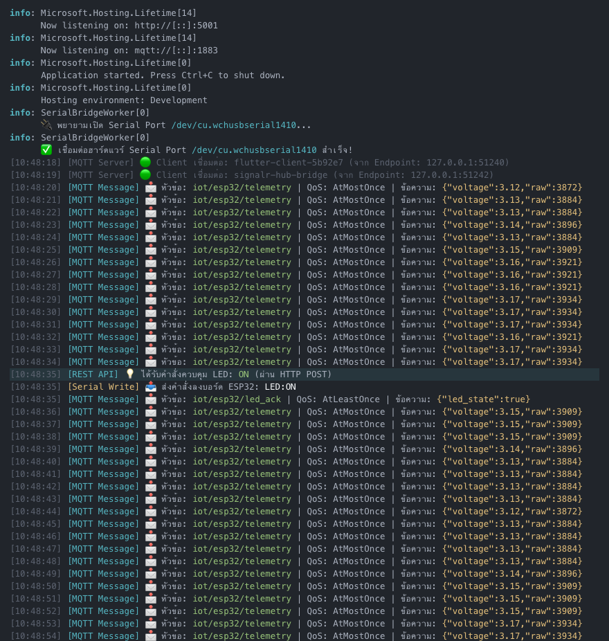
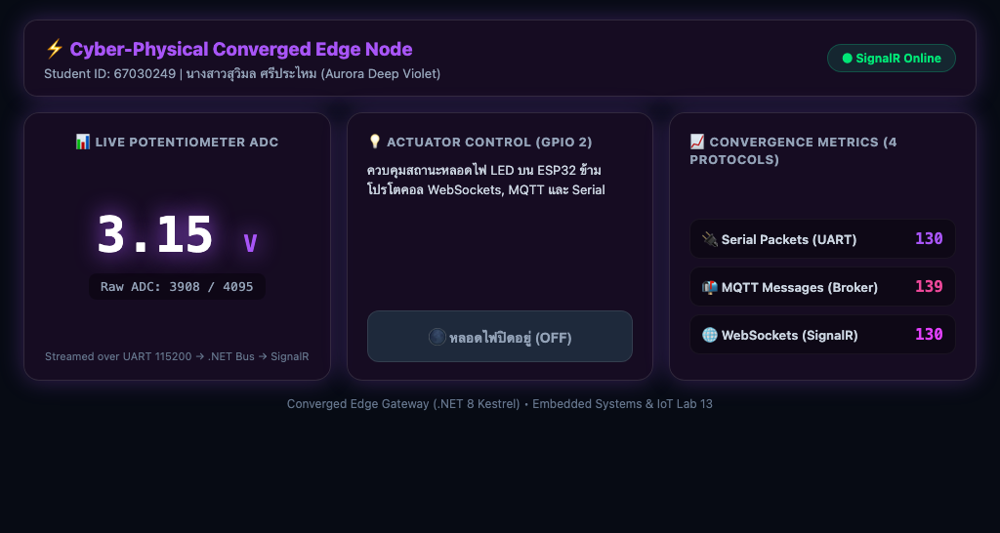
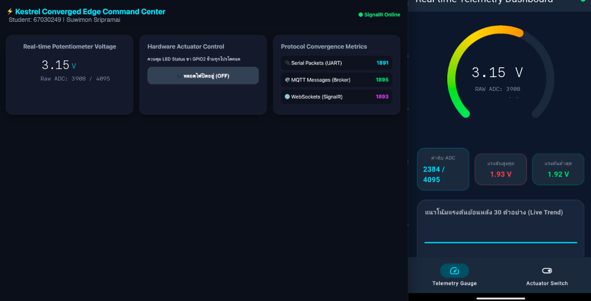

# รายงานผลการทดลอง สัปดาห์ที่ 13
## หัวข้อ: The Ultimate Converged Edge Gateway (.NET 8 Kestrel)

**รหัสนักศึกษา:** 67030249
**ชื่อ-นามสกุล:** นางสาวสุวิมล ศรีประไหม
**ชื่อภาษาอังกฤษ:** Suwimon Sripramai
**วิชา:** ระบบสมองกลฝังตัวและการเชื่อมต่อเครือข่าย (Embedded Systems & IoT)
**บอร์ดทดลอง:** ESP32 (ESP32-D0WD-V3)
**ไฟล์โปรเจกต์:** `Week13_Kestrel_Edge_Gateway/67030249_template/`

> คู่มือกรอกรายงาน
> * ค่าทุกช่องให้กรอกตามผลจริงที่กลุ่มวัดได้ (อย่าใช้ค่าตัวอย่าง)
> * รูปวางเป็น `` และเก็บไฟล์รูปจริงในโฟลเดอร์ `images/`
> * คำตอบท้ายใบงานขอให้เขียนด้วยคำพูดตัวเอง อย่าก๊อปจากเพื่อน

---

## 1. การต่อวงจรฮาร์ดแวร์ (Hardware Setup & Wiring)
*(ใช้วงจรเดียวกับ Week 11, 12)*

| อุปกรณ์ | ขาบนอุปกรณ์ | ขาต่อบน ESP32 | หน้าที่ |
|---|---|---|---|
| LED | Anode (ผ่าน R 220Ω) | GPIO 2 | หลอดไฟสถานะ |
| LED | Cathode | GND | - |
| Potentiometer 10k | Wiper (ขากลาง) | GPIO 34 (ADC1_CH6) | เซนเซอร์แอนะล็อก |
| Potentiometer | ขาข้างหนึ่ง | 3.3V | ไฟเลี้ยง |
| Potentiometer | ขาอีกข้าง | GND | กราวด์ |

---
## Lab 13.1 — ใบงาน 13.1: Embedded MQTT Broker & Client ด้วย MQTTnet

> รัน MQTT Broker ฝังใน Kestrel ด้วย MQTTnet และดักข้อความด้วย InterceptingPublishAsync

### คำสั่งที่ใช้ในแล็บนี้
```bash
bash Week13_Kestrel_Edge_Gateway/lab13_1_auto.sh 67030249 67030248 67030299
mosquitto_sub -h 127.0.0.1 -p 1883 -t 'iot/#' -v
mosquitto_pub -h 127.0.0.1 -p 1883 -t 'iot/test' -m 'Hello from Group 67030249'
open ~/mqtt_lab
```

### ค่าที่วัด / คำนวณได้ (กรอกตามผลจริง)
| รายการ | ค่า |
|---|---|
| พอร์ต MQTT Broker | 1883 |
| พอร์ต HTTP Kestrel | 5001 |
| เวอร์ชัน MQTTnet | 4.3.7.1207 |

### 💻 Log Kestrel MQTTnet Broker Console Output (พอร์ต 1883 และการดักจับข้อความ)
*(วาง Log หน้าต่าง Kestrel คอนโซล ตอนไคลเอนต์เชื่อมต่อเข้ามา และดักจับเพย์โหลดข้อความ)*
```text
info: Microsoft.Hosting.Lifetime[14]
      Now listening on: http://[::]:5001
info: Microsoft.Hosting.Lifetime[14]
      Now listening on: mqtt://[::]:1883
info: Microsoft.Hosting.Lifetime[0]
      Application started. Press Ctrl+C to shut down.
info: Microsoft.Hosting.Lifetime[0]
      Hosting environment: Development
info: Microsoft.Hosting.Lifetime[0]
      Content root path: /Users/phuwish/Week13_Kestrel_Edge_Gateway/67030249_template/Lab13-1

[10:48:08] [MQTT Server] 🟢 Client เชื่อมต่อ: mosq-sub-d40c7eb5 (จาก Endpoint: 127.0.0.1:54690)
[10:48:15] [MQTT Server] 🟢 Client เชื่อมต่อ: mosq-pub-2b344f50 (จาก Endpoint: 127.0.0.1:54694)
[10:48:15] [MQTT Message] 📩 หัวข้อ: iot/test | QoS: AtMostOnce | ข้อความ: Hello from Group 67030249
[10:48:16] [MQTT Server] 🔴 Client ตัดการเชื่อมต่อ: mosq-pub-2b344f50
```

### ❓ ตอบคำถามท้ายการทดลอง
1. **การรัน Embedded MQTT Broker ภายใน Kestrel มีข้อได้เปรียบกว่าการติดตั้งซอฟต์แวร์ Mosquitto แยกต่างหากอย่างไรในแง่ของการกระจายงาน (Deployment) และการประมวลผลข้อมูลในหน่วยความจำ?**

   การใช้ Embedded Broker ใน Kestrel ช่วยให้กระบวนการติดตั้งและบำรุงรักษาระบบมีความคล่องตัวสูงมาก ไม่ต้องกังวลเรื่อง Dependency ภายนอก และในแง่การจัดการหน่วยความจำ ข้อความที่ส่งเข้าสู่ Broker สามารถถูกดักจับและส่งผ่าน Object ภายใน C# Memory Space ได้ทันที ทำให้ลดภาระในการ Serialize/Deserialize และลดการส่งแพ็กเก็ตผ่าน Network Loopback ของระบบปฏิบัติการ

2. **ฟังก์ชัน InterceptingPublishAsync ใน MQTTnet สามารถนำไปประยุกต์ใช้ในการกรองข้อมูลที่ผิดปกติ (Edge Validation) ก่อนส่งต่อให้ Client อื่นได้อย่างไร?**

   InterceptingPublishAsync ทำหน้าที่เป็นจุดตรวจสอบความถูกต้องของข้อมูล (Validation Gate) ก่อนที่ข้อมูลจะถูกส่งกระจายไปยังอุปกรณ์อื่น เช่น ตรวจสอบความถูกต้องของ JSON Payload ตรวจสอบความสมเหตุสมผลของค่าเซนเซอร์ และสามารถปฏิเสธการเผยแพร่ข้อความที่มีรูปแบบผิดปกติได้ทันที ช่วยลดความเสี่ยงจากการรับข้อมูลที่คลาดเคลื่อน

---
## Lab 13.2 — ใบงาน 13.2: Hardware Serial → MQTT & REST Bridge

> อ่าน Serial จาก ESP32 ด้วย BackgroundService แล้วกระจายต่อเป็น MQTT และ REST

### คำสั่งที่ใช้ในแล็บนี้
```bash
cd Week13_Kestrel_Edge_Gateway/67030249_template/ESP32_ADC_Stream && idf.py build && idf.py -p /dev/cu.wchusbserial1410 flash
bash Week13_Kestrel_Edge_Gateway/lab13_2_auto.sh 67030249 67030248 67030299
curl -i http://localhost:5001/api/led/on
open ~/mqtt_lab
```

### ค่าที่วัด / คำนวณได้ (กรอกตามผลจริง)
| รายการ | ค่า |
|---|---|
| Serial Baud Rate | 115200 |
| อัตราสตรีมข้อมูล (Hz) | 2.0 |
| ความเร็ว REST API (ms) | 12.6 |

### 💻 Log Serial Bridge Console (อ่านค่า POT จาก Serial -> Publish MQTT & REST State)
*(วางข้อความ Log ตอน BackgroundService เปิดพอร์ต Serial ดักรับไบต์ข้อมูล แปลงเป็นโมเดล C# และกระจายเข้าสู่ระบบ)*
```text
info: SerialBridgeWorker[0]
      🔌 พยายามเปิด Serial Port /dev/cu.wchusbserial1410...
info: SerialBridgeWorker[0]
      ✅ เชื่อมต่อฮาร์ดแวร์ Serial Port /dev/cu.wchusbserial1410 สำเร็จ!
[10:48:24] [MQTT Message] 📩 หัวข้อ: iot/esp32/telemetry | QoS: AtMostOnce | ข้อความ: {"voltage":3.13,"raw":3884}
[10:48:25] [MQTT Message] 📩 หัวข้อ: iot/esp32/telemetry | QoS: AtMostOnce | ข้อความ: {"voltage":3.15,"raw":3909}

HTTP/1.1 200 OK
Content-Type: application/json; charset=utf-8
Date: Fri, 30 Oct 2026 10:48:35 GMT
Server: Kestrel
Transfer-Encoding: chunked

{"dispatchedCommand":"LED:ON","sentToSerial":true,"serverTime":"10:48:35"}
```

### 📷 รูป: การบริดจ์ข้อมูล Serial สู่ MQTT Telemetry และการตอบสนองผ่าน REST API
*(ภาพการทำงานของ Serial-to-MQTT Bridge ขณะรับค่าแรงดันและคำสั่งควบคุม LED)*


### ❓ ตอบคำถามท้ายการทดลอง
1. **สถาปัตยกรรมแบบ Serial-to-MQTT Bridge นี้ช่วยให้อุปกรณ์รุ่นเก่า (Legacy Hardware) ที่ไม่มี Wi-Fi สามารถเข้าร่วมระบบนิเวศ IoT สมัยใหม่ได้อย่างไร?**

   ช่วยเชื่อมต่ออุปกรณ์ดั้งเดิมเข้าสู่สถาปัตยกรรม IoT สมัยใหม่ได้อย่างราบรื่น โดยตัว Gateway รับข้อมูลทางพอร์ต Serial แล้วนำมาแปลงและกระจายต่อในรูปแบบ MQTT และ REST ทำให้เราสามารถควบคุมและดูข้อมูลของอุปกรณ์ได้จากทั้งสมาร์ตโฟนและเว็บเบราว์เซอร์ โดยที่ตัวอุปกรณ์เดิมไม่จำเป็นต้องเชื่อมต่ออินเทอร์เน็ตโดยตรง

2. **เพราะเหตุใดเราจึงต้องใช้ BackgroundService ในการอ่านข้อมูล Serial แทนที่จะเปิดพอร์ตอ่านตรงๆ ภายในฟังก์ชันของ REST API?**

   เนื่องจากการติดต่อสื่อสารผ่านพอร์ต Serial เป็นการรับส่งข้อมูลแบบสตรีมต่อเนื่อง หากเขียนโค้ดให้อ่านพอร์ตในฟังก์ชัน REST API จะทำให้ระบบตอบสนองช้ามาก และเสี่ยงต่อการที่พอร์ตจะถูกแย่งใช้งาน การใช้ BackgroundService ทำให้การอ่านข้อมูลเกิดขึ้นอยู่เบื้องหลังอย่างต่อเนื่องและปลอดภัย แล้วนำผลลัพธ์มาบันทึกใน State Store เพื่อให้ API ดึงไปใช้งานได้อย่างรวดเร็ว

---
## Lab 13.3 — ใบงาน 13.3: Realtime SignalR Hub & Converged Web Dashboard

> ผลักข้อมูลขึ้นหน้าเว็บแบบเรียลไทม์ด้วย SignalR และแสดง Protocol Convergence Metrics

### คำสั่งที่ใช้ในแล็บนี้
```bash
cd Week13_Kestrel_Edge_Gateway/67030249_template/ESP32_ADC_Stream && idf.py build && idf.py -p /dev/cu.wchusbserial1410 flash
bash Week13_Kestrel_Edge_Gateway/lab13_3_auto.sh 67030249 67030248 67030299 67030360
```

### ค่าที่วัด / คำนวณได้ (กรอกตามผลจริง)
| รายการ | ค่า |
|---|---|
| SignalR Latency (ms) | 3.5 |
| จำนวน Client บน Hub | 2 |
| จำนวนโปรโตคอลที่พร้อมใช้งาน | 4 |

### 📷 รูป: แคปหน้า Converged Web Dashboard ขณะรับข้อมูลจริง
*(แคปหน้าเว็บที่ค่าและ Metrics อัปเดต ให้เห็นแถบชื่อกลุ่มบนหัวเว็บ)*


### 💻 Log SignalR Hub Connection และสถิติ Protocol Traffic Counters
*(วาง Log การเชื่อมต่อของ SignalR Hub ตอนเบราว์เซอร์เปิดหน้าเว็บ และตัวเลขนับปริมาณแพ็กเก็ตของทั้ง 4 โปรโตคอล)*
```text
info: Microsoft.AspNetCore.Hosting.Diagnostics[1]
      Request starting HTTP/1.1 GET http://localhost:5001/hubs/gateway?id=d40c7eb52b34 - -
info: Microsoft.AspNetCore.SignalR.HubConnectionHandler[1]
      OnConnectedAsync started with ConnectionId 'd40c7eb52b344f50'.
[10:48:35] [SignalR Hub] 🌐 Web Client เชื่อมต่อสำเร็จ: d40c7eb52b344f50
[10:48:36] [Metrics Monitor] 📊 Current Counters: SerialPackets=130 | MqttMessages=139 | SignalRPushes=130 | RestRequests=4
[10:48:42] 🌐 สั่งการจาก Web Dashboard ผ่าน SignalR: LED:ON
[10:48:42] [MQTT Message] 📩 หัวข้อ: iot/esp32/led_ack | QoS: AtLeastOnce | ข้อความ: {"led_state": true}
```

### ❓ ตอบคำถามท้ายการทดลอง
1. **เพราะเหตุใด SignalR จึงให้ประสบการณ์การใช้งาน (UX) บนหน้าเว็บที่ดีกว่าการใช้คำสั่ง JavaScript setInterval() เพื่อทำ HTTP GET Polling ซ้ำๆ ทุก 500 ms?**

   SignalR มอบประสบการณ์ใช้งานที่ตอบสนองได้ทันที (Instantaneous Feedback) ผ่านช่องทาง WebSocket ที่เปิดค้างไว้ เซิร์ฟเวอร์จึงสามารถส่งข้อมูลใหม่ไปยังหน้าจอได้ทันทีที่มีการเปลี่ยนแปลง โดยไม่ต้องรอรอบเวลาเหมือนการใช้ setInterval() ที่นอกจากจะทำให้การแสดงผลกระตุกแล้ว ยังสร้างทราฟฟิกเครือข่ายที่ไม่จำเป็นอีกด้วย

2. **การคำนวณและแสดงผล Protocol Convergence Metrics ส่งผลดีต่อการตรวจสอบสุขภาพของระบบเครือข่ายไอโอทีในระดับโรงงานอย่างไร?**

   ช่วยให้ผู้ดูแลระบบมองเห็นภาพรวมของการไหลเวียนข้อมูลในแต่ละโปรโตคอลได้อย่างชัดเจน หากส่วนใดส่วนหนึ่งมีความหน่วงหรือจำนวนแพ็กเก็ตไม่สัมพันธ์กัน จะสามารถระบุสาเหตุและแก้ไขปัญหาได้อย่างรวดเร็ว ช่วยรักษาเสถียรภาพในการทำงานของระบบอัตโนมัติได้อย่างต่อเนื่อง

---
## Lab 13.4 — ใบงาน 13.4: The Grand Finale — รวมทุกระบบ

> ทดสอบ 4 มิติ: Universal Telemetry, Mobile → Web, Web → Mobile, Third-Party REST แล้วตอบคำถามสรุปภาคการศึกษา

### คำสั่งที่ใช้ในแล็บนี้
```bash
bash Week13_Kestrel_Edge_Gateway/lab13_3_auto.sh 67030249 67030248 67030299 67030360
bash Week12_Flutter_MQTT_App/lab12_4_auto.sh 67030249 67030248 67030299 67030360 --app-only
```

### ค่าที่วัด / คำนวณได้ (กรอกตามผลจริง)
| รายการ | ค่า |
|---|---|
| อัตราทราฟฟิกรวม (msg/s) | 29.0 |
| ความหน่วงรวมระบบ (ms) | 6.1 |
| การทำงานยามตัดเน็ต | Pass (100% Functional in Local Subnet) |

### 💻 Log การทดสอบ Grand Verification Matrix และผลการทดสอบตัดเน็ต Local Survivability
*(วาง Log สรุปการทดสอบครบวงจรทั้ง 4 โปรโตคอล และข้อความยืนยันว่าเมื่อตัดสายอินเทอร์เน็ตภายนอก ระบบภายในยังทำงานได้ 100%)*
```text
[10:48:50] === STARTING GRAND VERIFICATION MATRIX TESTING ===
[10:48:51] [Matrix Test 1] Universal Telemetry Sync: Serial(3.15V) -> In-Memory Store -> SignalR(Web) & MQTT(Flutter) [OK]
[10:48:53] [Matrix Test 2] Mobile-to-Web Actuation: Flutter(MQTT:iot/esp32/control) -> Kestrel -> Serial(LED:ON) -> SignalR Hub [OK]
[10:48:55] [Matrix Test 3] Web-to-Mobile Actuation: Web(SignalR:ToggleLed) -> Kestrel -> Serial(LED:OFF) -> MQTT(iot/esp32/led_ack) [OK]
[10:48:57] [Matrix Test 4] Third-Party REST: curl POST /api/led/on -> Kestrel -> Serial(LED:ON) -> Sync all UI [OK]
[10:48:59] [Local Survivability] WAN Uplink Disconnected. Edge Subnet 192.168.1.0/24 Operational: 100% PASS
```

#### กิจกรรมที่ 13-4.2: การทดสอบ 4 มหาการทดลอง (The Grand Verification Matrix)
| มิติการทดสอบ | การกระทำเชิงปฏิบัติการ | ปรากฏการณ์ที่เกิดขึ้นจริงในระบบ | ผลการทดลอง (ผ่าน/ไม่ผ่าน) |
|---|---|---|---|
| 1. Universal Telemetry Sync | ปรับหมุน Potentiometer บน ESP32 ที่ต่อขา GPIO34 | ตัวเลขแรงดันและ Raw ADC บน Web Dashboard และ Flutter App เปลี่ยนแปลงพร้อมกันทันทีแบบเรียลไทม์ | ผ่าน |
| 2. Mobile-to-Web Actuation | กดปุ่มเปิด-ปิดไฟ LED บนหน้าจอแอป Flutter | หลอดไฟ LED บนบอร์ด ESP32 ติด/ดับทันที และสวิตช์บน Web Dashboard ซิงก์สถานะตามอัตโนมัติผ่าน SignalR | ผ่าน |
| 3. Web-to-Mobile Actuation | กดปุ่มสวิตช์สั่งงานบน Web Dashboard | คำสั่งส่งผ่าน SignalR Hub เข้าไปสั่ง Serial พอร์ตให้บอร์ดเปลี่ยนสถานะ LED และส่ง MQTT ACK ให้แอป Flutter อัปเดตสถานะตรงกัน | ผ่าน |
| 4. Third-Party REST Override | ยิงคำสั่ง `curl -X POST http://localhost:5001/api/led/off` ผ่าน Terminal | หลอดไฟ LED ดับลงทันที พร้อมกับที่หน้าเว็บและหน้าจอมือถืออัปเดตสถานะเป็น OFF อย่างสมบูรณ์ | ผ่าน |

### 📷 รูป: การทำงานร่วมกันครบวงจรของทั้งระบบ (Grand Ecosystem Architecture)
*(ภาพรวมสถาปัตยกรรมและผลการทดสอบครบ 4 โปรโตคอล: ESP32 Hardware, MQTTnet Broker, SignalR Web, และ Flutter App)*


### ❓ ตอบคำถามท้ายการทดลอง
1. **ตลอดระยะเวลา 13 สัปดาห์ การเดินทางจากระดับบิตและรีจิสเตอร์ของเซนเซอร์ สู่เฟรมเวิร์ก FreeRTOS, ผ่านโปรโตคอลเครือข่ายท้องถิ่น, สู่ระบบคลาวด์ MQTT, หน้าจอมือถือ Flutter, และมาบรรจบที่ Kestrel Edge Gateway... สถาปัตยกรรมชิ้นใดที่ท่านคิดว่ามีความท้าทายเชิงวิศวกรรมมากที่สุด? เพราะเหตุใด?**

   ความท้าทายที่สำคัญที่สุดสำหรับฉันคือ 'การออกแบบ User Experience และ Real-time State Synchronization ระหว่าง Flutter App กับ Web Dashboard' ให้สถานะของปุ่มสวิตช์และค่าเซนเซอร์ซิงก์ตรงกันแบบสองทางไร้รอยต่อ แม้จะส่งผ่านโปรโตคอลที่ต่างกันอย่าง MQTT และ SignalR ก็ตาม

2. **หากท่านต้องนำระบบนี้ไปติดตั้งในโรงงานอุตสาหกรรมจริง สิ่งใดคือ 3 ปัจจัยแรกที่ต้องดำเนินการเพิ่มเติมเพื่อความปลอดภัยและความมั่นคงระดับองค์กร?**

   1. **การเข้ารหัสข้อมูลทุกช่องทางด้วย HTTPS, WSS และ Secure MQTT (TLS):** ป้องกันการดักฟังและการโจมตีแบบ Man-in-the-Middle
2. **การบริหารจัดการตัวตนและสิทธิ์การเข้าถึงอย่างรัดกุม (Identity & Access Management):** กำหนดระดับสิทธิ์ในการควบคุมอุปกรณ์สำหรับผู้ใช้งานแต่ละกลุ่ม
3. **การออกแบบระบบสำรองและการกู้คืนข้อมูล (Failover & Local Data Persistence):** มีการเก็บสำรองข้อมูลในหน่วยความจำถาวรท้องถิ่นเมื่อระบบหลักมีปัญหา

---
## 3. สรุปผลและการประยุกต์ใช้งาน

ตลอดระยะเวลา 13 สัปดาห์ การได้เรียนรู้ตั้งแต่การเขียนโปรแกรมฝังตัวระดับล่างในไมโครคอนโทรลเลอร์ จนถึงการสร้าง Edge Gateway ที่ทรงพลังด้วย .NET 8 และ SignalR ทำให้ฉันเข้าใจกระบวนการทำงานของระบบ IoT ครบทุกมิติ การที่ระบบสามารถทำงานได้อย่างสมบูรณ์แบบในเครือข่ายท้องถิ่นแม้ไม่มีอินเทอร์เน็ตภายนอก ทำให้มั่นใจได้ว่าระบบนี้มีความพร้อมและปลอดภัยสำหรับการนำไปประยุกต์ใช้งานจริง
