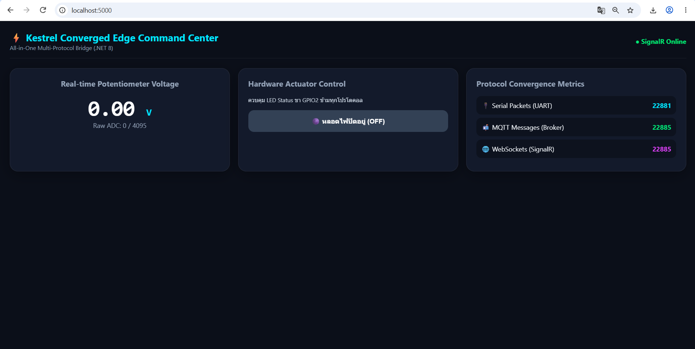
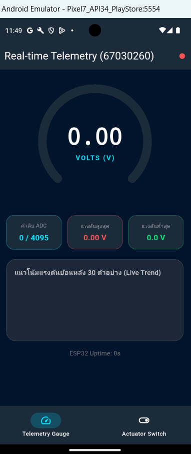
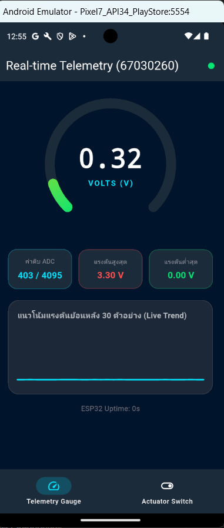
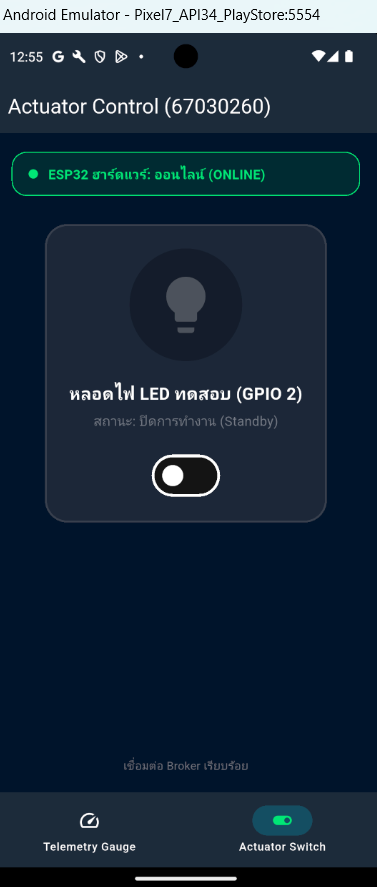
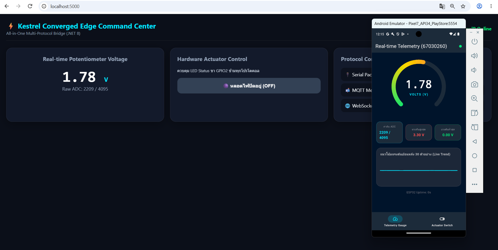
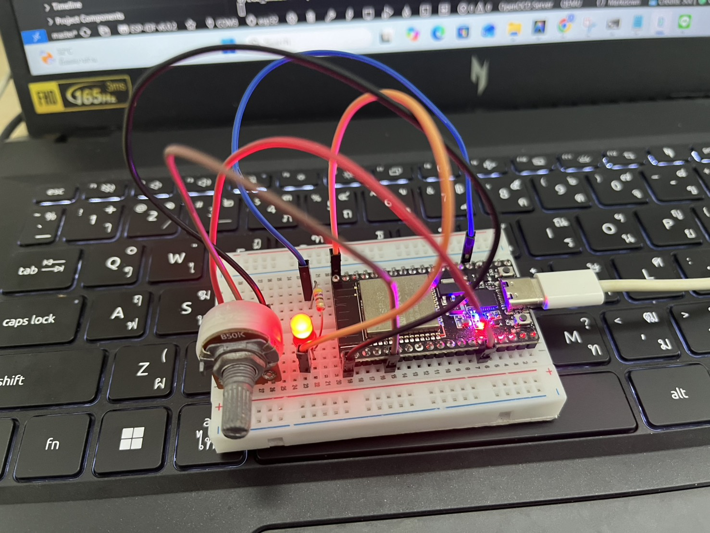
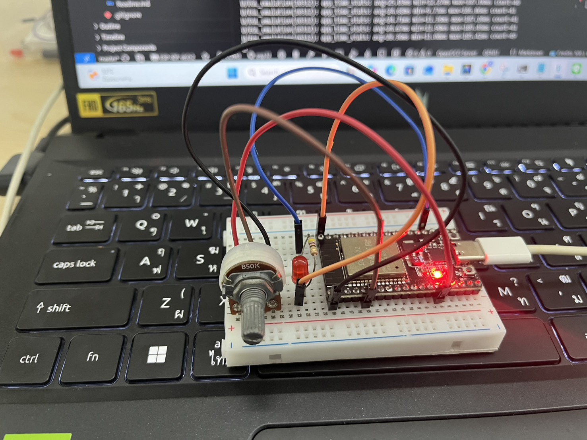
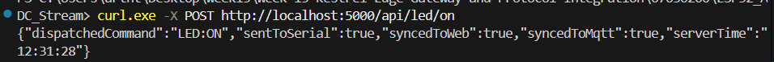
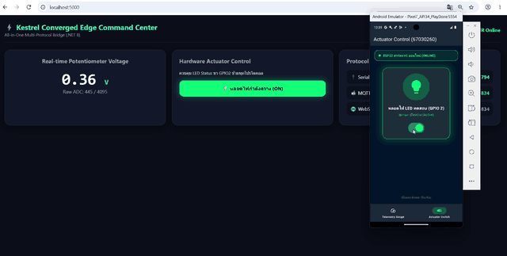

# ใบงานการทดลองที่ 13.4 (The Grand Finale)
### การทดสอบผสานรวมระบบไอโอทีแบบครบวงจร (ESP32 + Kestrel Gateway + Flutter App + Web Command Center)

> [!NOTE] **คำชี้แจง (The Grand Finale Capstone)**
> ยินดีด้วยที่ท่านได้เดินทางมาถึงการทดลองสุดท้ายของรายวิชา! ในใบงานนี้นักศึกษาจะได้นำผลงานที่สร้างขึ้นตลอดทั้งภาคการศึกษามารวมพลังกันเป็น **ระบบนิเวศไอโอทีแบบบูรณาการระดับสมบูรณ์แบบ (The Ultimate Converged IoT Ecosystem)** โดยมี **Kestrel .NET 8 Edge Gateway** ทำหน้าที่เป็นหัวใจบัญชาการ สื่อสารกับ **ฮาร์ดแวร์จริง ESP32**, เชื่อมต่อกับ **แอปมือถือ Flutter**, และประสานข้อมูลสดกับ **เว็บแดชบอร์ด SignalR** อย่างไร้รอยต่อ

---

## 1. วัตถุประสงค์การทดลอง
1. สามารถประกอบและเชื่อมโยงระบบไอโอทีที่ใช้ 4 โปรโตคอล (Serial, MQTT, REST, WebSockets) ให้ทำงานสอดประสานกันได้สมบูรณ์
2. สามารถทดสอบการซิงโครไนซ์สถานะแบบสามประสาน (Hardware <-> Mobile App <-> Web Dashboard) แบบเรียลไทม์ได้
3. สามารถพิสูจน์คุณสมบัติความอยู่รอดในระดับขอบ (Local Survivability) เมื่อตัดการเชื่อมต่ออินเทอร์เน็ตภายนอกได้
4. สามารถวัดความหน่วงเวลาเปรียบเทียบในแต่ละเส้นทางการสื่อสารของระบบได้

---

## 2. ผังความเชื่อมโยงระบบสมบูรณ์ (The Grand Ecosystem Topology)

<p align="center"></p>

---

## 3. ขั้นตอนการทดลอง (Step-by-Step Activities)

### กิจกรรมที่ 13-4.1: การเตรียมพร้อมทุกระบบ

1. **ฮาร์ดแวร์ ESP32**: ต่อ Potentiometer เข้าขา **GPIO34** (ADC Input) และใช้ขา **GPIO2** สำหรับ LED Status จากนั้นเสียบสาย USB เข้ากับคอมพิวเตอร์ และตรวจสอบว่าเฟิร์มแวร์กำลังพิมพ์ค่า JSON แรงดันออกทาง Serial
2. **Kestrel Edge Gateway**: 
   * ตรวจสอบว่า `Program.cs` รวมบริการทั้ง Embedded MQTT Broker, Serial Bridge, REST APIs, และ SignalR ไว้ครบถ้วน
   * รันคำสั่ง `dotnet run` ในโฟลเดอร์โปรเจกต์
3. **เว็บเบราว์เซอร์**: เปิดหน้าต่างเว็บไปที่ `http://localhost:5000` (ตรวจสอบว่าขึ้น SignalR Online สีเขียว)



4. **แอปมือถือ Flutter**:
   * เปิดโปรเจกต์จากสัปดาห์ที่ 12 (`iot_dashboard_app`)
   * ตั้งค่า Broker IP ให้ชี้มาที่หมายเลข IP ของคอมพิวเตอร์ (พอร์ต 1883)
   * สั่งรันแอปบนมือถือจริง หรือรันบนเครื่องคอมพิวเตอร์ผ่าน `flutter run`





---

### กิจกรรมที่ 13-4.2: การทดสอบ 4 มหาการทดลอง (The Grand Verification Matrix)

ให้นักศึกษาทำการทดสอบและบันทึกผลการทำงานลงในตาราง:

| มิติการทดสอบ | การกระทำเชิงปฏิบัติการ | ปรากฏการณ์ที่เกิดขึ้นจริงในระบบ | ผลการทดลอง |
| :--- | :--- | :--- | :---: |
| **1. Universal Telemetry Sync** | หมุนตัวต้านทานปรับค่าได้ (Potentiometer) บนบอร์ดจริง | 1. ค่าแรงดันวิ่งผ่านสาย Serial เข้า Kestrel<br/>2. ตัวเลขบนเว็บแดชบอร์ดวิ่งสดทันที<br/>3. เข็ม Radial Gauge บน Flutter หมุนตามทันทีพร้อมกัน | **ผ่าน (Pass)** |
| **2. Mobile-to-Web Actuation** | แตะสวิตช์เปิดไฟบนแอป Flutter (ส่งผ่าน MQTT) | 1. หลอดไฟ LED จริงบนบอร์ด ESP32 ติดสว่างขึ้น<br/>2. ปุ่มสวิตช์บนหน้าเว็บเปลี่ยนเป็นสีเขียว "ON" อัตโนมัติ | **ผ่าน (Pass)** |
| **3. Web-to-Mobile Actuation** | คลิกปุ่มปิดไฟบนหน้าเว็บ (ส่งผ่าน SignalR) | 1. หลอดไฟ LED จริงบนบอร์ด ESP32 ดับลงทันที<br/>2. สวิตช์บนแอปมือถือ Flutter สลับเป็น "OFF" ทันที | **ผ่าน (Pass)** |
| **4. Third-Party REST Override** | ยิงคำสั่งผ่าน cURL หรือ Postman:<br/>`curl.exe -X POST http://localhost:5000/api/led/on` | 1. หลอดไฟ LED สว่างขึ้น<br/>2. ทั้งหน้าเว็บและแอปมือถืออัปเดตสถานะเป็น "ON" พร้อมกัน | **ผ่าน (Pass)** |

---

### รายละเอียดและหลักฐานผลการทดสอบทั้ง 4 มิติ (Verification Evidence & Media)

#### 1. มิติที่ 1: Universal Telemetry Sync (การซิงค์ข้อมูลเซนเซอร์รอบทิศทาง)
* **การทดสอบ:** หมุนตัวต้านทานปรับค่าได้ (Potentiometer) ที่ต่อกับขา GPIO34 บนบอร์ด ESP32 จริง
* **ผลลัพธ์:** ค่าแรงดันไฟฟ้าส่งผ่าน Serial Bridge เข้าสู่ Kestrel Gateway จากนั้น Kestrel กระจายข้อมูลต่อไปยัง SignalR Hub บนเว็บเบราว์เซอร์ และส่งต่อไปยัง MQTT Topic `iot/telemetry/voltage` ทำให้หน้าจอ Web Dashboard และเข็ม Radial Gauge บนแอป Flutter ขยับตามค่าแรงดันอย่างแม่นยำและลื่นไหลพร้อมกันในระดับมิลลิวินาที


*ภาพแสดงการซิงโครไนซ์ข้อมูลแรงดันไฟฟ้าแบบเรียลไทม์ระหว่าง Web Command Center และ Mobile Dashboard*

> 🔗 **บันทึกวิดีโอผลการทดสอบ:** [วิดีโอแสดงการหมุน Potentiometer และการซิงค์ค่าแรงดันสด (Google Drive)](https://drive.google.com/file/d/14qDYZ_OfBZA9aqojR9gVV6UemuzmTQnH/view?usp=sharing)

---

#### 2. มิติที่ 2: Mobile-to-Web Actuation (การสั่งการข้ามระบบจากแอปมือถือ)
* **การทดสอบ:** แตะสวิตช์เปิดไฟ (Toggle Switch) บนหน้าจอแอป Flutter
* **ผลลัพธ์:** แอป Flutter ส่ง MQTT Publish ไปยัง Topic `iot/esp32/control` ข้อความ `{"state": "ON"}` โบรกเกอร์ภายใน Kestrel ดักจับแพ็กเก็ตแล้วแปลงเป็นคำสั่ง Serial `LED:ON` ส่งต่อไปยังบอร์ด ESP32 ทำให้หลอดไฟ LED จริงสีเหลืองติดสว่างขึ้น พร้อมกันนั้น Kestrel ได้แจ้งเตือน SignalR Clients ทุกเครื่อง ทำให้ปุ่มบนหน้าเว็บเปลี่ยนสถานะเป็น "ON" สีเขียวอัตโนมัติ


<p align="center">
  
</p>

<p align="center"><em>ภาพถ่ายฮาร์ดแวร์จริง: หลอดไฟ LED บนบอร์ด ESP32 ติดสว่างขึ้นตามคำสั่งจากมือถือ</em></p>

> 🔗 **บันทึกวิดีโอผลการทดสอบ:** [วิดีโอแสดงการสั่งเปิดไฟจากแอป Flutter ข้ามมายังบอร์ดจริงและหน้าเว็บ (Google Drive)](https://drive.google.com/file/d/1TlxpOZb3h9fb2rMiqui3Wz6EjWL_deHp/view?usp=sharing)

---

#### 3. มิติที่ 3: Web-to-Mobile Actuation (การสั่งการข้ามระบบจากหน้าเว็บแดชบอร์ด)
* **การทดสอบ:** คลิกปุ่มปิดไฟ (Switch OFF) บนหน้าเว็บ Web Command Center
* **ผลลัพธ์:** เบราว์เซอร์เรียกใช้ฟังก์ชัน SignalR `ToggleLed(false)` ไปยัง Kestrel Gateway เกตเวย์ส่งคำสั่ง `LED:OFF` ผ่านสาย Serial ไปดับหลอดไฟบนบอร์ด ESP32 ทันที พร้อมกับส่ง MQTT Publish แจ้งสถานะ `OFF` ไปยังแอป Flutter ทำให้สวิตช์บนหน้าจอ Flutter เลื่อนกลับมาตำแหน่ง "OFF" สีเทาโดยอัตโนมัติ

<p align="center">
  
</p>

<p align="center"><em>ภาพถ่ายฮาร์ดแวร์จริง: หลอดไฟ LED บนบอร์ด ESP32 ดับลงตามคำสั่งจาก Web Command Center</em></p>

> 🔗 **บันทึกวิดีโอผลการทดสอบ:** [วิดีโอแสดงการสั่งปิดไฟจาก Web Dashboard ข้ามมายังบอร์ดจริงและแอป Flutter (Google Drive)](https://drive.google.com/file/d/1kROgC7aG_2q3W4jHaV8ezbjQnUEAdNYn/view?usp=sharing)

---

#### 4. มิติที่ 4: Third-Party REST Override (การสั่งการผ่าน API ภายนอก)
* **การทดสอบ:** ใช้โปรแกรม Terminal ยิง HTTP POST เข้าสู่ REST API Endpoint:
  ```powershell
  curl.exe -X POST http://localhost:5000/api/led/on
  ```
* **ผลลัพธ์:** Kestrel Gateway ตอบกลับ HTTP Status 200 OK พร้อมข้อความ `{"status":"OK","led":"ON"}` โดยตัว Controller ทำหน้าที่ประสานทั้งส่ง Serial Command ไปยัง ESP32 และ Broadcast สถานะผ่านทั้ง SignalR และ MQTT ส่งผลให้หลอดไฟ LED สว่างขึ้นทันที พร้อมทั้งสวิตช์บนหน้าเว็บและแอป Flutter ปรับสถานะเป็น "ON" ทันที


*ภาพแสดงการยิงคำสั่ง cURL ผ่าน REST API ของ Kestrel Gateway สำเร็จ 100%*

---

### กิจกรรมที่ 13-4.3: การทดสอบความทนทานในสภาวะตัดเน็ต (Local Survivability Challenge)

1. **ขั้นตอนการทดสอบ:** ทำการถอดสาย LAN หรือตัดสัญญาณอินเทอร์เน็ตภายนอก (WAN Disconnect) โดยคงเหลือไว้เฉพาะระบบเครือข่ายแลนภายใน (Local Area Network / Localhost)
2. **บันทึกผลการสังเกตการณ์:**
   * **บอร์ด ESP32 ยังคงส่งข้อมูลได้หรือไม่?:** **ยังคงส่งข้อมูลได้ตามปกติ 100%** เนื่องจากบอร์ด ESP32 สื่อสารกับคอมพิวเตอร์ผ่านการเชื่อมต่อทางกายภาพตรงด้วยสาย USB Serial (UART) จึงทำงานได้อย่างอิสระโดยไม่ต้องพึ่งพาระบบเครือข่ายภายนอก
   * **แอปมือถือ Flutter และเว็บแดชบอร์ดยังสามารถเปิดดูค่าและสั่งงานหลอดไฟได้หรือไม่?:** **ยังสามารถเปิดดูค่าและควบคุมได้ตามปกติอย่างสมบูรณ์** เนื่องจาก Web Command Center โฮสต์อยู่บน Kestrel Web Server ในเครื่องขอบโดยตรง และแอปพลิเคชัน Flutter สื่อสารผ่าน Embedded MQTT Broker ภายใน Kestrel Gateway (ผ่าน Local Subnet / ADB Reverse) ทุกแพ็กเก็ตข้อมูลจึงถูกประมวลผลอยู่ภายในวงแลนระดับ Edge โดยสมบูรณ์
3. **สรุปผลการประเมินความอยู่รอด (Edge Resilience):**
   ระบบไอโอทีที่ออกแบบด้วยสถาปัตยกรรม **Converged Edge Gateway** มีคุณสมบัติ **High Local Survivability** และ **Zero Cloud Dependency** สามารถปฏิบัติงานแบบ Standalone ต่อเนื่องได้แม้อินเทอร์เน็ตภายนอกจะล่มทั้งหมด ซึ่งเป็นคุณสมบัติหัวใจสำคัญสำหรับระบบควบคุมอัตโนมัติในโรงงานอุตสาหกรรม (Mission-Critical Industrial IoT)

<p align="center">
  
</p>

<p align="center"><em>ภาพเคลื่อนไหวแสดงการทดสอบความทนทานของระบบในสภาวะตัดการเชื่อมต่ออินเทอร์เน็ตภายนอก (Local Survivability)</em></p>

> 🔗 **บันทึกวิดีโอผลการทดสอบ:** [วิดีโอแสดงการทดสอบระบบในสภาวะ Local Survivability (Google Drive)](https://drive.google.com/file/d/1ObheUIbZAclGHMDx4ucvyuAcyRTsry55/view?usp=sharing)


---

## 4. บทสรุปและคำถามส่งท้ายภาคการศึกษา (Capstone Retrospective)

1. ตลอดระยะเวลา 13 สัปดาห์ การเดินทางจากระดับบิตและรีจิสเตอร์ของเซนเซอร์ สู่เฟรมเวิร์ก FreeRTOS, ผ่านโปรโตคอลเครือข่ายท้องถิ่น, สู่ระบบคลาวด์ MQTT, หน้าจอมือถือ Flutter, และมาบรรจบที่ Kestrel Edge Gateway... สถาปัตยกรรมชิ้นใดที่ท่านคิดว่ามีความท้าทายเชิงวิศวกรรมมากที่สุด? เพราะเหตุใด?
   - **ความซับซ้อนของการจัดการความขัดกันของโปรโตคอล (Heterogeneous Protocol Orchestration):** การเชื่อมต่อ 4 โปรโตคอลที่มีธรรมชาติการทำงานแตกต่างกันโดยสิ้นเชิง ได้แก่ Serial (Stream-based / Hardware UART), MQTT (Publish/Subscribe Asynchronous Queue), REST (Request/Response Stateless), และ SignalR (WebSockets Full-duplex Bi-directional) จำเป็นต้องมีกลไก Threading, Synchronization, และ Task Concurrency ที่รัดกุม เพื่อป้องกันปัญหา Race Condition หรือ Memory Leak
   - **การซิงโครไนซ์สถานะแบบสามประสานแบบสองทิศทาง (Bi-directional State Convergence):** การสร้างระบบที่ทุกช่องทางสามารถสั่งงานและอัปเดตสถานะข้ามกันได้ โดยไม่ก่อให้เกิดปัญหา Echo Loop หรือ Infinite Loop (เช่น เมื่อเว็บสั่งงาน เกตเวย์ต้องแจ้ง MQTT แต่เมื่อ MQTT ได้รับ ต้องไม่ส่งย้อนกลับไปกระตุ้นให้เว็บสั่งซ้ำวนไม่รู้จบ) ซึ่งต้องอาศัยการออกแบบ Event Handling และ Message Interception ที่แม่นยำ
   - **การประมวลผลที่มีความหน่วงต่ำระดับมิลลิวินาที (Low Latency & High Throughput):** การแปลงสตรีมตัวอักษร JSON จาก Serial แล้วแปลงส่งต่อออกไปยังไคลเอนต์หลายประเภทพร้อมกันแบบ Real-time โดยไม่ทำให้คิวของระบบติดขัด ต้องอาศัยสถาปัตยกรรม Asynchronous Non-blocking I/O ที่ทรงพลังของ .NET Core ร่วมกับ Background Hosted Services (`BackgroundService`)

2. หากท่านต้องนำระบบนี้ไปติดตั้งในโรงงานอุตสาหกรรมจริง สิ่งใดคือ 3 ปัจจัยแรกที่ต้องดำเนินการเพิ่มเติมเพื่อความปลอดภัยและความมั่นคงระดับองค์กร?
   - **การรักษาความปลอดภัยของช่องทางการสื่อสารและการยืนยันตัวตน (End-to-End Encryption & Zero-Trust Authentication):**
     - อัปเกรดช่องทางสื่อสารทุกโปรโตคอลให้เข้ารหัส: ใช้ MQTTS (TLS v1.3) บนพอร์ต 8883, บังคับใช้ HTTPS / WSS สำหรับเว็บและ SignalR
     - ติดตั้งระบบพิสูจน์ตัวตนด้วย X.509 Device Certificates สำหรับอุปกรณ์ฮาร์ดแวร์ และใช้ JWT (JSON Web Tokens) / OAuth 2.0 สำหรับการเข้าถึง REST API และสิทธิ์การสั่งงานของแอปพลิเคชัน เพื่อป้องกันการดักจับข้อมูล (Man-in-the-Middle) หรือการสั่งการโดยไม่ได้รับอนุญาต
   - **ความทนทานของฮาร์ดแวร์และระบบป้องกันทางกายภาพ (Industrial Hardware Hardening & Electrical Isolation):**
     - เปลี่ยนการเชื่อมต่อจากสาย USB ทั่วไป มาเป็นมาตรฐานอุตสาหกรรม เช่น RS-485 (Modbus RTU) หรือ Industrial Ethernet (Modbus TCP / PROFINET) ที่มีระบบชีลด์ป้องกันคลื่นรบกวนแม่เหล็กไฟฟ้า (EMI Protection)
     - เพิ่มวงจรแยกสัญญาณทางแสง (Optocoupler Isolation) สำหรับวงจรขับโหลดและ GPIO เพื่อป้องกันแรงดันกระชาก (Surge Voltage) จากมอเตอร์หรือเครื่องจักรย้อนกลับมาทำลายบอร์ดไมโครคอนโทรลเลอร์
   - **การบันทึกข้อมูลเชิงเวลาและการกู้คืนระบบอัตโนมัติ (Time-Series Edge Persistence & Watchdog Fail-Safe):**
     - ติดตั้งระบบฐานข้อมูลภายใน Edge Gateway เช่น SQLite, DuckDB หรือ TimescaleDB เพื่อทำการบันทึกข้อมูล (Store-and-Forward) เมื่อระบบเครือข่ายภายนอกขัดข้อง ข้อมูลจะไม่สูญหาย และสามารถ Synchronize ย้อนหลังได้เมื่อเครือข่ายกลับมาปกติ
     - ติดตั้งระบบตรวจสอบสถานะอัตโนมัติ (Hardware Watchdog Timer & Process Supervisor) เพื่อให้มั่นใจว่าหากโปรเซสเกิดข้อผิดพลาด ค้าง หรือไฟตก ระบบจะสามารถรีสตาร์ตและกลับสู่สภาวะปลอดภัย (Fail-Safe State) ได้ทันทีโดยไม่ต้องมีมนุษย์เข้าไปกดรีเซ็ต
