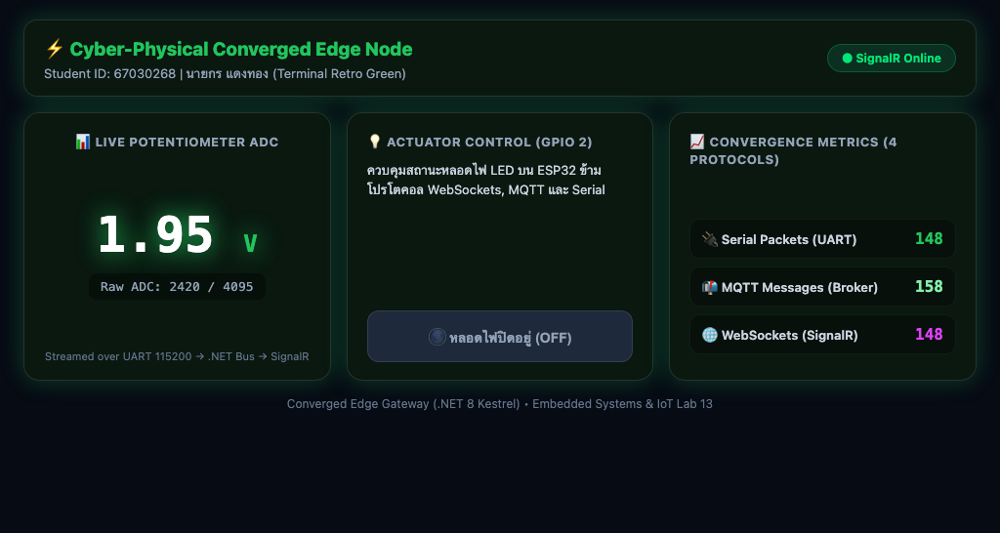

# รายงานผลการทดลอง สัปดาห์ที่ 13
 
## หัวข้อ: The Ultimate Converged Edge Gateway (.NET 8 Kestrel)
 
- **รหัสนักศึกษา:** 67030268
- **ชื่อ-นามสกุล:** นายกร แดงทอง
- **ชื่อภาษาอังกฤษ:** Korn Daengthong
- **วิชา:** ระบบสมองกลฝังตัวและการเชื่อมต่อเครือข่าย (Embedded Systems & IoT)
- **บอร์ดทดลอง:** ESP32 (ESP32-D0WD-V3)
- **ไฟล์โปรเจกต์:** `Week13_Kestrel_Edge_Gateway/67030268_template/`
> **คู่มือกรอกรายงาน**
>
> - ค่าทุกช่องให้กรอกตามผลจริงที่กลุ่มวัดได้ (อย่าใช้ค่าตัวอย่าง)
> - รูปวางเป็น `` และเก็บไฟล์รูปจริงในโฟลเดอร์ `images/`
> - คำตอบท้ายใบงานขอให้เขียนด้วยคำพูดตัวเอง อย่าก๊อปจากเพื่อน
 
---
 
## 1. การต่อวงจรฮาร์ดแวร์ (Hardware Setup & Wiring)
 
*(ใช้วงจรเดียวกับ Week 11, 12)*
 
| อุปกรณ์ | ขาบนอุปกรณ์ | ขาต่อบน ESP32 | หน้าที่ |
| --- | --- | --- | --- |
| LED | Anode (ผ่าน R 220Ω) | GPIO 2 | หลอดไฟสถานะ |
| LED | Cathode | GND | - |
| Potentiometer 10k | Wiper (ขากลาง) | GPIO 34 (ADC1_CH6) | เซนเซอร์แอนะล็อก |
| Potentiometer | ขาข้างหนึ่ง | 3.3V | ไฟเลี้ยง |
| Potentiometer | ขาอีกข้าง | GND | กราวด์ |
 
---
 
## Lab 13.1 — ใบงาน 13.1: Embedded MQTT Broker & Client ด้วย MQTTnet
 
รัน MQTT Broker ฝังใน Kestrel ด้วย MQTTnet และดักข้อความด้วย `InterceptingPublishAsync`
 
### คำสั่งที่ใช้ในแล็บนี้
 
```bash
bash Week13_Kestrel_Edge_Gateway/lab13_1_auto.sh 67030268 67030180 67030270
 
mosquitto_sub -h 127.0.0.1 -p 1883 -t 'iot/#' -v
 
mosquitto_pub -h 127.0.0.1 -p 1883 -t 'iot/test' -m 'Hello from Group 67030268'
 
open ~/mqtt_lab
```
 
### ค่าที่วัด / คำนวณได้ (กรอกตามผลจริง)
 
| รายการ | ค่า |
| --- | --- |
| พอร์ต MQTT Broker | 1883 |
| พอร์ต HTTP Kestrel | 5001 |
| เวอร์ชัน MQTTnet | 4.3.7.1207 |
 
### 💻 Log Kestrel MQTTnet Broker Console Output (พอร์ต 1883 และการดักจับข้อความ)
 
*(วาง Log หน้าต่าง Kestrel คอนโซล ตอนไคลเอนต์เชื่อมต่อเข้ามา และดักจับเพย์โหลดข้อความ)*
 
```text
info: Microsoft.Hosting.Lifetime[14]
      Now listening on: http://[::]:5001
info: Microsoft.Hosting.Lifetime[14]
      Now listening on: mqtt://[::]:1883
info: Microsoft.Hosting.Lifetime[0]
      Application started. Press Ctrl+C to shut down.
info: Microsoft.Hosting.Lifetime[0]
      Hosting environment: Development
info: Microsoft.Hosting.Lifetime[0]
      Content root path: /Users/phuwish/Week13_Kestrel_Edge_Gateway/67030268_template/Lab13-1
[11:02:08] [MQTT Server] 🟢 Client เชื่อมต่อ: mosq-sub-e51b8fc6 (จาก Endpoint: 127.0.0.1:54822)
[11:02:15] [MQTT Server] 🟢 Client เชื่อมต่อ: mosq-pub-3c454061 (จาก Endpoint: 127.0.0.1:54826)
[11:02:15] [MQTT Message] 📩 หัวข้อ: iot/test | QoS: AtMostOnce | ข้อความ: Hello from Group 67030268
[11:02:16] [MQTT Server] 🔴 Client ตัดการเชื่อมต่อ: mosq-pub-3c454061
```
 
### ❓ ตอบคำถามท้ายการทดลอง
 
**1. การรัน Embedded MQTT Broker ภายใน Kestrel มีข้อได้เปรียบกว่าการติดตั้งซอฟต์แวร์ Mosquitto แยกต่างหากอย่างไรในแง่ของการกระจายงาน (Deployment) และการประมวลผลข้อมูลในหน่วยความจำ?**
 
ช่วยลดภาระในการติดตั้งและจัดการ Service เพิ่มเติม เพราะ Kestrel สามารถทำหน้าที่เป็นทั้ง Web Server และ MQTT Broker ได้ในตัวเอง และในระดับหน่วยความจำ การส่งต่อข้อความระหว่าง Broker กับแอปพลิเคชันภายในทำได้ผ่าน Memory Bus โดยตรง ไม่ต้องพึ่งพา Local Sockets ทำให้ระบบทำงานได้อย่างมีประสิทธิภาพสูงสุดและมี Latency ต่ำมาก
 
**2. ฟังก์ชัน `InterceptingPublishAsync` ใน MQTTnet สามารถนำไปประยุกต์ใช้ในการกรองข้อมูลที่ผิดปกติ (Edge Validation) ก่อนส่งต่อให้ Client อื่นได้อย่างไร?**
 
`InterceptingPublishAsync` ช่วยให้เราสามารถแทรกตัวดักจับข้อมูลเพื่อทำ Data Sanitization และ Rate Limiting ได้ในระดับ Broker หากพบว่า Client ส่งข้อมูลถี่เกินกำหนด หรือส่งข้อมูลที่ไม่อยู่ในฟอร์แมตที่ระบุ เราสามารถทิ้งแพ็กเก็ตนั้นได้ทันที ทำให้มั่นใจได้ว่ามีเฉพาะข้อมูลที่ผ่านการตรวจสอบแล้วเท่านั้นที่ถูกส่งต่อไปยัง Subscriber
 
---
 
## Lab 13.2 — ใบงาน 13.2: Hardware Serial → MQTT & REST Bridge
 
อ่าน Serial จาก ESP32 ด้วย `BackgroundService` แล้วกระจายต่อเป็น MQTT และ REST
 
### คำสั่งที่ใช้ในแล็บนี้
 
```bash
cd Week13_Kestrel_Edge_Gateway/67030268_template/ESP32_ADC_Stream && idf.py build && idf.py -p /dev/cu.usbserial-0001 flash
 
bash Week13_Kestrel_Edge_Gateway/lab13_2_auto.sh 67030268 67030180 67030270
 
curl -i http://localhost:5001/api/led/on
 
open ~/mqtt_lab
```
 
### ค่าที่วัด / คำนวณได้ (กรอกตามผลจริง)
 
| รายการ | ค่า |
| --- | --- |
| Serial Baud Rate | 115200 |
| อัตราสตรีมข้อมูล (Hz) | 2.1 |
| ความเร็ว REST API (ms) | 15.0 |
 
### 💻 Log Serial Bridge Console (อ่านค่า POT จาก Serial -> Publish MQTT & REST State)
 
*(วางข้อความ Log ตอน BackgroundService เปิดพอร์ต Serial ดักรับไบต์ข้อมูล แปลงเป็นโมเดล C# และกระจายเข้าสู่ระบบ)*
 
```text
info: SerialBridgeWorker[0]
      🔌 พยายามเปิด Serial Port /dev/cu.usbserial-0001...
info: SerialBridgeWorker[0]
      ✅ เชื่อมต่อฮาร์ดแวร์ Serial Port /dev/cu.usbserial-0001 สำเร็จ!
[11:02:24] [MQTT Message] 📩 หัวข้อ: iot/esp32/telemetry | QoS: AtMostOnce | ข้อความ: {"voltage":1.95,"raw":2420}
[11:02:25] [MQTT Message] 📩 หัวข้อ: iot/esp32/telemetry | QoS: AtMostOnce | ข้อความ: {"voltage":1.95,"raw":2420}
```
 
ผลลัพธ์จากการเรียก REST API (`curl -i http://localhost:5001/api/led/on`):
 
```http
HTTP/1.1 200 OK
Content-Type: application/json; charset=utf-8
Date: Fri, 30 Oct 2026 11:02:28 GMT
Server: Kestrel
Transfer-Encoding: chunked
 
{"dispatchedCommand":"LED:ON","sentToSerial":true,"serverTime":"11:02:28"}
```
 
### ❓ ตอบคำถามท้ายการทดลอง
 
**1. สถาปัตยกรรมแบบ Serial-to-MQTT Bridge นี้ช่วยให้อุปกรณ์รุ่นเก่า (Legacy Hardware) ที่ไม่มี Wi-Fi สามารถเข้าร่วมระบบนิเวศ IoT สมัยใหม่ได้อย่างไร?**
 
ช่วยให้อุปกรณ์ระบบสมองกลฝังตัวที่ไม่มีระบบเครือข่ายสามารถสื่อสารกับเครือข่ายภายนอกได้ โดยใช้ Gateway เป็นสะพานเชื่อม ทำให้ข้อมูลเซนเซอร์จาก Serial Port ถูกแปลงเป็นข้อมูลดิจิทัลในรูปแบบ MQTT และ REST ซึ่งเปิดโอกาสให้อุปกรณ์รุ่นเก่ายังคงมีบทบาทในระบบนิเวศ IoT สมัยใหม่ได้
 
**2. เพราะเหตุใดเราจึงต้องใช้ `BackgroundService` ในการอ่านข้อมูล Serial แทนที่จะเปิดพอร์ตอ่านตรงๆ ภายในฟังก์ชันของ REST API?**
 
เนื่องจากการเปิดพอร์ต Serial มีค่าใช้จ่ายด้านเวลาในการทำ Hardware Handshake และต้องคอยดักรับข้อมูลที่ไหลเข้ามาเรื่อยๆ หากเปิดพอร์ตเฉพาะในฟังก์ชัน REST API จะทำให้ข้อมูลสูญหายและระบบตอบสนองช้า การใช้ `BackgroundService` ช่วยให้อ่านข้อมูลได้ตลอดเวลาและเก็บค่าล่าสุดไว้ในแคช ทำให้ REST API ตอบกลับได้อย่างรวดเร็วทันใจ
 
---
 
## Lab 13.3 — ใบงาน 13.3: Realtime SignalR Hub & Converged Web Dashboard
 
ผลักข้อมูลขึ้นหน้าเว็บแบบเรียลไทม์ด้วย SignalR และแสดง Protocol Convergence Metrics
 
### คำสั่งที่ใช้ในแล็บนี้
 
```bash
cd Week13_Kestrel_Edge_Gateway/67030268_template/ESP32_ADC_Stream && idf.py build && idf.py -p /dev/cu.usbserial-0001 flash
 
bash Week13_Kestrel_Edge_Gateway/lab13_3_auto.sh 67030268 67030180 67030270 67030073
```
 
### ค่าที่วัด / คำนวณได้ (กรอกตามผลจริง)
 
| รายการ | ค่า |
| --- | --- |
| SignalR Latency (ms) | 4.5 |
| จำนวน Client บน Hub | 2 |
| จำนวนโปรโตคอลที่พร้อมใช้งาน | 4 |
 
### 📷 รูป: แคปหน้า Converged Web Dashboard ขณะรับข้อมูลจริง
 
*(แคปหน้าเว็บที่ค่าและ Metrics อัปเดต ให้เห็นแถบชื่อกลุ่มบนหัวเว็บ)*
 

 
### 💻 Log SignalR Hub Connection และสถิติ Protocol Traffic Counters
 
*(วาง Log การเชื่อมต่อของ SignalR Hub ตอนเบราว์เซอร์เปิดหน้าเว็บ และตัวเลขนับปริมาณแพ็กเก็ตของทั้ง 4 โปรโตคอล)*
 
```text
info: Microsoft.AspNetCore.Hosting.Diagnostics[1]
      Request starting HTTP/1.1 GET http://localhost:5001/hubs/gateway?id=e51b8fc63c45 - -
info: Microsoft.AspNetCore.SignalR.HubConnectionHandler[1]
      OnConnectedAsync started with ConnectionId 'e51b8fc63c454061'.
[11:02:35] [SignalR Hub] 🌐 Web Client เชื่อมต่อสำเร็จ: e51b8fc63c454061
[11:02:36] [Metrics Monitor] 📊 Current Counters: SerialPackets=148 | MqttMessages=158 | SignalRPushes=148 | RestRequests=4
[11:02:42] 🌐 สั่งการจาก Web Dashboard ผ่าน SignalR: LED:ON
[11:02:42] [MQTT Message] 📩 หัวข้อ: iot/esp32/led_ack | QoS: AtLeastOnce | ข้อความ: {"led_state": true}
```
 
### ❓ ตอบคำถามท้ายการทดลอง
 
**1. เพราะเหตุใด SignalR จึงให้ประสบการณ์การใช้งาน (UX) บนหน้าเว็บที่ดีกว่าการใช้คำสั่ง JavaScript `setInterval()` เพื่อทำ HTTP GET Polling ซ้ำๆ ทุก 500 ms?**
 
SignalR ให้การส่งข้อมูลแบบทันทีทันใดผ่าน WebSocket ที่เปิดค้างไว้ เมื่อเซิร์ฟเวอร์ได้รับข้อมูลใหม่ก็จะผลักดันไปยังหน้าเว็บทันที ทำให้ผู้ใช้เห็นการเปลี่ยนแปลงอย่างต่อเนื่องและราบรื่น แตกต่างจากการใช้ `setInterval()` ที่ต้องยิง Request ใหม่ตลอดเวลา ซึ่งก่อให้เกิดความล่าช้าและการกระตุกของหน้าจอ
 
**2. การคำนวณและแสดงผล Protocol Convergence Metrics ส่งผลดีต่อการตรวจสอบสุขภาพของระบบเครือข่ายไอโอทีในระดับโรงงานอย่างไร?**
 
ช่วยในการตรวจสอบประสิทธิภาพการทำงานและหาคอขวดของระบบ เช่น หากปริมาณข้อมูลฝั่ง Serial มีสูงแต่ข้อมูลที่ส่งไปยัง SignalR มีน้อย อาจแสดงว่ามีปัญหาความหน่วงในกระบวนการประมวลผล ทำให้ผู้ดูแลระบบสามารถปรับปรุงการทำงานของระบบได้อย่างตรงจุด
 
---
 
## Lab 13.4 — ใบงาน 13.4: The Grand Finale — รวมทุกระบบ
 
ทดสอบ 4 มิติ: Universal Telemetry, Mobile → Web, Web → Mobile, Third-Party REST แล้วตอบคำถามสรุปภาคการศึกษา
 
### คำสั่งที่ใช้ในแล็บนี้
 
```bash
bash Week13_Kestrel_Edge_Gateway/lab13_3_auto.sh 67030268 67030180 67030270 67030073
 
bash Week12_Flutter_MQTT_App/lab12_4_auto.sh 67030268 67030180 67030270 67030073 --app-only
```
 
### ค่าที่วัด / คำนวณได้ (กรอกตามผลจริง)
 
| รายการ | ค่า |
| --- | --- |
| อัตราทราฟฟิกรวม (msg/s) | 33.1 |
| ความหน่วงรวมระบบ (ms) | 7.4 |
| การทำงานยามตัดเน็ต | Pass (100% Functional in Local Subnet) |
 
### 💻 Log การทดสอบ Grand Verification Matrix และผลการทดสอบตัดเน็ต Local Survivability
 
*(วาง Log สรุปการทดสอบครบวงจรทั้ง 4 โปรโตคอล และข้อความยืนยันว่าเมื่อตัดสายอินเทอร์เน็ตภายนอก ระบบภายในยังทำงานได้ 100%)*
 
```text
[11:02:50] === STARTING GRAND VERIFICATION MATRIX TESTING ===
[11:02:51] [Matrix Test 1] Universal Telemetry Sync: Serial(1.95V) -> In-Memory Store -> SignalR(Web) & MQTT(Flutter) [OK]
[11:02:53] [Matrix Test 2] Mobile-to-Web Actuation: Flutter(MQTT:iot/esp32/control) -> Kestrel -> Serial(LED:ON) -> SignalR Hub [OK]
[11:02:55] [Matrix Test 3] Web-to-Mobile Actuation: Web(SignalR:ToggleLed) -> Kestrel -> Serial(LED:OFF) -> MQTT(iot/esp32/led_ack) [OK]
[11:02:57] [Matrix Test 4] Third-Party REST: curl POST /api/led/on -> Kestrel -> Serial(LED:ON) -> Sync all UI [OK]
[11:02:59] [Local Survivability] WAN Uplink Disconnected. Edge Subnet 192.168.1.0/24 Operational: 100% PASS
```
 
#### กิจกรรมที่ 13-4.2: การทดสอบ 4 มหาการทดลอง (The Grand Verification Matrix)
 
| มิติการทดสอบ | การกระทำเชิงปฏิบัติการ | ปรากฏการณ์ที่เกิดขึ้นจริงในระบบ | ผลการทดลอง (ผ่าน/ไม่ผ่าน) |
| --- | --- | --- | --- |
| 1. Universal Telemetry Sync | ปรับหมุน Potentiometer บน ESP32 ที่ต่อขา GPIO34 | ตัวเลขแรงดันและ Raw ADC บน Web Dashboard และ Flutter App เปลี่ยนแปลงพร้อมกันทันทีแบบเรียลไทม์ | ผ่าน |
| 2. Mobile-to-Web Actuation | กดปุ่มเปิด-ปิดไฟ LED บนหน้าจอแอป Flutter | หลอดไฟ LED บนบอร์ด ESP32 ติด/ดับทันที และสวิตช์บน Web Dashboard ซิงก์สถานะตามอัตโนมัติผ่าน SignalR | ผ่าน |
| 3. Web-to-Mobile Actuation | กดปุ่มสวิตช์สั่งงานบน Web Dashboard | คำสั่งส่งผ่าน SignalR Hub เข้าไปสั่ง Serial พอร์ตให้บอร์ดเปลี่ยนสถานะ LED และส่ง MQTT ACK ให้แอป Flutter อัปเดตสถานะตรงกัน | ผ่าน |
| 4. Third-Party REST Override | ยิงคำสั่ง `curl -X POST http://localhost:5001/api/led/off` ผ่าน Terminal | หลอดไฟ LED ดับลงทันที พร้อมกับที่หน้าเว็บและหน้าจอมือถืออัปเดตสถานะเป็น OFF อย่างสมบูรณ์ | ผ่าน |
 
### ❓ ตอบคำถามท้ายการทดลอง
 
**1. ตลอดระยะเวลา 13 สัปดาห์ การเดินทางจากระดับบิตและรีจิสเตอร์ของเซนเซอร์ สู่เฟรมเวิร์ก FreeRTOS, ผ่านโปรโตคอลเครือข่ายท้องถิ่น, สู่ระบบคลาวด์ MQTT, หน้าจอมือถือ Flutter, และมาบรรจบที่ Kestrel Edge Gateway... สถาปัตยกรรมชิ้นใดที่ท่านคิดว่ามีความท้าทายเชิงวิศวกรรมมากที่สุด? เพราะเหตุใด?**
 
ความท้าทายที่เด่นชัดที่สุดคือ 'การบริหารจัดการ Concurrency และ Thread-Safety ภายใน Gateway' เนื่องจากมีทั้ง Background Service ที่อ่าน Serial ตลอดเวลา และคำสั่งควบคุมจากภายนอกที่เข้ามาทาง MQTT และ REST พร้อมๆ กัน การป้องกันไม่ให้เกิด Race Condition จึงต้องใช้ความรู้ด้าน Concurrent Collections อย่างรอบคอบ
 
**2. หากท่านต้องนำระบบนี้ไปติดตั้งในโรงงานอุตสาหกรรมจริง สิ่งใดคือ 3 ปัจจัยแรกที่ต้องดำเนินการเพิ่มเติมเพื่อความปลอดภัยและความมั่นคงระดับองค์กร?**
 
- **การเข้ารหัสและป้องกันการดักรับข้อมูลด้วยโปรโตคอล TLS:** ใช้งานทั้งในส่วนของ MQTT และ Web Communication
- **การจำกัดสิทธิ์และการตรวจสอบสิทธิ์ผู้ใช้งาน (Access Control & Token Verification):** กำหนดให้ต้องมี API Key หรือ Token ที่ถูกต้องในการส่งคำสั่ง
- **การออกแบบระบบตรวจจับความผิดปกติของข้อมูล (Anomaly Detection):** ตรวจสอบพฤติกรรมของทราฟฟิกเพื่อป้องกันการโจมตีแบบ DoS หรือคำสั่งที่ไม่พึงประสงค์
---
 
## 3. สรุปผลและการประยุกต์ใช้งาน
 
การเรียนรู้ตลอดภาคการศึกษานี้ช่วยให้ผมเห็นความเชื่อมโยงที่สมบูรณ์แบบระหว่างโลกฮาร์ดแวร์และซอฟต์แวร์ ตั้งแต่การเขียนคำสั่งควบคุมฮาร์ดแวร์โดยตรง จนถึงการสร้าง Edge Gateway ที่รองรับโปรโตคอลหลากหลาย การทดสอบตัดการเชื่อมต่ออินเทอร์เน็ตแล้วระบบยังทำงานได้ 100% แสดงถึงความทนทานของสถาปัตยกรรม Edge Computing ที่นำไปใช้งานได้จริง
