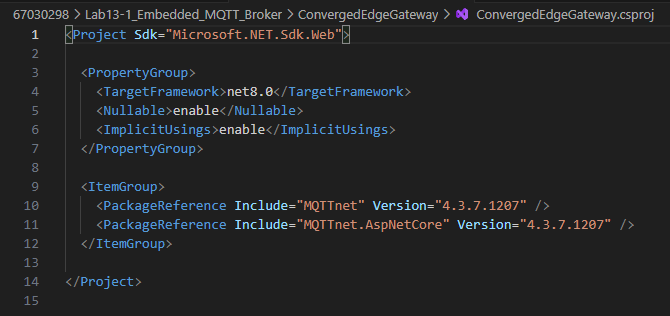
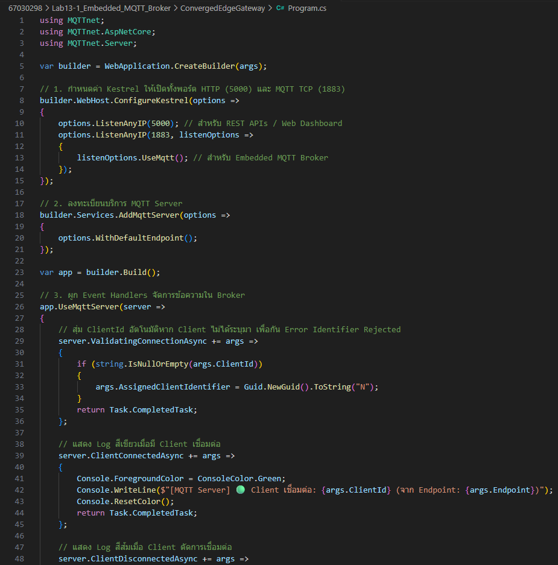
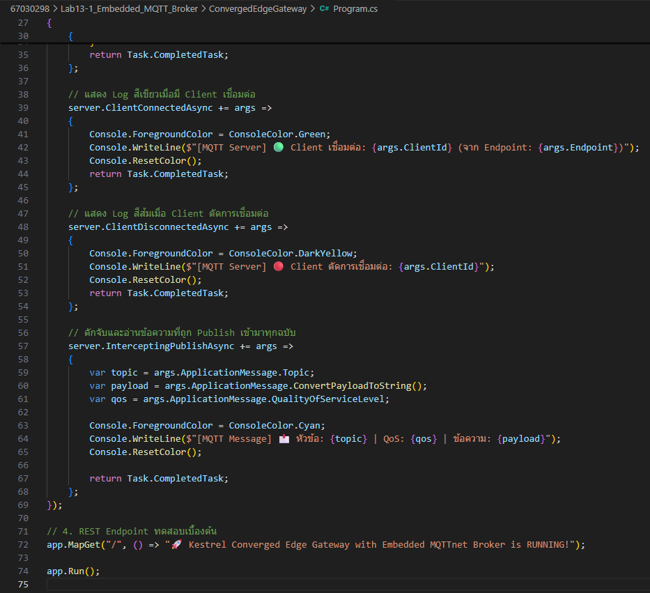
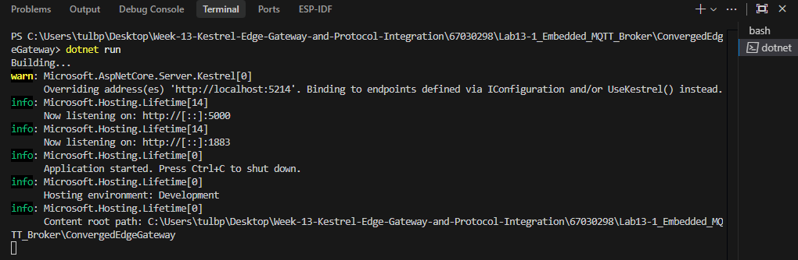
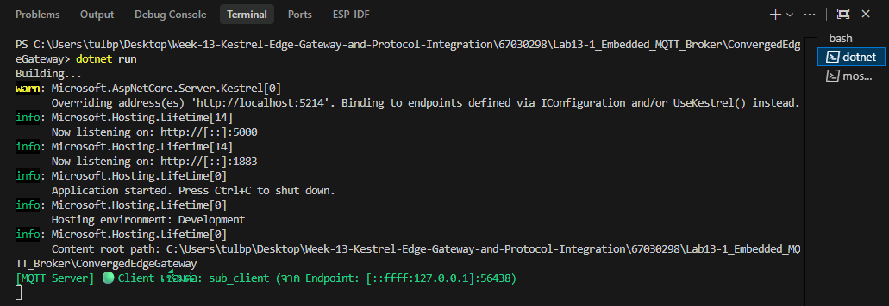
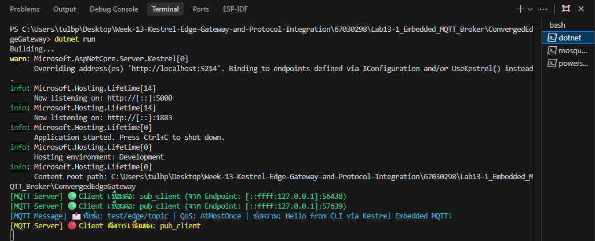

# รายงานผลการทดลองที่ 13.1
## การสร้าง Embedded MQTT Broker และ Client ภายใน Kestrel .NET 8 ด้วยไลบรารี MQTTnet

---

## 1. บันทึกผลการทดลอง (Experimental Results)

### กิจกรรมที่ 13-1.1: การสร้างโปรเจกต์และติดตั้งแพ็กเกจ

#### 1. การสร้างโปรเจกต์ .NET 8 Web Application
* **คำสั่งที่ใช้:**
```powershell
dotnet new web -n ConvergedEdgeGateway
cd ConvergedEdgeGateway
```

* **บันทึก Log ผลการรันคำสั่ง:**
```text
PS C:\Users\tulbp\Desktop\Week-13-Kestrel-Edge-Gateway-and-Protocol-Integration\67030298\Lab13-1_Embedded_MQTT_Broker> dotnet new web -n ConvergedEdgeGateway
The template "ASP.NET Core Empty" was created successfully.

Processing post-creation actions...
Restoring C:\Users\tulbp\Desktop\Week-13-Kestrel-Edge-Gateway-and-Protocol-Integration\67030298\Lab13-1_Embedded_MQTT_Broker\ConvergedEdgeGateway\ConvergedEdgeGateway.csproj:
  Determining projects to restore...
  Restored C:\Users\tulbp\Desktop\Week-13-Kestrel-Edge-Gateway-and-Protocol-Integration\67030298\Lab13-1_Embedded_MQTT_Broker\ConvergedEdgeGateway\Co
  nvergedEdgeGateway.csproj (in 60 ms).
Restore succeeded.


PS C:\Users\tulbp\Desktop\Week-13-Kestrel-Edge-Gateway-and-Protocol-Integration\67030298\Lab13-1_Embedded_MQTT_Broker> cd ConvergedEdgeGateway
PS C:\Users\tulbp\Desktop\Week-13-Kestrel-Edge-Gateway-and-Protocol-Integration\67030298\Lab13-1_Embedded_MQTT_Broker\ConvergedEdgeGateway> 
```

---

#### 2. การติดตั้งแพ็กเกจ MQTTnet และ MQTTnet.AspNetCore
* **คำสั่งที่ใช้:**
```powershell
dotnet add package MQTTnet --version 4.3.7.1207
dotnet add package MQTTnet.AspNetCore --version 4.3.7.1207
```

* **บันทึก Log ผลการติดตั้งแพ็กเกจ:**
```text
PS C:\Users\tulbp\Desktop\Week-13-Kestrel-Edge-Gateway-and-Protocol-Integration\67030298\Lab13-1_Embedded_MQTT_Broker\ConvergedEdgeGateway> dotnet add package MQTTnet --version 4.3.7.1207
  Determining projects to restore...
  Writing C:\Users\tulbp\AppData\Local\Temp\tmpsn531w.tmp
info : X.509 certificate chain validation will use the default trust store selected by .NET for code signing.
info : X.509 certificate chain validation will use the default trust store selected by .NET for timestamping.
info : Adding PackageReference for package 'MQTTnet' into project 'C:\Users\tulbp\Desktop\Week-13-Kestrel-Edge-Gateway-and-Protocol-Integration\67030298\Lab13-1_Embedded_MQTT_Broker\ConvergedEdgeGateway\ConvergedEdgeGateway.csproj'.
info : Restoring packages for C:\Users\tulbp\Desktop\Week-13-Kestrel-Edge-Gateway-and-Protocol-Integration\67030298\Lab13-1_Embedded_MQTT_Broker\ConvergedEdgeGateway\ConvergedEdgeGateway.csproj...
info :   GET https://api.nuget.org/v3-flatcontainer/mqttnet/index.json
info :   OK https://api.nuget.org/v3-flatcontainer/mqttnet/index.json 787ms
info :   GET https://api.nuget.org/v3-flatcontainer/mqttnet/4.3.7.1207/mqttnet.4.3.7.1207.nupkg
info :   OK https://api.nuget.org/v3-flatcontainer/mqttnet/4.3.7.1207/mqttnet.4.3.7.1207.nupkg 857ms
info : Installed MQTTnet 4.3.7.1207 from https://api.nuget.org/v3/index.json to C:\Users\tulbp\.nuget\packages\mqttnet\4.3.7.1207 with content hash ah7aHXoedWp5m5a4zy2u4phOEVj0QFYzOb5tFKQeV8RRBrxp+1QREF4ymZuG8D+hzB2dhtrrG81WxTFv0PzOeQ==.
info :   GET https://api.nuget.org/v3/vulnerabilities/index.json
info :   OK https://api.nuget.org/v3/vulnerabilities/index.json 241ms
info :   GET https://api.nuget.org/v3-vulnerabilities/2026.10.26.23.37.37/vulnerability.base.json
info :   GET https://api.nuget.org/v3-vulnerabilities/2026.10.26.23.37.37/2026.10.27.11.37.40/vulnerability.update.json
info :   OK https://api.nuget.org/v3-vulnerabilities/2026.10.26.23.37.37/2026.10.27.11.37.40/vulnerability.update.json 275ms
info :   OK https://api.nuget.org/v3-vulnerabilities/2026.10.26.23.37.37/vulnerability.base.json 633ms
info : Package 'MQTTnet' is compatible with all the specified frameworks in project 'C:\Users\tulbp\Desktop\Week-13-Kestrel-Edge-Gateway-and-Protocol-Integration\67030298\Lab13-1_Embedded_MQTT_Broker\ConvergedEdgeGateway\ConvergedEdgeGateway.csproj'.
info : PackageReference for package 'MQTTnet' version '4.3.7.1207' added to file 'C:\Users\tulbp\Desktop\Week-13-Kestrel-Edge-Gateway-and-Protocol-Integration\67030298\Lab13-1_Embedded_MQTT_Broker\ConvergedEdgeGateway\ConvergedEdgeGateway.csproj'.
info : Writing assets file to disk. Path: C:\Users\tulbp\Desktop\Week-13-Kestrel-Edge-Gateway-and-Protocol-Integration\67030298\Lab13-1_Embedded_MQTT_Broker\ConvergedEdgeGateway\obj\project.assets.json
log  : Restored C:\Users\tulbp\Desktop\Week-13-Kestrel-Edge-Gateway-and-Protocol-Integration\67030298\Lab13-1_Embedded_MQTT_Broker\ConvergedEdgeGateway\ConvergedEdgeGateway.csproj (in 4.79 sec).
PS C:\Users\tulbp\Desktop\Week-13-Kestrel-Edge-Gateway-and-Protocol-Integration\67030298\Lab13-1_Embedded_MQTT_Broker\ConvergedEdgeGateway> dotnet add
 package MQTTnet.AspNetCore --version 4.3.7.1207
  Determining projects to restore...
  Writing C:\Users\tulbp\AppData\Local\Temp\tmpllrycn.tmp
info : X.509 certificate chain validation will use the default trust store selected by .NET for code signing.
info : X.509 certificate chain validation will use the default trust store selected by .NET for timestamping.
info : Adding PackageReference for package 'MQTTnet.AspNetCore' into project 'C:\Users\tulbp\Desktop\Week-13-Kestrel-Edge-Gateway-and-Protocol-Integration\67030298\Lab13-1_Embedded_MQTT_Broker\ConvergedEdgeGateway\ConvergedEdgeGateway.csproj'.
info : Restoring packages for C:\Users\tulbp\Desktop\Week-13-Kestrel-Edge-Gateway-and-Protocol-Integration\67030298\Lab13-1_Embedded_MQTT_Broker\ConvergedEdgeGateway\ConvergedEdgeGateway.csproj...
info :   GET https://api.nuget.org/v3-flatcontainer/mqttnet.aspnetcore/index.json
info :   OK https://api.nuget.org/v3-flatcontainer/mqttnet.aspnetcore/index.json 900ms
info :   GET https://api.nuget.org/v3-flatcontainer/mqttnet.aspnetcore/4.3.7.1207/mqttnet.aspnetcore.4.3.7.1207.nupkg
info :   OK https://api.nuget.org/v3-flatcontainer/mqttnet.aspnetcore/4.3.7.1207/mqttnet.aspnetcore.4.3.7.1207.nupkg 699ms
info : Installed MQTTnet.AspNetCore 4.3.7.1207 from https://api.nuget.org/v3/index.json to C:\Users\tulbp\.nuget\packages\mqttnet.aspnetcore\4.3.7.1207 with content hash aDtlDjDv65kK0J3/SeagD9h1/xAzxSjbIMEQOzwChyv9mZt79KRRX0TIHQ03SyXfsRC6yyOcyqJxIp8K7FON1A==.
info :   CACHE https://api.nuget.org/v3/vulnerabilities/index.json
info :   CACHE https://api.nuget.org/v3-vulnerabilities/2026.10.26.23.37.37/vulnerability.base.json
info :   CACHE https://api.nuget.org/v3-vulnerabilities/2026.10.26.23.37.37/2026.10.27.11.37.40/vulnerability.update.json
info : Package 'MQTTnet.AspNetCore' is compatible with all the specified frameworks in project 'C:\Users\tulbp\Desktop\Week-13-Kestrel-Edge-Gateway-and-Protocol-Integration\67030298\Lab13-1_Embedded_MQTT_Broker\ConvergedEdgeGateway\ConvergedEdgeGateway.csproj'.
info : PackageReference for package 'MQTTnet.AspNetCore' version '4.3.7.1207' added to file 'C:\Users\tulbp\Desktop\Week-13-Kestrel-Edge-Gateway-and-Protocol-Integration\67030298\Lab13-1_Embedded_MQTT_Broker\ConvergedEdgeGateway\ConvergedEdgeGateway.csproj'.
info : Writing assets file to disk. Path: C:\Users\tulbp\Desktop\Week-13-Kestrel-Edge-Gateway-and-Protocol-Integration\67030298\Lab13-1_Embedded_MQTT_Broker\ConvergedEdgeGateway\obj\project.assets.json
log  : Restored C:\Users\tulbp\Desktop\Week-13-Kestrel-Edge-Gateway-and-Protocol-Integration\67030298\Lab13-1_Embedded_MQTT_Broker\ConvergedEdgeGateway\ConvergedEdgeGateway.csproj (in 2.86 sec).
```

* **ภาพหน้าจอไฟล์ `ConvergedEdgeGateway.csproj` หลังติดตั้งแพ็กเกจ:**



---

### กิจกรรมที่ 13-1.2: การเขียนโค้ดตั้งค่าเซิร์ฟเวอร์ (`Program.cs`)

#### 1. การตั้งค่า Kestrel สำหรับ HTTP (Port 5000) และ MQTT TCP (Port 1883)
* **ภาพหน้าจอซอร์สโค้ด `Program.cs` ใน VS Code:**





---

### กิจกรรมที่ 13-1.3: การสั่งรันและทดสอบด้วยเครื่องมือ CLI

#### 1. สั่งรัน Kestrel Edge Gateway
* **คำสั่งที่ใช้:**
```powershell
dotnet run
```

* **บันทึก Log ผลการรันเซิร์ฟเวอร์ Kestrel:**
```text
PS C:\Users\tulbp\Desktop\Week-13-Kestrel-Edge-Gateway-and-Protocol-Integration\67030298\Lab13-1_Embedded_MQTT_Broker\ConvergedEdgeGateway> dotnet run
Building...
warn: Microsoft.AspNetCore.Server.Kestrel[0]
      Overriding address(es) 'http://localhost:5214'. Binding to endpoints defined via IConfiguration and/or UseKestrel() instead.
info: Microsoft.Hosting.Lifetime[14]
      Now listening on: http://[::]:5000
info: Microsoft.Hosting.Lifetime[14]
      Now listening on: http://[::]:1883
info: Microsoft.Hosting.Lifetime[0]
      Application started. Press Ctrl+C to shut down.
info: Microsoft.Hosting.Lifetime[0]
      Hosting environment: Development
info: Microsoft.Hosting.Lifetime[0]
      Content root path: C:\Users\tulbp\Desktop\Week-13-Kestrel-Edge-Gateway-and-Protocol-Integration\67030298\Lab13-1_Embedded_MQTT_Broker\ConvergedEdgeGateway
```

* **ภาพหน้าจอ Terminal ขณะรัน Kestrel Edge Gateway:**



---

#### 2. การทดสอบ Subscribe หัวข้อผ่าน CLI (PowerShell หน้าต่างที่ 2)
* **คำสั่งที่ใช้:**
```powershell
mosquitto_sub -h 127.0.0.1 -p 1883 -t "test/edge/topic" -i "sub_client" -v
```

* **บันทึก Log ผลการรัน Subscriber:**
```text
PS C:\Users\tulbp\Desktop\Week-13-Kestrel-Edge-Gateway-and-Protocol-Integration> mosquitto_sub -h 127.0.0.1 -p 1883 -t "test/edge/topic" -i "sub_client" -v
test/edge/topic Hello from CLI via Kestrel Embedded MQTT!
```

* **การแจ้งเตือนบนคอนโซลของ Kestrel เมื่อมี Client เชื่อมต่อ:**
```text
PS C:\Users\tulbp\Desktop\Week-13-Kestrel-Edge-Gateway-and-Protocol-Integration\67030298\Lab13-1_Embedded_MQTT_Broker\ConvergedEdgeGateway> dotnet run
Building...
warn: Microsoft.AspNetCore.Server.Kestrel[0]
      Overriding address(es) 'http://localhost:5214'. Binding to endpoints defined via IConfiguration and/or UseKestrel() instead.
info: Microsoft.Hosting.Lifetime[14]
      Now listening on: http://[::]:5000
info: Microsoft.Hosting.Lifetime[14]
      Now listening on: http://[::]:1883
info: Microsoft.Hosting.Lifetime[0]
      Application started. Press Ctrl+C to shut down.
info: Microsoft.Hosting.Lifetime[0]
      Hosting environment: Development
info: Microsoft.Hosting.Lifetime[0]
      Content root path: C:\Users\tulbp\Desktop\Week-13-Kestrel-Edge-Gateway-and-Protocol-Integration\67030298\Lab13-1_Embedded_MQTT_Broker\ConvergedEdgeGateway
[MQTT Server] 🟢 Client เชื่อมต่อ: sub_client (จาก Endpoint: [::ffff:127.0.0.1]:56438)
```

* **ภาพหน้าจอ Terminal การ Subscribe:**



---

#### 3. การทดสอบ Publish ข้อความผ่าน CLI (PowerShell หน้าต่างที่ 3)
* **คำสั่งที่ใช้:**
```powershell
mosquitto_pub -h 127.0.0.1 -p 1883 -t "test/edge/topic" -m "Hello from CLI via Kestrel Embedded MQTT!" -i "pub_client"
```

* **บันทึก Log ผลการรัน Publisher:**
```text
PS C:\Users\tulbp\Desktop\Week-13-Kestrel-Edge-Gateway-and-Protocol-Integration> mosquitto_pub -h 127.0.0.1 -p 1883 -t "test/edge/topic" -m "Hello from CLI via Kestrel Embedded MQTT!" -i "pub_client"
PS C:\Users\tulbp\Desktop\Week-13-Kestrel-Edge-Gateway-and-Protocol-Integration>
```

* **การดักจับข้อความ (Intercepting) บนคอนโซลของ Kestrel:**
```text
[MQTT Server] 🟢 Client เชื่อมต่อ: sub_client (จาก Endpoint: [::ffff:127.0.0.1]:56438)
[MQTT Server] 🟢 Client เชื่อมต่อ: pub_client (จาก Endpoint: [::ffff:127.0.0.1]:57639)
[MQTT Message] 📩 หัวข้อ: test/edge/topic | QoS: AtMostOnce | ข้อความ: Hello from CLI via Kestrel Embedded MQTT!
[MQTT Server] 🔴 Client ตัดการเชื่อมต่อ: pub_client
```

* **ภาพหน้าจอ Terminal การ Publish และรับข้อความที่ Subscriber:**



---

#### 4. ผลการทดสอบการทำงานร่วมกันแบบบูรณาการ (3 Terminals Co-operation)

* **ตารางสรุปผลการทดสอบการเชื่อมต่อและรับส่งข้อความ:**

| ขั้นตอนการทดสอบ | โปรโตคอล / พอร์ต | บทบาทของคอมโพเนนต์ | ผลการทดลอง (ผ่าน / ไม่ผ่าน) | หมายเหตุ / ข้อสังเกต |
| :--- | :--- | :--- | :---: | :--- |
| 1. รัน Kestrel Server | HTTP (5000) & MQTT (1883) | Embedded Broker & Minimal API | ผ่าน | Kestrel เปิดรับการเชื่อมต่อทั้ง HTTP และ MQTT พร้อมกันสำเร็จ โดยไม่เกิดข้อผิดพลาดในการ Bind พอร์ต |
| 2. เชื่อมต่อ Subscriber | MQTT TCP (Port 1883) | External Client (mosquitto_sub) | ผ่าน | เชื่อมต่อเข้า Broker สำเร็จ และ Broker แสดง Log สีเขียวแจ้ง ClientConnected |
| 3. ส่งข้อความ Publisher | MQTT TCP (Port 1883) | External Client (mosquitto_pub) | ผ่าน | ส่งข้อความ Payload เข้าสู่หัวข้อ test/edge/topic ได้สำเร็จ |
| 4. ดักจับข้อความในระบบ | In-Memory Interceptor | `InterceptingPublishAsync` Callback | ผ่าน | ดักจับข้อความก่อนส่งต่อได้สำเร็จ แสดง Log สีฟ้าพร้อมเนื้อหา Payload ได้ถูกต้อง |

---

## 2. สรุปผลการทดลอง (Conclusion)

จากการทดลองที่ 13.1 สามารถนำไลบรารี `MQTTnet.AspNetCore` มาติดตั้งและรันเป็น Embedded MQTT Broker บนเซิร์ฟเวอร์ Kestrel (.NET 8) ได้สำเร็จ ทำให้โปรเจกต์ตัวเดียวสามารถเปิดให้บริการได้ทั้งพอร์ต 5000 (HTTP) และพอร์ต 1883 (MQTT) พร้อมกัน จากการทดสอบด้วย `mosquitto_sub` และ `mosquitto_pub` พบว่า Client สามารถเชื่อมต่อและรับส่งข้อความผ่าน Broker ได้ปกติ และตัวฟังก์ชัน `InterceptingPublishAsync` สามารถดักจับข้อความในระบบเพื่อนำมาแสดงผล Log ได้ถูกต้อง โดยไม่ต้องติดตั้งหรือเปิดโปรแกรม Mosquitto แยกต่างหาก

---

## 3. คำถามท้ายการทดลอง (Review Questions)

### ข้อ 1: การรัน Embedded MQTT Broker ภายใน Kestrel มีข้อได้เปรียบกว่าการติดตั้งซอฟต์แวร์ Mosquitto แยกต่างหากอย่างไรในแง่ของการกระจายงาน (Deployment) และการประมวลผลข้อมูลในหน่วยความจำ?
> ช่วยให้ติดตั้งและนำไปใช้งานได้ง่ายขึ้นเพราะรวม Web API กับ MQTT Broker ไว้ในโปรเจกต์เดียวกัน ไม่ต้องลงโปรแกรม Mosquitto แยกบนเครื่อง และยังสามารถส่งข้อมูลระหว่างกันผ่านหน่วยความจำได้โดยตรง ทำให้ทำงานได้เร็วกว่าและไม่ต้องส่งวนผ่านเครือข่าย

---

### ข้อ 2: ฟังก์ชัน `InterceptingPublishAsync` ใน MQTTnet สามารถนำไปประยุกต์ใช้ในการกรองข้อมูลที่ผิดปกติ (Edge Validation) ก่อนส่งต่อให้ Client อื่นได้อย่างไร?
> ใช้ดักจับข้อมูลก่อนที่ Broker จะส่งต่อไปยัง Subscriber อื่น โดยเราสามารถเขียนโค้ดเช็กความถูกต้องของข้อมูล เช่น ตรวจสอบช่วงค่าของเซนเซอร์ ถ้าพบว่าข้อมูลผิดปกติก็สั่งยกเลิกการส่งต่อด้วยคำสั่ง c.ProcessPublish = false ได้ทันที ทำให้ข้อมูลที่ผิดพลาดไม่ถูกส่งต่อไปยังส่วนอื่น


