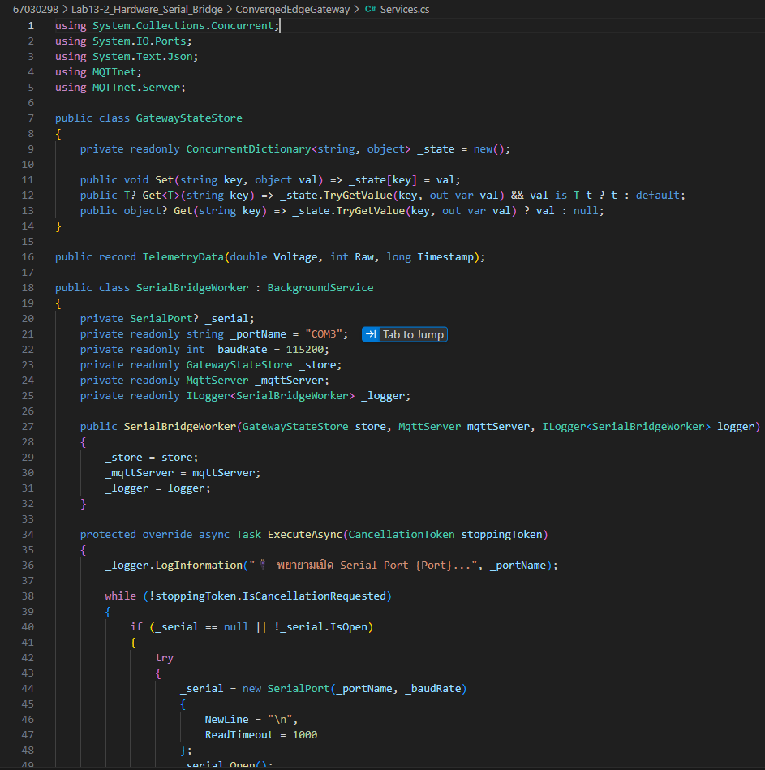
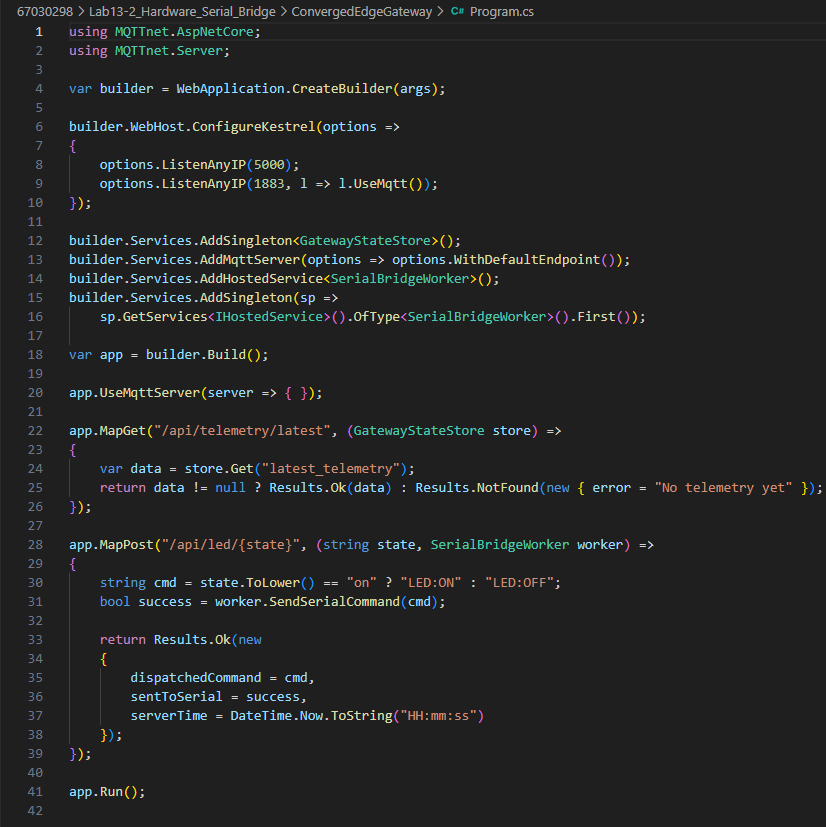
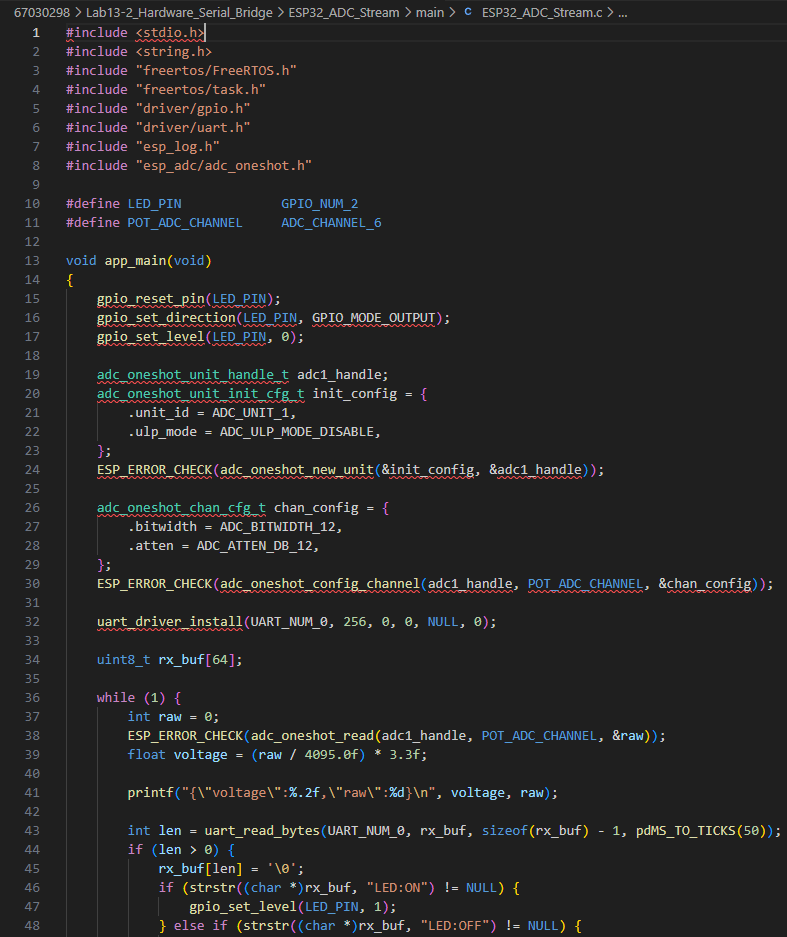
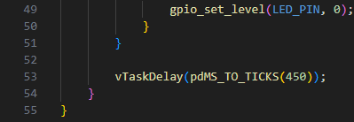
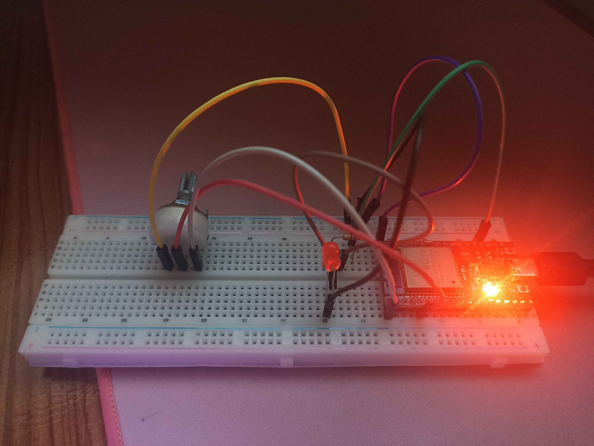
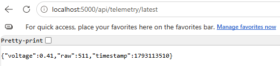
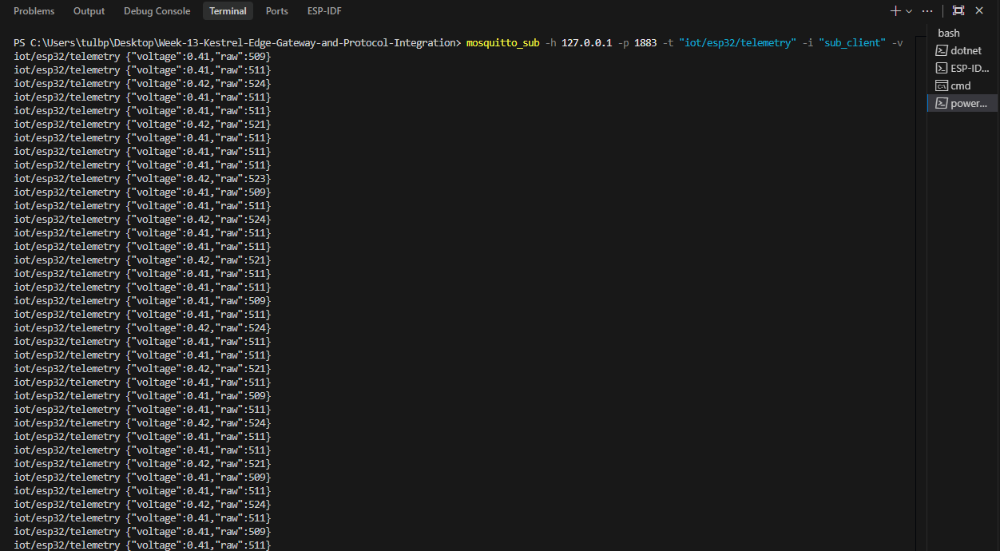
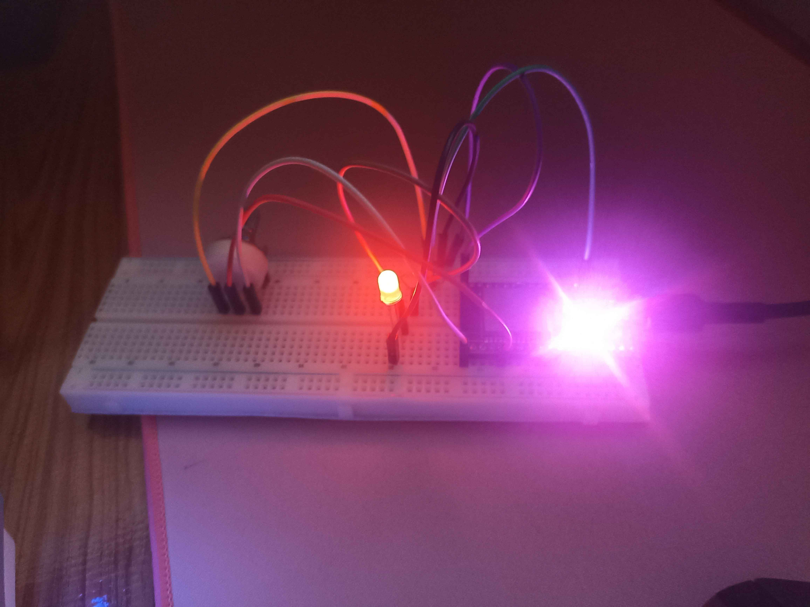
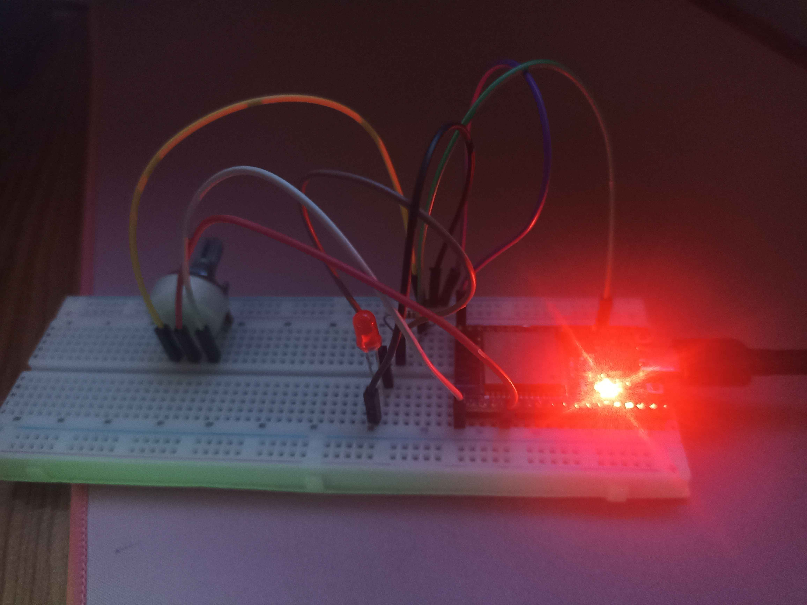

# รายงานผลการทดลองที่ 13.2
## การพัฒนา Hardware Serial Bridge ดักฟังข้อมูล USB-UART จาก ESP32 แปลงเข้าสู่ MQTT Topics และ REST API

---

## 1. บันทึกผลการทดลอง (Experimental Results)

### กิจกรรมที่ 13-2.1: การติดตั้งคอมโพเนนต์ Serial Port

#### 1. คำสั่งติดตั้งแพ็กเกจ `System.IO.Ports`
* **คำสั่งที่ใช้:**
```powershell
dotnet add package System.IO.Ports --version 8.0.0
```

* **บันทึก Log ผลการรันคำสั่ง:**
```text
PS C:\Users\tulbp\Desktop\Week-13-Kestrel-Edge-Gateway-and-Protocol-Integration\67030298\Lab13-2_Hardware_Serial_Bridge\ConvergedEdgeGateway> dotnet add package System.IO.Ports --version 8.0.0
  Determining projects to restore...
  Writing C:\Users\tulbp\AppData\Local\Temp\tmpyeo52y.tmp
info : X.509 certificate chain validation will use the default trust store selected by .NET for code signing.
info : X.509 certificate chain validation will use the default trust store selected by .NET for timestamping.
info : Adding PackageReference for package 'System.IO.Ports' into project 'C:\Users\tulbp\Desktop\Week-13-Kestrel-Edge-Gateway-and-Protocol-Integration\67030298\Lab13-2_Hardware_Serial_Bridge\ConvergedEdgeGateway\ConvergedEdgeGateway.csproj'.
info : Restoring packages for C:\Users\tulbp\Desktop\Week-13-Kestrel-Edge-Gateway-and-Protocol-Integration\67030298\Lab13-2_Hardware_Serial_Bridge\ConvergedEdgeGateway\ConvergedEdgeGateway.csproj...
info :   GET https://api.nuget.org/v3-flatcontainer/system.io.ports/index.json
info :   OK https://api.nuget.org/v3-flatcontainer/system.io.ports/index.json 740ms
info :   GET https://api.nuget.org/v3-flatcontainer/system.io.ports/8.0.0/system.io.ports.8.0.0.nupkg
info :   OK https://api.nuget.org/v3-flatcontainer/system.io.ports/8.0.0/system.io.ports.8.0.0.nupkg 809ms
info :   GET https://api.nuget.org/v3-flatcontainer/runtime.native.system.io.ports/index.json
info :   OK https://api.nuget.org/v3-flatcontainer/runtime.native.system.io.ports/index.json 801ms
info :   GET https://api.nuget.org/v3-flatcontainer/runtime.native.system.io.ports/8.0.0/runtime.native.system.io.ports.8.0.0.nupkg
info :   OK https://api.nuget.org/v3-flatcontainer/runtime.native.system.io.ports/8.0.0/runtime.native.system.io.ports.8.0.0.nupkg 754ms
info :   GET https://api.nuget.org/v3-flatcontainer/runtime.linux-arm.runtime.native.system.io.ports/index.json
info :   GET https://api.nuget.org/v3-flatcontainer/runtime.linux-arm64.runtime.native.system.io.ports/index.json
info :   GET https://api.nuget.org/v3-flatcontainer/runtime.linux-x64.runtime.native.system.io.ports/index.json
info :   GET https://api.nuget.org/v3-flatcontainer/runtime.osx-arm64.runtime.native.system.io.ports/index.json
info :   GET https://api.nuget.org/v3-flatcontainer/runtime.osx-x64.runtime.native.system.io.ports/index.json
info :   OK https://api.nuget.org/v3-flatcontainer/runtime.linux-x64.runtime.native.system.io.ports/index.json 683ms
info :   GET https://api.nuget.org/v3-flatcontainer/runtime.linux-x64.runtime.native.system.io.ports/8.0.0/runtime.linux-x64.runtime.native.system.io.ports.8.0.0.nupkg
info :   OK https://api.nuget.org/v3-flatcontainer/runtime.linux-arm.runtime.native.system.io.ports/index.json 712ms
info :   GET https://api.nuget.org/v3-flatcontainer/runtime.linux-arm.runtime.native.system.io.ports/8.0.0/runtime.linux-arm.runtime.native.system.io.ports.8.0.0.nupkg
info :   OK https://api.nuget.org/v3-flatcontainer/runtime.osx-arm64.runtime.native.system.io.ports/index.json 751ms
info :   GET https://api.nuget.org/v3-flatcontainer/runtime.osx-arm64.runtime.native.system.io.ports/8.0.0/runtime.osx-arm64.runtime.native.system.io.ports.8.0.0.nupkg
info :   OK https://api.nuget.org/v3-flatcontainer/runtime.osx-x64.runtime.native.system.io.ports/index.json 821ms
info :   GET https://api.nuget.org/v3-flatcontainer/runtime.osx-x64.runtime.native.system.io.ports/8.0.0/runtime.osx-x64.runtime.native.system.io.ports.8.0.0.nupkg
info :   OK https://api.nuget.org/v3-flatcontainer/runtime.linux-arm64.runtime.native.system.io.ports/index.json 888ms
info :   GET https://api.nuget.org/v3-flatcontainer/runtime.linux-arm64.runtime.native.system.io.ports/8.0.0/runtime.linux-arm64.runtime.native.system.io.ports.8.0.0.nupkg
info :   OK https://api.nuget.org/v3-flatcontainer/runtime.linux-arm.runtime.native.system.io.ports/8.0.0/runtime.linux-arm.runtime.native.system.io.ports.8.0.0.nupkg 285ms
info :   OK https://api.nuget.org/v3-flatcontainer/runtime.osx-x64.runtime.native.system.io.ports/8.0.0/runtime.osx-x64.runtime.native.system.io.ports.8.0.0.nupkg 271ms
info :   OK https://api.nuget.org/v3-flatcontainer/runtime.linux-x64.runtime.native.system.io.ports/8.0.0/runtime.linux-x64.runtime.native.system.io.ports.8.0.0.nupkg 758ms
info :   OK https://api.nuget.org/v3-flatcontainer/runtime.osx-arm64.runtime.native.system.io.ports/8.0.0/runtime.osx-arm64.runtime.native.system.io.ports.8.0.0.nupkg 764ms
info :   OK https://api.nuget.org/v3-flatcontainer/runtime.linux-arm64.runtime.native.system.io.ports/8.0.0/runtime.linux-arm64.runtime.native.system.io.ports.8.0.0.nupkg 738ms
info : Installed runtime.native.System.IO.Ports 8.0.0 from https://api.nuget.org/v3/index.json to C:\Users\tulbp\.nuget\packages\runtime.native.system.io.ports\8.0.0 with content hash Ee7Sz5llLpTgyKIWzKI/GeuRSbFkOABgJRY00SqTY0OkTYtkB+9l5rFZfE7fxPA3c22RfytCBYkUdAkcmwMjQg==.
info : Installed runtime.osx-x64.runtime.native.System.IO.Ports 8.0.0 from https://api.nuget.org/v3/index.json to C:\Users\tulbp\.nuget\packages\runtime.osx-x64.runtime.native.system.io.ports\8.0.0 with content hash IcfB4jKtM9pkzP9OpYelEcUX1MiDt0IJPBh3XYYdEISFF+6Mc+T8WWi0dr9wVh1gtcdVjubVEIBgB8BHESlGfQ==.
info : Installed runtime.linux-arm.runtime.native.System.IO.Ports 8.0.0 from https://api.nuget.org/v3/index.json to C:\Users\tulbp\.nuget\packages\runtime.linux-arm.runtime.native.system.io.ports\8.0.0 with content hash gK720fg6HemDg8sXcfy+xCMZ9+hF78Gc7BmREbmkS4noqlu1BAr9qZtuWGhLzFjBfgecmdtl4+SYVwJ1VneZBQ==.
info : Installed runtime.linux-x64.runtime.native.System.IO.Ports 8.0.0 from https://api.nuget.org/v3/index.json to C:\Users\tulbp\.nuget\packages\runtime.linux-x64.runtime.native.system.io.ports\8.0.0 with content hash Wnw5vhA4mgGbIFoo6l9Fk3iEcwRSq49a1aKwJgXUCUtEQLCSUDjTGSxqy/oMUuOyyn7uLHsH8KgZzQ1y3lReiQ==.
info : Installed runtime.osx-arm64.runtime.native.System.IO.Ports 8.0.0 from https://api.nuget.org/v3/index.json to C:\Users\tulbp\.nuget\packages\runtime.osx-arm64.runtime.native.system.io.ports\8.0.0 with content hash rbUBLAaFW9oVkbsb0+XSrAo2QdhBeAyzLl5KQ6Oci9L/u626uXGKInsVJG6B9Z5EO8bmplC8tsMiaHK8wOBZ+w==.
info : Installed runtime.linux-arm64.runtime.native.System.IO.Ports 8.0.0 from https://api.nuget.org/v3/index.json to C:\Users\tulbp\.nuget\packages\runtime.linux-arm64.runtime.native.system.io.ports\8.0.0 with content hash KYG6/3ojhEWbb3FwQAKgGWPHrY+HKUXXdVjJlrtyCLn3EMcNTaNcPadb2c0ndQzixZSmAxZKopXJr0nLwhOrpQ==.
info : Installed System.IO.Ports 8.0.0 from https://api.nuget.org/v3/index.json to C:\Users\tulbp\.nuget\packages\system.io.ports\8.0.0 with content hash MaiPbx2/QXZc62gm/DrajRrGPG1lU4m08GWMoWiymPYM+ba4kfACp2PbiYpqJ4QiFGhHD00zX3RoVDTucjWe9g==.
info :   CACHE https://api.nuget.org/v3/vulnerabilities/index.json
info :   CACHE https://api.nuget.org/v3-vulnerabilities/2026.10.26.23.37.37/vulnerability.base.json
info :   CACHE https://api.nuget.org/v3-vulnerabilities/2026.10.26.23.37.37/2026.10.27.11.37.40/vulnerability.update.json
info : Package 'System.IO.Ports' is compatible with all the specified frameworks in project 'C:\Users\tulbp\Desktop\Week-13-Kestrel-Edge-Gateway-and-Protocol-Integration\67030298\Lab13-2_Hardware_Serial_Bridge\ConvergedEdgeGateway\ConvergedEdgeGateway.csproj'.
info : PackageReference for package 'System.IO.Ports' version '8.0.0' added to file 'C:\Users\tulbp\Desktop\Week-13-Kestrel-Edge-Gateway-and-Protocol-Integration\67030298\Lab13-2_Hardware_Serial_Bridge\ConvergedEdgeGateway\ConvergedEdgeGateway.csproj'.
info : Writing assets file to disk. Path: C:\Users\tulbp\Desktop\Week-13-Kestrel-Edge-Gateway-and-Protocol-Integration\67030298\Lab13-2_Hardware_Serial_Bridge\ConvergedEdgeGateway\obj\project.assets.json
log  : Restored C:\Users\tulbp\Desktop\Week-13-Kestrel-Edge-Gateway-and-Protocol-Integration\67030298\Lab13-2_Hardware_Serial_Bridge\ConvergedEdgeGateway\ConvergedEdgeGateway.csproj (in 7.85 sec).
```

---

### กิจกรรมที่ 13-2.2: การสร้างคลาสเก็บสถานะและ Worker อ่าน Serial (`Services.cs`)

#### 1. การสร้าง `GatewayStateStore` และ `SerialBridgeWorker`
* **พอร์ต COM ที่เชื่อมต่อกับบอร์ด ESP32:** `COM3`
* **ภาพหน้าจอซอร์สโค้ด `Services.cs` ใน VS Code:**



---

### กิจกรรมที่ 13-2.3: ปรับแต่ง `Program.cs` ให้เปิดใช้ REST APIs

#### 1. การเปิดจุดเชื่อมต่อ `/api/telemetry/latest` และ `/api/led/{state}`
* **ภาพหน้าจอซอร์สโค้ด `Program.cs` ใน VS Code:**



---

### กิจกรรมที่ 13-2.4: โค้ดฝั่ง ESP32 สำหรับสื่อสารสองทางผ่าน Serial (`main.c`)

#### 1. การตั้งค่า ADC1_CH6 (GPIO34) และ UART Driver บน ESP32
* **ภาพหน้าจอซอร์สโค้ด `main.c` (ESP-IDF) ใน VS Code:**





* **ภาพการต่อวงจรฮาร์ดแวร์จริง (Potentiometer + LED + ESP32):**



---

### กิจกรรมที่ 13-2.5: การทดสอบสะพานเชื่อมต่อแบบหลายมิติ

#### 1. การรัน Kestrel Gateway พร้อมเปิดการเชื่อมต่อ Serial Port
* **คำสั่งที่ใช้:**
```powershell
dotnet run
```

* **บันทึก Log การเชื่อมต่อพอร์ต Serial สำเร็จ:**
```text
PS C:\Users\tulbp\Desktop\Week-13-Kestrel-Edge-Gateway-and-Protocol-Integration\67030298\Lab13-2_Hardware_Serial_Bridge\ConvergedEdgeGateway> dotnet run
Building...
info: SerialBridgeWorker[0]
      🔌 พยายามเปิด Serial Port COM3...
warn: Microsoft.AspNetCore.Server.Kestrel[0]
      Overriding address(es) 'http://localhost:5213'. Binding to endpoints defined via IConfiguration and/or UseKestrel() instead.
info: Microsoft.Hosting.Lifetime[14]
      Now listening on: http://[::]:5000
info: Microsoft.Hosting.Lifetime[14]
      Now listening on: http://[::]:1883
info: Microsoft.Hosting.Lifetime[0]
      Application started. Press Ctrl+C to shut down.
info: Microsoft.Hosting.Lifetime[0]
      Hosting environment: Development
info: Microsoft.Hosting.Lifetime[0]
      Content root path: C:\Users\tulbp\Desktop\Week-13-Kestrel-Edge-Gateway-and-Protocol-Integration\67030298\Lab13-2_Hardware_Serial_Bridge\ConvergedEdgeGateway
info: SerialBridgeWorker[0]
      ✅ เชื่อมต่อฮาร์ดแวร์ Serial Port COM3 สำเร็จ!
```

---

#### 2. การทดสอบเรียกดูค่า Telemetry ผ่าน REST API
* **คำสั่งที่ใช้:**
```powershell
curl http://localhost:5000/api/telemetry/latest
```

* **บันทึกผลลัพธ์ JSON ที่ได้รับจาก REST API:**
```json
C:\Users\tulbp\Desktop\Week-13-Kestrel-Edge-Gateway-and-Protocol-Integration>curl http://localhost:5000/api/telemetry/latest
{"voltage":0.41,"raw":511,"timestamp":1793113457}
```

* **ภาพหน้าจอการเรียก REST API ผ่าน cURL / เบราว์เซอร์:**



---

#### 3. การทดสอบรับข้อมูล Telemetry ผ่าน MQTT Subscription
* **คำสั่งที่ใช้:**
```powershell
mosquitto_sub -h 127.0.0.1 -p 1883 -t "iot/esp32/telemetry" -i "sub_client" -v
```

* **บันทึก Log ข้อความที่ได้รับผ่าน MQTT:**
```text
PS C:\Users\tulbp\Desktop\Week-13-Kestrel-Edge-Gateway-and-Protocol-Integration> mosquitto_sub -h 127.0.0.1 -p 1883 -t "iot/esp32/telemetry" -i "sub_client" -v
iot/esp32/telemetry {"voltage":0.41,"raw":509}
iot/esp32/telemetry {"voltage":0.41,"raw":511}
iot/esp32/telemetry {"voltage":0.42,"raw":524}
iot/esp32/telemetry {"voltage":0.41,"raw":511}
iot/esp32/telemetry {"voltage":0.41,"raw":511}
iot/esp32/telemetry {"voltage":0.42,"raw":521}
iot/esp32/telemetry {"voltage":0.41,"raw":511}
iot/esp32/telemetry {"voltage":0.41,"raw":511}
iot/esp32/telemetry {"voltage":0.41,"raw":511}
iot/esp32/telemetry {"voltage":0.42,"raw":523}
iot/esp32/telemetry {"voltage":0.42,"raw":524}
iot/esp32/telemetry {"voltage":0.41,"raw":505}
iot/esp32/telemetry {"voltage":0.43,"raw":530}
iot/esp32/telemetry {"voltage":0.41,"raw":511}
iot/esp32/telemetry {"voltage":0.41,"raw":511}
iot/esp32/telemetry {"voltage":0.41,"raw":511}
iot/esp32/telemetry {"voltage":0.41,"raw":511}
iot/esp32/telemetry {"voltage":0.41,"raw":511}
iot/esp32/telemetry {"voltage":0.41,"raw":511}
iot/esp32/telemetry {"voltage":0.41,"raw":511}
iot/esp32/telemetry {"voltage":0.41,"raw":511}
iot/esp32/telemetry {"voltage":0.42,"raw":523}
iot/esp32/telemetry {"voltage":0.41,"raw":511}
```

* **ภาพหน้าจอ Terminal ขณะรับข้อมูล Telemetry ผ่าน MQTT:**



---

#### 4. การทดสอบสั่งควบคุมหลอดไฟผ่าน REST API เข้าสู่สาย Serial
* **คำสั่งเปิดไฟ (LED:ON):**
```powershell
curl -X POST http://localhost:5000/api/led/on
```

* **ผลลัพธ์การตอบกลับและสถานะหลอดไฟบนบอร์ดจริง:**
```text
C:\Users\tulbp\Desktop\Week-13-Kestrel-Edge-Gateway-and-Protocol-Integration>curl -X POST http://localhost:5000/api/led/on
{"dispatchedCommand":"LED:ON","sentToSerial":true,"serverTime":"22:07:54"}
```

* **คำสั่งปิดไฟ (LED:OFF):**
```powershell
curl -X POST http://localhost:5000/api/led/off
```

* **ผลลัพธ์การตอบกลับและสถานะหลอดไฟบนบอร์ดจริง:**
```text
C:\Users\tulbp\Desktop\Week-13-Kestrel-Edge-Gateway-and-Protocol-Integration>curl -X POST http://localhost:5000/api/led/off
{"dispatchedCommand":"LED:OFF","sentToSerial":true,"serverTime":"22:08:26"}
```

* **ภาพหน้าจอหลอดไฟ LED บนบอร์ด ESP32 ติดและดับตามคำสั่ง REST:**

- curl -X POST http://localhost:5000/api/led/on



- curl -X POST http://localhost:5000/api/led/off



---

#### 5. ตารางบันทึกผลการทดสอบการแปลงโปรโตคอล (Bridge Verification Table)

| กรณีทดสอบ | ทิศทางการส่งข้อมูล | โปรโตคอลต้นทาง | โปรโตคอลปลายทาง | ผลการทำงานจริง | สถานะ (ผ่าน / ไม่ผ่าน) |
| :--- | :--- | :--- | :--- | :--- | :---: |
| 1. ADC Stream to REST | ขาเข้า (Inbound) | Hardware UART Serial | HTTP REST (`/api/telemetry/latest`) | ได้รับ Response ข้อมูล JSON เซนเซอร์ล่าสุด (`voltage: 0.41`, `raw: 511`) จาก State Store สำเร็จ | ผ่าน |
| 2. ADC Stream to MQTT | ขาเข้า (Inbound) | Hardware UART Serial | MQTT Topic (`iot/esp32/telemetry`) | ไคลเอนต์ `mosquitto_sub` ได้รับข้อมูล Telemetry สตรีมมิ่งผ่าน MQTT แบบ Real-time ต่อเนื่อง | ผ่าน |
| 3. LED Control via REST | ขาออก (Outbound) | HTTP POST (`/api/led/on`) | Hardware UART Serial (`LED:ON`) | ได้รับ Response `sentToSerial: true` ส่งคำสั่ง `LED:ON` ไปทาง Serial และไฟ LED บนบอร์ด ESP32 ติดสว่าง | ผ่าน |
| 4. LED Control via REST | ขาออก (Outbound) | HTTP POST (`/api/led/off`)| Hardware UART Serial (`LED:OFF`)| ได้รับ Response `sentToSerial: true` ส่งคำสั่ง `LED:OFF` ไปทาง Serial และไฟ LED บนบอร์ด ESP32 ดับลง | ผ่าน |

---

## 2. สรุปผลการทดลอง (Conclusion)

---

## 3. คำถามท้ายการทดลอง (Review Questions)

### ข้อ 1: สถาปัตยกรรมแบบ Serial-to-MQTT Bridge นี้ช่วยให้อุปกรณ์รุ่นเก่า (Legacy Hardware) ที่ไม่มี Wi-Fi สามารถเข้าร่วมระบบนิเวศ IoT สมัยใหม่ได้อย่างไร?
> 

---

### ข้อ 2: เพราะเหตุใดเราจึงต้องใช้ `BackgroundService` ในการอ่านข้อมูล Serial แทนที่จะเปิดพอร์ตอ่านตรงๆ ภายในฟังก์ชันของ REST API?
> 

