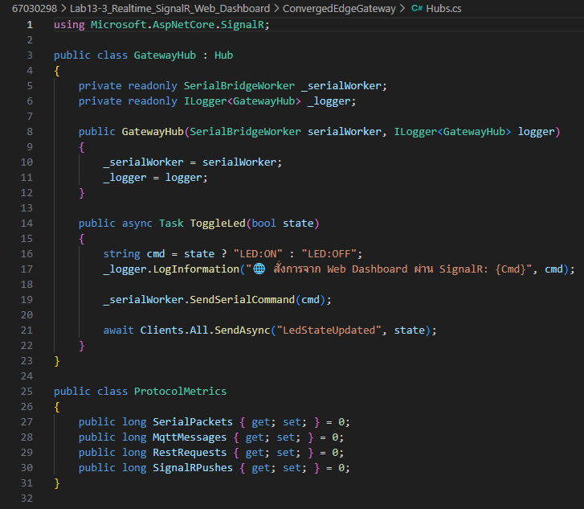
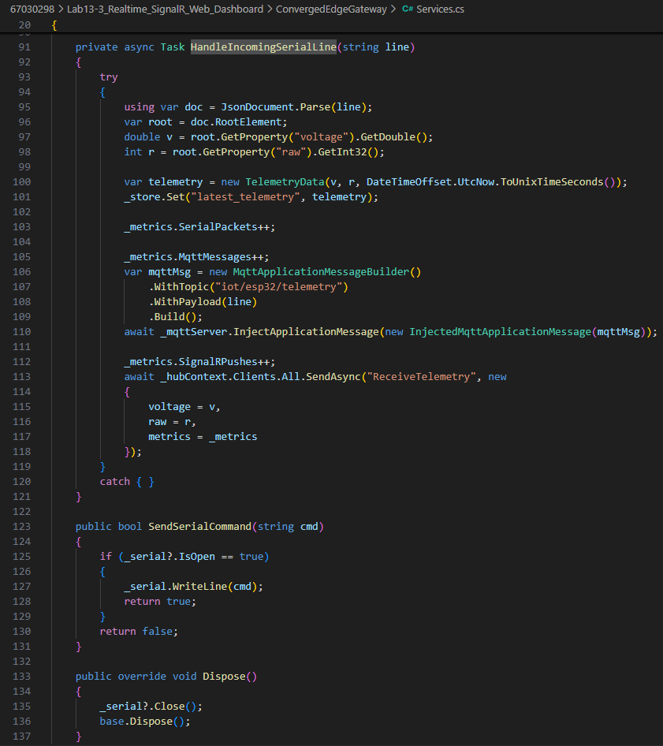
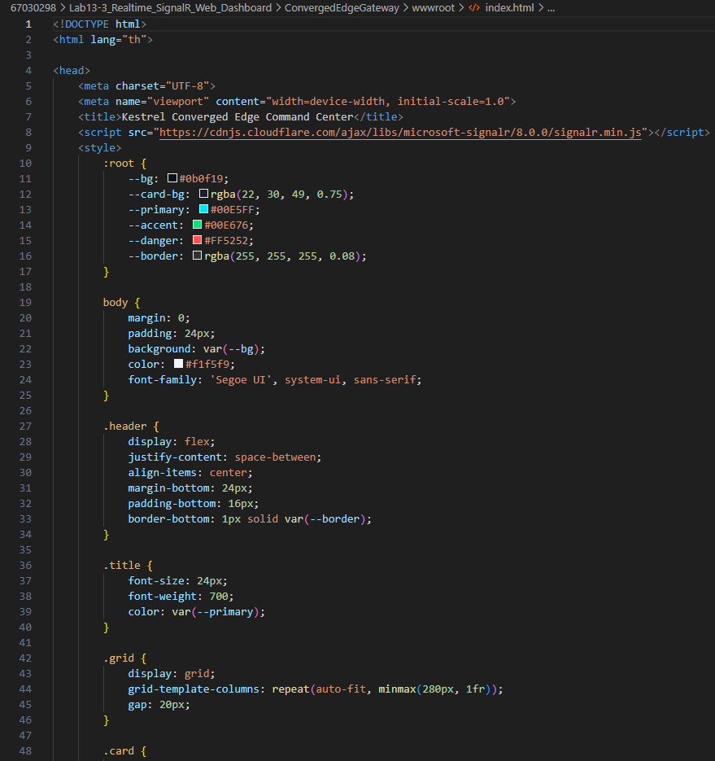
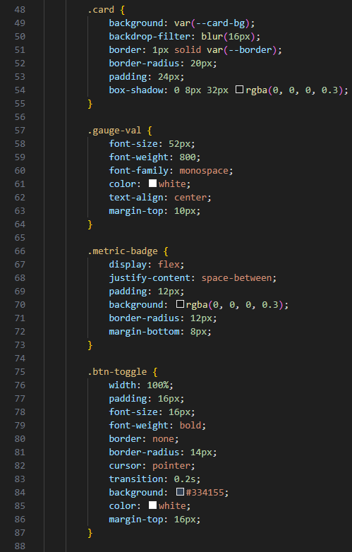
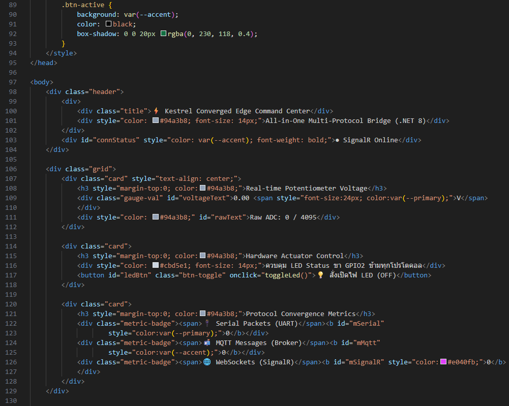
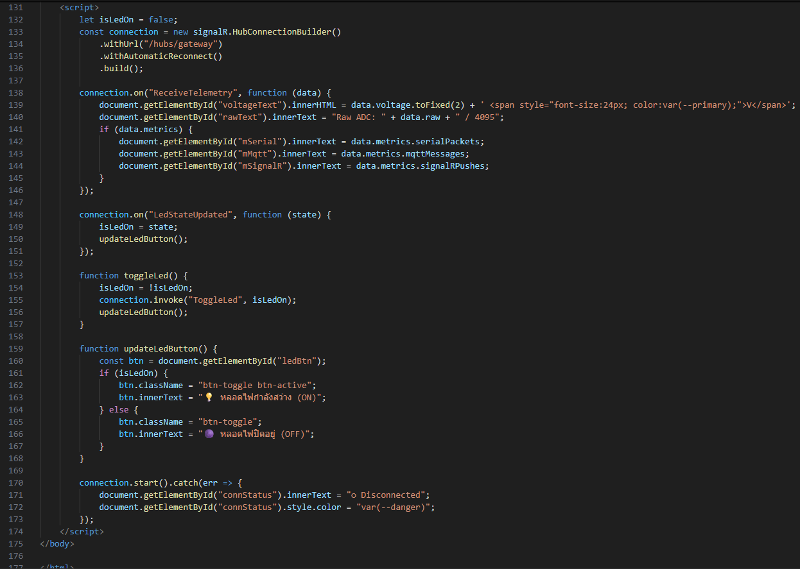
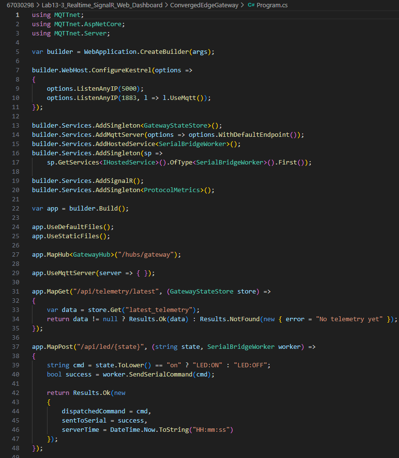
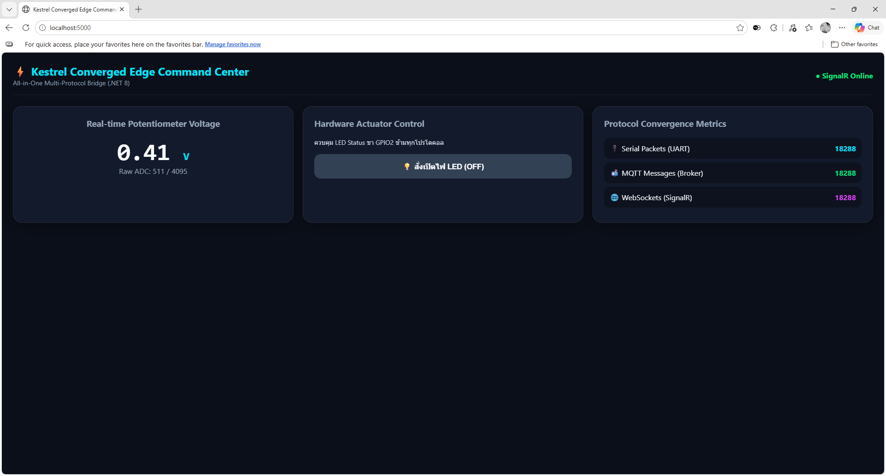
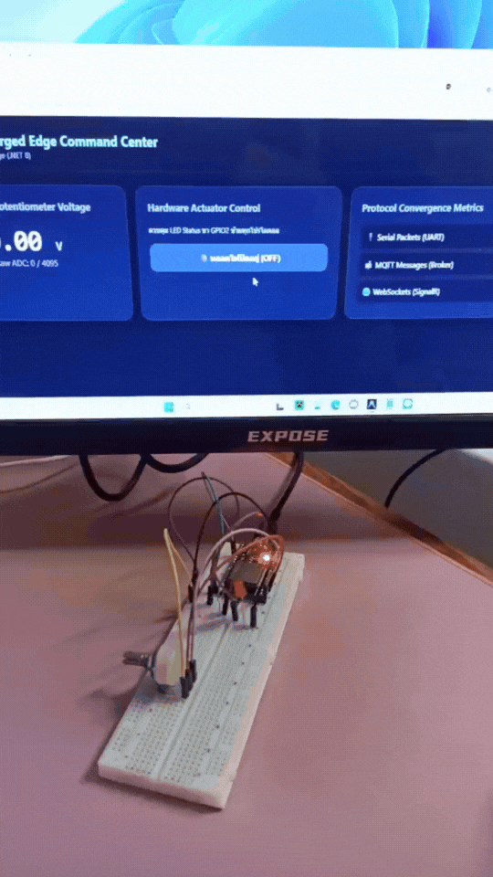
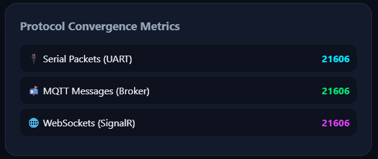

# รายงานผลการทดลองที่ 13.3
## การสร้าง SignalR Realtime Hub และเว็บแดชบอร์ดศูนย์บัญชาการ (Converged Web Dashboard) สไตล์ Glassmorphism

---

## 1. บันทึกผลการทดลอง (Experimental Results)

### กิจกรรมที่ 13-3.1: การสร้างคลาส SignalR Hub และตัวนับสถิติ (`Hubs.cs`)

#### 1. การสร้าง `GatewayHub` และ `ProtocolMetrics`
* **ภาพหน้าจอซอร์สโค้ด `Hubs.cs` ใน VS Code:**



---

### กิจกรรมที่ 13-3.2: ปรับปรุง Worker ให้ผลักข้อมูลเข้าสู่ Hub (`Services.cs`)

#### 1. การส่งผ่านข้อมูล Telemetry เข้าสู่ SignalR Client ผ่าน `IHubContext`
* **ภาพหน้าจอโค้ดฟังก์ชัน `HandleIncomingSerialLine` ใน `Services.cs`:**



---

### กิจกรรมที่ 13-3.3: การสร้างหน้าเว็บศูนย์บัญชาการ (`wwwroot/index.html`)

#### 1. โครงสร้าง Glassmorphism และ JavaScript SignalR Client
* **ภาพหน้าจอโค้ด `index.html` ใน VS Code:**









---

### กิจกรรมที่ 13-3.4: ผูก Static Files และ SignalR ใน `Program.cs`

#### 1. การกำหนดค่า Middleware และ Hub Mapping
* **ภาพหน้าจอโค้ด `Program.cs` ที่ลงทะเบียน SignalR และ Static Files:**



---

### กิจกรรมที่ 13-3.5: การทดสอบหน้าเว็บแดชบอร์ดแบบเรียลไทม์

#### 1. การเชื่อมต่อ SignalR และสถานะการเชื่อมต่อบนหน้าเว็บ
* **สถานะการเชื่อมต่อเริ่มต้น (Connection Status):** `● SignalR Online`
* **ภาพหน้าจอหน้าเว็บแดชบอร์ดเมื่อเชื่อมต่อกับ Kestrel สำเร็จ:**



---

#### 2. การทดสอบหมุน Potentiometer เพื่อเปลี่ยนค่าแรงดันแบบสด

* **ภาพหน้าจอหน้าเว็บแดชบอร์ดขณะตัวเลขแรงดันเปลี่ยนแปลงแบบเรียลไทม์:**


---

#### 3. การทดสอบคลิกปุ่มควบคุมหลอดไฟบนหน้าเว็บ (Toggle LED)

* **การตอบสนองของหลอดไฟ LED บนบอร์ด ESP32 จริง:**
```text
info: GatewayHub[0]
      🌐 สั่งการจาก Web Dashboard ผ่าน SignalR: LED:ON
info: GatewayHub[0]
      🌐 สั่งการจาก Web Dashboard ผ่าน SignalR: LED:OFF
info: GatewayHub[0]
      🌐 สั่งการจาก Web Dashboard ผ่าน SignalR: LED:ON
info: GatewayHub[0]
      🌐 สั่งการจาก Web Dashboard ผ่าน SignalR: LED:OFF
info: GatewayHub[0]
      🌐 สั่งการจาก Web Dashboard ผ่าน SignalR: LED:ON
info: GatewayHub[0]
      🌐 สั่งการจาก Web Dashboard ผ่าน SignalR: LED:OFF
```

* **ภาพหน้าจอแดชบอร์ดขณะหลอดไฟติด (OFF) และ (ON) พร้อมภาพหลอดไฟบนบอร์ด:**



---

#### 4. การตรวจสอบตัวนับทราฟฟิกโปรโตคอล (Protocol Convergence Metrics)
* **บันทึกค่าตัวนับทราฟฟิกแต่ละโปรโตคอลหลังทดสอบรัน 1 นาที:**

| โปรโตคอล / ชนิดทราฟฟิก | คอมโพเนนต์ตัวนับ | ปริมาณแพ็กเก็ต / ข้อความที่นับได้ | อัตราเฉลี่ยโดยประมาณ |
| :--- | :--- | :---: | :---: |
| 🔌 Hardware Serial (UART) | `SerialPackets` | 21,606 | ประมาณ 2 แพ็กเก็ตต่อวินาที |
| 📬 Embedded MQTT (Broker) | `MqttMessages` | 21,606 | ประมาณ 2 ข้อความต่อวินาที |
| 🌐 WebSockets (SignalR) | `SignalRPushes` | 21,606 | ประมาณ 2 ข้อความต่อวินาที |

* **ภาพหน้าจอการ์ด Protocol Convergence Metrics บนหน้าเว็บ:**



---

## 2. สรุปผลการทดลอง (Conclusion)

การทดลองนี้เป็นการนำ SignalR มาทำงานร่วมกับ Kestrel เพื่อสร้างเว็บแดชบอร์ดแสดงผลและควบคุมระบบแบบเรียลไทม์ ผลการทดลองพบว่าเมื่อ ESP32 ส่งข้อมูลค่าแรงดันผ่านพอร์ต Serial เข้ามา ตัว Gateway สามารถผลักข้อมูลขึ้นหน้าเว็บผ่าน WebSockets ได้ทันทีโดยผู้ใช้งานไม่ต้องกดรีเฟรชหน้าจอ และเมื่อหมุนตัวต้านทานปรับค่าได้ ตัวเลขแรงดันบนหน้าเว็บจะขยับตามแบบทันทีทันใด

นอกจากนี้ยังสามารถส่งคำสั่งสลับการเปิดปิดหลอดไฟ LED จากหน้าเว็บย้อนกลับไปหาฮาร์ดแวร์ผ่านคำสั่ง SignalR ได้อย่างรวดเร็ว โดยมีตัวนับสถิติช่วยตรวจสอบทราฟฟิกของทั้ง Serial, MQTT และ SignalR ที่เพิ่มขึ้นสอดคล้องกัน แสดงให้เห็นถึงประสิทธิภาพของ Kestrel ในการรวมศูนย์ข้อมูลและให้บริการเว็บแดชบอร์ดความเร็วสูงได้ในตัวเดียว

---

## 3. คำถามท้ายการทดลอง (Review Questions)

### ข้อ 1: เพราะเหตุใด SignalR จึงให้ประสบการณ์การใช้งาน (UX) บนหน้าเว็บที่ดีกว่าการใช้คำสั่ง JavaScript `setInterval()` เพื่อทำ HTTP GET Polling ซ้ำๆ ทุก 500 ms?
> การทำ Polling ต้องสร้างการเชื่อมต่อ HTTP และส่ง Header ใหม่ทุกครั้ง ทำให้สิ้นเปลืองทรัพยากรและเกิดความหน่วง ข้อมูลบนหน้าจออาจกระตุกหรือไม่ตรงจังหวะ แต่ SignalR ใช้ WebSockets เชื่อมต่อค้างไว้เพียงเส้นเดียว เมื่อมีข้อมูลใหม่เซิร์ฟเวอร์จะยิงผลักมาที่หน้าเว็บทันที การแสดงผลจึงลื่นไหลแบบเรียลไทม์และไม่กินแบนด์วิดท์

---

### ข้อ 2: การคำนวณและแสดงผล Protocol Convergence Metrics ส่งผลดีต่อการตรวจสอบสุขภาพของระบบเครือข่ายไอโอทีในระดับโรงงานอย่างไร?
> ช่วยให้มองเห็นการไหลของข้อมูลในแต่ละโปรโตคอลได้พร้อมกันแบบเรียลไทม์ หากพบว่าตัวเลขตัวนับของโปรโตคอลใดหยุดวิ่งหรือไม่สอดคล้องกัน เช่น ข้อมูลเข้าทาง Serial ปกติแต่ไม่ออกไปที่ MQTT หรือ SignalR ผู้ดูแลระบบจะรู้ได้ทันทีว่าเกิดปัญหาหรือคอขวดที่จุดใด ทำให้แก้ไขระบบได้อย่างรวดเร็ว

