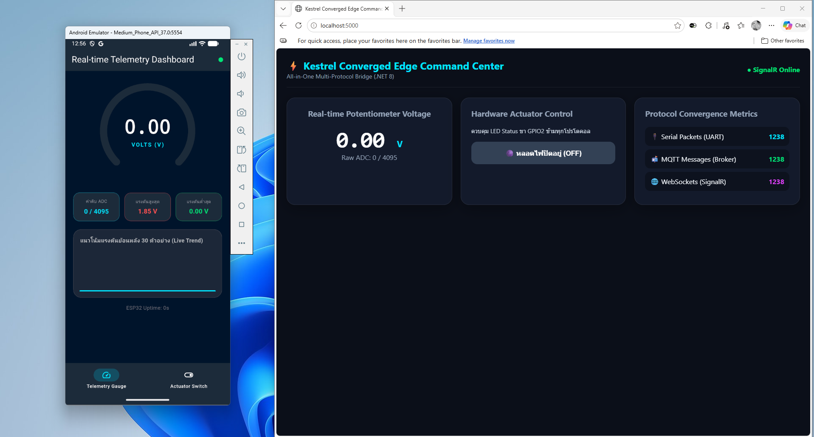
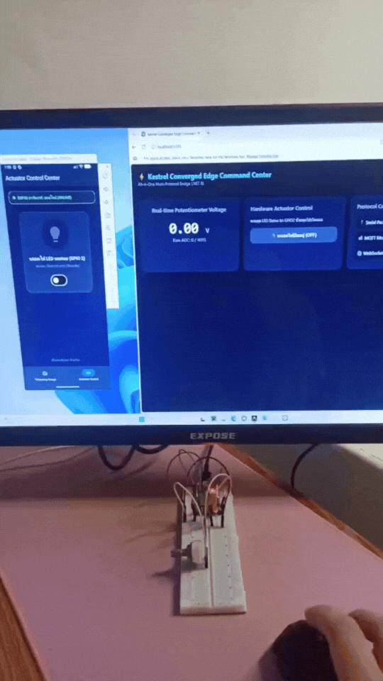
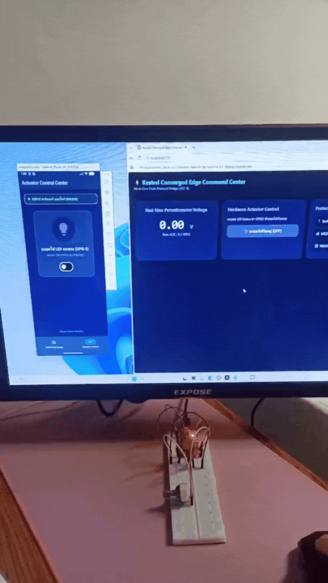

# รายงานผลการทดลองที่ 13.4 (The Grand Finale)
## การทดสอบผสานรวมระบบไอโอทีแบบครบวงจร (ESP32 + Kestrel Gateway + Flutter App + Web Command Center)

---

## 1. บันทึกผลการทดลอง (Experimental Results)

### กิจกรรมที่ 13-4.1: การเตรียมความพร้อมของทุกส่วนประกอบในระบบนิเวศ

#### 1. การเชื่อมต่อและสถานะของแต่ละโหนดในระบบ
* **ฮาร์ดแวร์ ESP32 (Sensor/Actuator Node):** `COM3`
* **Kestrel .NET 8 Edge Gateway:** `รันพอร์ต 5000 และ 1883`
* **เว็บเบราว์เซอร์ Command Center:** `เปิด http://localhost:5000 และ ● SignalR Online`
* **โมบายล์แอปพลิเคชัน Flutter:** `Android Emulator เชื่อมต่อ Broker IP 10.0.2.2 พอร์ต 1883`

* **ภาพหน้าจอภาพรวมการจัดเตรียมระบบทั้งหมดพร้อมทำงานร่วมกัน:**



---

### กิจกรรมที่ 13-4.2: การทดสอบ 4 มหาการทดลอง (The Grand Verification Matrix)

#### 1. การทดสอบที่ 1: Universal Telemetry Sync (หมุน Potentiometer ปรับค่าสด)
* **พฤติกรรมของระบบ:**
  1. ค่าแรงดันวิ่งผ่านสาย Serial (USB-UART) เข้าสู่ Kestrel Gateway
  2. ตัวเลขแรงดันบนหน้าเว็บแดชบอร์ดวิ่งสดแบบเรียลไทม์ผ่าน SignalR
  3. เข็ม Radial Gauge และค่าบน Flutter Mobile App ขยับตามทันทีพร้อมกันผ่าน MQTT
* **ภาพหน้าจอการแสดงผลค่าแรงดันพร้อมกันทั้งบนหน้าเว็บและแอปมือถือ Flutter:**

---

#### 2. การทดสอบที่ 2: Mobile-to-Web Actuation (สั่งงานจาก Flutter สู่บอร์ดและหน้าเว็บ)
* **การกระทำ:** แตะสวิตช์เปิดไฟบนแอปพลิเคชัน Flutter (ส่งคำสั่งผ่าน MQTT)
* **ผลลัพธ์ที่เกิดขึ้น:**
  - หลอดไฟ LED บนบอร์ด ESP32 จริง: `ไฟ LED สว่างขึ้น`
  - ปุ่มสวิตช์บนหน้าเว็บ Command Center: `เปลี่ยนสถานะเป็น ON สีเขียวอัตโนมัติ`
* **ภาพหน้าจอขณะสั่งเปิดไฟจากแอปมือถือ แล้วหลอดไฟติดพร้อมหน้าเว็บอัปเดต:**



---

#### 3. การทดสอบที่ 3: Web-to-Mobile Actuation (สั่งงานจากหน้าเว็บสู่บอร์ดและมือถือ)
* **การกระทำ:** คลิกปุ่มสลับปิดไฟบนหน้าเว็บ Command Center (ส่งคำสั่งผ่าน SignalR)
* **ผลลัพธ์ที่เกิดขึ้น:**
  - หลอดไฟ LED บนบอร์ด ESP32 จริง: `หลอดไฟดับลงทันที`
  - สวิตช์บนแอปมือถือ Flutter: `สถานะ: ปิดการทำงาน (Standby)`
* **ภาพหน้าจอขณะสั่งปิดไฟจากหน้าเว็บ แล้วหลอดไฟดับพร้อมแอปมือถืออัปเดต:**



---

#### 4. การทดสอบที่ 4: Third-Party REST Override (การสั่งงานจากภายนอกผ่าน HTTP API)
* **คำสั่งที่ใช้ยิง API:**
```powershell
curl -X POST http://localhost:5000/api/led/on
```

* **บันทึกผลการตอบกลับจากเซิร์ฟเวอร์:**
```json
C:\Users\tulbp\Desktop\Week-13-Kestrel-Edge-Gateway-and-Protocol-Integration>curl -X POST http://localhost:5000/api/led/on
{"dispatchedCommand":"LED:ON","sentToSerial":true,"serverTime":"01:18:35"}
```

* **ผลกระทบข้ามทั้งระบบ:**
  - หลอดไฟ LED จริงบนบอร์ด ESP32: `สว่างขึ้น`
  - สวิตช์บนหน้าเว็บ Command Center: `หลอดไฟกำลังสว่าง (ON)`
  - สวิตช์บนแอปมือถือ Flutter: `สถานะ: เปิดสว่าง (Active)`
* **ภาพหน้าจอแสดงการยิงคำสั่งผ่าน cURL พร้อมทั้งหน้าเว็บ มือถือ และหลอดไฟเปลี่ยนสถานะพร้อมกัน:**


---

#### 5. ตารางสรุปผล 4 มหาการทดลอง (The Grand Verification Matrix Table)

| มิติการทดสอบ | การกระทำเชิงปฏิบัติการ | ปรากฏการณ์ที่เกิดขึ้นจริงในระบบ | ผลการทดลอง (ผ่าน / ไม่ผ่าน) | หมายเหตุ / ข้อสังเกต |
| :--- | :--- | :--- | :---: | :--- |
| **1. Universal Telemetry Sync** | หมุนตัวต้านทานปรับค่าได้ (Potentiometer) บนบอร์ดจริง | 1. ค่าแรงดันวิ่งผ่านสาย Serial เข้า Kestrel<br/>2. ตัวเลขบนเว็บแดชบอร์ดวิ่งสดทันที<br/>3. เข็ม Radial Gauge บน Flutter หมุนตามทันทีพร้อมกัน | ผ่าน | ข้อมูลแรงดันจากเซนเซอร์ส่งผ่าน Serial ไปกระจายต่อให้ SignalR และ MQTT ได้พร้อมกันแบบเรียลไทม์โดยไม่มีความหน่วงสะสม |
| **2. Mobile-to-Web Actuation** | แตะสวิตช์เปิดไฟบนแอป Flutter (ส่งผ่าน MQTT) | 1. หลอดไฟ LED จริงบนบอร์ด ESP32 ติดสว่างขึ้น<br/>2. ปุ่มสวิตช์บนหน้าเว็บเปลี่ยนเป็นสีเขียว "ON" อัตโนมัติ | ผ่าน | คำสั่ง MQTT ถูก Gateway แปลงเป็นคำสั่ง Serial ส่งไปบอร์ดได้สำเร็จและย้อนกลับมาอัปเดตหน้าเว็บทันที |
| **3. Web-to-Mobile Actuation** | คลิกปุ่มปิดไฟบนหน้าเว็บ (ส่งผ่าน SignalR) | 1. หลอดไฟ LED จริงบนบอร์ด ESP32 ดับลงทันที<br/>2. สวิตช์บนแอปมือถือ Flutter สลับเป็น "OFF" ทันที | ผ่าน | หน้าเว็บส่งคำสั่งผ่าน SignalR Hub แล้ว Gateway สั่งบอร์ดพร้อมส่งข้อความยืนยันกลับไปยังแอป Flutter ได้ถูกต้อง |
| **4. Third-Party REST Override** | ยิงคำสั่งผ่าน cURL หรือ Postman:<br/>`curl -X POST http://localhost:5000/api/led/on` | 1. หลอดไฟ LED สว่างขึ้น<br/>2. ทั้งหน้าเว็บและแอปมือถืออัปเดตสถานะเป็น "ON" พร้อมกัน | ผ่าน | คำสั่ง REST API ตอบกลับสำเร็จ และสั่งการข้ามโปรโตคอลไปยังหน้าจอแสดงผลทั้งสองฝั่งได้อย่างสมบูรณ์ |

---

### กิจกรรมที่ 13-4.3: การทดสอบความทนทานในสภาวะตัดเน็ต (Local Survivability Challenge)

#### 1. การตัดการเชื่อมต่ออินเทอร์เน็ตภายนอก (Offline Simulation)
* **วิธีดำเนินการ:** ถอดสาย LAN หรือปิดการเชื่อมต่ออินเทอร์เน็ตของเครื่องคอมพิวเตอร์และมือถือ (คงไว้เฉพาะสัญญาณ Local Wi-Fi / Hotspot ที่ไม่มีเน็ต)
* **บันทึกผลการตรวจสอบการทำงาน:**
  - บอร์ด ESP32 ยังคงอ่านและส่งข้อมูล Serial ได้หรือไม่: `ได้อย่างสมบูรณ์`
  - เว็บแดชบอร์ดและแอป Flutter ยังคงเปิดดูค่าแรงดันสดได้หรือไม่: `ทำงานได้ต่อเนื่อง 100%`
  - ระบบยังสามารถสั่งการสวิตช์เปิด-ปิดไฟได้ตามปกติหรือไม่: `สั่งงานได้ทันทีไม่ติดขัด`
* **ภาพหน้าจอระบบทำงานได้อย่างสมบูรณ์ในสภาวะตัดขาดจากอินเทอร์เน็ตภายนอก:**


---

## 2. สรุปผลการทดลอง (Conclusion)

การทดลองนี้สามารถเชื่อมต่อระบบนิเวศ IoT ทั้งหมดเข้าด้วยกันผ่าน Kestrel Edge Gateway ได้อย่างสมบูรณ์ โดยข้อมูลแรงดันจาก ESP32 ส่งผ่านสาย Serial ไปอัปเดตบนหน้าเว็บและแอป Flutter ได้พร้อมกันแบบเรียลไทม์ ด้านการควบคุมหลอดไฟ LED สามารถสั่งการและซิงก์สถานะข้ามกันได้ครบทุกทิศทางทั้งจากมือถือ หน้าเว็บ และ REST API อีกทั้งเมื่อทดสอบตัดอินเทอร์เน็ตภายนอก ระบบก็ยังทำงานในเครือข่ายท้องถิ่นได้อย่างต่อเนื่อง แสดงถึงความเสถียรและประสิทธิภาพของสถาปัตยกรรม Edge Gateway


## 3. บทสรุปและคำถามส่งท้ายภาคการศึกษา (Capstone Retrospective)

### ข้อ 1: ตลอดระยะเวลา 13 สัปดาห์ การเดินทางจากระดับบิตและรีจิสเตอร์ของเซนเซอร์ สู่เฟรมเวิร์ก FreeRTOS, ผ่านโปรโตคอลเครือข่ายท้องถิ่น, สู่ระบบคลาวด์ MQTT, หน้าจอมือถือ Flutter, และมาบรรจบที่ Kestrel Edge Gateway... สถาปัตยกรรมชิ้นใดที่ท่านคิดว่ามีความท้าทายเชิงวิศวกรรมมากที่สุด? เพราะเหตุใด?
> ระบบเครือข่ายไร้สาย Wi-Fi ท้าทายที่สุด เพราะอุปกรณ์มักหากันไม่เจอและใช้เวลาค้นหากับเชื่อมต่อนานมาก ทั้งการค้นหาหมายเลข IP ของบอร์ดและการจับคู่อุปกรณ์ข้ามแพลตฟอร์ม ทำให้ต้องใช้เวลาแก้ปัญหาการเชื่อมต่อนานกว่าการต่อสายสื่อสารโดยตรง

---

### ข้อ 2: หากท่านต้องนำระบบนี้ไปติดตั้งในโรงงานอุตสาหกรรมจริง สิ่งใดคือ 3 ปัจจัยแรกที่ต้องดำเนินการเพิ่มเติมเพื่อความปลอดภัยและความมั่นคงระดับองค์กร?
> ปัจจัยที่หนึ่งคือการเข้ารหัสข้อมูลและยืนยันตัวตนด้วย TLS และ Token เพื่อป้องกันการดักฟังหรือคำสั่งแปลกปลอม ต่อไปปัจจัยที่สองคือการเปลี่ยนสายสื่อสารเป็นมาตรฐานอุตสาหกรรมอย่าง RS485 พร้อมระบบกู้คืนการทำงานอัตโนมัติเมื่อเกิดสัญญาณรบกวนและปัจจัยที่สามคือการแยกวงเครือข่ายด้วย VLAN และจัดเก็บข้อมูลลงฐานข้อมูลเพื่อใช้ตรวจสอบย้อนหลังเมื่อเกิดปัญหา


