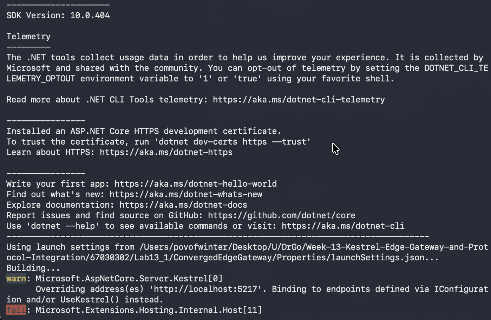
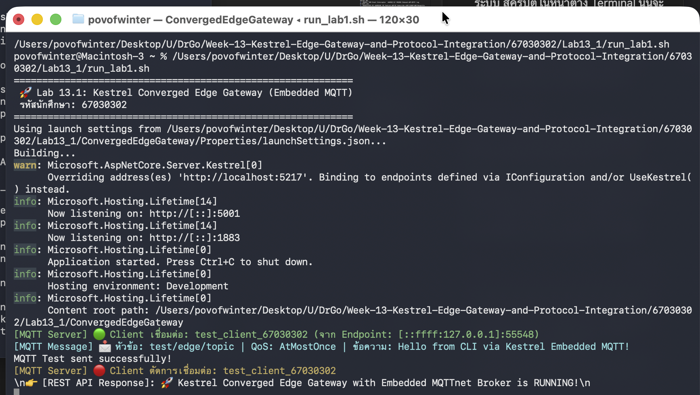
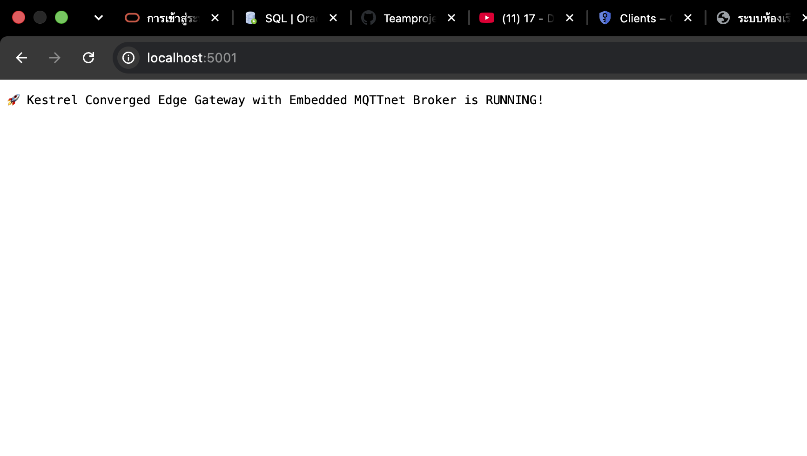
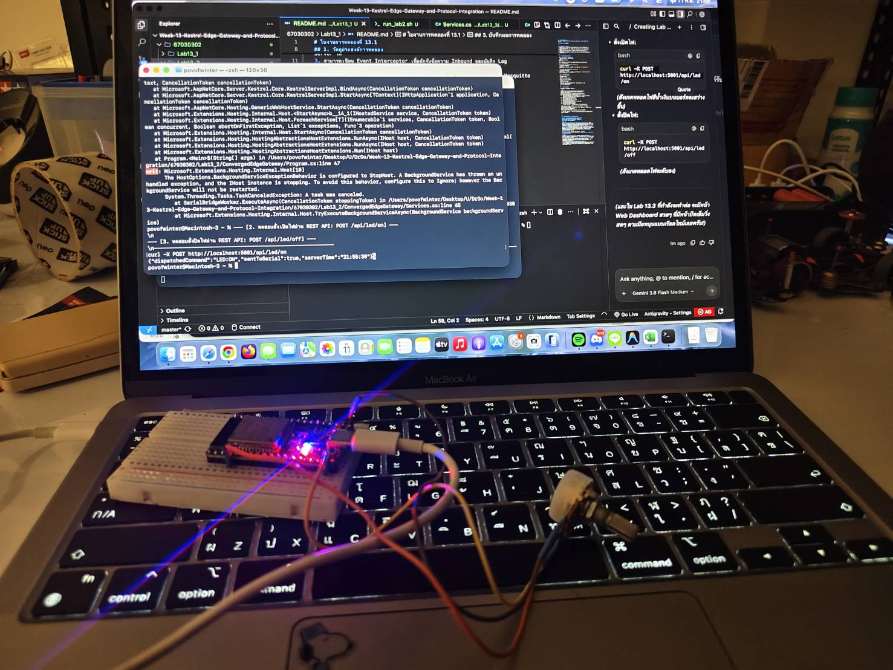

# ใบงานการทดลองที่ 13.1
## การสร้าง Embedded MQTT Broker และ Client ภายใน Kestrel .NET 8 ด้วยไลบรารี MQTTnet

**รหัสนักศึกษา:** 67030302  

---

## 1. วัตถุประสงค์การทดลอง
1. สามารถสร้างโปรเจกต์ ASP.NET Core Web Application (.NET 8) และติดตั้งแพ็กเกจ `MQTTnet.AspNetCore` ได้
2. สามารถกำหนดค่า Kestrel ให้เปิดพอร์ต TCP 1883 สำหรับให้บริการ Embedded MQTT Server ได้
3. สามารถเขียน Event Interceptor เพื่อดักจับข้อความ Inbound และบันทึก Log ลงในระบบได้
4. สามารถทดสอบการเชื่อมต่อ การ Publish และการ Subscribe ผ่านเครื่องมือ Mosquitto CLI หรือ MQTTX ได้

---

## 2. ขั้นตอนการรันและการทดสอบ

### 1) สั่งรัน Kestrel Edge Gateway
เข้าไปที่โฟลเดอร์โปรเจกต์แล้วสั่งรัน:
```bash
cd ConvergedEdgeGateway
dotnet run
```
*สังเกตคอนโซลว่าเซิร์ฟเวอร์เปิดฟังที่พอร์ต 5000 (HTTP) และ 1883 (MQTT)*


### 2) ทดสอบ Subscribe หัวข้อด้วย `mosquitto_sub`
เปิด Terminal อีกหน้าต่าง:
```bash
mosquitto_sub -h 127.0.0.1 -p 1883 -t "test/edge/topic" -i "sub_client" -v
```

### 3) ทดสอบ Publish ข้อความด้วย `mosquitto_pub`
เปิด Terminal อีกหน้าต่าง:
```bash
mosquitto_pub -h 127.0.0.1 -p 1883 -t "test/edge/topic" -m "Hello from CLI via Kestrel Embedded MQTT!" -i "pub_client"
```


### 4) ทดสอบ REST Endpoint
ทดสอบผ่าน Terminal:
```bash
curl http://localhost:5001/
```
หรือเปิดเว็บเบราว์เซอร์ไปที่:
```text
http://localhost:5001/
```
*(หมายเหตุ: บน macOS พอร์ต 5000 ถูกระบบ AirPlay Receiver ใช้งาน จึงปรับมาใช้พอร์ต 5001 แทน)*

---

## 3. บันทึกผลการทดลอง

*(ผลการรันจริงจากหน้าต่าง Terminal):*

```text
============================================================
 Lab 13.1: Kestrel Converged Edge Gateway (Embedded MQTT)
 รหัสนักศึกษา: 67030302
============================================================
Using launch settings from .../Properties/launchSettings.json...
warn: Microsoft.AspNetCore.Server.Kestrel[0]
      Overriding address(es) 'http://localhost:5217'. Binding to endpoints defined via IConfiguration and/or UseKestrel() instead.
info: Microsoft.Hosting.Lifetime[14]
      Now listening on: http://[::]:5001
info: Microsoft.Hosting.Lifetime[14]
      Now listening on: http://[::]:1883
info: Microsoft.Hosting.Lifetime[0]
      Application started. Press Ctrl+C to shut down.
info: Microsoft.Hosting.Lifetime[0]
      Hosting environment: Development
info: Microsoft.Hosting.Lifetime[0]
      Content root path: .../67030302/Lab13_1/ConvergedEdgeGateway

[MQTT Server] 🟢 Client เชื่อมต่อ: test_client_67030302 (จาก Endpoint: [::ffff:127.0.0.1]:55548)
[MQTT Message] 📩 หัวข้อ: test/edge/topic | QoS: AtMostOnce | ข้อความ: Hello from CLI via Kestrel Embedded MQTT!
MQTT Test sent successfully!
[MQTT Server] 🔴 Client ตัดการเชื่อมต่อ: test_client_67030302

👉 [REST API Response]: 🚀 Kestrel Converged Edge Gateway with Embedded MQTTnet Broker is RUNNING!
```

---

## 4. คำถามท้ายการทดลอง (Review Questions)

### ข้อ 1: การรัน Embedded MQTT Broker ภายใน Kestrel มีข้อได้เปรียบกว่าการติดตั้งซอฟต์แวร์ Mosquitto แยกต่างหากอย่างไรในแง่ของการกระจายงาน (Deployment) และการประมวลผลข้อมูลในหน่วยความจำ?

**คำตอบ:**  
1. **ความสะดวกในการกระจายงาน (Zero-Dependency Single Deployment):** การฝัง MQTTnet เข้ากับ Kestrel ช่วยให้ระบบทั้งหมดรวมอยู่ในไฟล์ไบนารีเดียว (.NET Single Executable) สามารถนำไปรันบน Edge Device หรือคอนเทนเนอร์ได้ทันทีโดยไม่ต้องติดตั้ง กำหนดค่าสิทธิ์ หรือคอยดูแลเซอร์วิสภายนอกอย่าง Mosquitto เพิ่มเติม
2. **ประสิทธิภาพในการประมวลผลในหน่วยความจำ (In-Memory Processing & Zero Network Overhead):** เซอร์วิสอื่นๆ ภายในแอปพลิเคชันเกตเวย์ (เช่น REST API, Background Workers, SignalR) สามารถส่งต่อและประมวลผลข้อมูลร่วมกับ MQTT Broker ได้โดยตรงผ่าน Dependency Injection และ In-Memory Channels โดยไม่ต้องเสียเวลา Serialize ข้อมูลข้าม Loopback Socket (TCP/IP) ไปมาระหว่าง Process ทำให้ได้ Latency ต่ำและประหยัดทรัพยากร CPU/RAM

### ข้อ 2: ฟังก์ชัน `InterceptingPublishAsync` ใน MQTTnet สามารถนำไปประยุกต์ใช้ในการกรองข้อมูลที่ผิดปกติ (Edge Validation) ก่อนส่งต่อให้ Client อื่นได้อย่างไร?

**คำตอบ:**  
ฟังก์ชัน `InterceptingPublishAsync` ทำหน้าที่เป็น Event Interceptor ที่ดักจับข้อความทุกฉบับที่มีการ Publish เข้ามาก่อนที่ Broker จะกระจายต่อ (Route/Distribute) ไปยัง Subscribers:
1. **การตรวจสอบโครงสร้างและขอบเขตข้อมูล (Schema & Range Validation):** สามารถ Parse ตรวจสอบ Payload เช่น หากข้อมูลเป็น JSON สามารถตรวจว่ามี Key ที่ต้องการครบถ้วนหรือไม่ และค่าตัวเลขอยู่ในช่วงที่ยอมรับได้หรือไม่ (เช่น อุณหภูมิอยู่ในช่วงที่กำหนด)
2. **การคัดกรองและการจัดการข้อผิดพลาด (Edge Sanitation):** หากพบว่าข้อมูลไม่ถูกต้องหรือเป็นข้อมูลขยะ สามารถสั่งตั้งค่า `args.ProcessFailed = true` หรือยกเลิกการส่งต่อข้อความนั้นได้ทันที พร้อมทั้งสามารถบันทึก Security/Audit Log หรือส่งสัญญาณเตือน (Alert) โดยข้อมูลที่ผิดปกติจะไม่หลุดไปยัง Client อื่นๆ หรือระบบ Cloud

