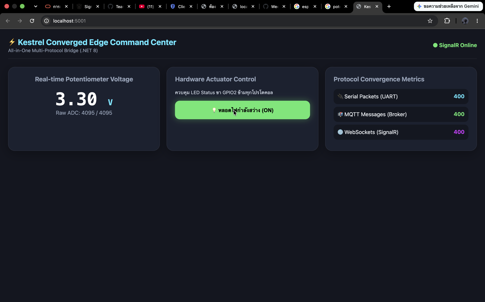
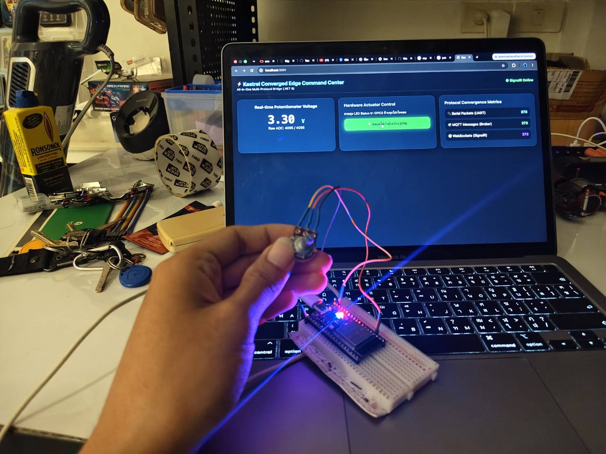

# ใบงานการทดลองที่ 13.3
## การสร้าง SignalR Realtime Hub และเว็บแดชบอร์ดศูนย์บัญชาการ (Converged Web Dashboard) สไตล์ Glassmorphism

**รหัสนักศึกษา:** 67030302  

---

## 1. วัตถุประสงค์การทดลอง
1. สามารถติดตั้งและกำหนดค่า SignalR Hub ใน ASP.NET Core (.NET 8) ได้
2. สามารถเขียนโค้ดผลักดันข้อมูลจากงานเบื้องหลัง (`SerialBridgeWorker`) ไปยังหน้าเว็บผ่าน `IHubContext` ได้
3. สามารถพัฒนาเว็บแดชบอร์ด HTML5/JavaScript ที่เชื่อมต่อกับ SignalR เพื่อแสดงผลมาตรวัดเข็มสด และสลับสวิตช์ไฟได้
4. สามารถติดตามและนับสถิติการรับส่งข้อมูลของทั้ง 4 โปรโตคอล (Protocol Traffic Counters) ได้

---

## 2. ขั้นตอนการรันและการทดสอบ

### 1) ตรวจสอบการตั้งค่าพอร์ต Serial ใน `Services.cs`
แก้ไข `_portName` ให้ตรงกับพอร์ตของ ESP32 บนเครื่องของคุณ

### 2) สั่งรัน Kestrel Edge Gateway
```bash
cd ConvergedEdgeGateway
dotnet run
```

### 3) เปิดเว็บแดชบอร์ด
เปิดเว็บเบราว์เซอร์ไปที่:
```text
http://localhost:5000
```
- สังเกตสถานะการเชื่อมต่อ SignalR ด้านมุมขวาบนเปลี่ยนเป็นสีเขียว `● SignalR Online`
- ทดลองหมุนตัวต้านทานปรับค่าได้ (Potentiometer) บนบอร์ด ESP32 สังเกตมาตรวัดเข็ม (Gauge) และตัวเลขแรงดันไฟฟ้าอัปเดตแบบเรียลไทม์
- สังเกตตัวนับ Protocol Traffic Counters ทั้ง Serial, MQTT, REST และ SignalR เพิ่มขึ้นอย่างต่อเนื่อง
- คลิกปุ่มสวิตช์หลอดไฟบนหน้าเว็บ สังเกตหลอดไฟ LED จริงบนบอร์ดสว่าง/ดับตามคำสั่ง

---

## 3. บันทึกผลการทดลอง



---

## 4. คำถามท้ายการทดลอง (Review Questions)

### ข้อ 1: เพราะเหตุใด SignalR จึงให้ประสบการณ์การใช้งาน (UX) บนหน้าเว็บที่ดีกว่าการใช้คำสั่ง JavaScript `setInterval()` เพื่อทำ HTTP GET Polling ซ้ำๆ ทุก 500 ms?

**คำตอบ:**  
SignalR ทำงานบนโปรโตคอล **Full-Duplex WebSockets** แบบ Persistent Connection โดยเซิร์ฟเวอร์สามารถผลักดันข้อมูล (Push) มายังหน้าเว็บทันทีที่มีการเปลี่ยนแปลงของค่าเซนเซอร์ (Event-Driven) ซึ่งมีข้อได้เปรียบเหนือการทำ HTTP Polling ดังนี้:
1. **ลดความหน่วงเวลา (Latency < 5 ms):** ค่าแรงดันและการขยับของเข็มบนมาตรวัดจะลื่นไหลสมจริงแบบ Real-time โดยไม่ต้องรอรอบเวลาของ Interval
2. **กำจัด Overhead มหาศาล:** การ Polling ซ้ำๆ ทุก 500 ms จะต้องส่ง HTTP Request และ Response Headers ขนาดกว่า 100-500 ไบต์ในทุกๆ รอบ ซึ่งสิ้นเปลืองแบนด์วิดท์เครือข่ายและสร้างภาระการประมวลผล (CPU Load) ให้กับเซิร์ฟเวอร์โดยไม่จำเป็น ในขณะที่ WebSockets มี Frame Overhead เพียง 2-10 ไบต์เท่านั้น

### ข้อ 2: การคำนวณและแสดงผล Protocol Convergence Metrics ส่งผลดีต่อการตรวจสอบสุขภาพของระบบเครือข่ายไอโอทีในระดับโรงงานอย่างไร?

**คำตอบ:**  
Protocol Convergence Metrics (ตัวนับสถิติการรับส่งข้อมูลของ Serial, MQTT, REST และ SignalR) ช่วยให้วิศวกรผู้ดูแลระบบเห็นภาพรวมความสมบูรณ์และปริมาณทราฟฟิกของระบบได้แบบเรียลไทม์:
1. **การตรวจจับจุดคอขวดและข้อผิดพลาด (Bottleneck & Anomaly Detection):** หากตัวนับ `Serial Packets` มีการเพิ่มขึ้นอย่างต่อเนื่อง แต่อัตราการเพิ่มของ `MQTT Messages` หรือ `SignalR Pushes` หยุดนิ่ง จะสามารถระบุได้ทันทีว่าเกิดปัญหาขึ้นที่คิวภายใน (Internal Channel/Queue) หรือเอนจินการแปลงโปรโตคอลของเกตเวย์
2. **การวินิจฉัยและระบุต้นตอของปัญหา (Root Cause Analysis - RCA):** ช่วยแยกแยะได้ทันทีว่าปัญหาเกิดจากฮาร์ดแวร์ต้นทาง (Hardware Failure), ปัญหาโครงข่ายอินเทอร์เน็ต/เครือข่ายท้องถิ่น (Network Drop), หรือปัญหาที่แอปพลิเคชันส่วนหน้า (Client Rendering Issue) ทำให้การบำรุงรักษาและการกู้คืนระบบทำได้อย่างรวดเร็วและแม่นยำ

