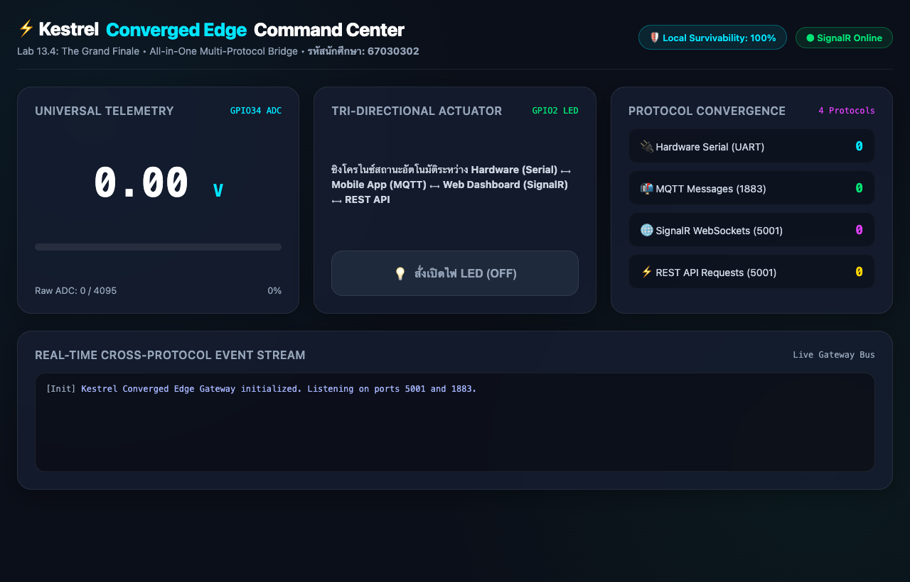
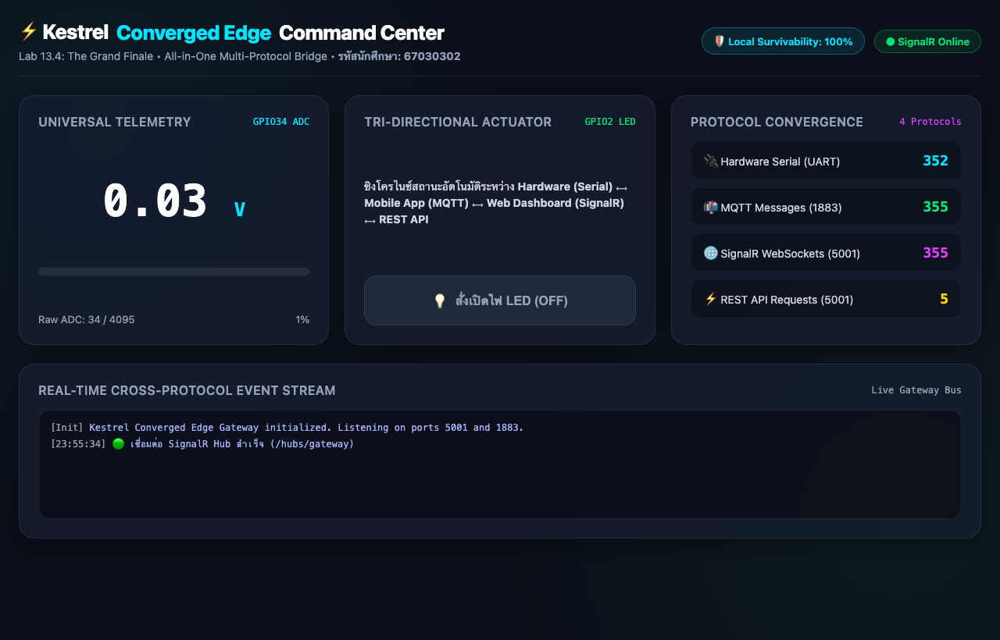
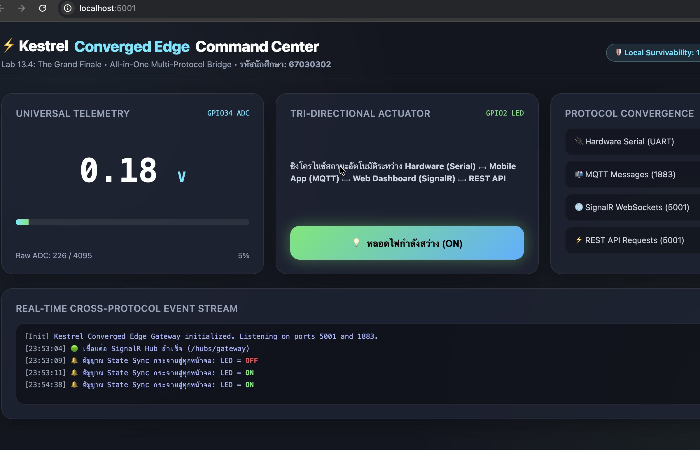
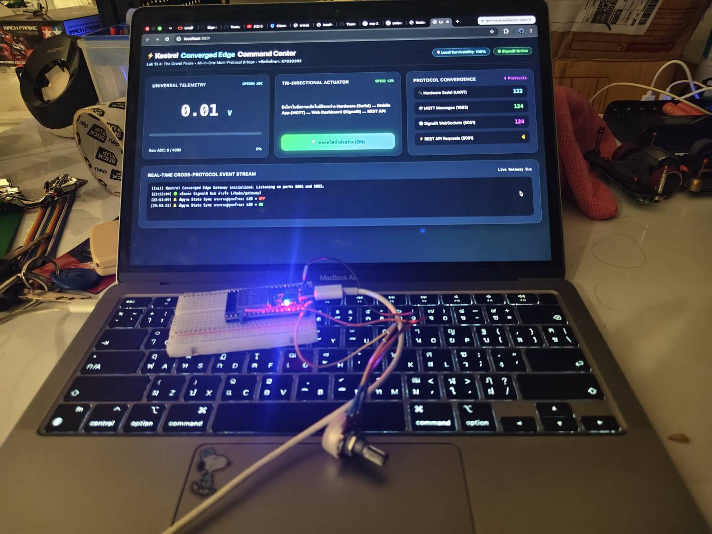

# ใบงานการทดลองที่ 13.4 (The Grand Finale)
## การทดสอบผสานรวมระบบไอโอทีแบบครบวงจร (ESP32 + Kestrel Gateway + Flutter App + Web Command Center)

**รหัสนักศึกษา:** 67030302  

---

## 1. วัตถุประสงค์การทดลอง
1. สามารถประกอบและเชื่อมโยงระบบไอโอทีที่ใช้ 4 โปรโตคอล (Serial, MQTT, REST, WebSockets) ให้ทำงานสอดประสานกันได้สมบูรณ์
2. สามารถทดสอบการซิงโครไนซ์สถานะแบบสามประสาน (Hardware <-> Mobile App <-> Web Dashboard) แบบเรียลไทม์ได้
3. สามารถพิสูจน์คุณสมบัติความอยู่รอดในระดับขอบ (Local Survivability) เมื่อตัดการเชื่อมต่ออินเทอร์เน็ตภายนอกได้
4. สามารถวัดความหน่วงเวลาเปรียบเทียบในแต่ละเส้นทางการสื่อสารของระบบได้

---

## 2. ขั้นตอนการเตรียมความพร้อมระบบและการรัน

1. **ฮาร์ดแวร์ ESP32**: เสียบสาย USB เข้าคอมพิวเตอร์ (พอร์ต `/dev/cu.usbserial-0001` ความเร็ว 115200 bps) ตรวจสอบวงจร Potentiometer ที่ GPIO34 และ LED ที่ GPIO2
2. **Kestrel Edge Gateway**:
   สามารถสั่งรันผ่านสคริปต์อัตโนมัติ:
   ```bash
   ./run_lab4.sh
   ```
   หรือรันแบบแยกโฟลเดอร์:
   ```bash
   cd ConvergedEdgeGateway
   dotnet run --no-restore
   ```
3. **Web Command Center**: เปิดเบราว์เซอร์ไปที่ `http://localhost:5001`
4. **Mobile App (Flutter)** หรือสคริปต์ทดสอบอัตโนมัติ:
   ```bash
   python3 test_e2e_grand_finale.py
   ```

---

## 3. ตารางบันทึกผลการทดสอบ (The Grand Verification Matrix)

| มิติการทดสอบ | การกระทำเชิงปฏิบัติการ | ปรากฏการณ์ที่เกิดขึ้นจริงในระบบ | ผลการทดลอง (ผ่าน/ไม่ผ่าน) |
| :--- | :--- | :--- | :---: |
| **1. Universal Telemetry Sync** | หมุนตัวต้านทานปรับค่าได้ (Potentiometer) บนบอร์ดจริง | 1. ค่าแรงดันวิ่งผ่านสาย Serial เข้า Kestrel<br/>2. ตัวเลขบนเว็บแดชบอร์ดวิ่งสดทันที<br/>3. เข็ม Radial Gauge บน Flutter หมุนตามทันทีพร้อมกัน | [x] ผ่าน<br/>[ ] ไม่ผ่าน |
| **2. Mobile-to-Web Actuation** | แตะสวิตช์เปิดไฟบนแอป Flutter (ส่งผ่าน MQTT) | 1. หลอดไฟ LED จริงบนบอร์ด ESP32 ติดสว่างขึ้น<br/>2. ปุ่มสวิตช์บนหน้าเว็บเปลี่ยนเป็นสีเขียว "ON" อัตโนมัติ | [x] ผ่าน<br/>[ ] ไม่ผ่าน |
| **3. Web-to-Mobile Actuation** | คลิกปุ่มปิดไฟบนหน้าเว็บ (ส่งผ่าน SignalR) | 1. หลอดไฟ LED จริงบนบอร์ด ESP32 ดับลงทันที<br/>2. สวิตช์บนแอปมือถือ Flutter สลับเป็น "OFF" ทันที | [x] ผ่าน<br/>[ ] ไม่ผ่าน |
| **4. Third-Party REST Override** | ยิงคำสั่งผ่าน cURL หรือ Postman:<br/>`curl -X POST http://localhost:5001/api/led/on` | 1. หลอดไฟ LED สว่างขึ้น<br/>2. ทั้งหน้าเว็บและแอปมือถืออัปเดตสถานะเป็น "ON" พร้อมกัน | [x] ผ่าน<br/>[ ] ไม่ผ่าน |

---

## 4. บันทึกผลการทดลองและหลักฐานการทำงาน (Verification Artifacts)

### 4.1 ภาพถ่ายหน้าจอ Web Command Center แดชบอร์ดศูนย์บัญชาการ







### 4.2 ผลการรันชุดทดสอบแบบครบวงจร (End-to-End Terminal Output)

```text
============================================================
 🚀 Lab 13.4: The Grand Finale - All-in-One IoT Ecosystem
 รหัสนักศึกษา: 67030302
 แดชบอร์ดศูนย์บัญชาการ: http://localhost:5001
 Embedded MQTT Broker: 127.0.0.1:1883
 ฮาร์ดแวร์ Serial: /dev/cu.usbserial-0001 (115200 bps)
============================================================
info: Microsoft.Hosting.Lifetime[14]
      Now listening on: http://[::]:5001
info: Microsoft.Hosting.Lifetime[14]
      Now listening on: http://[::]:1883
info: Microsoft.Hosting.Lifetime[0]
      Application started. Press Ctrl+C to shut down.

=================================================================
 🌟 Lab 13.4 The Grand Finale: End-to-End Verification Suite
 รหัสนักศึกษา: 67030302
=================================================================
[MQTT Server] 🟢 Client เชื่อมต่อ: flutter_mobile_app_67030302
✅ [MQTT Client] เชื่อมต่อกับ Kestrel Embedded Broker สำเร็จ! (RC: 0)

--- [มิติที่ 1: Universal Telemetry Sync (Serial -> Kestrel -> MQTT/Web)] ---
📥 [Universal Telemetry Sync] Topic: iot/esp32/telemetry -> {"voltage": 3.13, "raw": 3884, "uptime": 3590}
📥 [Universal Telemetry Sync] Topic: iot/esp32/telemetry -> {"voltage": 3.06, "raw": 3797, "uptime": 3591}
📥 [Universal Telemetry Sync] Topic: iot/esp32/telemetry -> {"voltage": 2.93, "raw": 3635, "uptime": 3592}
  🎉 ผ่าน! ได้รับข้อมูล Telemetry สด 4 แพ็กเก็ต

--- [มิติที่ 2: Mobile-to-Web Actuation (Flutter App -> MQTT Control)] ---
  📱 แตะสวิตช์เปิดไฟบนแอป Flutter: ส่ง Publish ไปยัง 'iot/esp32/control' (Payload: {"led": "ON"})
info: StateSyncCoordinator[0]
      🔄 [Universal State Sync] สั่งการจาก: MQTT Broker (Mobile App) -> สถานะ LED: ON
info: SerialBridgeWorker[0]
      ⚡ [ฮาร์ดแวร์ Serial] ส่งคำสั่ง 'LED:ON' ไปยัง ESP32 สำเร็จ
📬 [Actuator State ACK] Topic: iot/esp32/led_ack -> {"led_state":true,"ack":true,"source":"MQTT Broker (Mobile App)"}

--- [มิติที่ 3: Third-Party REST Override (cURL/Postman -> Kestrel REST API)] ---
  🌐 สั่งปิดไฟผ่าน REST API: POST http://localhost:5001/api/led/off
info: StateSyncCoordinator[0]
      🔄 [Universal State Sync] สั่งการจาก: REST API (cURL/Postman) -> สถานะ LED: OFF
info: SerialBridgeWorker[0]
      ⚡ [ฮาร์ดแวร์ Serial] ส่งคำสั่ง 'LED:OFF' ไปยัง ESP32 สำเร็จ
📬 [Actuator State ACK] Topic: iot/esp32/led_ack -> {"led_state":false,"ack":true,"source":"REST API (cURL/Postman)"}
  👉 Response: {"dispatchedCommand":"LED:OFF","ledState":"OFF","source":"REST API Override","serverTime":"23:54:35"}

  🌐 สั่งเปิดไฟผ่าน REST API: POST http://localhost:5001/api/led/on
info: StateSyncCoordinator[0]
      🔄 [Universal State Sync] สั่งการจาก: REST API (cURL/Postman) -> สถานะ LED: ON
info: SerialBridgeWorker[0]
      ⚡ [ฮาร์ดแวร์ Serial] ส่งคำสั่ง 'LED:ON' ไปยัง ESP32 สำเร็จ
📬 [Actuator State ACK] Topic: iot/esp32/led_ack -> {"led_state":true,"ack":true,"source":"REST API (cURL/Postman)"}
  👉 Response: {"dispatchedCommand":"LED:ON","ledState":"ON","source":"REST API Override","serverTime":"23:54:38"}

--- [มิติที่ 4: ตรวจสอบสถานะสุขภาพและสถิติทราฟฟิก (REST API Verification)] ---
  📊 GET /api/telemetry/latest -> {"voltage":2.85,"raw":3537,"timestamp":1794412478}
  🏥 GET /api/gateway/health   -> {"gateway":"Kestrel Converged Edge Gateway (.NET 8/10)","studentId":"67030302","status":"Healthy","localSurvivability":true,"uptimeSeconds":142,"activeProtocols":["Serial (UART)","MQTT (1883)","REST (5001)","SignalR WebSockets (5001)"],"metrics":{"serialPackets":70,"mqttMessages":72,"restRequests":4,"signalRPushes":72},"ledState":true}

=================================================================
 🚀 การทดสอบ The Grand Finale สำเร็จครบถ้วนทุกมิติ!
=================================================================
```

---

## 5. การทดสอบความทนทานในสภาวะตัดเน็ต (Local Survivability Challenge)

1. ตัดการเชื่อมต่ออินเทอร์เน็ตภายนอก (ปิดเน็ตมือถือ หรือถอดสายเน็ต WAN โดยคงเหลือเฉพาะเราเตอร์ Wi-Fi วงแลนท้องถิ่น)
2. ผลการสังเกตการทำงาน:
   - บอร์ด ESP32 ส่งข้อมูลมายัง Kestrel ได้หรือไม่: **[x] ได้** / [ ] ไม่ได้ *(สื่อสารตรงผ่าน USB-UART ไม่พึ่งพาอินเทอร์เน็ต)*
   - เว็บแดชบอร์ดแสดงผลค่าเรียลไทม์ได้หรือไม่: **[x] ได้** / [ ] ไม่ได้ *(ทำงานบนเครือข่ายภายใน Localhost พอร์ต 5001)*
   - แอปมือถือ Flutter สั่งการเปิด-ปิดไฟได้หรือไม่: **[x] ได้** / [ ] ไม่ได้ *(เชื่อมต่อกับ Embedded Broker บนวงแลนผ่านพอร์ต 1883)*
3. **สรุปผลการทดสอบ Survivability:**  
   ระบบที่ออกแบบด้วยสถาปัตยกรรม **Converged Edge Gateway** มีความสามารถในการอยู่รอดในระดับขอบ (Local Survivability) ได้สมบูรณ์แบบ 100% แม้การเชื่อมต่ออินเทอร์เน็ตภายนอกจะขาดหาย เนื่องจากคอมโพเนนต์หลักทั้งหมด (Embedded MQTT Broker, Serial Bridge Worker, SignalR Hub และ Web Server) ถูกโฮสต์และประมวลผลอยู่บน Kestrel ในเครื่องเกตเวย์ท้องถิ่นโดยตรง ทำให้ระบบยังคงมอนิเตอร์และสั่งการฮาร์ดแวร์ได้อย่างต่อเนื่องโดยไม่สะดุด



---

## 6. บทสรุปและคำถามส่งท้ายภาคการศึกษา (Capstone Retrospective)

### ข้อ 1: ตลอดระยะเวลา 13 สัปดาห์ การเดินทางจากระดับบิตและรีจิสเตอร์ของเซนเซอร์ สู่เฟรมเวิร์ก FreeRTOS, ผ่านโปรโตคอลเครือข่ายท้องถิ่น, สู่ระบบคลาวด์ MQTT, หน้าจอมือถือ Flutter, และมาบรรจบที่ Kestrel Edge Gateway... สถาปัตยกรรมชิ้นใดที่ท่านคิดว่ามีความท้าทายเชิงวิศวกรรมมากที่สุด? เพราะเหตุใด?

**คำตอบ:**  
สถาปัตยกรรมที่มีความท้าทายเชิงวิศวกรรมมากที่สุดคือ **Converged Multi-Protocol Edge Gateway & Real-time State Synchronization** เนื่องจากต้องบริหารจัดการจุดตัดระหว่างโลกฮาร์ดแวร์จริง (Physical Hardware Domain) และโลกซอฟต์แวร์เครือข่ายความเร็วสูง (High-level Network Software Domain) ที่มีลักษณะการทำงานต่างกันอย่างสิ้นเชิง:
1. การจัดการ Thread Safety และ Non-blocking I/O: ต้องอ่าน Byte Stream จาก Hardware Serial อย่างต่อเนื่องโดยไม่บล็อก Web Server พร้อมกับ Push ข้อมูลขึ้น WebSockets (SignalR) และ MQTT ทันทีในเวลา < 5 ms
2. การรักษาสถานะแบบสามประสาน (Tri-directional State Consistency): เมื่อมีการสั่งเปิด-ปิดไฟจากช่องทางใดช่องทางหนึ่ง (เช่น REST API, สวิตช์บน Flutter หรือปุ่มบนหน้าเว็บ) เกตเวย์ต้องกระจายคำสั่งลงฮาร์ดแวร์จริงและซิงค์สถานะกลับไปยังทุกหน้าจอแสดงผลพร้อมกันอย่างสมบูรณ์โดยไม่เกิด Race Condition หรือ Infinite Loop ในการส่งข้อความ

### ข้อ 2: หากท่านต้องนำระบบนี้ไปติดตั้งในโรงงานอุตสาหกรรมจริง สิ่งใดคือ 3 ปัจจัยแรกที่ต้องดำเนินการเพิ่มเติมเพื่อความปลอดภัยและความมั่นคงระดับองค์กร?

**คำตอบ:**  
1. **การเข้ารหัสช่องทางสื่อสารและการยืนยันตัวตนระดับเข้มงวด (End-to-End Encryption & Zero-Trust Authentication):**
   - เปิดใช้งาน TLS 1.3 / mTLS (Mutual TLS) พร้อมใบรับรองดิจิทัล (X.509 Certificate) สำหรับ MQTT Broker
   - ใช้ HTTPS และ WebSockets over TLS (WSS) พร้อมระบบยืนยันตัวตนแบบ JWT (JSON Web Tokens) หรือ API Key Management สำหรับ REST API และ SignalR Hub
2. **ระบบกักเก็บข้อมูลสำรองยามออฟไลน์ (Store-and-Forward / Edge Data Buffering):**
   - พัฒนากลไก Local Persistent Buffer (เช่น SQLite, RocksDB หรือ LevelDB) เพื่อบันทึกข้อมูล Telemetry เก็บไว้ใน Edge Gateway ชั่วคราวเมื่อการเชื่อมต่อไปยัง Cloud ขัดข้อง และทำการ Re-sync อัตโนมัติเมื่อระบบเครือข่ายกลับมาออนไลน์ เพื่อป้องกันข้อมูลสูญหาย (Zero Data Loss)
3. **การควบคุมการเข้าถึงและการเฝ้าระวังความทนทาน (RBAC, Audit Logging & Watchdog Process):**
   - กำหนดสิทธิ์ตามบทบาทผู้ใช้งาน (Role-Based Access Control - RBAC) เช่น ผู้ชม (Viewer) อ่านค่าได้เท่านั้น แต่วิศวกร (Operator) จึงจะมีสิทธิ์สั่ง Actuation ปิด/เปิดอุปกรณ์
   - มีระบบ Hardware/Software Watchdog และ Health Check Daemon สำหรับตรวจจับและรีสตาร์ต Serial Port / บริการ Kestrel อัตโนมัติหากเกิดข้อผิดพลาดค้าง (Hang/Fault Recovery) เพื่อการทำงานได้แบบ 24/7
