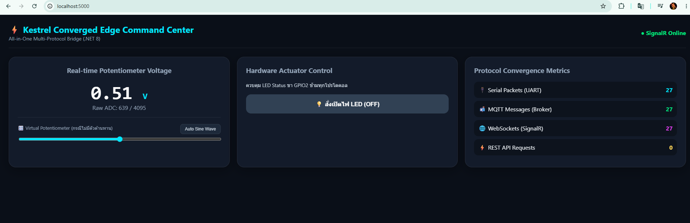
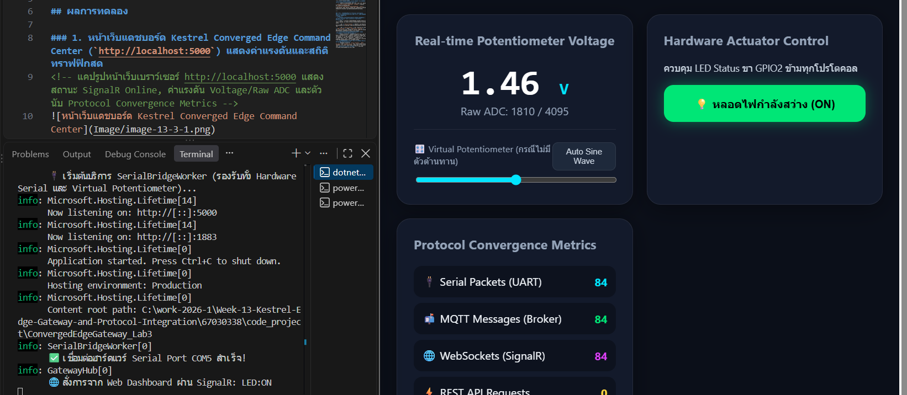

# ใบงานการทดลองที่ 13.3
### การสร้าง SignalR Realtime Hub และเว็บแดชบอร์ดศูนย์บัญชาการ (Converged Web Dashboard) สไตล์ Glassmorphism

---

## ผลการทดลอง

### 1. หน้าเว็บแดชบอร์ด Kestrel Converged Edge Command Center (`http://localhost:5000`) แสดงค่าแรงดันและสถิติทราฟฟิกสด
<!-- แคปรูปหน้าเว็บเบราว์เซอร์ http://localhost:5000 แสดงสถานะ SignalR Online, ค่าแรงดัน Voltage/Raw ADC และตัวนับ Protocol Convergence Metrics -->

### 2. การทดสอบกดปุ่มควบคุมหลอดไฟ LED บนหน้าเว็บแดชบอร์ดผ่าน SignalR Hub (`ToggleLed`)
<!-- แคปรูปหน้าเว็บขณะปุ่มสวิตช์เปลี่ยนเป็นสีเขียว "หลอดไฟกำลังสว่าง (ON)" คู่กับหน้าต่าง Console ของ Kestrel ที่ขึ้น Log สั่งการผ่าน SignalR -->

---

## 4. คำถามท้ายการทดลอง (Review Questions)

### ข้อ 1: เพราะเหตุใด SignalR จึงให้ประสบการณ์การใช้งาน (UX) บนหน้าเว็บที่ดีกว่าการใช้คำสั่ง JavaScript `setInterval()` เพื่อทำ HTTP GET Polling ซ้ำๆ ทุก 500 ms?
* **คำตอบ:**
  1. **สถาปัตยกรรม Server Push แบบ Event-Driven เทียบกับ Client Pull (Polling):**
     * **HTTP GET Polling (`setInterval`):** เบราว์เซอร์ต้องเป็นฝ่ายส่งคำขอ HTTP ไปถามเซิร์ฟเวอร์ซ้ำๆ ทุก 500 ms แม้ว่าค่าเซนเซอร์จะไม่ได้เปลี่ยนแปลงก็ตาม ทำให้เกิดจังหวะหน่วงเวลา (Polling Delay) และหากตั้งความถี่สูงขึ้นก็จะยิ่งสร้างภาระให้ทั้งเบราว์เซอร์และเซิร์ฟเวอร์
     * **ASP.NET Core SignalR (WebSockets):** ทำการอัปเกรดการเชื่อมต่อเป็นท่อสื่อสารสองทิศทางแบบถาวร (Persistent Full-Duplex WebSocket Connection) เพียงครั้งเดียว ทันทีที่ `SerialBridgeWorker` อ่านค่าใหม่จาก ESP32 ได้ เซิร์ฟเวอร์จะผลักข้อมูล (`Clients.All.SendAsync("ReceiveTelemetry", ...)`) พุ่งตรงไปยังหน้าเว็บทันทีด้วยความหน่วงเวลาต่ำกว่า **1–5 มิลลิวินาที** ทำให้ตัวเลขแรงดันและมาตรวัดเคลื่อนไหวอย่างลื่นไหลไร้รอยต่อ
  2. **ลดปริมาณ Overhead ของเครือข่ายอย่างมหาศาล:**
     * การทำ HTTP GET ทุกๆ 500 ms จะต้องแนบ HTTP Request/Response Headers ขนาดหลายร้อยไบต์ไป-กลับทุกครั้ง (2 ครั้งต่อวินาที = 120 คำขอต่อนาทีต่อผู้ใช้ 1 คน) ในขณะที่เฟรมข้อมูลของ WebSocket หลังผ่านการ Handshake แล้วมีขนาด Header เพียง **2–10 ไบต์** เท่านั้น จึงประหยัดแบนด์วิดท์และพลังงานซีพียูได้ดีกว่ามาก
  3. **การซิงโครไนซ์สถานะแบบสองทางระหว่างผู้ใช้หลายคน (Multi-Client Bi-directional Sync):**
     * เมื่อผู้ใช้คนใดคนหนึ่งคลิกปุ่มเปิดไฟ LED บนหน้าเว็บ (`connection.invoke("ToggleLed", isLedOn)`) SignalR Hub สามารถกระจายสถานะใหม่ (`Clients.All.SendAsync("LedStateUpdated", state)`) ไปยังหน้าจอเบราว์เซอร์ทุกเครื่องที่เปิดอยู่ได้พร้อมกันในเสี้ยววินาที โดยไม่ต้องรอให้หน้าเว็บอื่นสุ่มถามสถานะในรอบถัดไป

---

### ข้อ 2: การคำนวณและแสดงผล Protocol Convergence Metrics ส่งผลดีต่อการตรวจสอบสุขภาพของระบบเครือข่ายไอโอทีในระดับโรงงานอย่างไร?
* **คำตอบ:**
  1. **การตรวจจับคอขวดและจุดล่มของแต่ละโปรโตคอลได้แบบแยกส่วน (Granular Fault Isolation & Bottleneck Detection):**
     * ในระบบเกตเวย์ที่เชื่อมต่อหลายโปรโตคอลพร้อมกัน หากหน้าจอแสดงผลไม่อัปเดต วิศวกรจะทราบสาเหตุได้ทันทีจากการดูตัวนับสถิติ:
       * หาก **`Serial Packets`** หยุดนิ่ง แสดงว่าปัญหาอยู่ที่สายสัญญาณ USB/UART หรือบอร์ดไมโครคอนโทรลเลอร์หน้างาน
       * หาก **`Serial Packets`** ยังเพิ่มขึ้นปกติ แต่ **`MQTT Messages`** หรือ **`WebSockets (SignalR)`** ไม่เพิ่มขึ้น แสดงว่าเกิดความผิดปกติในไปป์ไลน์การกระจายข้อความภายในหรือการเชื่อมต่อของกลุ่ม Client นั้นๆ
  2. **การติดตามปริมาณโหลดและอัตราการไหลของข้อมูล (Throughput & Traffic Monitoring):**
     * ช่วยให้ผู้ดูแลระบบเห็นอัตราการไหลของแพ็กเก็ต (Packet Rate) ในแต่ละช่องทางแบบเรียลไทม์ สามารถประเมินภาระงาน (Workload) ของเกตเวย์ และตรวจจับพฤติกรรมผิดปกติ เช่น มีระบบภายนอกยิง REST API หรือ MQTT เข้ามามากผิดปกติ (Traffic Spike / DoS) เพื่อวางแผนตั้งค่า Rate Limiting หรือขยายขีดความสามารถของระบบได้อย่างแม่นยำ
  3. **การยืนยันความครบถ้วนของการแปลงโปรโตคอล (End-to-End Bridge Verification):**
     * เมื่อตัวเลขสถิติของ `Serial Packets`, `MQTT Messages` และ `SignalR Pushes` ขยับเพิ่มขึ้นอย่างสอดคล้องกันในทุกๆ รอบการส่งข้อมูล ย่อมเป็นหลักฐานเชิงประจักษ์ที่ยืนยันว่ากลไก **Universal Protocol Bridge** ของเกตเวย์กำลังทำงานสอดประสานกันอย่างสมบูรณ์ 100%
