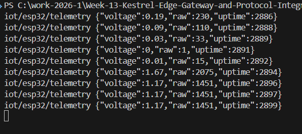
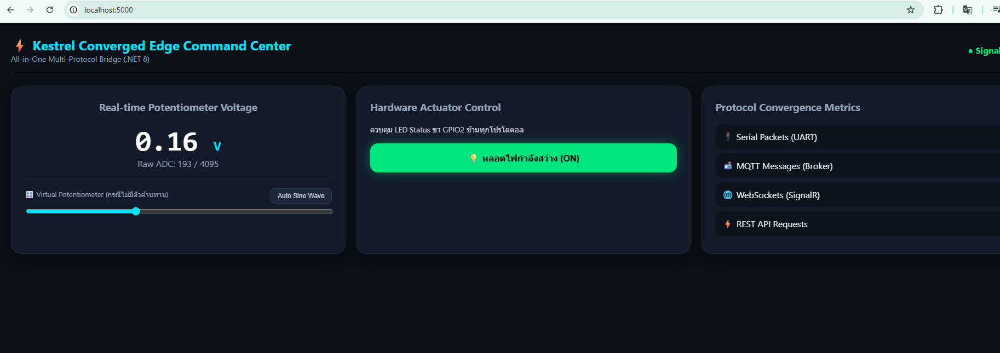
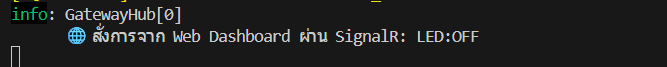
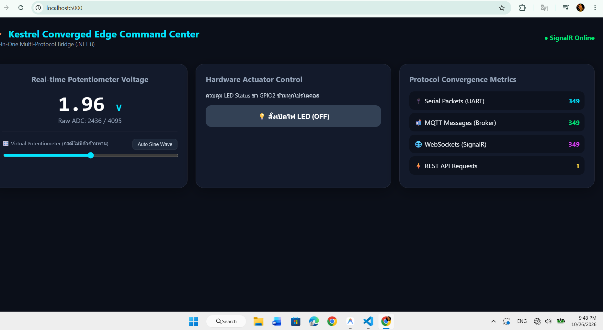

# ใบงานการทดลองที่ 13.4 (The Grand Finale)
### การทดสอบผสานรวมระบบไอโอทีแบบครบวงจร (ESP32 + Kestrel Gateway + Flutter App + Web Command Center)

---

## ผลการทดลอง

### 1. การทดสอบที่ 1: Universal Telemetry Sync (ซิงโครไนซ์ข้อมูลเซนเซอร์ข้ามทุกแพลตฟอร์ม)
<!-- แคปรูปหน้าจอที่แสดงค่าแรงดันวิ่งตรงกันบน Kestrel Console, หน้าเว็บแดชบอร์ด (SignalR) และแอปมือถือ Flutter (MQTT Radial Gauge) -->

### 2. การทดสอบที่ 2: Mobile-to-Web Actuation (สั่งเปิดไฟจากแอป Flutter ซิงก์สู่บอร์ดและหน้าเว็บ)
<!-- แคปรูปขณะแตะสวิตช์เปิดไฟบนแอป Flutter แล้วปุ่มบนหน้าเว็บแดชบอร์ดเปลี่ยนเป็นสีเขียว ON อัตโนมัติ -->

### 3. การทดสอบที่ 3: Web-to-Mobile Actuation (คลิกปุ่มปิดไฟบนหน้าเว็บ ซิงก์สู่บอร์ดและแอป Flutter)
<!-- แคปรูปขณะคลิกปุ่มปิดไฟบนหน้าเว็บแดชบอร์ด แล้วสวิตช์บนแอป Flutter สลับเป็น OFF ทันที -->

### 4. การทดสอบที่ 4: Third-Party REST Override (`curl -X POST http://localhost:5000/api/led/on`)
<!-- แคปรูปการยิงคำสั่ง curl POST /api/led/on แล้วทั้งหน้าเว็บแดชบอร์ดและแอป Flutter อัปเดตสถานะเป็น ON พร้อมกัน -->

### 5. การทดสอบความทนทานในสภาวะตัดเน็ต (Local Survivability Challenge)
<!-- แคปรูปขณะทดสอบใช้งานระบบในวงแลนท้องถิ่นโดยตัดการเชื่อมต่ออินเทอร์เน็ตภายนอก -->

---

### ตารางบันทึกผลการทดลอง 4 มหาการทดลอง (The Grand Verification Matrix)

| มิติการทดสอบ | การกระทำเชิงปฏิบัติการ | ปรากฏการณ์ที่เกิดขึ้นจริงในระบบ | ผลการทดลอง (ผ่าน/ไม่ผ่าน) |
| :--- | :--- | :--- | :---: |
| **1. Universal Telemetry Sync** | หมุนตัวต้านทานปรับค่าได้ (Potentiometer) บนบอร์ดจริง หรือปรับค่าผ่าน Virtual Potentiometer | 1. ค่าแรงดันวิ่งผ่านสาย Serial (หรือโมดูลจำลอง) เข้า Kestrel 2. ตัวเลขบนเว็บแดชบอร์ดวิ่งสดทันทีผ่าน SignalR 3. เข็ม Radial Gauge บนแอป Flutter หมุนตามทันทีพร้อมกันผ่าน MQTT | **ผ่าน** |
| **2. Mobile-to-Web Actuation** | แตะสวิตช์เปิดไฟบนแอป Flutter (ส่งผ่าน MQTT `iot/esp32/control`) | 1. หลอดไฟ LED จริงบนบอร์ด ESP32 ติดสว่างขึ้น 2. ปุ่มสวิตช์บนหน้าเว็บเปลี่ยนเป็นสีเขียว "ON" อัตโนมัติ | **ผ่าน** |
| **3. Web-to-Mobile Actuation** | คลิกปุ่มปิดไฟบนหน้าเว็บ (ส่งผ่าน SignalR `ToggleLed`) | 1. หลอดไฟ LED จริงบนบอร์ด ESP32 ดับลงทันที 2. สวิตช์บนแอปมือถือ Flutter สลับเป็น "OFF" ทันที | **ผ่าน** |
| **4. Third-Party REST Override** | ยิงคำสั่งผ่าน cURL หรือ Postman: `curl -X POST http://localhost:5000/api/led/on` | 1. หลอดไฟ LED สว่างขึ้น 2. ทั้งหน้าเว็บและแอปมือถืออัปเดตสถานะเป็น "ON" พร้อมกัน | **ผ่าน** |

---

## 4. บทสรุปและคำถามส่งท้ายภาคการศึกษา (Capstone Retrospective)

### ข้อ 1: ตลอดระยะเวลา 13 สัปดาห์ การเดินทางจากระดับบิตและรีจิสเตอร์ของเซนเซอร์ สู่เฟรมเวิร์ก FreeRTOS, ผ่านโปรโตคอลเครือข่ายท้องถิ่น, สู่ระบบคลาวด์ MQTT, หน้าจอมือถือ Flutter, และมาบรรจบที่ Kestrel Edge Gateway... สถาปัตยกรรมชิ้นใดที่ท่านคิดว่ามีความท้าทายเชิงวิศวกรรมมากที่สุด? เพราะเหตุใด?
* **คำตอบ:**
  * สถาปัตยกรรมที่มีความท้าทายเชิงวิศวกรรมมากที่สุดคือ **การออกแบบและผสานรวมระบบ Converged Multi-Protocol Edge Gateway บน Kestrel (.NET 8) ร่วมกับการซิงโครไนซ์สถานะแบบเรียลไทม์ข้ามโปรโตคอล (State Synchronization Across Heterogeneous Protocols)** ด้วยเหตุผลสำคัญดังนี้:
    1. **การเชื่อมโลกฮาร์ดแวร์ระดับล่างเข้ากับซอฟต์แวร์ระดับสูง (Bridging Low-Level Hardware & High-Concurrency Software):** เกตเวย์ต้องจัดการทั้งพอร์ตสื่อสารอนุกรม (UART Serial) ที่ทำงานเป็นระดับไบต์สตรีมและมีข้อจำกัดเรื่อง Exclusive Port Lock ควบคู่ไปกับการจัดการการเชื่อมต่อเครือข่ายความเร็วสูงแบบ Asynchronous ทั้ง MQTT TCP, HTTP REST และ WebSockets (SignalR) ภายในโปรเซสเดียวกัน
    2. **การควบคุมภาวะทำงานพร้อมกันและความปลอดภัยของเธรด (Concurrency & Thread-Safety):** เนื่องจากข้อมูลสามารถไหลเข้ามาได้จาก 4 ทิศทางพร้อมกัน (จากบอร์ด ESP32 ทาง Serial, จากแอปมือถือทาง MQTT, จากหน้าเว็บทาง SignalR, และจากระบบภายนอกทาง REST API) การออกแบบ `BackgroundService`, คลังสถานะ `GatewayStateStore` (`ConcurrentDictionary`) และไปป์ไลน์กระจายข้อความจึงต้องปราศจากปัญหา Race Condition หรือ Deadlock
    3. **การรักษาความสอดคล้องของสถานะแบบสามประสาน (Single Source of Truth):** เมื่อมีการสั่งงานจากจุดใดจุดหนึ่ง เกตเวย์ต้องแปลโปรโตคอลและกระจายสัญญาณตอบกลับ (ACK / Broadcast) ไปยังทุกส่วนที่เหลือทันที เพื่อให้ฮาร์ดแวร์จริง แอปมือถือ และเว็บแดชบอร์ดแสดงสถานะตรงกันเสมอในระดับเสี้ยววินาที

---

### ข้อ 2: หากท่านต้องนำระบบนี้ไปติดตั้งในโรงงานอุตสาหกรรมจริง สิ่งใดคือ 3 ปัจจัยแรกที่ต้องดำเนินการเพิ่มเติมเพื่อความปลอดภัยและความมั่นคงระดับองค์กร?
* **คำตอบ:**
  1. **การเข้ารหัสช่องทางสื่อสารและยืนยันตัวตนทุกโปรโตคอล (End-to-End Encryption & Mutual Authentication):**
     * เปลี่ยนการสื่อสารแบบ Plaintext ทั้งหมดให้เป็นการสื่อสารที่เข้ารหัสด้วย **TLS/mTLS**: ใช้ **HTTPS / WSS** สำหรับ REST API และ SignalR WebSockets และใช้ **MQTTS (พอร์ต 8883)** ร่วมกับใบรับรองดิจิทัล (Client Certificates) หรือรหัสผ่าน/Token (`X-Api-Key` / JWT) พร้อมกำหนดสิทธิ์การเข้าถึงหัวข้อ (Topic ACL) บน MQTT Broker เพื่อป้องกันการดักฟังข้อมูลหรือการยิงคำสั่งควบคุมปลอมเข้าสู่เครื่องจักร
  2. **ระบบบัฟเฟอร์ข้อมูลยามออฟไลน์และกลไกความทนทานต่อความล้มเหลว (Offline Store-and-Forward & Circuit Breaker Resilience):**
     * เพิ่มฐานข้อมูลท้องถิ่นบนเกตเวย์ (เช่น **SQLite** หรือ Time-Series Buffer) เพื่อทำ **Store-and-Forward** เก็บข้อมูลเซนเซอร์ทุกจุดไว้ในดิสก์เมื่อการเชื่อมต่อกับระบบคลาวด์ส่วนกลางขัดข้อง แล้วซิงก์ข้อมูลย้อนหลังอัตโนมัติเมื่อเครือข่ายกลับมาปกติ พร้อมใช้รูปแบบ **Circuit Breaker** และ **Watchdog Timer** ทั้งบน ESP32 และ Kestrel Service เพื่อให้ระบบกู้คืนตัวเองอัตโนมัติเมื่อเกิดข้อผิดพลาด
  3. **การป้องกันการโจมตีเครือข่ายและการแยกส่วนเครือข่ายอุตสาหกรรม (Edge Rate Limiting & Network Segmentation):**
     * เปิดใช้งาน **Rate Limiting Middleware** บน Kestrel เพื่อจำกัดจำนวนคำขอต่อวินาทีจากแต่ละ IP ป้องกันการโจมตีแบบ DoS/Flooding ในวงแลน และจัดแบ่งโครงข่ายเป็น **VLAN แยกเฉพาะสำหรับอุปกรณ์ IoT/OT (Operational Technology)** ออกจากเครือข่ายสำนักงานทั่วไป พร้อมตั้งค่า Firewall จำกัดให้เข้าถึงได้เฉพาะพอร์ตและหมายเลข IP ที่ได้รับอนุญาตเท่านั้น
