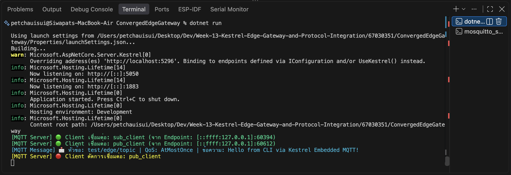
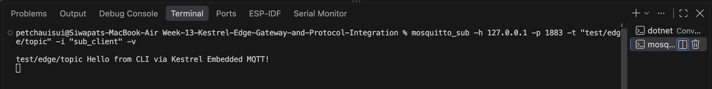
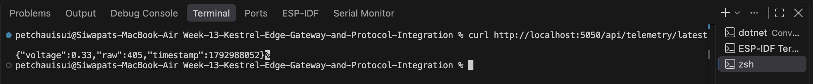
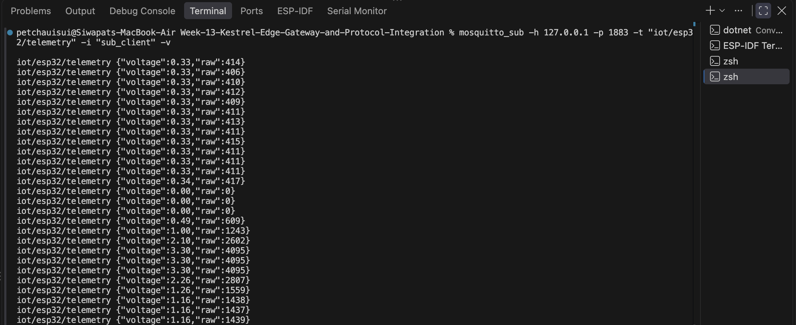
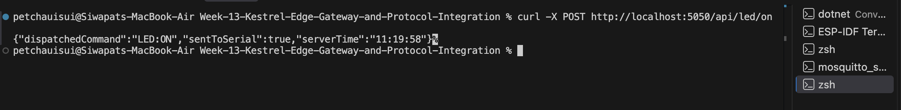

# 13.1 การสร้าง Embedded MQTT Broker และ Client ภายใน Kestrel .NET 8 ด้วยไลบรารี MQTTnet
## กิจกรรมที่ 13-1.3: การสั่งรันและทดสอบด้วยเครื่องมือ CLI
### 3. เปิดหน้าต่าง PowerShell ที่สาม: ทดสอบ Publish ข้อความ
ส่งข้อความผ่าน `mosquitto_pub`:
```bash
mosquitto_pub -h 127.0.0.1 -p 1883 -t "test/edge/topic" -m "Hello from CLI via Kestrel Embedded MQTT!" -i "pub_client"
```
#### ผลการทดลอง
1. สังเกตข้อความบนคอนโซลว่าเซิร์ฟเวอร์กำลังฟังที่พอร์ต 5000 (HTTP) และ 1883 (MQTT)


2. สังเกตหน้าต่างคอนโซลของ Kestrel จะขึ้นข้อความสีเขียวว่ามี Client เชื่อมต่อเข้ามา!


## คำถามท้ายการทดลอง (Review Questions)
**ข้อ 1: การรัน Embedded MQTT Broker ภายใน Kestrel มีข้อได้เปรียบกว่าการติดตั้งซอฟต์แวร์ Mosquitto แยกต่างหากอย่างไรในแง่ของการกระจายงาน (Deployment) และการประมวลผลข้อมูลในหน่วยความจำ?**
* **ด้านการกระจายงาน (Deployment):** ช่วยลดความยุ่งยากในการติดตั้งและตั้งค่าระบบ (Zero External Dependency) เนื่องจากรวมทั้ง Web Server, REST API และ MQTT Broker ไว้เป็นแอปพลิเคชันตัวเดียว (Single Binary / Single Process) เวลาเอาไปติดตั้งบนอุปกรณ์ Edge หรือสร้างเป็น Container ก็สามารถรันได้ทันทีโดยไม่ต้องลงหรือเปิด Service ของ Mosquitto แยกต่างหาก
* **ด้านการประมวลผลในหน่วยความจำ (In-Memory Processing):** เมื่อรันอยู่ใน Process เดียวกัน ข้อมูลที่ส่งเข้ามาทาง MQTT Broker สามารถส่งต่อไปยังส่วนอื่นๆ เช่น C# State Store, Background Worker, หรือส่งออก Real-time Web Dashboard (SignalR) ได้ผ่านหน่วยความจำของเครื่องโดยตรง (In-Process Memory) ทำให้มีความเร็วสูง (Low Latency) ไม่ต้องเสียเวลาส่งวนผ่าน TCP Loopback Interface ซ้ำซ้อนเหมือนการใช้ซอฟต์แวร์แยก

**ข้อ 2: ฟังก์ชัน `InterceptingPublishAsync` ใน MQTTnet สามารถนำไปประยุกต์ใช้ในการกรองข้อมูลที่ผิดปกติ (Edge Validation) ก่อนส่งต่อให้ Client อื่นได้อย่างไร?**
* **คำตอบ:** ฟังก์ชัน `InterceptingPublishAsync` ทำหน้าที่เป็นตัวดักฟัง (Interceptor Hook) ก่อนที่ข้อความจะถูกกระจายไปยัง Subscribers อื่นๆ เราสามารถเขียนโค้ดตรวจสอบ Payload ได้ เช่น:
  1. **การตรวจสอบความถูกต้อง (Validation):** ตรวจสอบว่ารูปแบบข้อมูลเป็น JSON ที่ถูกต้องหรือไม่ และค่าเซนเซอร์อยู่ในช่วงปกติหรือเปล่า (เช่น ค่าอุณหภูมิหรือแรงดันไฟฟ้าไม่เกินขอบเขตที่กำหนด)
  2. **การคัดกรองหรือระงับข้อความ (Filtering):** หากพบว่าข้อมูลผิดปกติหรือเป็นอันตราย เราสามารถตั้งค่า `context.ProcessPublish = false;` เพื่อสั่งยกเลิกการส่งต่อข้อความนั้นไปยัง Client อื่นได้ทันที
  3. **การแปลงข้อมูลและแจ้งเตือน (Data Sanitization & Alerting):** สามารถแก้ไขค่าข้อมูลให้เหมาะสมก่อนส่งต่อ หรือส่งคำเตือนไปยังระบบความปลอดภัยได้ตั้งแต่ระดับ Edge Gateway โดยไม่ต้องรอให้ถึง Cloud

---

# 13.2 การพัฒนา Hardware Serial Bridge ดักฟังข้อมูล USB-UART จาก ESP32 แปลงเข้าสู่ MQTT Topics และ REST API
## กิจกรรมที่ 13-2.5: การทดสอบสะพานเชื่อมต่อ (Hardware Serial Bridge)

### 2. ทดสอบเรียกดูค่าเซนเซอร์ล่าสุดผ่าน REST API ด้วย cURL
เรียกดูข้อมูลเซนเซอร์ล่าสุดผ่าน `curl`:
```bash
curl http://localhost:5050/api/telemetry/latest
```
#### ผลการทดลอง
สังเกตว่าได้รับข้อมูล JSON แสดงค่าแรงดันไฟฟ้า (`voltage`), ค่าดิบ ADC (`raw`), และเวลา `timestamp` ทันที โดยเป็นค่าที่ Worker อ่านจากพอร์ต Serial ของ ESP32 แล้วนำไปบันทึกไว้ใน In-Memory State Store (`GatewayStateStore`):


---

### 3. เปิด mosquitto_sub: ทดสอบการบริดจ์ข้อมูลเข้าสู่ MQTT
ดักฟังสตรีมข้อมูลผ่าน `mosquitto_sub`:
```bash
mosquitto_sub -h 127.0.0.1 -p 1883 -t "iot/esp32/telemetry" -i "sub_client" -v
```
#### ผลการทดลอง
สังเกตว่าข้อมูลแรงดันไฟฟ้าที่อ่านจากสาย USB Serial ถูกแปลงและส่งต่อไปยัง Embedded MQTT Broker ภายใต้หัวข้อ `iot/esp32/telemetry` โดยอัตโนมัติแบบ Real-time:


---

### 4. ทดสอบสั่งเปิด-ปิดไฟ LED ผ่าน REST API
ส่งคำสั่งเปิดไฟ LED ด้วย HTTP POST Request:
```bash
curl -X POST http://localhost:5050/api/led/on
```
#### ผลการทดลอง
1. ฝั่ง Terminal ได้รับ Response ยืนยันการส่งคำสั่งสำเร็จ (`"dispatchedCommand":"LED:ON"`, `"sentToSerial":true`):


2. สังเกตว่าคำสั่ง `LED:ON` ถูกส่งผ่านสาย USB Serial ไปควบคุมหลอดไฟ LED บนบอร์ด ESP32 ให้สว่างขึ้นทันที:


## คำถามท้ายการทดลอง (Review Questions)
**ข้อ 1: สถาปัตยกรรมแบบ Serial-to-MQTT Bridge นี้ช่วยให้อุปกรณ์รุ่นเก่า (Legacy Hardware) ที่ไม่มี Wi-Fi สามารถเข้าร่วมระบบนิเวศ IoT สมัยใหม่ได้อย่างไร?**
* **คำตอบ:** อุปกรณ์รุ่นเก่าหรือเซนเซอร์ในโรงงานอุตสาหกรรมส่วนใหญ่ไม่มีโมดูลเชื่อมต่อเครือข่ายไร้สาย (ไม่มี Wi-Fi/Ethernet) แต่มีพอร์ตสื่อสารแบบอนุกรม เช่น RS-232, RS-485 หรือ USB-UART การใช้สถาปัตยกรรม Serial-to-MQTT Bridge จะทำหน้าที่เป็น "สะพานแปลงโปรโตคอล (Protocol Gateway)" โดยการดึงข้อมูลดิบจากสาย Serial เข้ามา แล้วนำมาห่อหุ้มให้อยู่ในรูปของข้อความ MQTT (MQTT Topics/Payloads) ส่งขึ้นสู่ระบบเครือข่าย ทำให้อุปกรณ์เดิมสามารถคุยกับ Dashboard, คลาวด์ หรือระบบ IoT สมัยใหม่ได้ทันที โดยไม่ต้องเปลี่ยนหรือซื้อฮาร์ดแวร์ใหม่ทั้งหมด

**ข้อ 2: เพราะเหตุใดเราจึงต้องใช้ `BackgroundService` ในการอ่านข้อมูล Serial แทนที่จะเปิดพอร์ตอ่านตรงๆ ภายในฟังก์ชันของ REST API?**
* **คำตอบ:** 
  1. **ลักษณะการทำงานของข้อมูลที่ต่างกัน (Continuous Stream vs Request-Response):** ข้อมูลจากบอร์ดไมโครคอนโทรลเลอร์จะส่งผ่าน Serial เข้ามาอย่างต่อเนื่องตลอดเวลา (Streaming) ในขณะที่ REST API ทำงานแบบเรียกเป็นครั้งๆ เมื่อมี Request เข้ามา หากเราไปเปิดอ่าน Serial ใน API จะต้องรอจังหวะที่ข้อมูลส่งเข้ามา ทำให้ API เกิดการค้าง (Blocking) หรือ Timeout ได้
  2. **ข้อจำกัดเรื่องการแย่งใช้งานพอร์ต (Exclusive Access):** พอร์ต Serial สามารถเปิดใช้งานได้เพียง 1 โปรแกรม/Connection ในเวลาเดียวกันเท่านั้น หากเราเปิด-ปิดพอร์ตทุกครั้งที่ API ถูกเรียก จะทำให้เกิดการแย่งใช้งานและพอร์ตถูกล็อกจน Error (Port Busy)
  3. **ประสิทธิภาพและการแยกหน้าที่ (Decoupling):** การใช้ `BackgroundService` (`SerialBridgeWorker`) จะเปิดพอร์ตค้างไว้ตัวเดียวในเบื้องหลัง คอยอ่านข้อมูลตลอดเวลาและนำไปบันทึกไว้ใน `GatewayStateStore` (In-Memory Cache) เมื่อมีคนเรียก REST API ตัว API ก็สามารถหยิบค่าล่าสุดจากหน่วยความจำไปตอบได้ทันที ทำให้ระบบตอบสนองได้รวดเร็วระดับมิลลิวินาทีและมีความเสถียรสูง


