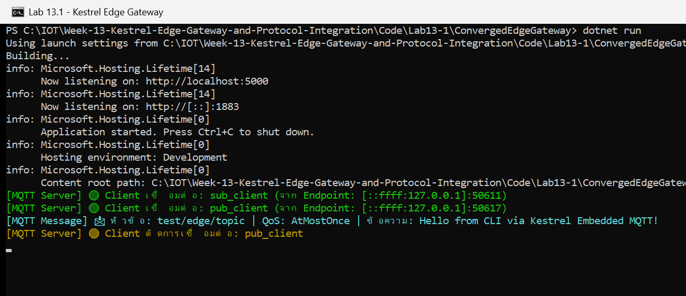
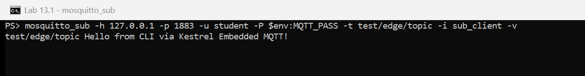

# ใบงานที่ 13.1 – Embedded MQTT Broker และ Client ภายใน Kestrel ด้วย MQTTnet

> [← กลับหน้ารวม](README.md)  ·  ใบงาน: [06-Labsheet-13-1](../06-Labsheet-13-1-Embedded-MQTT-Broker-and-Client-with-MQTTnet.md)  ·  โค้ด: [Code/Lab13-1](../Code/Lab13-1/README.md)

## 1. สภาพแวดล้อมที่ใช้ทดลอง

| รายการ | ค่า |
| :--- | :--- |
| .NET SDK / Runtime | 10.0.400 / 10.0.11 (โปรเจกต์ target `net10.0` เพราะเครื่องนี้ไม่มี runtime .NET 8) |
| MQTTnet / MQTTnet.AspNetCore | 4.3.7.1207 (ตามใบงาน) |
| Mosquitto CLI | 2.1.2 (`C:\Program Files\mosquitto`) ใช้เป็น client ทดสอบเท่านั้น ไม่ได้รัน Mosquitto Broker |
| โปรเจกต์ | `Code/Lab13-1/ConvergedEdgeGateway` |
| พอร์ต | HTTP 5000 (เฉพาะ localhost), MQTT 1883 (ทุก IP) |
| วันที่ทดลอง | 27/10/2026 |

## 2. ขั้นตอนการทดลอง

### กิจกรรมที่ 13-1.1: สร้างโปรเจกต์และติดตั้งแพ็กเกจ

โปรเจกต์สร้างไว้แล้วที่ `Code/Lab13-1/ConvergedEdgeGateway` แพ็กเกจกำหนดเวอร์ชันไว้ที่ `Code/Directory.Packages.props`
(เทียบเท่าคำสั่ง `dotnet add package MQTTnet --version 4.3.7.1207` และ `MQTTnet.AspNetCore` ในใบงาน)

### กิจกรรมที่ 13-1.2: โค้ด `Program.cs`

ใช้โค้ดตามใบงาน (ListenAnyIP 5000 + 1883 `UseMqtt()`, `AddMqttServer`, Event ทั้ง 4 ตัว) และเพิ่มด้านความปลอดภัย:

| สิ่งที่เพิ่มจากใบงาน | เหตุผล |
| :--- | :--- |
| ตรวจ username/password ใน `ValidatingConnectionAsync` (อ่านจาก `dotnet user-secrets`) | Broker เปิดพอร์ต 1883 ให้ทั้งวง LAN ถ้าไม่มีรหัสผ่าน ใครก็ publish/subscribe ได้ |
| ไม่มีรหัสผ่าน หรือรหัสสั้นกว่า 8 ตัว → โปรแกรมไม่ยอมเริ่มทำงาน | กันการเผลอรัน Broker แบบไม่มีรหัส |
| HTTP 5000 ฟังเฉพาะ `localhost` | ใบงานนี้ยังไม่มี API ที่เครื่องอื่นต้องเรียก |
| คงการสุ่ม ClientId เมื่อ client ไม่ส่ง `-i` | ตามใบงาน |

### กิจกรรมที่ 13-1.3: รันและทดสอบ

ตั้งรหัสผ่าน (ครั้งเดียว ค่าถูกเก็บใน `%APPDATA%\Microsoft\UserSecrets\` ไม่อยู่ในโฟลเดอร์งาน):

```powershell
cd Code\Lab13-1\ConvergedEdgeGateway
dotnet user-secrets set "Mqtt:Username" "student"
dotnet user-secrets set "Mqtt:Password" "<รหัสผ่านอย่างน้อย 8 ตัว>"
```

**หน้าต่างที่ 1** – รัน Kestrel:

```powershell
dotnet run
```

**หน้าต่างที่ 2** – Subscribe (เก็บรหัสผ่านไว้ในตัวแปร `$env:MQTT_PASS` เพื่อไม่ให้รหัสโผล่บนหน้าจอ):

```powershell
. .\Code\env.ps1
mosquitto_sub -h 127.0.0.1 -p 1883 -u student -P $env:MQTT_PASS -t "test/edge/topic" -i "sub_client" -v
```

**หน้าต่างที่ 3** – Publish:

```powershell
. .\Code\env.ps1
mosquitto_pub -h 127.0.0.1 -p 1883 -u student -P $env:MQTT_PASS -t "test/edge/topic" -m "Hello from CLI via Kestrel Embedded MQTT!" -i "pub_client"
```

## 3. ผลการทดลอง

### 3.1 หน้าต่าง Kestrel: เปิด 2 พอร์ต, Client เชื่อมต่อ (สีเขียว), ดักจับข้อความ (สีฟ้า)



### 3.2 หน้าต่าง mosquitto_sub: ได้รับข้อความที่ส่งผ่าน Broker ใน Kestrel



### 3.3 ตารางบันทึกผล

| ขั้นตอน | ผลที่คาดหวัง (ใบงาน) | ผลจริง | ผ่าน/ไม่ผ่าน |
| :--- | :--- | :--- | :--- |
| `dotnet run` | ฟังพอร์ต 5000 (HTTP) และ 1883 (MQTT) | `Now listening on: http://localhost:5000` และ `http://[::]:1883` | ☑ ผ่าน |
| `mosquitto_sub` เชื่อมต่อ | Kestrel แสดง Log สีเขียว | `🟢 Client เชื่อมต่อ: sub_client (จาก Endpoint: [::ffff:127.0.0.1]:50611)` | ☑ ผ่าน |
| `mosquitto_pub` ส่งข้อความ | Kestrel แสดง Log สีฟ้า | `📩 หัวข้อ: test/edge/topic \| QoS: AtMostOnce \| ข้อความ: Hello from CLI via Kestrel Embedded MQTT!` | ☑ ผ่าน |
| หน้าต่าง `mosquitto_sub` | ได้รับข้อความทันที | `test/edge/topic Hello from CLI via Kestrel Embedded MQTT!` | ☑ ผ่าน |
| `mosquitto_pub` ส่งเสร็จแล้วออก | Kestrel แสดง Client ตัดการเชื่อมต่อ | `🔴 Client ตัดการเชื่อมต่อ: pub_client` (สีเหลือง) | ☑ ผ่าน |
| เชื่อมต่อโดยไม่ใส่รหัส / รหัสผิด (ทดสอบเพิ่ม) | ถูกปฏิเสธ | `BadUserNameOrPassword` และ Kestrel แสดง `⛔ ปฏิเสธการเชื่อมต่อ` | ☑ ผ่าน |

**สรุป:** Kestrel ทำหน้าที่เป็นทั้ง Web Server (5000) และ MQTT Broker (1883) ในโปรแกรมเดียว
โดยไม่ต้องติดตั้งหรือรัน Mosquitto Broker แยก และดักอ่านทุกข้อความที่ผ่าน Broker ได้จากโค้ด C# โดยตรง

## 4. คำถามท้ายการทดลอง

### ข้อ 1. การรัน Embedded MQTT Broker ภายใน Kestrel มีข้อได้เปรียบกว่าการติดตั้ง Mosquitto แยกต่างหากอย่างไร ในแง่การกระจายงาน (Deployment) และการประมวลผลข้อมูลในหน่วยความจำ?

**ด้าน Deployment**
- ติดตั้งโปรแกรมเดียว (`dotnet publish` ได้ไฟล์ชุดเดียว) ไม่ต้องติดตั้ง ตั้งค่า และดูแลบริการ Mosquitto แยก
  ลดจำนวน service, พอร์ต และไฟล์ config ที่ต้องดูแลบนเครื่อง Edge
- เวอร์ชันของ Broker ถูกล็อกไว้กับแอป (NuGet `MQTTnet 4.3.7.1207`) ทุกเครื่องจึงได้ Broker เวอร์ชันเดียวกัน
- เริ่ม/หยุดพร้อมกัน ใช้ Logging, Configuration และ Health Check ของ ASP.NET Core ชุดเดียวกัน
- การตรวจสิทธิ์เขียนเป็นโค้ด C# ได้เลย (ในการทดลองนี้คือ `ValidatingConnectionAsync`) ไม่ต้องแก้ไฟล์ password/ACL ของ Mosquitto

**ด้านการประมวลผลในหน่วยความจำ**
- ข้อความ MQTT ถึงโค้ดของเราผ่าน event (`InterceptingPublishAsync`) ใน process เดียวกันทันที
  ไม่ต้องมี client อีกตัวไป subscribe ผ่าน TCP เหมือนกรณีใช้ Mosquitto (ไม่มีการ serialize/ส่งผ่าน network ซ้ำ)
- เกตเวย์ส่งข้อความเข้า Broker ได้ตรง ๆ ด้วย `InjectApplicationMessage` (ใช้ในใบงาน 13.2) จึงเชื่อม Serial, REST และ SignalR
  เข้ากับ MQTT ได้ผ่านหน่วยความจำร่วม ความหน่วงต่ำกว่าและใช้ทรัพยากรน้อยกว่า

**ข้อแลกเปลี่ยน:** ถ้าแอปล่ม Broker ล่มไปด้วย และ Mosquitto มีฟีเจอร์ระดับ production ครบกว่า (bridge, persistence, ACL ละเอียด)
ระบบใหญ่ที่มี client จำนวนมากอาจยังเหมาะกับ Broker แยก

### ข้อ 2. ฟังก์ชัน `InterceptingPublishAsync` นำไปใช้กรองข้อมูลผิดปกติ (Edge Validation) ก่อนส่งต่อให้ Client อื่นได้อย่างไร?

`InterceptingPublishAsync` ถูกเรียก **ก่อน** Broker ส่งข้อความต่อให้ผู้ subscribe จึงเป็นจุดตรวจได้ทุกข้อความ:

1. **ตรวจรูปแบบข้อมูล** – parse payload เป็น JSON ถ้าผิดรูปแบบ ขาด field หรือค่าอยู่นอกช่วง (เช่น `raw` ไม่อยู่ใน 0–4095
   หรือแรงดันเกิน 3.3 V) ให้ตั้ง `args.ProcessPublish = false` เพื่อทิ้งข้อความนั้น
2. **ตรวจสิทธิ์ตามหัวข้อ** – ใช้ `args.ClientId` ตรวจว่าใครส่ง เช่น อนุญาตให้เฉพาะเกตเวย์ publish `iot/esp32/telemetry`
   client อื่นที่ส่งมาจะถูกทิ้ง (ใช้จริงในโค้ด Lab 13.2–13.4 กันการปลอมค่าเซนเซอร์)
3. **จำกัดขนาด/อัตรา** – ทิ้ง payload ที่ใหญ่เกินกำหนด หรือ client ที่ส่งถี่ผิดปกติ
4. **แปลงหรือเติมข้อมูล** – แก้ `args.ApplicationMessage` ก่อนส่งต่อได้ เช่น เติม timestamp หรือปัดเศษค่า
5. **บันทึกเหตุผิดปกติ** – เขียน log หรือนับสถิติข้อความที่ถูกปฏิเสธ เพื่อใช้ตรวจสอบภายหลัง

ข้อดีคือข้อมูลเสียหรือข้อมูลปลอมถูกตัดทิ้งตั้งแต่ระดับ Edge จึงไม่ไปถึงแดชบอร์ด แอปมือถือ หรือคลาวด์
ทั้งยังประหยัดแบนด์วิดท์และลดภาระของระบบปลายทาง

## 5. ข้อสังเกตเพิ่มเติม

- `-P <รหัสผ่าน>` ของ mosquitto CLI ยังเห็นได้ในรายการ process ของ Windows (Task Manager → Command line)
  ควรใช้รหัสผ่านเฉพาะสำหรับ Lab นี้ ไม่ใช้รหัสเดียวกับ Wi-Fi หรือบัญชีส่วนตัว
- MQTT พอร์ต 1883 ไม่เข้ารหัส รหัสผ่านถูกส่งเป็นข้อความธรรมดาในวง LAN ระบบจริงควรใช้ MQTT over TLS (8883) ตามสัปดาห์ที่ 11
