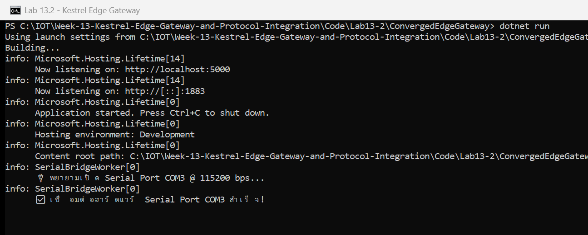
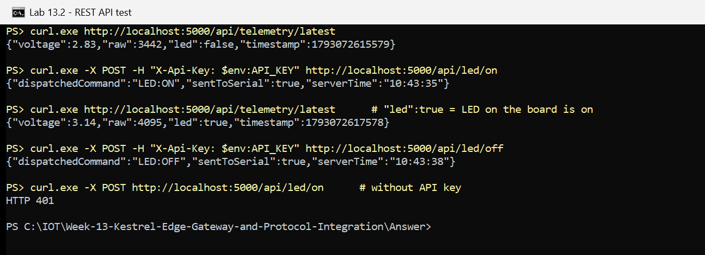
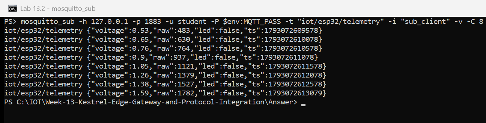

# ใบงานที่ 13.2 – Hardware Serial Bridge: ESP32 (USB-UART) → MQTT Topics และ REST API

> [← กลับหน้ารวม](README.md)  ·  ใบงาน: [07-Labsheet-13-2](../07-Labsheet-13-2-Hardware-Serial-to-MQTT-and-REST-Bridge.md)  ·  โค้ด: [Code/Lab13-2](../Code/Lab13-2/README.md)

## 1. สภาพแวดล้อมที่ใช้ทดลอง

| รายการ | ค่า |
| :--- | :--- |
| บอร์ด | ESP32-D0WD-V3 (revision v3.1, MAC `14:33:5c:0e:7a:a8`), USB-UART Silicon Labs CP210x ที่ **COM3** |
| ESP-IDF | v6.1 (เฟิร์มแวร์ `Code/Lab13-2/esp32_serial_bridge`) |
| ความเร็ว Serial | 115200 bps, 1 บรรทัด JSON ทุก 500 ms |
| LED | GPIO2 (LED บนบอร์ด) |
| เซนเซอร์ | ตัวต้านทานปรับค่าได้ (Potentiometer) ขากลาง → **GPIO34** (ADC1_CH6), ขาริม → 3V3 / GND อ่านค่าจริง (`CONFIG_LAB_SIMULATE_ADC=n`) |
| .NET / แพ็กเกจ | .NET 10, MQTTnet 4.3.7.1207, System.IO.Ports 10.0.12 |
| Mosquitto CLI | 2.1.2 (ใช้เป็น client ทดสอบเท่านั้น) |
| วันที่ทดลอง | 27/10/2026 |

## 2. ขั้นตอนการทดลอง

### 2.1 แฟลชเฟิร์มแวร์ ESP32 (กิจกรรม 13-2.4)

```powershell
cd Code\Lab13-2\esp32_serial_bridge
idf.py -p COM3 build flash
```

ผล: `Chip type: ESP32-D0WD-V3 (revision v3.1)` และ `Hash of data verified.`

เฟิร์มแวร์อ่าน ADC 12-bit (0–4095) ที่ Attenuation 12 dB เฉลี่ย 8 ครั้งต่อค่า และแปลงเป็นแรงดันด้วย ADC calibration (line fitting)

ทดสอบสาย Serial ก่อนต่อเกตเวย์: บอร์ดส่ง `{"voltage":1.30,"raw":1603,"led":0}` ทุก 500 ms ค่าเปลี่ยนตามการหมุน
และเมื่อส่ง `LED:ON` ค่า `"led"` เปลี่ยนเป็น `1` และ LED บนบอร์ดติด

> ตอนแรกอ่านค่าได้ `raw = 0` ตลอด ตรวจด้วยเฟิร์มแวร์ชั่วคราวที่สแกนทุกขา ADC1 พบว่า ADC ปกติ แต่ GPIO34 ติดกับ GND
> หลังแก้สายตัวต้านทานแล้วอ่านค่าได้ปกติ (เฟิร์มแวร์มีตัวเลือก `CONFIG_LAB_SIMULATE_ADC=y` ไว้สุ่มค่าเมื่อไม่มีตัวต้านทาน
> แต่การทดลองนี้ใช้ค่าจริง)

### 2.2 ติดตั้งคอมโพเนนต์และเขียนโค้ด (กิจกรรม 13-2.1 – 13-2.3)

ใช้โค้ดใน `Code/Lab13-2/ConvergedEdgeGateway` (`System.IO.Ports` ล็อกเวอร์ชันไว้ที่ `Code/Directory.Packages.props`)

| ส่วน | ตามใบงาน | เพิ่ม/แก้จากใบงาน |
| :--- | :--- | :--- |
| `GatewayStateStore` | `ConcurrentDictionary` เก็บ `latest_telemetry` | – |
| `SerialBridgeWorker` | `BackgroundService` อ่าน `ReadLine()`, ต่อใหม่ทุก 3 วิ, ส่งเข้า MQTT ด้วย `InjectApplicationMessage` | รอ MQTT Server พร้อมก่อน (โค้ดในใบงานล่มตอนเริ่มถ้าข้อมูลมาก่อน Broker พร้อม), ตรวจ JSON และช่วงค่า, ส่งเฉพาะ JSON ที่ตรวจแล้ว, `lock` ตอนเขียน Serial, ตั้ง `DtrEnable/RtsEnable = false` กันบอร์ด reset |
| ชื่อพอร์ต | แก้ในโค้ด `_portName` | อ่านจาก `appsettings.json` (`Serial:PortName` = `COM3`) |
| `GET /api/telemetry/latest` | ✔ | – |
| `POST /api/led/{state}` | ✔ | ต้องมี header `X-Api-Key`, จำกัด 10 ครั้ง/10 วินาที, รับเฉพาะ `on`/`off`, คำสั่ง Serial อยู่ใน allowlist |
| MQTT | Broker ใน Kestrel | ต้องใส่ username/password และ client อื่น publish หัวข้อ `iot/esp32/telemetry` ไม่ได้ (กันปลอมค่าเซนเซอร์) |

ตั้งค่าความลับ (เก็บนอกโฟลเดอร์งาน):

```powershell
cd Code\Lab13-2\ConvergedEdgeGateway
dotnet user-secrets set "Mqtt:Username" "student"
dotnet user-secrets set "Mqtt:Password" "<รหัสผ่านอย่างน้อย 8 ตัว>"
dotnet user-secrets set "Gateway:ApiKey" ([guid]::NewGuid().ToString("N"))
```

### 2.3 ทดสอบสะพานเชื่อมต่อ (กิจกรรม 13-2.5)

ปิด `idf monitor` ก่อน (Windows ให้เปิดพอร์ต COM ได้ทีละโปรแกรม) แล้ว:

```powershell
# หน้าต่างที่ 1
dotnet run
# หน้าต่างที่ 2
mosquitto_sub -h 127.0.0.1 -p 1883 -u student -P $env:MQTT_PASS -t "iot/esp32/telemetry" -i "sub_client" -v
# หน้าต่างที่ 3
curl.exe http://localhost:5000/api/telemetry/latest
curl.exe -X POST -H "X-Api-Key: $env:API_KEY" http://localhost:5000/api/led/on
```

> ใน PowerShell 5.1 คำสั่ง `curl` คือ `Invoke-WebRequest` จึงต้องพิมพ์ `curl.exe`

## 3. ผลการทดลอง

### 3.1 Kestrel เปิดพอร์ต 5000/1883 และเชื่อมต่อ Serial Port COM3 สำเร็จ



### 3.2 REST API: อ่านค่าเซนเซอร์ล่าสุด และสั่งเปิด-ปิด LED ผ่านสาย Serial



### 3.3 MQTT: ข้อมูลจากสาย USB Serial ถูกส่งเข้าหัวข้อ `iot/esp32/telemetry` อัตโนมัติ



### 3.4 ตารางบันทึกผล

| ขั้นตอน | ผลที่คาดหวัง (ใบงาน) | ผลจริง | ผ่าน/ไม่ผ่าน |
| :--- | :--- | :--- | :--- |
| `dotnet run` ขณะเสียบบอร์ด | เปิด Serial Port ได้ | `✅ เชื่อมต่อฮาร์ดแวร์ Serial Port COM3 สำเร็จ!` | ☑ ผ่าน |
| `curl.exe .../api/telemetry/latest` | ได้ JSON แรงดันทันที | `{"voltage":2.83,"raw":3442,"led":false,"timestamp":...}` | ☑ ผ่าน |
| `mosquitto_sub iot/esp32/telemetry` | ข้อมูลจาก Serial เข้า MQTT อัตโนมัติ | ได้ข้อความทุก 500 ms ขณะหมุนตัวต้านทาน แรงดันเพิ่มจาก 0.53 → 0.65 → 0.76 → 0.90 → 1.05 → 1.26 → 1.38 → 1.59 V (raw 483 → 1782) | ☑ ผ่าน |
| `POST /api/led/on` | `LED:ON` ถูกส่งเข้าบอร์ด ไฟติด | `"dispatchedCommand":"LED:ON","sentToSerial":true` LED GPIO2 ติด และ telemetry ถัดมาเป็น `"led":true` | ☑ ผ่าน |
| `POST /api/led/off` | ไฟดับ | `"sentToSerial":true` LED ดับ telemetry กลับเป็น `"led":false` | ☑ ผ่าน |
| `POST /api/led/on` ไม่มี API key (ทดสอบเพิ่ม) | ถูกปฏิเสธ | `HTTP 401` | ☑ ผ่าน |

**สรุป:** เกตเวย์ตัวเดียวแปลงข้อมูลจากสาย USB-UART ของ ESP32 ออกไปได้ 2 ทาง คือ MQTT topic (สำหรับ client ที่ subscribe)
และ REST API (สำหรับระบบภายนอกที่ขอค่าล่าสุด) ทั้งยังส่งคำสั่งจาก REST ย้อนกลับลงสาย Serial ไปควบคุม LED ได้จริง
ค่าแรงดันทั้งหมดอ่านจากตัวต้านทานปรับค่าได้ที่ GPIO34 จริง และเปลี่ยนตามการหมุนแบบเรียลไทม์

## 4. คำถามท้ายการทดลอง

### ข้อ 1. สถาปัตยกรรม Serial-to-MQTT Bridge ช่วยให้อุปกรณ์รุ่นเก่า (Legacy Hardware) ที่ไม่มี Wi-Fi เข้าร่วมระบบนิเวศ IoT สมัยใหม่ได้อย่างไร?

- **อุปกรณ์ไม่ต้องรู้จักเครือข่ายเลย** อุปกรณ์เดิมแค่พ่นข้อความทางสาย UART/RS-232/RS-485 ตามที่ทำได้อยู่แล้ว
  เกตเวย์รับหน้าที่แปลงเป็น MQTT / REST ให้ ไม่ต้องแก้เฟิร์มแวร์ ไม่ต้องเพิ่มโมดูล Wi-Fi และไม่ต้องมี TCP/IP stack ในอุปกรณ์
- **แปลงรูปแบบข้อมูลให้เป็นมาตรฐานเดียวกัน** เกตเวย์ parse ข้อความดิบ ตรวจความถูกต้อง แล้วส่งต่อเป็น JSON ใน topic
  ที่ตั้งชื่อเป็นระบบ (`iot/esp32/telemetry`) แอปมือถือ แดชบอร์ด หรือคลาวด์จึง subscribe ได้เหมือนอุปกรณ์ IoT รุ่นใหม่ทั่วไป
- **ใช้ได้ทั้งสองทิศทาง** คำสั่งจาก REST/MQTT ถูกแปลงกลับเป็นคำสั่ง Serial (`LED:ON`) อุปกรณ์เก่าจึงถูกควบคุมจากระยะไกลได้ด้วย
- **ความปลอดภัยอยู่ที่เกตเวย์** อุปกรณ์เก่ามักไม่รองรับการเข้ารหัสหรือการยืนยันตัวตน เกตเวย์เป็นผู้ตรวจรหัสผ่าน MQTT, API key
  และ allowlist คำสั่งแทน ขณะที่สาย Serial อยู่ในตู้ควบคุมซึ่งเข้าถึงทางกายภาพได้ยาก
- **ยืดอายุการใช้งานของเครื่องจักรเดิม** ลงทุนแค่เกตเวย์หนึ่งตัวต่อกลุ่มอุปกรณ์ ไม่ต้องเปลี่ยนเครื่องทั้งหมด

### ข้อ 2. เพราะเหตุใดจึงต้องใช้ `BackgroundService` อ่านข้อมูล Serial แทนการเปิดพอร์ตอ่านตรง ๆ ในฟังก์ชันของ REST API?

1. **ข้อมูลไหลมาตลอดเวลา ไม่ได้มาตอนมีคน request** บอร์ดส่งทุก 500 ms ต้องมีตัวอ่านทำงานต่อเนื่อง
   เพื่อเก็บค่าล่าสุดลง `GatewayStateStore` และส่งเข้า MQTT ทันที ถ้าอ่านเฉพาะตอนมี request ข้อมูลระหว่างนั้นจะหาย
   และ MQTT subscriber จะไม่ได้อะไรเลย
2. **Windows ให้เปิดพอร์ต COM ได้ทีละโปรแกรม/ทีละ handle (Exclusive Access)** ถ้าแต่ละ request เปิดพอร์ตเอง
   request ที่มาพร้อมกันจะชนกัน (`UnauthorizedAccessException`) การมีเจ้าของพอร์ตเพียงหนึ่งเดียว (Worker แบบ Singleton)
   แล้วให้ API เรียก `SendSerialCommand()` ผ่าน lock จึงปลอดภัยกว่า
3. **ไม่บล็อก request** `ReadLine()` รอได้นานถึง 1 วินาที ถ้าอยู่ใน REST handler จะทำให้ API ช้าและกิน thread ของ Kestrel
   แต่ Worker อ่านอยู่เบื้องหลัง API จึงตอบจากหน่วยความจำได้ทันที
4. **การเปิด/ปิดพอร์ตบ่อยทำให้บอร์ด reset** เมื่อเปิดพอร์ต สัญญาณ DTR/RTS อาจรีเซ็ต ESP32 และข้อมูลช่วงบูตจะหายทุกครั้ง
   การเปิดค้างไว้ครั้งเดียวจึงเสถียรกว่า
5. **จัดการวงจรชีวิตและการกู้คืนได้ในที่เดียว** Worker เริ่มพร้อมแอป ลองต่อใหม่ทุก 3 วินาทีเมื่อถอดสาย
   และปิดพอร์ตเรียบร้อยเมื่อแอปหยุด (`stoppingToken`, `Dispose`)

## 5. ข้อสังเกตเพิ่มเติม

- โค้ดในใบงานเรียก `InjectApplicationMessage` ทันทีที่ได้ข้อมูล ถ้าบอร์ดส่งข้อมูลก่อน MQTT Server สตาร์ทเสร็จ จะเกิด
  `InvalidOperationException: The MQTT server is not started` และทั้งเกตเวย์หยุดทำงาน
  โค้ดที่ใช้จึงรอ `IsStarted` ก่อนเริ่มอ่าน Serial
- ค่าที่ส่งเข้า MQTT เป็น JSON ที่เกตเวย์สร้างใหม่หลังตรวจค่าแล้ว (มี `led` และ `ts` เพิ่ม) ไม่ใช่ข้อความดิบจากสาย
  ข้อความที่เสียหรือไม่ใช่ JSON (เช่น boot log ของ ESP-IDF) จึงไม่หลุดออกไปถึง client
