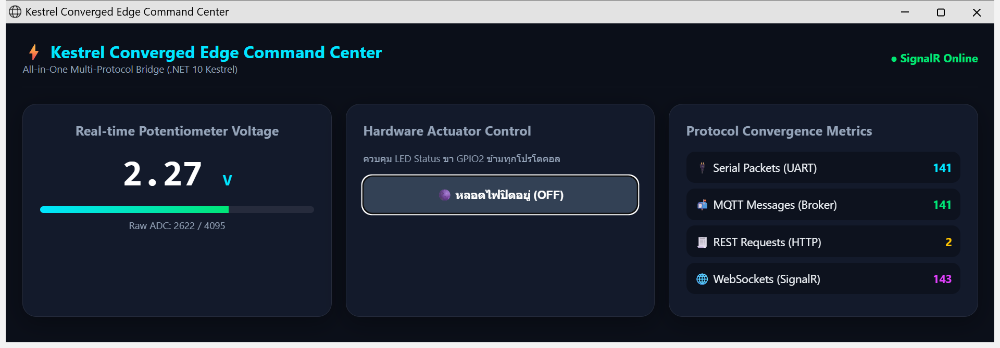
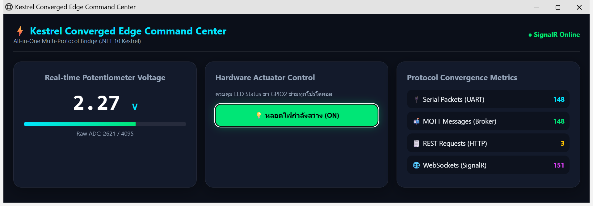

# ใบงานที่ 13.3 – SignalR Realtime Hub และเว็บแดชบอร์ดศูนย์บัญชาการ (Converged Web Dashboard)

> [← กลับหน้ารวม](README.md)  ·  ใบงาน: [08-Labsheet-13-3](../08-Labsheet-13-3-Realtime-SignalR-Hub-and-Converged-Web-Dashboard.md)  ·  โค้ด: [Code/Lab13-3](../Code/Lab13-3/README.md)

## 1. สภาพแวดล้อมที่ใช้ทดลอง

| รายการ | ค่า |
| :--- | :--- |
| บอร์ด | ESP32-D0WD-V3 (MAC `14:33:5c:0e:7a:a8`), CP210x ที่ **COM3** |
| เซนเซอร์ | ตัวต้านทานปรับค่าได้ (Potentiometer) ขากลาง → **GPIO34**, ขาริม → 3V3 / GND (ค่าจริง ไม่ได้สุ่ม) |
| เฟิร์มแวร์ | `Code/Lab13-2/esp32_serial_bridge` (ESP-IDF v6.1, `CONFIG_LAB_SIMULATE_ADC=n`) |
| เกตเวย์ | `Code/Lab13-3/ConvergedEdgeGateway` (.NET 10, MQTTnet 4.3.7.1207, SignalR) |
| SignalR JS client | @microsoft/signalr 10.0.11 เก็บไว้ใน `wwwroot/lib/signalr` (ไม่โหลดจาก CDN) |
| เบราว์เซอร์ | Microsoft Edge |
| วันที่ทดลอง | 27/10/2026 |

## 2. ขั้นตอนการทดลอง

### กิจกรรมที่ 13-3.1: SignalR Hub และตัวนับสถิติ (`Hubs.cs`)

- `GatewayHub.ToggleLed(bool state)` ส่ง `LED:ON`/`LED:OFF` ลงสาย Serial แล้วกระจาย `LedStateUpdated` ให้ทุกหน้าเว็บ
  ถ้าบอร์ดไม่ได้เสียบ จะส่ง `LedCommandFailed` กลับให้เฉพาะคนที่กด และปุ่มกลับสถานะเดิม
- `ProtocolMetrics` นับ Serial / MQTT / REST / SignalR ด้วย `Interlocked` (ปลอดภัยเมื่อหลาย thread นับพร้อมกัน)
  ใบงานใช้ `++` ธรรมดาซึ่งนับพลาดได้เมื่อมีการเพิ่มค่าพร้อมกัน

### กิจกรรมที่ 13-3.2: Worker ผลักข้อมูลเข้า Hub (`Services.cs`)

`SerialBridgeWorker` รับ `IHubContext<GatewayHub>` และ `ProtocolMetrics` ทาง Dependency Injection
ทุกบรรทัด JSON จากบอร์ดจะถูก: นับ Serial → ส่งเข้า MQTT (นับ MQTT) → ส่ง `ReceiveTelemetry` เข้า SignalR (นับ SignalR)

### กิจกรรมที่ 13-3.3: หน้าเว็บ (`wwwroot/index.html` + `app.js`)

หน้าตาตามใบงาน (Dark Glassmorphism, มาตรวัดแรงดัน, ปุ่ม LED, การ์ดสถิติ) มีส่วนที่ต่างจากใบงาน:

| ต่างจากใบงาน | เหตุผล |
| :--- | :--- |
| `signalr.min.js` เก็บในเครื่องแทน CDN | หน้าเว็บยังใช้งานได้เมื่อตัดอินเทอร์เน็ต (ใบงาน 13.4) |
| แยกสคริปต์เป็น `app.js` และตั้ง Content-Security-Policy | ห้ามสคริปต์ inline หรือสคริปต์จากเว็บอื่น |
| ใช้ `textContent` แทน `innerHTML` | กันการฉีดสคริปต์จากข้อมูลที่รับมา |
| เพิ่มตัวนับ REST Requests (การ์ดมี 4 แถว) | ครบ 4 โปรโตคอลตามวัตถุประสงค์ข้อ 4 |
| ปุ่ม LED ซิงก์กับค่า `"led"` ที่บอร์ดรายงาน | หน้าเว็บแสดงสถานะจริงของหลอดไฟ |

### กิจกรรมที่ 13-3.4: ผูก Static Files และ SignalR (`Program.cs`)

`AddSignalR()`, `AddSingleton<ProtocolMetrics>()`, `UseDefaultFiles()`, `UseStaticFiles()`, `MapHub<GatewayHub>("/hubs/gateway")`

```powershell
cd Code\Lab13-3\ConvergedEdgeGateway
dotnet run
```

แล้วเปิดเบราว์เซอร์ไปที่ `http://localhost:5000`

## 3. ผลการทดลอง

### 3.1 หน้าศูนย์บัญชาการ: ค่าแรงดันจากบอร์ดจริงและตัวนับ 4 โปรโตคอล (LED ปิด)



### 3.2 หลังคลิกปุ่มบนหน้าเว็บ: ปุ่มเป็นสีเขียว "ON" และ LED จริงบนบอร์ดติด



### 3.3 ตารางบันทึกผล

| สิ่งที่ใบงานให้สังเกต | ผลจริง | ผ่าน/ไม่ผ่าน |
| :--- | :--- | :--- |
| หัวเว็บแสดงสถานะการเชื่อมต่อ | `● SignalR Online` (สีเขียว) | ☑ ผ่าน |
| ตัวเลขแรงดันวิ่งสดตามตัวต้านทานบนบอร์ด | แสดง `2.27 V`, `Raw ADC: 2622 / 4095` อัปเดตทุก 500 ms (ค่าจาก GPIO34 จริง) | ☑ ผ่าน |
| ตัวนับ Serial, MQTT, SignalR วิ่งขึ้นพร้อมกัน | รูป 3.1 → 3.2 (ห่างกันประมาณ 4 วินาที): Serial 141 → 148, MQTT 141 → 148, SignalR 143 → 151 | ☑ ผ่าน |
| คลิกปุ่มบนเว็บ → LED จริงบนบอร์ดสว่าง | ปุ่มเปลี่ยนเป็น `💡 หลอดไฟกำลังสว่าง (ON)` LED GPIO2 ติด และค่าที่บอร์ดส่งกลับมาเป็น `"led":true` | ☑ ผ่าน |
| คลิกอีกครั้ง → LED ดับ | ปุ่มกลับเป็น `OFF` และบอร์ดรายงาน `"led":false` | ☑ ผ่าน |

**สรุป:** ข้อมูลจากสาย Serial ถูกผลักขึ้นหน้าเว็บทันทีผ่าน WebSocket (SignalR) โดยหน้าเว็บไม่ต้องร้องขอ
และคำสั่งจากหน้าเว็บวิ่งย้อนกลับผ่าน Hub → Serial → ESP32 ได้ในการเชื่อมต่อเดียวกัน
ตัวนับแสดงว่า 1 แพ็กเก็ตจาก Serial ถูกกระจายออกไปทั้ง MQTT และ SignalR พร้อมกัน (Serial = MQTT)
ส่วน SignalR มากกว่าเล็กน้อยจากการแจ้งสถานะ LED ทุกครั้งที่กดปุ่ม

## 4. คำถามท้ายการทดลอง

### ข้อ 1. ทำไม SignalR จึงให้ UX ดีกว่าการใช้ `setInterval()` ทำ HTTP GET Polling ทุก 500 ms?

1. **ข้อมูลมาถึงทันทีที่เกิด (Push)** เซิร์ฟเวอร์ส่งเมื่อมีข้อมูลใหม่ จึงไม่มีความหน่วงจากรอบ polling
   Polling ทุก 500 ms ทำให้ข้อมูลช้าได้สูงสุดเกือบ 500 ms บวกเวลา request อีก และตัวเลขจะกระตุกไม่สม่ำเสมอ
2. **Overhead ต่ำกว่ามาก** หลัง handshake ครั้งแรก WebSocket ส่งแค่เฟรมเล็ก ๆ (หัวเฟรมไม่กี่ไบต์)
   ขณะที่ HTTP polling ต้องส่ง header หลายร้อยไบต์ทุกครั้ง แม้ข้อมูลไม่เปลี่ยน คิดเป็น 2 request/วินาที/ผู้ใช้ 1 คน
   ถ้ามีผู้ใช้ 100 คน คือ 200 request/วินาทีที่ส่วนใหญ่ไม่มีข้อมูลใหม่
3. **ทุกหน้าจอเห็นตรงกันทันที** เมื่อคนหนึ่งกดปุ่ม Hub ส่ง `LedStateUpdated` ให้ทุกหน้าที่เปิดอยู่ทันที
   แบบ polling แต่ละหน้าจะเห็นการเปลี่ยนแปลงไม่พร้อมกัน
4. **สองทิศทางในการเชื่อมต่อเดียว** การสั่ง LED (`invoke("ToggleLed")`) ใช้ช่องทางเดียวกับการรับข้อมูล ไม่ต้องเปิด HTTP POST แยก
5. **จัดการการเชื่อมต่อให้เอง** `withAutomaticReconnect()` ต่อใหม่เมื่อหลุด และหน้าเว็บแสดงสถานะ Online/Disconnected ได้ถูกต้อง
   ถ้า WebSocket ใช้ไม่ได้ SignalR จะเปลี่ยนไปใช้ Server-Sent Events หรือ Long Polling ให้เอง
6. **ประหยัดทรัพยากรฝั่งเกตเวย์และอุปกรณ์** CPU และแบตเตอรี่ของมือถือหรือแท็บเล็ตไม่ต้องสร้าง request ซ้ำตลอดเวลา

### ข้อ 2. Protocol Convergence Metrics ช่วยตรวจสุขภาพระบบไอโอทีระดับโรงงานอย่างไร?

1. **เห็นจุดที่ข้อมูลหายทันที** ในภาวะปกติ 1 แพ็กเก็ต Serial ต้องกลายเป็น 1 ข้อความ MQTT และ 1 push ของ SignalR
   (ในการทดลอง Serial = MQTT = 148) ถ้าตัวเลขเริ่มห่างกัน แปลว่าขั้นใดขั้นหนึ่งมีปัญหา เช่น ส่งเข้า Broker ไม่สำเร็จ
2. **ตรวจว่าอุปกรณ์ยังมีชีวิต** ถ้าตัวนับ Serial หยุดเพิ่ม แปลว่าสายหลุด บอร์ดค้าง หรือพอร์ตถูกโปรแกรมอื่นแย่งใช้
   โดยไม่ต้องเดินไปดูที่เครื่อง
3. **วัดอัตราข้อมูลเทียบกับที่คาดไว้** บอร์ดส่งทุก 500 ms ควรได้ 2 แพ็กเก็ต/วินาที ถ้าอัตราตกหรือพุ่ง
   แปลว่าเฟิร์มแวร์หรือสายสื่อสารผิดปกติ
4. **เห็นภาระและพฤติกรรมผิดปกติจากภายนอก** ถ้า REST Requests พุ่งสูงผิดปกติ อาจเป็นระบบภายนอกที่ตั้งค่าผิด
   หรือมีการโจมตี (ใช้คู่กับ rate limit ที่ตั้งไว้ 10 ครั้ง / 10 วินาที)
5. **วางแผนขยายระบบ** ตัวเลขบอกว่าโปรโตคอลใดถูกใช้หนักที่สุด ช่วยตัดสินใจเพิ่มทรัพยากรหรือแยกบริการ
6. **ส่งต่อเข้าระบบเฝ้าระวังกลางได้** ค่าเดียวกันอ่านได้จาก `GET /api/metrics` จึงนำเข้า dashboard
   หรือระบบแจ้งเตือนของโรงงานได้ โดยไม่ต้องเปิดหน้าเว็บนี้

## 5. ข้อสังเกตเพิ่มเติม

- ระหว่างทดลองพบว่า Windows บางครั้งยกเลิกการอ่าน Serial กลางคัน (`OperationCanceledException`) หลังสั่ง LED
  ทำให้เกตเวย์หยุดทำงานทั้งตัว จึงแก้ `SerialBridgeWorker` ให้ถือเป็นการหลุดชั่วคราวแล้วเปิดพอร์ตใหม่
  (แก้แล้วใน Lab 13.2, 13.3 และ 13.4)
- บอร์ดตัวใหม่อ่าน GPIO34 ได้ 0 ตลอดในครั้งแรก ตรวจด้วยเฟิร์มแวร์ชั่วคราวที่สแกนทุกขา ADC1
  พบว่า ADC ปกติแต่ขา 34 ติดกับ GND หลังแก้สายตัวต้านทานปรับค่าได้แล้วอ่านค่าได้ปกติ (ประมาณ 1600–2700)
