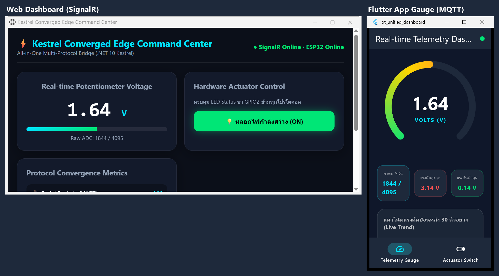
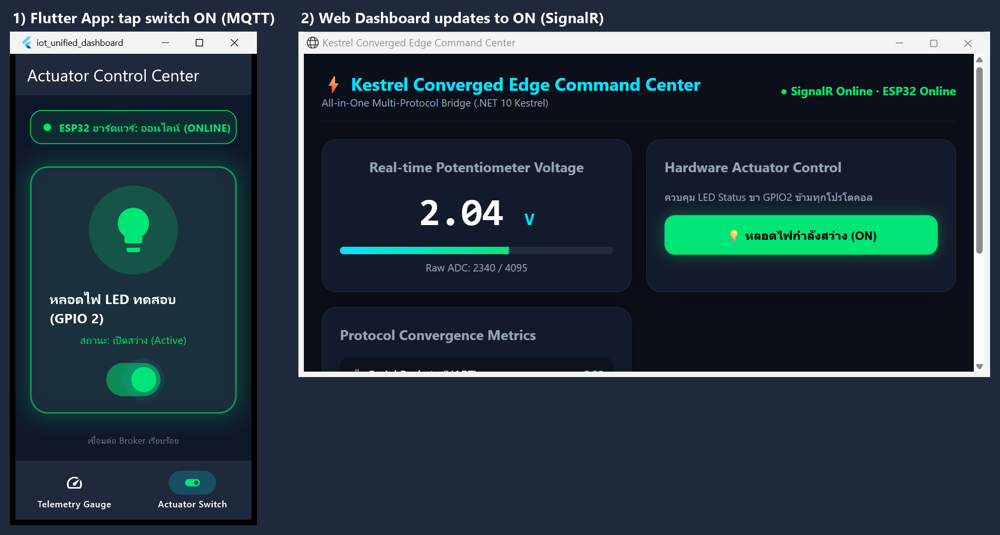
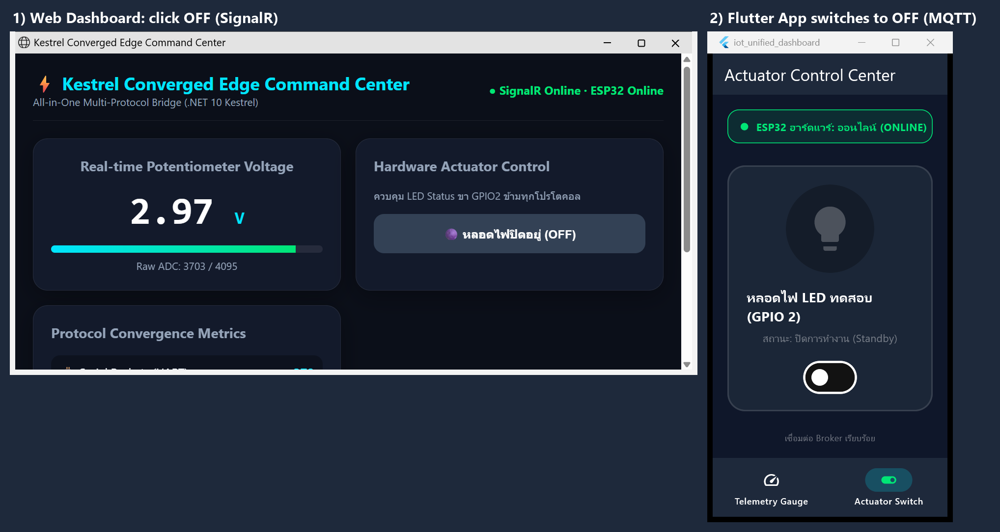
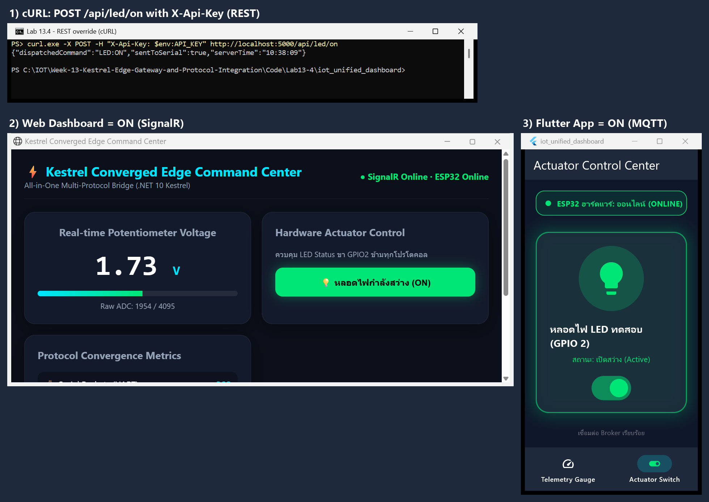
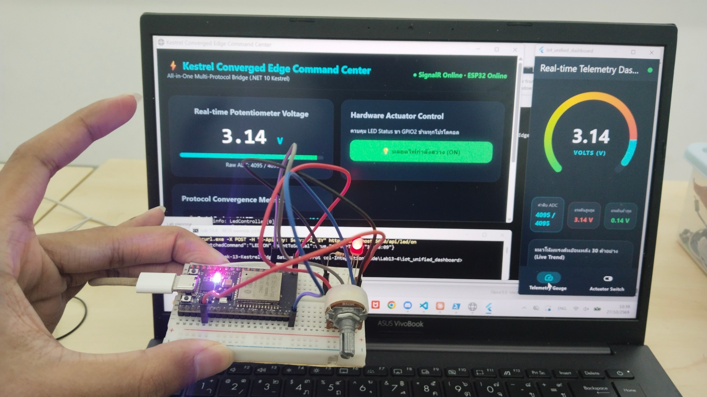
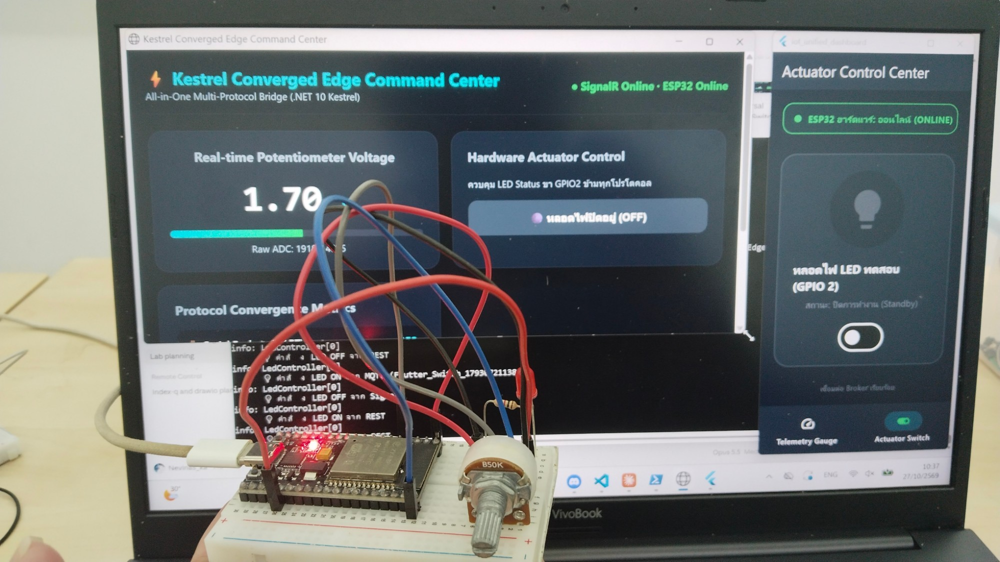

# ใบงานที่ 13.4 (The Grand Finale) – ผสานรวมระบบไอโอทีครบวงจร: ESP32 + Kestrel Gateway + Flutter App + Web Command Center

> [← กลับหน้ารวม](README.md)  ·  ใบงาน: [09-Labsheet-13-4](../09-Labsheet-13-4-The-Grand-Finale-All-in-One-IoT-System-Integration.md)  ·  โค้ด: [Code/Lab13-4](../Code/Lab13-4/README.md)

## 1. สภาพแวดล้อมที่ใช้ทดลอง

| ส่วนของระบบ | รายละเอียด |
| :--- | :--- |
| ฮาร์ดแวร์ | ESP32-D0WD-V3 (CP210x ที่ **COM3**), ตัวต้านทานปรับค่าได้ที่ **GPIO34**, LED บนบอร์ดที่ **GPIO2** |
| เฟิร์มแวร์ | `Code/Lab13-2/esp32_serial_bridge` (ESP-IDF v6.1) อ่านค่า ADC จริง |
| เกตเวย์ | `Code/Lab13-4/ConvergedEdgeGateway` (.NET 10, MQTTnet 4.3.7.1207, SignalR) |
| เว็บแดชบอร์ด | Microsoft Edge → `http://localhost:5000` |
| แอปมือถือ | Flutter 3.47.7 `Code/Lab13-4/iot_unified_dashboard` (แอปจากสัปดาห์ที่ 12 + ล็อกอิน MQTT) **รันบน Windows Desktop** ซึ่งใบงานอนุญาต ("รันบนเครื่องคอมพิวเตอร์ผ่าน `flutter run`") |
| Broker IP ในแอป | `127.0.0.1:1883` (ตั้งใน `gateway.env.json` ซึ่งไม่ถูก commit) |
| วันที่ทดลอง | 27/10/2026 |

### หัวข้อ MQTT ที่ใช้ร่วมกันระหว่างเกตเวย์และแอป

| Topic | ใครส่ง | Payload |
| :--- | :--- | :--- |
| `iot/esp32/telemetry` | เกตเวย์ (แปลงจาก Serial) | `{"voltage":1.64,"raw":1844,"led":true,"ts":...}` |
| `iot/esp32/status` (retain) | เกตเวย์ | `online` / `offline` ตามสถานะพอร์ต Serial |
| `iot/esp32/control` | แอป Flutter | `{"led":"ON"}` / `{"led":"OFF"}` |
| `iot/esp32/led_ack` (retain) | เกตเวย์ | `{"led_state":true}` |

ทุกคำสั่ง LED ไม่ว่ามาจาก MQTT, SignalR หรือ REST ผ่าน `LedController` จุดเดียว
ซึ่งส่งคำสั่งลงสาย Serial แล้วแจ้งสถานะใหม่ทั้ง `led_ack` (แอป) และ `LedStateUpdated` (เว็บ) พร้อมกัน

## 2. กิจกรรมที่ 13-4.1: การเตรียมพร้อมทุกระบบ

| ขั้นตอน | ผล |
| :--- | :--- |
| 1. ESP32: ต่อตัวต้านทานปรับค่าได้ที่ GPIO34, LED GPIO2, เสียบ USB | บอร์ดส่ง JSON ทุก 500 ms |
| 2. Kestrel Gateway: `dotnet run` | `/api/health` → `{"serialConnected":true,...}` |
| 3. เว็บเบราว์เซอร์ `http://localhost:5000` | `● SignalR Online · ESP32 Online` |
| 4. แอป Flutter (`flutter run --dart-define-from-file=gateway.env.json`) | จุดสถานะสีเขียว, หน้าสวิตช์แสดง `ESP32 ฮาร์ดแวร์: ออนไลน์ (ONLINE)` และ `/api/health` → `"mqttClients":2` (แอปเปิด 2 หน้าจอ ใช้ 2 การเชื่อมต่อ) |

## 3. กิจกรรมที่ 13-4.2: The Grand Verification Matrix

### ทดสอบที่ 1 – Universal Telemetry Sync (หมุนตัวต้านทาน)

### ทดสอบที่ 2 – Mobile-to-Web Actuation (แตะสวิตช์บนแอป Flutter → MQTT)

### ทดสอบที่ 3 – Web-to-Mobile Actuation (คลิกปุ่มบนเว็บ → SignalR)

### ทดสอบที่ 4 – Third-Party REST Override (cURL)

> รูปทุกรูปเป็นภาพจับจากหน้าต่างจริงขณะทดสอบ วางเรียงกันในรูปเดียวเพื่อให้เห็นทุกหน้าจอในจังหวะเดียวกัน

### ภาพถ่ายฮาร์ดแวร์จริงคู่กับหน้าจอ

**หมุนตัวต้านทานสุด (3.14 V) และสั่ง ON ผ่าน REST:** เว็บและแอป Flutter แสดง 3.14 V ตรงกัน ปุ่มบนเว็บเป็น ON
หน้าต่าง cURL ด้านหลังแสดงคำสั่ง `POST /api/led/on` และ LED จริงบน breadboard ติดสว่าง (ทดสอบที่ 1 และ 4)

**สั่ง OFF จากหน้าเว็บ:** เว็บเป็น OFF แอปเปลี่ยนเป็น `ปิดการทำงาน (Standby)` และ LED จริงดับ
log ของเกตเวย์ด้านหลังแสดงคำสั่งจากทั้ง REST, MQTT (Flutter) และ SignalR ที่ผ่าน `LedController` (ทดสอบที่ 3)

### ตารางบันทึกผล

| มิติการทดสอบ | การกระทำ | ปรากฏการณ์ที่เกิดขึ้นจริง | ผลการทดลอง |
| :--- | :--- | :--- | :--- |
| **1. Universal Telemetry Sync** | หมุนตัวต้านทานบนบอร์ดจริง | ค่าแรงดันวิ่ง 0.90 → 1.09 → 1.23 → 1.41 → 1.68 V ภายใน 3 วินาที เว็บและเข็ม Radial Gauge บน Flutter แสดง **1.64 V (raw 1844)** ตรงกันในจังหวะเดียวกัน แอปบันทึกช่วงที่หมุนได้ 0.14–3.14 V | ☑ ผ่าน |
| **2. Mobile-to-Web Actuation** | แตะสวิตช์บนแอป Flutter (MQTT `iot/esp32/control`) | LED GPIO2 บนบอร์ดติด, บอร์ดรายงาน `"led":true`, ปุ่มบนเว็บเปลี่ยนเป็นสีเขียว `(ON)` เอง | ☑ ผ่าน |
| **3. Web-to-Mobile Actuation** | คลิกปุ่มบนหน้าเว็บ (SignalR `ToggleLed`) | LED ดับ, บอร์ดรายงาน `"led":false`, สวิตช์บนแอปกลับเป็น OFF และสถานะ `ปิดการทำงาน (Standby)` | ☑ ผ่าน |
| **4. Third-Party REST Override** | `curl.exe -X POST -H "X-Api-Key: $env:API_KEY" http://localhost:5000/api/led/on` | ตอบ `{"dispatchedCommand":"LED:ON","sentToSerial":true}`, LED ติด, ทั้งเว็บและแอปเป็น ON พร้อมกัน | ☑ ผ่าน |

ตัวนับหลังทดสอบ (`/api/metrics`): Serial 441, MQTT 452, REST 29, SignalR 450
(MQTT และ SignalR มากกว่า Serial เพราะมีข้อความแจ้งสถานะ LED เพิ่มทุกครั้งที่สั่ง)

> หมายเหตุคำสั่งในใบงาน: `curl -X POST http://localhost:5000/api/led/on` ใช้กับโค้ดชุดนี้ไม่ได้ เพราะเกตเวย์บังคับ header `X-Api-Key`
> (ถ้าไม่ส่งจะได้ `401`) และใน PowerShell 5.1 ต้องพิมพ์ `curl.exe`

## 4. กิจกรรมที่ 13-4.3: ความทนทานเมื่อตัดอินเทอร์เน็ต (Local Survivability)

**วิธีทดสอบ:** ถอดสาย LAN หรือปิดอินเทอร์เน็ตภายนอก คงไว้แค่ Wi-Fi ในวงแลน แล้วทำตารางในข้อ 3 ซ้ำ

**ข้อมูลยืนยันจากการตรวจสอบระบบ:**
- ทุกส่วนคุยกันภายในเครื่อง/วงแลน: ESP32 ↔ เกตเวย์ทางสาย USB, แอป ↔ Broker ที่ `127.0.0.1:1883`, เว็บ ↔ `localhost:5000`
- ไฟล์ทั้งหมดที่หน้าเว็บโหลด (ตรวจจาก network log ของเบราว์เซอร์) มาจาก `http://localhost:5000` เท่านั้น:
  `/`, `/lib/signalr/signalr.min.js`, `/app.js`, `/hubs/gateway` **ไม่มีการเรียก CDN หรือเซิร์ฟเวอร์ภายนอก**
  (ใบงาน 13.3 ต้นฉบับโหลด `signalr.min.js` จาก cdnjs ซึ่งจะทำให้หน้าเว็บใช้งานไม่ได้เมื่อไม่มีอินเทอร์เน็ต)
- MQTT Broker ฝังอยู่ใน Kestrel จึงไม่พึ่งคลาวด์

| การสังเกต | ผลที่คาดหวัง | ผลจริง (กรอกหลังทดสอบตัดเน็ต) |
| :--- | :--- | :--- |
| ESP32 ยังส่งข้อมูลได้หรือไม่ | ได้ (สาย USB ไม่เกี่ยวกับอินเทอร์เน็ต) | ☐ |
| แอป Flutter และเว็บยังเห็นค่าและสั่ง LED ได้หรือไม่ | ได้ (Broker และเว็บอยู่ในเครื่อง) | ☐ |

> ขั้นนี้ต้องให้ผู้ทดลองถอดสายหรือปิดอินเทอร์เน็ตเอง ระหว่างที่ผู้ช่วยทำการทดลองยังคงต้องใช้อินเทอร์เน็ต จึงยังไม่ได้ตัดเน็ตจริง

**สรุป:** ระบบที่ออกแบบด้วยสถาปัตยกรรม Converged Edge Gateway ทำงานได้โดยไม่พึ่งอินเทอร์เน็ตภายนอก
เพราะทุกโปรโตคอล (Serial, MQTT, REST, WebSocket) จบอยู่ที่เกตเวย์ในพื้นที่

## 5. บทสรุปและคำถามส่งท้ายภาคการศึกษา (Capstone Retrospective)

### ข้อ 1. สถาปัตยกรรมชิ้นใดมีความท้าทายเชิงวิศวกรรมมากที่สุด เพราะเหตุใด?

**การรักษาสถานะให้ตรงกันข้ามหลายโปรโตคอล (State Synchronization) ในเกตเวย์** ท้าทายที่สุด เพราะ:

- **แหล่งคำสั่งมีหลายทาง แต่อุปกรณ์มีตัวเดียว** คำสั่ง LED มาได้ทั้งจาก MQTT, SignalR และ REST ในเวลาใดก็ได้
  ถ้าแต่ละทางสั่ง Serial และแจ้งสถานะเอง หน้าจอจะเห็นไม่ตรงกัน จึงต้องรวมเป็น `LedController` จุดเดียว
  มี lock ป้องกันคำสั่งชนกัน แล้วกระจายสถานะไปทุกช่องทาง
- **ปัญหาเวลาและข้อมูลค้าง** ข้อมูล telemetry ที่ค้างอยู่ในบัฟเฟอร์ Serial ตอนส่งคำสั่งยังมีสถานะเก่า
  ถ้าใช้ซิงก์ทันที ปุ่มจะกระพริบ จึงต้องเว้นช่วงหลังส่งคำสั่ง (1.5 วินาที) ก่อนเชื่อค่าที่บอร์ดรายงาน
- **ทรัพยากรฮาร์ดแวร์ใช้ร่วมกันไม่ได้** พอร์ต COM เปิดได้ทีละโปรแกรม ต้องมี `BackgroundService` เป็นเจ้าของคนเดียว
  และต้องรับมือการหลุดของสาย/ไดรเวอร์ (ในการทดลองพบ `OperationCanceledException` จาก Windows ที่ทำให้เกตเวย์ล่ม)
- **ลำดับการเริ่มต้นของบริการ** Worker ส่งข้อมูลเข้า MQTT ก่อน Broker สตาร์ทเสร็จจะทำให้ทั้งระบบหยุด
  ต้องออกแบบให้รอบริการอื่นพร้อมก่อน

### ข้อ 2. หากนำไปติดตั้งในโรงงานจริง 3 ปัจจัยแรกที่ต้องดำเนินการเพิ่มเพื่อความปลอดภัยและความมั่นคงระดับองค์กร?

1. **เข้ารหัสและยืนยันตัวตนทุกช่องทาง**
   - เปลี่ยน MQTT 1883 เป็น MQTT over TLS (8883) และใช้ mTLS หรือใบรับรองต่ออุปกรณ์ (ตามสัปดาห์ที่ 11)
   - เว็บและ REST ใช้ HTTPS
   - ระบบล็อกอินผู้ใช้ (เช่น OpenID Connect) พร้อมสิทธิ์แยกระหว่างคนดูค่ากับคนสั่งงานเครื่องจักร
   - ACL ราย topic
   - เก็บความลับใน Secret Store หรือ TPM แทนไฟล์
   - Lab นี้มีแค่รหัสผ่าน MQTT, API key และการกันปลอม topic เท่านั้น
2. **ความทนทานและความพร้อมใช้งาน (Resilience)**
   - รันเกตเวย์เป็น Windows Service หรือ systemd ให้เริ่มใหม่เองเมื่อล่ม
   - Watchdog และ health check (`/api/health`) ต่อเข้าระบบแจ้งเตือน
   - Store-and-Forward บัฟเฟอร์ข้อมูลลงดิสก์เมื่อคลาวด์ขาดการเชื่อมต่อ
   - Circuit Breaker สำหรับปลายทางที่ล่ม
   - มีเกตเวย์สำรอง (redundancy) สำหรับจุดสำคัญ
   - ใช้ RS-485 ที่ทนสัญญาณรบกวนแทน USB
3. **การบริหารจัดการและตรวจสอบย้อนหลัง (Operations & Governance)**
   - บันทึก audit log ว่าใครสั่งอะไร เมื่อใด ผ่านช่องทางใด
   - แยกเครือข่าย OT/IT ด้วย VLAN และไฟร์วอลล์ (เปิดเฉพาะพอร์ตที่จำเป็น)
   - อัปเดตเฟิร์มแวร์แบบ OTA ที่เซ็นรับรอง (Secure Boot + Flash Encryption บน ESP32)
   - ล็อกเวอร์ชันซอฟต์แวร์และสแกนช่องโหว่ไลบรารีเป็นประจำ (โปรเจกต์นี้เริ่มไว้แล้วด้วย NuGet Audit และ lock files)

### ข้อ 3.

รับทราบครับ 🎉 จบการทดลองครบทั้ง 4 ใบงานของสัปดาห์ที่ 13

## 6. ข้อสังเกตเพิ่มเติม

- แอป Flutter ทดสอบบน Windows Desktop ไม่ใช่มือถือจริง เพราะเครื่องนี้ยังไม่ได้ติดตั้ง Android SDK
  เส้นทางข้อมูลเหมือนกันทุกอย่าง ต่างกันแค่ IP ของ Broker ถ้ารันบนมือถือ ให้ตั้ง `GATEWAY_HOST` เป็น IP วงแลนของคอมพิวเตอร์
  และเปิดไฟร์วอลล์พอร์ต 1883 เฉพาะโปรไฟล์ Private
- รหัสผ่าน MQTT ที่ใส่ผ่าน `--dart-define` ถูกฝังอยู่ในไฟล์แอปที่ build แล้ว ไฟล์ build และ `gateway.env.json` ไม่ถูก commit
  ควรใช้รหัสเฉพาะสำหรับ Lab และไม่ใช้ซ้ำกับรหัส Wi-Fi
