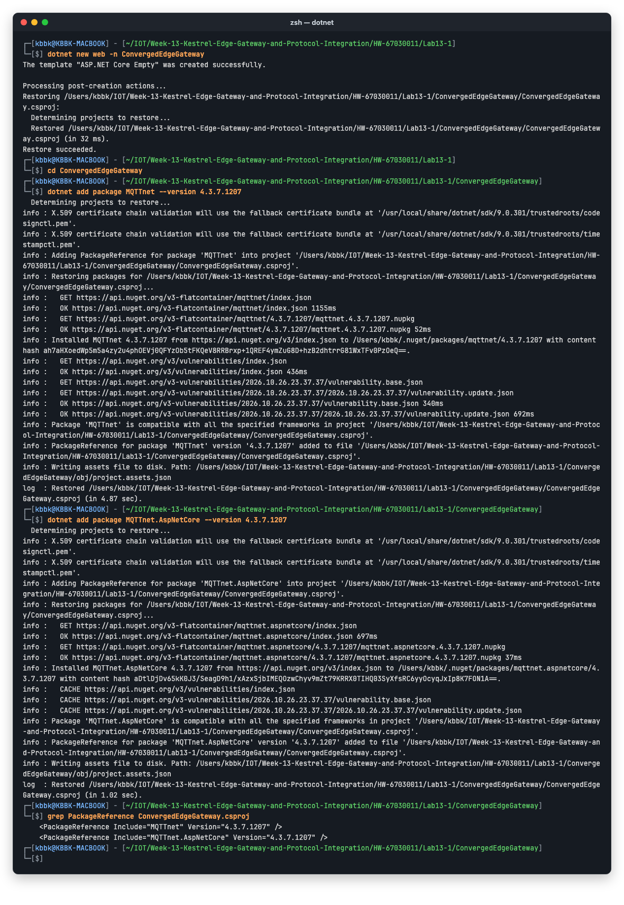
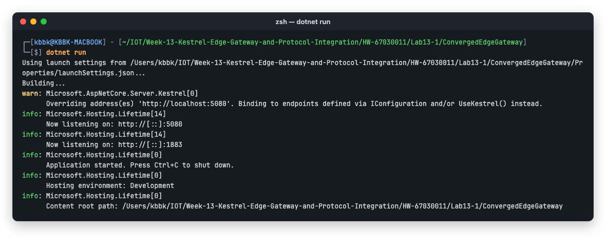
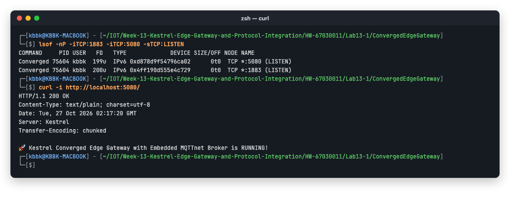
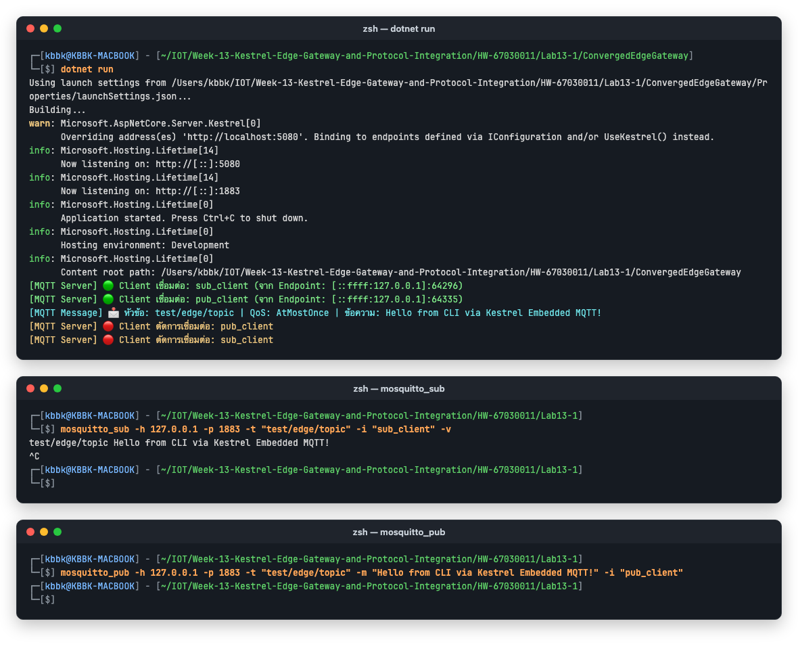
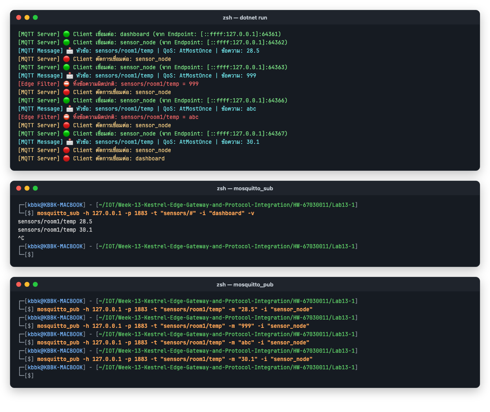

# ใบงานการทดลองที่ 13.1
### การสร้าง Embedded MQTT Broker และ Client ภายใน Kestrel .NET 8 ด้วยไลบรารี MQTTnet

> [!NOTE] **คำชี้แจง**
> ในใบงานนี้นักศึกษาจะได้เปลี่ยนเว็บเซิร์ฟเวอร์ ASP.NET Core Kestrel ให้กลายเป็น **Embedded MQTT Broker** แบบเบ็ดเสร็จในตัวเอง โดยใช้ไลบรารี **`MQTTnet`** ทำให้แอปพลิเคชัน C# เพียงตัวเดียวสามารถรับการเชื่อมต่อจาก MQTT Client ภายนอกผ่านพอร์ต 1883 และสามารถดักจับ (Intercept) ข้อความเพื่อนำมาประมวลผลภายในได้อย่างมีประสิทธิภาพ โดยไม่ต้องติดตั้ง Mosquitto ภายนอก

---

## 1. วัตถุประสงค์การทดลอง
1. สามารถสร้างโปรเจกต์ ASP.NET Core Web Application (.NET 8) และติดตั้งแพ็กเกจ `MQTTnet.AspNetCore` ได้
2. สามารถกำหนดค่า Kestrel ให้เปิดพอร์ต TCP 1883 สำหรับให้บริการ Embedded MQTT Server ได้
3. สามารถเขียน Event Interceptor เพื่อดักจับข้อความ Inbound และบันทึก Log ลงในระบบได้
4. สามารถทดสอบการเชื่อมต่อ การ Publish และการ Subscribe ผ่านเครื่องมือ Mosquitto CLI หรือ MQTTX ได้

> [!NOTE] **สภาพแวดล้อมที่ใช้ทำการทดลองจริง (รหัสนักศึกษา 67030011)**
> * macOS 15.5 (Apple Silicon), .NET SDK **9.0.301** (`dotnet new web` จึงได้ `net9.0`), MQTTnet / MQTTnet.AspNetCore **4.3.7.1207**, Mosquitto CLI **2.0.22**
> * ใบงานเขียนไว้สำหรับ Windows PowerShell — บน Mac ใช้ zsh แทน คำสั่ง `dotnet` และ `mosquitto_*` เหมือนกันทุกตัว
> * **พอร์ต HTTP ใช้ 5080 แทน 5000** เพราะบน macOS พอร์ต 5000 ถูก AirPlay Receiver (ControlCenter) จองไว้ ส่วนพอร์ต MQTT ยังเป็น 1883 ตามใบงาน
> * ใบงานนี้เป็นซอฟต์แวร์ล้วน ยังไม่ต้องใช้บอร์ด ESP32
> * โปรเจกต์: [Lab13-1/ConvergedEdgeGateway/](Lab13-1/ConvergedEdgeGateway/) และ Log ดิบทั้งหมดอยู่ใน [Lab13-1/logs/](Lab13-1/logs/)

---

## 2. โครงสร้างสถาปัตยกรรม (Architecture Diagram)

<p align="center"></p>
<p align="center"><b></b>โครงสร้างสถาปัตยกรรม (Architecture Diagram)</p>

---

## 3. ขั้นตอนการทดลอง (Step-by-Step Activities)

### กิจกรรมที่ 13-1.1: การสร้างโปรเจกต์และติดตั้งแพ็กเกจ

#### 1. สร้างโปรเจกต์ .NET 8 Web ใหม่
เปิด PowerShell ในโฟลเดอร์สำหรับทำงาน:
```powershell
dotnet new web -n ConvergedEdgeGateway
cd ConvergedEdgeGateway
```

#### 2. ติดตั้งแพ็กเกจ `MQTTnet` และ `MQTTnet.AspNetCore`
```powershell
dotnet add package MQTTnet --version 4.3.7.1207
dotnet add package MQTTnet.AspNetCore --version 4.3.7.1207
```

**ผลการทดลอง:** สร้างโปรเจกต์จากเทมเพลต "ASP.NET Core Empty" สำเร็จ และ Restore ผ่าน จากนั้นติดตั้ง `MQTTnet` และ `MQTTnet.AspNetCore` เวอร์ชัน **4.3.7.1207** ตรงตามใบงาน NuGet แจ้งว่าแพ็กเกจเข้ากันได้กับ Framework ของโปรเจกต์ (`net9.0`) และไฟล์ `.csproj` มี `PackageReference` ครบทั้ง 2 ตัว

<p align="center">

</p>

---

### กิจกรรมที่ 13-1.2: การเขียนโค้ดตั้งค่าเซิร์ฟเวอร์ (`Program.cs`)

เปิดไฟล์ `Program.cs` และแทนที่ด้วยโค้ดต่อไปนี้:

```csharp
using MQTTnet;
using MQTTnet.AspNetCore;
using MQTTnet.Server;

var builder = WebApplication.CreateBuilder(args);

// 1. กำหนดค่า Kestrel ให้เปิดทั้งพอร์ต HTTP (5000) และ MQTT TCP (1883)
builder.WebHost.ConfigureKestrel(options =>
{
    // พอร์ตสำหรับ HTTP REST APIs และเว็บแดชบอร์ด
    options.ListenAnyIP(5000);

    // พอร์ตสำหรับ Embedded MQTT Broker
    options.ListenAnyIP(1883, listenOptions =>
    {
        listenOptions.UseMqtt();
    });
});

// 2. ลงทะเบียนบริการ MQTT Server
builder.Services.AddMqttServer(options =>
{
    options.WithDefaultEndpoint();
});

var app = builder.Build();

// 3. ผูก Event Handlers สำหรับจัดการข้อความใน Broker
app.UseMqttServer(server =>
{
    // ตรวจสอบการเชื่อมต่อ: กรณี Client ไม่ได้ระบุ ClientId (เช่น mosquitto CLI ที่ไม่ได้ใส่ -i)
    // ให้ Broker สุ่ม ClientId ให้โดยอัตโนมัติ เพื่อป้องกัน Connection Refused: identifier rejected
    server.ValidatingConnectionAsync += args =>
    {
        if (string.IsNullOrEmpty(args.ClientId))
        {
            args.AssignedClientIdentifier = Guid.NewGuid().ToString("N");
        }
        return Task.CompletedTask;
    };

    // เมื่อมี Client เชื่อมต่อเข้ามา
    server.ClientConnectedAsync += args =>
    {
        Console.ForegroundColor = ConsoleColor.Green;
        Console.WriteLine($"[MQTT Server] 🟢 Client เชื่อมต่อ: {args.ClientId} (จาก Endpoint: {args.Endpoint})");
        Console.ResetColor();
        return Task.CompletedTask;
    };

    // เมื่อ Client ตัดการเชื่อมต่อ
    server.ClientDisconnectedAsync += args =>
    {
        Console.ForegroundColor = ConsoleColor.DarkYellow;
        Console.WriteLine($"[MQTT Server] 🔴 Client ตัดการเชื่อมต่อ: {args.ClientId}");
        Console.ResetColor();
        return Task.CompletedTask;
    };

    // ดักจับและอ่านข้อความที่ถูก Publish ทุกฉบับ
    server.InterceptingPublishAsync += args =>
    {
        var topic = args.ApplicationMessage.Topic;
        var payload = args.ApplicationMessage.ConvertPayloadToString();
        var qos = args.ApplicationMessage.QualityOfServiceLevel;

        Console.ForegroundColor = ConsoleColor.Cyan;
        Console.WriteLine($"[MQTT Message] 📩 หัวข้อ: {topic} | QoS: {qos} | ข้อความ: {payload}");
        Console.ResetColor();

        return Task.CompletedTask;
    };
});

// 4. จุดทดสอบ REST Endpoint เบื้องต้น
app.MapGet("/", () => "🚀 Kestrel Converged Edge Gateway with Embedded MQTTnet Broker is RUNNING!");

app.Run();
```

**ผลการทดลอง:** ใช้โค้ดตามใบงานทั้งหมด โดยต่างจากใบงาน 2 จุด ดูโค้ดเต็มได้ที่ [Program.cs](Lab13-1/ConvergedEdgeGateway/Program.cs)
1. `options.ListenAnyIP(5000)` เปลี่ยนเป็น `options.ListenAnyIP(5080)` เพราะพอร์ต 5000 บน macOS ถูก AirPlay Receiver ใช้อยู่ ถ้าไม่เปลี่ยน Kestrel จะ Bind ไม่ได้ และ `applicationUrl` ใน `Properties/launchSettings.json` ก็แก้เป็น `http://localhost:5080` ด้วย
2. เพิ่ม Edge Validation สำหรับหัวข้อ `sensors/#` ใน `InterceptingPublishAsync` (ใช้ตอบคำถามข้อ 2) ซึ่งไม่กระทบการทดสอบหัวข้อ `test/edge/topic` ของใบงาน

---

### กิจกรรมที่ 13-1.3: การสั่งรันและทดสอบด้วยเครื่องมือ CLI

#### 1. สั่งรัน Kestrel Edge Gateway
```powershell
dotnet run
```
*สังเกตข้อความบนคอนโซลว่าเซิร์ฟเวอร์กำลังฟังที่พอร์ต 5000 (HTTP) และ 1883 (MQTT)*

**ผลการทดลอง:** Kestrel ขึ้น `Now listening on: http://[::]:5080` และ `Now listening on: http://[::]:1883` แสดงว่าโปรเซสเดียวเปิดรับทั้ง HTTP และ MQTT (Kestrel พิมพ์คำว่า `http://` นำหน้าทุก Endpoint แม้พอร์ต 1883 จะใช้ `UseMqtt()` เป็น Connection Handler ก็ตาม)

ส่วนคำเตือน `Overriding address(es) 'http://localhost:5080'` เกิดจาก `ConfigureKestrel` กำหนด Endpoint ไว้ในโค้ดแล้ว Kestrel จึงไม่ใช้ `applicationUrl` จาก `launchSettings.json` ซึ่งเป็นพฤติกรรมที่ถูกต้อง

<p align="center">

</p>

ตรวจสอบเพิ่มเติมจากอีกหน้าต่าง `lsof` แสดงว่าทั้งพอร์ต 5080 และ 1883 เป็นของโปรเซส `ConvergedEdgeGateway` เดียวกัน (PID เดียวกัน) และ `curl` ที่ `/` ได้ `HTTP/1.1 200 OK` พร้อม Header `Server: Kestrel` และข้อความ "…is RUNNING!"

<p align="center">

</p>

#### 2. เปิดหน้าต่าง PowerShell ที่สอง: ทดสอบ Subscribe หัวข้อ
ใช้คำสั่ง `mosquitto_sub` เพื่อดักฟังข้อความจาก Embedded Broker ของเรา (ระบุพารามิเตอร์ `-i` เพื่อกำหนด Client ID):
```powershell
mosquitto_sub -h 127.0.0.1 -p 1883 -t "test/edge/topic" -i "sub_client" -v
```
> **ข้อสังเกต:** มาตรฐาน MQTT กำหนดให้ Client ต้องมี Client ID เสมอ สำหรับเครื่องมือ `mosquitto_sub` บน Windows หากไม่ระบุออปชัน `-i` มันจะส่ง Client ID ว่างเปล่ามา ซึ่งในโค้ดฝั่ง Broker เราได้ตั้งค่า `ValidatingConnectionAsync` ให้สุ่ม Client ID ให้โดยอัตโนมัติแล้ว

*สังเกตหน้าต่างคอนโซลของ Kestrel จะขึ้นข้อความสีเขียวว่ามี Client เชื่อมต่อเข้ามา!*

#### 3. เปิดหน้าต่าง PowerShell ที่สาม: ทดสอบ Publish ข้อความ
ส่งข้อความผ่าน `mosquitto_pub`:
```powershell
mosquitto_pub -h 127.0.0.1 -p 1883 -t "test/edge/topic" -m "Hello from CLI via Kestrel Embedded MQTT!" -i "pub_client"
```

#### 4. สังเกตผลลัพธ์
* หน้าต่าง Kestrel จะพิมพ์ Log สีฟ้าว่าดักจับข้อความได้ถูกต้อง
* หน้าต่าง `mosquitto_sub` จะได้รับข้อความที่ถูกส่งต่อผ่าน Broker สำเร็จทันที

**ผลการทดลอง:** ทั้ง 3 หน้าต่างทำงานตรงตามใบงาน
* **หน้าต่าง Kestrel**
  * เมื่อเปิด `mosquitto_sub` ขึ้นบรรทัดสีเขียว `Client เชื่อมต่อ: sub_client`
  * เมื่อสั่ง `mosquitto_pub` ขึ้นบรรทัดสีเขียวของ `pub_client` ตามด้วย Log สีฟ้า `หัวข้อ: test/edge/topic | QoS: AtMostOnce | ข้อความ: Hello from CLI via Kestrel Embedded MQTT!`
  * `mosquitto_pub` ส่งเสร็จแล้วตัดการเชื่อมต่อเองทันที จึงขึ้นบรรทัดสีเหลือง `Client ตัดการเชื่อมต่อ: pub_client`
  * เมื่อกด Ctrl+C ที่ `mosquitto_sub` ก็ขึ้นบรรทัดสีเหลืองของ `sub_client`
* **หน้าต่าง `mosquitto_sub`** ได้รับข้อความ `test/edge/topic Hello from CLI via Kestrel Embedded MQTT!` ทันที แสดงว่า Embedded Broker ส่งต่อข้อความให้ Subscriber ได้จริงโดยไม่ต้องมี Mosquitto Broker
* QoS ที่ได้เป็น `AtMostOnce` (QoS 0) เพราะ `mosquitto_pub` ใช้ QoS 0 เป็นค่าเริ่มต้นเมื่อไม่ระบุ `-q`

<p align="center">

</p>

---

## 4. คำถามท้ายการทดลอง (Review Questions)
1. **การรัน Embedded MQTT Broker ภายใน Kestrel มีข้อได้เปรียบกว่าการติดตั้งซอฟต์แวร์ Mosquitto แยกต่างหากอย่างไรในแง่ของการกระจายงาน (Deployment) และการประมวลผลข้อมูลในหน่วยความจำ?**
   * **คำตอบ:**
     * **ด้าน Deployment:** เกตเวย์ทั้งระบบเป็นแอปพลิเคชันเดียวและโปรเซสเดียว จากผล `lsof` ข้างบน พอร์ต 5080 (HTTP) และ 1883 (MQTT) อยู่ใน PID เดียวกัน
       * การติดตั้งเหลือแค่ `dotnet publish` แล้วคัดลอกไฟล์ไปเครื่องปลายทาง ไม่ต้องติดตั้ง Mosquitto ไม่ต้องเขียน `mosquitto.conf` และไม่ต้องดูแล Service แยกอีกตัว
       * ตอนทำสัปดาห์ที่ 11–12 ต้องรัน Broker แยกทุกครั้ง แต่ตอนนี้ `dotnet run` ครั้งเดียวก็มี Broker พร้อมใช้
       * เวอร์ชันของ Broker ถูกล็อกไว้ใน `.csproj` (MQTTnet 4.3.7.1207) จึงได้ Broker เวอร์ชันเดียวกันทุกเครื่อง
       * การตั้งค่า, Log (ผ่าน `ILogger` ตัวเดียวกัน), Health check และการอัปเดตรวมอยู่ใน Artifact เดียว เหมาะกับ Edge Device ที่มีทรัพยากรและคนดูแลจำกัด
     * **ด้านการประมวลผลในหน่วยความจำ:** ข้อความทุกฉบับเข้า Event (`InterceptingPublishAsync`) ในโปรเซสเดียวกับโค้ดของเรา เป็นอ็อบเจกต์ใน Memory ตรง ๆ
       * โค้ด C# จึงอ่าน กรอง แปลง หรือส่งต่อข้อความไปยัง REST API, SignalR หรือ State Store ได้ทันที โดยไม่ต้องเปิด MQTT Client อีกตัวมา Subscribe ผ่าน TCP Loopback
       * ตัดการ Serialize/Deserialize ซ้ำและ Network hop ภายในเครื่องออก ทำให้ Latency ต่ำลง
       * ฝั่ง Gateway ก็ยัด (Inject) ข้อความเข้า Broker เองได้ด้วย `InjectApplicationMessage` ซึ่ง Lab 13.2 ใช้วิธีนี้ส่งข้อมูลจาก Serial เข้า MQTT
     * ข้อแลกเปลี่ยนคือ Broker ตายพร้อมแอป (Single point of failure) และยังขาดฟีเจอร์ระดับ Production บางอย่างของ Mosquitto ที่ตั้งค่าไว้พร้อม เช่น Persistence, ACL file และ Bridge ไป Broker อื่น

2. **ฟังก์ชัน `InterceptingPublishAsync` ใน MQTTnet สามารถนำไปประยุกต์ใช้ในการกรองข้อมูลที่ผิดปกติ (Edge Validation) ก่อนส่งต่อให้ Client อื่นได้อย่างไร?**
   * **คำตอบ:**
     * **กลไก:** `InterceptingPublishAsync` ถูกเรียก **ก่อน** Broker ส่งข้อความต่อให้ Subscriber ภายใน Handler เราอ่าน `Topic` และ `Payload` ได้ แล้วตัดสินใจได้ 3 ทาง:
       * ตั้ง `args.ProcessPublish = false` เพื่อทิ้งข้อความ Subscriber จะไม่ได้รับเลย
       * แก้ไข `args.ApplicationMessage` เพื่อแปลงหรือทำความสะอาดข้อมูล เช่น ปัดทศนิยม หรือเติม Timestamp
       * ปล่อยผ่านตามปกติ
     * **ตัวอย่างการใช้งาน:** ตรวจรูปแบบ JSON, ตรวจช่วงค่าทางกายภาพ (Range check), ตัด Spike, จำกัดขนาด Payload, ตรวจสิทธิ์ว่า Client ID นี้ Publish หัวข้อนี้ได้ไหม (ดูจาก `args.ClientId`) และบันทึกข้อความผิดปกติไว้ตรวจสอบภายหลัง
     * ข้อมูลขยะจึงถูกกรองตั้งแต่ขอบเครือข่าย ไม่ลามไปถึง Dashboard, Database หรือ Cloud
     * **ทดลองจริง:** เพิ่มเงื่อนไขใน [Program.cs](Lab13-1/ConvergedEdgeGateway/Program.cs) ว่าหัวข้อ `sensors/#` ต้องเป็นตัวเลขในช่วง −40 ถึง 125 (ช่วงวัดของเซนเซอร์อุณหภูมิทั่วไป) ถ้าไม่ผ่านให้ตั้ง `ProcessPublish = false`
       ```csharp
       if (topic.StartsWith("sensors/") &&
           !(double.TryParse(payload, NumberStyles.Float, CultureInfo.InvariantCulture, out var value) && value is >= -40 and <= 125))
       {
           args.ProcessPublish = false;   // ไม่ส่งต่อให้ Subscriber
           Console.WriteLine($"[Edge Filter] ⛔ ทิ้งข้อความผิดปกติ: {topic} = {payload}");
       }
       ```
     * **ผล:** Publish ไปที่ `sensors/room1/temp` 4 ค่า คือ `28.5`, `999`, `abc` และ `30.1`
       * ฝั่ง Kestrel ยังเห็นทุกข้อความ (Log สีฟ้า) แต่ขึ้น `[Edge Filter]` สีแดงสำหรับ `999` (เกินช่วง) และ `abc` (ไม่ใช่ตัวเลข)
       * Subscriber `dashboard` ได้รับแค่ `28.5` กับ `30.1`
       * แปลว่าข้อมูลผิดปกติถูกกรองทิ้งที่ Gateway ก่อนถึง Client อื่นจริง

<p align="center">

</p>
