# ใบงานการทดลองที่ 13.2
### การพัฒนา Hardware Serial Bridge ดักฟังข้อมูล USB-UART จาก ESP32 แปลงเข้าสู่ MQTT Topics และ REST API

> [!NOTE] **คำชี้แจง**
> ในใบงานนี้นักศึกษาจะได้เชื่อมต่อบอร์ด ESP32 เข้ากับคอมพิวเตอร์ผ่านสาย USB-UART และพัฒนาคอมโพเนนต์ **`SerialBridgeWorker`** ซึ่งเป็น BackgroundService ใน .NET 8 ทำหน้าที่ดักฟังข้อมูลสตรีมมิ่งที่บอร์ดส่งขึ้นมาทางพอร์ตสื่อสารอนุกรม (COM Port) แล้วแปลงข้อมูลนั้นเป็นทั้ง **MQTT Telemetry Topic** และแคชไว้ใน **RESTful API** พร้อมทั้งเปิดช่องทางให้ REST API สามารถส่งคำสั่งเปิด-ปิดไฟย้อนกลับไปหาบอร์ดทางสาย Serial ได้

---

## 1. วัตถุประสงค์การทดลอง
1. สามารถติดตั้งและใช้งานไลบรารี `System.IO.Ports` ในโปรเจกต์ ASP.NET Core ได้
2. สามารถพัฒนา `BackgroundService` เพื่อเปิดพอร์ต Serial อ่านข้อมูลแบบ Non-blocking ได้
3. สามารถแปลงข้อมูลที่อ่านได้จากสาย Serial ไป Publish ต่อใน Embedded MQTT Broker ได้
4. สามารถพัฒนา REST API เพื่ออ่านค่าเซนเซอร์ล่าสุด และส่งคำสั่งควบคุมหลอดไฟผ่านสาย Serial ได้

> [!NOTE] **สภาพแวดล้อมที่ใช้ทำการทดลองจริง (รหัสนักศึกษา 67030011)**
> * macOS 15.5 (Apple Silicon), .NET SDK **9.0.301** (`net9.0`), MQTTnet **4.3.7.1207**, System.IO.Ports **8.0.0**, ESP-IDF **v6.0.2**, Mosquitto CLI **2.0.22**
> * บอร์ด ESP32-D0WD-V3 ต่อ USB ขึ้นเป็นพอร์ต **`/dev/cu.usbserial-0001`** (macOS ไม่มีชื่อ COMx) Potentiometer 10k ต่อขากลางเข้า GPIO34 และขาริมเข้า 3.3V/GND ส่วน LED ต่อที่ GPIO2 ผ่าน R 220Ω
> * พอร์ต HTTP ใช้ **5080** แทน 5000 เหมือนใบงาน 13.1 (พอร์ต 5000 บน macOS ถูก AirPlay Receiver ใช้อยู่)
> * โปรเจกต์ Gateway: [Lab13-2/ConvergedEdgeGateway/](Lab13-2/ConvergedEdgeGateway/) (ต่อยอดจากใบงาน 13.1), เฟิร์มแวร์: [Lab13-2/ESP32_ADC_Stream/](Lab13-2/ESP32_ADC_Stream/) และ Log ดิบทั้งหมดอยู่ใน [Lab13-2/logs/](Lab13-2/logs/)

---

## 2. โครงสร้างการเชื่อมโยงข้อมูล (Data Bridge Topology)

<p align="center"></p>
<p align="center"><b></b>โครงสร้างการเชื่อมโยงข้อมูล (Data Bridge Topology)</p>

---

## 3. ขั้นตอนการทดลอง (Step-by-Step Activities)

ใช้บอร์ด **ESP32** รุ่นปกติ โดยกำหนดขา ADC Input เป็น **GPIO34** (ADC1_CH6) และ LED Status เป็น **GPIO2** ในเฟิร์มแวร์ของบอร์ด ส่วนการเชื่อมต่อ USB-UART Serial ใช้ความเร็ว **115200 bps**

### กิจกรรมที่ 13-2.1: การติดตั้งคอมโพเนนต์ Serial Port

ในโฟลเดอร์โปรเจกต์ `ConvergedEdgeGateway` รันคำสั่ง:
```powershell
dotnet add package System.IO.Ports --version 8.0.0
```

**ผลการทดลอง:** ติดตั้ง `System.IO.Ports 8.0.0` สำเร็จ NuGet ดึง Native runtime ของแต่ละแพลตฟอร์มมาพร้อมกัน (`runtime.osx-arm64.runtime.native.System.IO.Ports` คือตัวที่ใช้บน Mac) แสดงว่าโค้ด `SerialPort` ชุดเดียวกันรันได้ทั้ง Windows, Linux และ macOS

<p align="center">
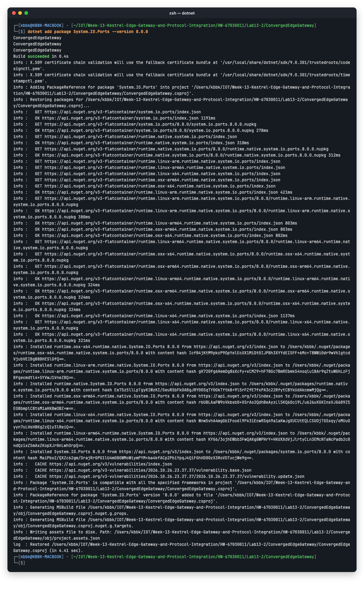
</p>

---

### กิจกรรมที่ 13-2.2: การสร้างคลาสเก็บสถานะและ Worker อ่าน Serial

สร้างไฟล์ `Services.cs` ในโปรเจกต์:

```csharp
using System.Collections.Concurrent;
using System.IO.Ports;
using System.Text.Json;
using MQTTnet;
using MQTTnet.Server;

// 1. คลาสจัดเก็บสถานะระบบแบบ Thread-Safe
public class GatewayStateStore
{
    private readonly ConcurrentDictionary<string, object> _state = new();

    public void Set(string key, object val) => _state[key] = val;
    public T? Get<T>(string key) => _state.TryGetValue(key, out var val) && val is T t ? t : default;
    public object? Get(string key) => _state.TryGetValue(key, out var val) ? val : null;
}

// 2. โมเดลข้อมูล Telemetry
public record TelemetryData(double Voltage, int Raw, long Timestamp);

// 3. งานเบื้องหลังสำหรับเชื่อมต่อและดักฟัง Serial Port
public class SerialBridgeWorker : BackgroundService
{
    private SerialPort? _serial;
    private readonly string _portName = "COM3"; // ปรับให้ตรงกับพอร์ตของ ESP32 บนเครื่องคุณ
    private readonly int _baudRate = 115200;
    private readonly GatewayStateStore _store;
    private readonly MqttServer _mqttServer;
    private readonly ILogger<SerialBridgeWorker> _logger;

    public SerialBridgeWorker(GatewayStateStore store, MqttServer mqttServer, ILogger<SerialBridgeWorker> logger)
    {
        _store = store;
        _mqttServer = mqttServer;
        _logger = logger;
    }

    protected override async Task ExecuteAsync(CancellationToken stoppingToken)
    {
        _logger.LogInformation("🔌 พยายามเปิด Serial Port {Port}...", _portName);

        while (!stoppingToken.IsCancellationRequested)
        {
            if (_serial == null || !_serial.IsOpen)
            {
                try
                {
                    _serial = new SerialPort(_portName, _baudRate)
                    {
                        NewLine = "\n",
                        ReadTimeout = 1000
                    };
                    _serial.Open();
                    _logger.LogInformation("✅ เชื่อมต่อฮาร์ดแวร์ Serial Port {Port} สำเร็จ!", _portName);
                }
                catch
                {
                    // หากยังไม่เสียบบอร์ด ให้รอ 3 วินาทีแล้วลองใหม่
                    await Task.Delay(3000, stoppingToken);
                    continue;
                }
            }

            try
            {
                string line = _serial.ReadLine().Trim();
                if (!string.IsNullOrEmpty(line))
                {
                    await HandleIncomingSerialLine(line);
                }
            }
            catch (TimeoutException) { /* ปกติเมื่อไม่มีข้อมูลส่งมาใน 1 วิ */ }
            catch (Exception ex)
            {
                _logger.LogWarning("Serial Read Warning: {Message}", ex.Message);
                _serial?.Close();
            }
        }
    }

    private async Task HandleIncomingSerialLine(string line)
    {
        try
        {
            // ตัวอย่างข้อมูลที่ ESP32 ยิงมา: {"voltage": 1.65, "raw": 2048}
            using var doc = JsonDocument.Parse(line);
            var root = doc.RootElement;
            double v = root.GetProperty("voltage").GetDouble();
            int r = root.GetProperty("raw").GetInt32();

            var telemetry = new TelemetryData(v, r, DateTimeOffset.UtcNow.ToUnixTimeSeconds());
            
            // 1. อัปเดตลง State Store ในหน่วยความจำ
            _store.Set("latest_telemetry", telemetry);

            // 2. แปลงและผลักเข้าสู่ Embedded MQTT Broker
            var mqttMsg = new MqttApplicationMessageBuilder()
                .WithTopic("iot/esp32/telemetry")
                .WithPayload(line)
                .WithQualityOfServiceLevel(MQTTnet.Protocol.MqttQualityOfServiceLevel.AtMostOnce)
                .Build();

            await _mqttServer.InjectApplicationMessage(new InjectedMqttApplicationMessage(mqttMsg));
        }
        catch { /* หากไม่ใช่ JSON ให้ข้ามไป */ }
    }

    // ฟังก์ชันส่งคำสั่งย้อนกลับไปหาบอร์ดทาง Serial
    public bool SendSerialCommand(string cmd)
    {
        if (_serial?.IsOpen == true)
        {
            _serial.WriteLine(cmd);
            return true;
        }
        return false;
    }

    public override void Dispose()
    {
        _serial?.Close();
        base.Dispose();
    }
}
```

**ผลการทดลอง:** ใช้โค้ดตามใบงาน ไฟล์จริงคือ [Services.cs](Lab13-2/ConvergedEdgeGateway/Services.cs) โดยแก้ 2 จุด:
1. `_portName = "COM3"` เปลี่ยนเป็น `"/dev/cu.usbserial-0001"` ซึ่งเป็นชื่อพอร์ตของบอร์ดบน macOS (ควรใช้ `/dev/cu.*` ไม่ใช่ `/dev/tty.*` เพราะ `tty.*` จะรอสัญญาณ DCD ก่อนเปิดพอร์ต)
2. **เพิ่ม `await Task.Yield();` เป็นบรรทัดแรกของ `ExecuteAsync`** เพราะถ้าใช้โค้ดตามใบงานตรง ๆ Kestrel จะไม่เปิดพอร์ตเลย

**ปัญหาที่พบ:**
* **อาการ:** รันโค้ดตามใบงานบน .NET 9 แล้ว Log ขึ้น `เชื่อมต่อฮาร์ดแวร์ Serial Port ... สำเร็จ!` แต่ไม่มีบรรทัด `Now listening on:` เลย พอเรียก `curl` ได้ `Failed to connect to localhost port 5080` และ `mosquitto_sub` ได้ `Connection refused`
* **สาเหตุ:**
  * ตอน Host เริ่มทำงาน `BackgroundService.StartAsync()` จะเรียก `ExecuteAsync()` **แบบ synchronous บนเธรดของ Host จนกว่าจะเจอ `await` ที่ต้องรอจริงครั้งแรก**
  * เมื่อเสียบบอร์ดอยู่แล้ว `_serial.Open()` สำเร็จทันทีโดยไม่ผ่าน `await Task.Delay(...)` จากนั้นลูปก็วนเรียก `_serial.ReadLine()` ซึ่งเป็นการอ่านแบบบล็อกไม่จบ
  * `StartAsync` ของ Worker จึงไม่คืนค่า และ Host ไม่ได้ไปเริ่ม Kestrel (ซึ่งเป็น Hosted Service ตัวถัดไป)
  * ตัวอย่างโค้ดใน `Example_Codes/ConvergedEdgeGateway_Lab3` ตั้ง `TargetFramework` เป็น `net10.0` ซึ่งรัน `ExecuteAsync` บน Background thread ให้อัตโนมัติ ปัญหานี้จึงไม่เกิดบนเครื่องที่ใช้ .NET 10
* **วิธีแก้:** `await Task.Yield();` บังคับให้ `ExecuteAsync` คืนการทำงานให้ Host ทันที ส่วนลูปที่เหลือไปรันต่อบน ThreadPool ทำให้ Kestrel เปิดพอร์ต 5080/1883 ได้ตามปกติ

ภาพด้านล่างเป็นการทดสอบซ้ำโดยปิด `Task.Yield()` ชั่วคราว จะเห็นว่า Serial เชื่อมต่อแล้วแต่ไม่มี `Now listening on:` และ `curl` ต่อพอร์ต 5080 ไม่ได้

<p align="center">
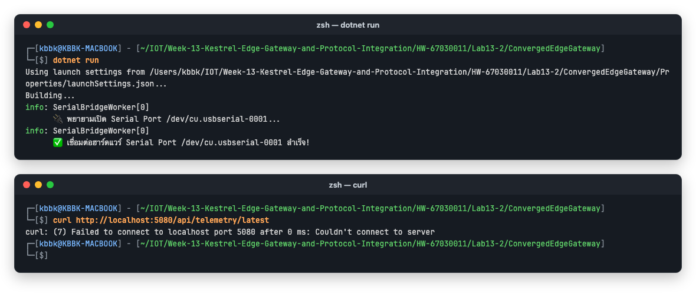
</p>

---

### กิจกรรมที่ 13-2.3: ปรับแต่ง `Program.cs` ให้เปิดใช้ REST APIs

เปิด `Program.cs` และปรับปรุงส่วนการลงทะเบียนบริการและเส้นทาง API:

```csharp
using MQTTnet.AspNetCore;
using MQTTnet.Server;

var builder = WebApplication.CreateBuilder(args);

// ตั้งค่า Kestrel
builder.WebHost.ConfigureKestrel(options =>
{
    options.ListenAnyIP(5000);
    options.ListenAnyIP(1883, l => l.UseMqtt());
});

// ลงทะเบียน Services
builder.Services.AddSingleton<GatewayStateStore>();
builder.Services.AddMqttServer(options => options.WithDefaultEndpoint());
builder.Services.AddHostedService<SerialBridgeWorker>();
// เพื่อให้ API เรียกใช้งาน Worker ได้
builder.Services.AddSingleton(sp => 
    sp.GetServices<IHostedService>().OfType<SerialBridgeWorker>().First());

var app = builder.Build();

app.UseMqttServer(server => { /* callbacks */ });

// 1. API อ่านข้อมูลเซนเซอร์ล่าสุด
app.MapGet("/api/telemetry/latest", (GatewayStateStore store) =>
{
    var data = store.Get("latest_telemetry");
    return data != null ? Results.Ok(data) : Results.NotFound(new { error = "No telemetry yet" });
});

// 2. API ควบคุมหลอดไฟผ่าน Serial Bridge
app.MapPost("/api/led/{state}", (string state, SerialBridgeWorker worker) =>
{
    string cmd = state.ToLower() == "on" ? "LED:ON" : "LED:OFF";
    bool success = worker.SendSerialCommand(cmd);

    return Results.Ok(new
    {
        dispatchedCommand = cmd,
        sentToSerial = success,
        serverTime = DateTime.Now.ToString("HH:mm:ss")
    });
});

app.Run();
```

**ผลการทดลอง:** ใช้โค้ดตามใบงาน ไฟล์จริงคือ [Program.cs](Lab13-2/ConvergedEdgeGateway/Program.cs) ต่างจากใบงาน 2 จุด:
* ใช้พอร์ต `5080`
* ส่วน `app.UseMqttServer(server => { /* callbacks */ });` ใส่ Callback ชุดเดียวกับใบงาน 13.1 (Validating, Connected, Disconnected) เพื่อให้เห็น Log ตอน Client ต่อเข้ามา

Build ผ่านโดยไม่มี Warning

---

### กิจกรรมที่ 13-2.4: โค้ดฝั่ง ESP32 สำหรับสื่อสารสองทางผ่าน Serial (`main.c`)

สำหรับฝั่งไมโครคอนโทรลเลอร์ ให้เขียนโค้ดในโปรเจกต์ ESP-IDF เพื่ออ่านค่าแอนะล็อกและสตรีม JSON ออกทาง Serial รวมถึงอ่านคำสั่งควบคุมหลอดไฟจาก C# Gateway:

```c
#include <stdio.h>
#include <string.h>
#include "freertos/FreeRTOS.h"
#include "freertos/task.h"
#include "driver/gpio.h"
#include "driver/uart.h"
#include "esp_log.h"
#include "esp_adc/adc_oneshot.h"

#define LED_PIN             GPIO_NUM_2       // Onboard LED บน ESP32
#define POT_ADC_CHANNEL     ADC_CHANNEL_6    // GPIO 34 (ADC1 Channel 6)

void app_main(void)
{
    // 1. ตั้งค่า GPIO สำหรับไฟ LED
    gpio_reset_pin(LED_PIN);
    gpio_set_direction(LED_PIN, GPIO_MODE_OUTPUT);
    gpio_set_level(LED_PIN, 0);

    // 2. ตั้งค่า ADC Unit 1
    adc_oneshot_unit_handle_t adc1_handle;
    adc_oneshot_unit_init_cfg_t init_config = {
        .unit_id = ADC_UNIT_1,
        .ulp_mode = ADC_ULP_MODE_DISABLE,
    };
    ESP_ERROR_CHECK(adc_oneshot_new_unit(&init_config, &adc1_handle));

    // 3. กำหนดความละเอียด 12-bit (0-4095) และ Attenuation 12dB (0 - 3.3V)
    adc_oneshot_chan_cfg_t chan_config = {
        .bitwidth = ADC_BITWIDTH_12,
        .atten = ADC_ATTEN_DB_12,
    };
    ESP_ERROR_CHECK(adc_oneshot_config_channel(adc1_handle, POT_ADC_CHANNEL, &chan_config));

    // 4. ติดตั้ง UART Driver บนพอร์ตเริ่มต้น เพื่อให้อ่านคำสั่งผ่าน Serial แบบ Non-blocking ได้
    uart_driver_install(UART_NUM_0, 256, 0, 0, NULL, 0);

    uint8_t rx_buf[64];

    while (1) {
        // --- ส่วนที่ 1: อ่านค่า ADC และส่งออก JSON ทาง Serial ---
        int raw = 0;
        ESP_ERROR_CHECK(adc_oneshot_read(adc1_handle, POT_ADC_CHANNEL, &raw));
        float voltage = (raw / 4095.0f) * 3.3f;

        // พิมพ์ JSON สตรีมมิ่งออก Serial
        printf("{\"voltage\":%.2f,\"raw\":%d}\n", voltage, raw);

        // --- ส่วนที่ 2: ตรวจจับคำสั่งจาก C# Kestrel (LED:ON / LED:OFF) ---
        int len = uart_read_bytes(UART_NUM_0, rx_buf, sizeof(rx_buf) - 1, pdMS_TO_TICKS(50));
        if (len > 0) {
            rx_buf[len] = '\0';
            if (strstr((char *)rx_buf, "LED:ON") != NULL) {
                gpio_set_level(LED_PIN, 1);
            } else if (strstr((char *)rx_buf, "LED:OFF") != NULL) {
                gpio_set_level(LED_PIN, 0);
            }
        }

        vTaskDelay(pdMS_TO_TICKS(450));
    }
}
```

**ผลการทดลอง:** สร้างโปรเจกต์ ESP-IDF [Lab13-2/ESP32_ADC_Stream/](Lab13-2/ESP32_ADC_Stream/) โดยใช้ [main.c](Lab13-2/ESP32_ADC_Stream/main/main.c) ตามใบงานทุกบรรทัด
* `idf.py set-target esp32` และ `idf.py build` บน ESP-IDF v6.0.2 ผ่าน ได้ไฟล์แอป 0x291c0 ไบต์ (เหลือพื้นที่ใน Partition 84%)

<p align="center">
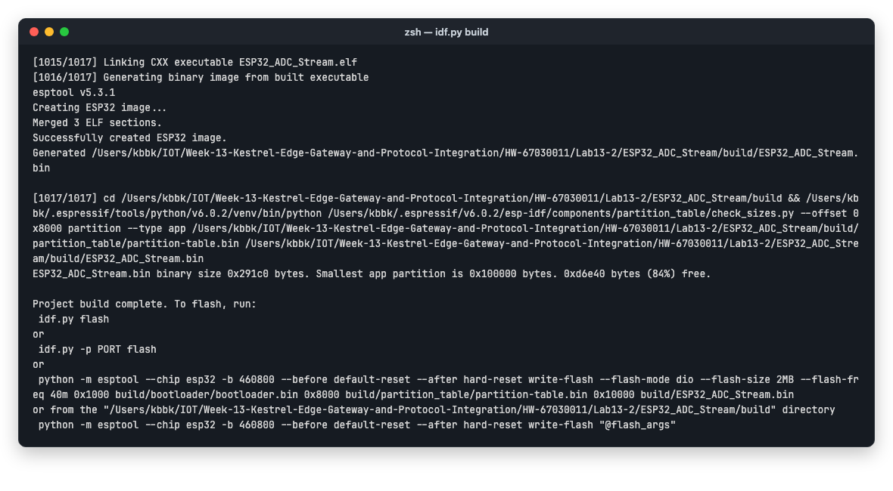
</p>

* `idf.py -p /dev/cu.usbserial-0001 flash` เขียนเฟิร์มแวร์และ Verify hash ผ่าน

<p align="center">
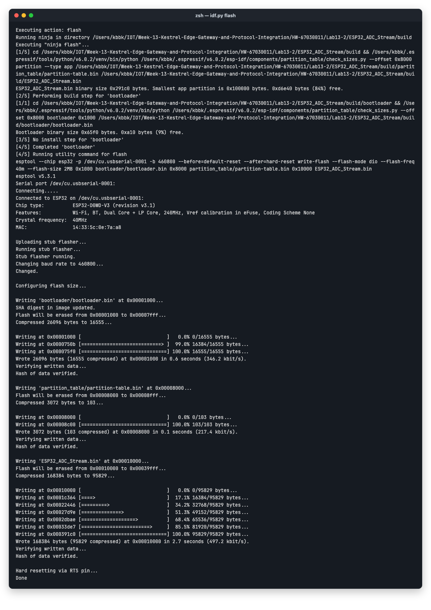
</p>

* `idf.py monitor` เห็นบอร์ดพิมพ์ JSON `{"voltage":..,"raw":..}` ทุกประมาณ 0.5 วินาที ตอนนั้น Potentiometer อยู่ที่ประมาณ 0.8 V (raw ~990)
* บรรทัด Log ของระบบตอนบูต (`I (270) main_task: ...`) ออกทาง UART0 เส้นเดียวกัน แต่ไม่ใช่ JSON ฝั่ง Gateway จึงข้ามไปด้วย `catch` ใน `HandleIncomingSerialLine`
* ปิด `idf.py monitor` ก่อนรัน Gateway ทุกครั้งตามคำเตือนของใบงาน

<p align="center">
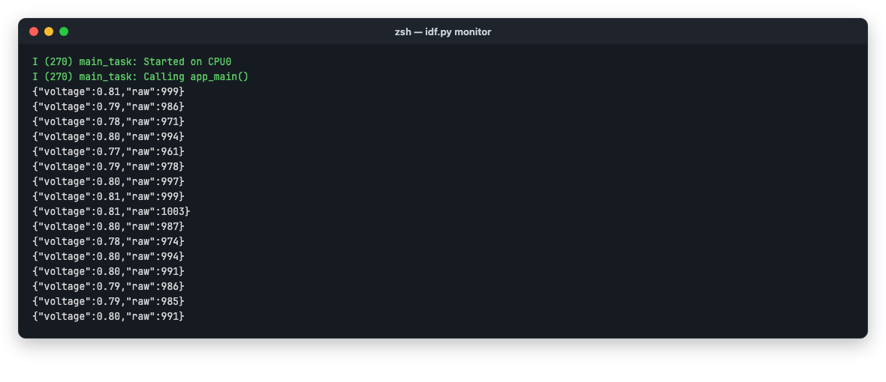
</p>


---

### กิจกรรมที่ 13-2.5: การทดสอบสะพานเชื่อมต่อ

> [!WARNING] **ข้อพึงระวังเรื่องพอร์ตสื่อสารอนุกรม (Serial Port Exclusive Lock):**
> 1. ตรวจสอบหมายเลข COM Port ของบอร์ด ESP32 ผ่าน Device Manager แล้วแก้ไขตัวแปร `_portName` ในไฟล์ `Services.cs` ให้ตรงกับเครื่องของคุณ (เช่น `COM24`)
> 2. **ต้องปิด `idf monitor`, PuTTY หรือ Serial Monitor อื่นๆ ก่อนรัน Kestrel เสมอ** เพราะบน Windows พอร์ต COM จะถูกล็อกใช้งานแบบ Exclusive Access (เปิดได้เพียง 1 โปรแกรมในเวลาเดียวกัน) หากมีโปรแกรมอื่นเปิดพอร์ตค้างไว้ C# จะเปิดพอร์ตไม่สำเร็จและส่งคำสั่งไม่ได้ (`sentToSerial: false`)

1. เสียบบอร์ด ESP32 เข้ากับเครื่อง และสั่งรัน Kestrel:
```powershell
dotnet run
```

**ผลการทดลอง:**
* `SerialBridgeWorker` เปิด `/dev/cu.usbserial-0001` สำเร็จ และ Kestrel เปิดพอร์ต 5080 กับ 1883 ครบ ลำดับของ Log คือ Worker เริ่มก่อน แล้ว Kestrel ขึ้น `Now listening on:` จากนั้น Worker จึงรายงาน `เชื่อมต่อ... สำเร็จ!` เพราะลูปไปรันต่อบน ThreadPool หลัง `Task.Yield()`
* บน Mac การเปิดพอร์ตจะสั่ง DTR/RTS ทำให้บอร์ดรีเซ็ต 1 ครั้ง ข้อความตอนบูตไม่ใช่ JSON จึงถูกข้ามไป

<p align="center">
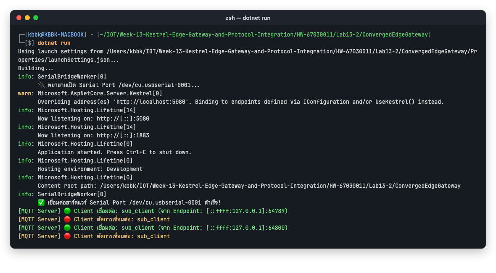
</p>
2. ทดสอบเรียกดูค่าเซนเซอร์ผ่านเบราว์เซอร์หรือ cURL:
```powershell
curl http://localhost:5000/api/telemetry/latest
```
*สังเกตว่าจะได้ข้อมูล JSON ของแรงดันไฟฟ้าทันที!*

**ผลการทดลอง:**
* `GET /api/telemetry/latest` ได้ `200 OK` และ JSON `{"voltage":0.8,"raw":989,"timestamp":1793068002}` ทันที ค่ามาจาก `GatewayStateStore` ที่ Worker อัปเดตทุกครั้งที่อ่านได้หนึ่งบรรทัด
* ระหว่างหมุน Potentiometer ช้า ๆ ได้ค่าตามภาพด้านล่าง ค่าไล่เปลี่ยนตามตำแหน่งของ Potentiometer และ `timestamp` (Unix seconds) เพิ่มขึ้นตามเวลา:

  | raw | voltage |
  | ---: | ---: |
  | 2533 | 2.04 V |
  | 57 | 0.05 V (ซ้ายสุด) |
  | 4095 | 3.3 V (ขวาสุด, ADC 12-bit อิ่มตัว) |
* Field ใน JSON เป็น camelCase (`voltage`, `raw`, `timestamp`) เพราะ ASP.NET Core แปลงชื่อ Property ของ `record TelemetryData` ให้อัตโนมัติ

<p align="center">
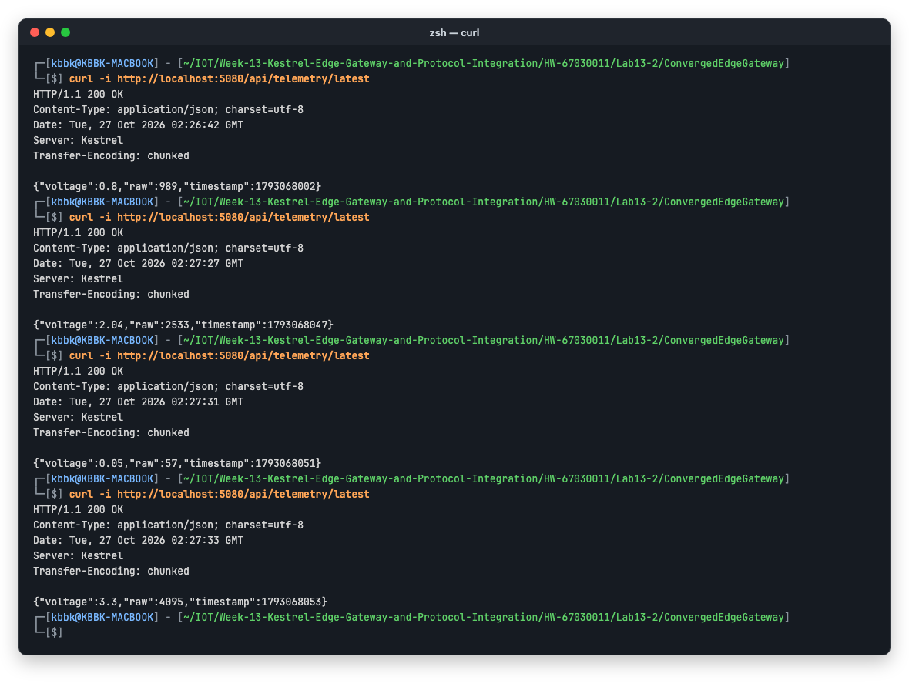
</p>
3. เปิด `mosquitto_sub`:
```powershell
mosquitto_sub -h 127.0.0.1 -p 1883 -t "iot/esp32/telemetry" -i "sub_client" -v
```
*สังเกตว่าข้อมูลที่อ่านจากสาย USB Serial ถูกส่งต่อเข้าหัวข้อ MQTT อัตโนมัติ!*

**ผลการทดลอง:**
* `mosquitto_sub` ได้ข้อความหัวข้อ `iot/esp32/telemetry` ทุกประมาณ 0.5 วินาที Payload คือบรรทัด JSON ดิบที่ ESP32 พิมพ์ออก Serial แบบไม่ผ่านการแปลง (`.WithPayload(line)`) จึงยังเป็น `"voltage":0.80` ทศนิยม 2 ตำแหน่งตามที่ `printf` พิมพ์มา
* ฝั่ง Gateway ขึ้น Log `Client เชื่อมต่อ: sub_client` แต่ไม่มี Client ไหนเป็นคน Publish หัวข้อนี้เลย ข้อความถูก `InjectApplicationMessage` จากข้อมูล Serial ภายในโปรเซสโดยตรง
* หน้าต่างล่างเป็นช่วงที่หมุน Potentiometer ไปสุดทั้งสองทาง ค่าไล่ขึ้นเป็น 4095 ลงไปถึง 0 แล้วกลับขึ้นเป็น 4095 แบบเรียลไทม์ ตลอด 3 นาทีที่บันทึกได้รับข้อความ 364 ฉบับ

<p align="center">
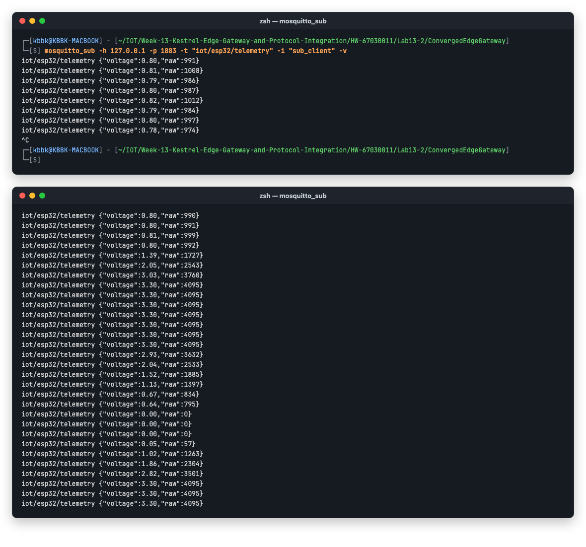
</p>
4. ทดสอบสั่งเปิด-ปิดไฟผ่าน REST API:
```powershell
curl -X POST http://localhost:5000/api/led/on
```
*สังเกตว่าคำสั่ง `LED:ON` ถูกส่งผ่านสาย USB เข้าไปควบคุมบอร์ดทันที!*

**ผลการทดลอง:**
* `POST /api/led/on` ได้ `{"dispatchedCommand":"LED:ON","sentToSerial":true,...}` และ LED บน GPIO2 ติด
* `POST /api/led/off` ได้ `LED:OFF`, `sentToSerial: true` และ LED ดับ
* `sentToSerial: true` ยืนยันว่า `SerialPort.WriteLine` เขียนลงพอร์ตได้ (มี Gateway เปิดพอร์ตอยู่โปรแกรมเดียว)
* ฝั่ง ESP32 อ่านคำสั่งด้วย `uart_read_bytes` ในช่วง 50 ms ของแต่ละรอบ ไบต์ที่มาถึงระหว่างรอบจะรออยู่ใน RX buffer 256 ไบต์ของ UART driver จึงไม่หาย LED จะเปลี่ยนสถานะภายในรอบถัดไป (ไม่เกินประมาณ 0.5 วินาที)

<p align="center">
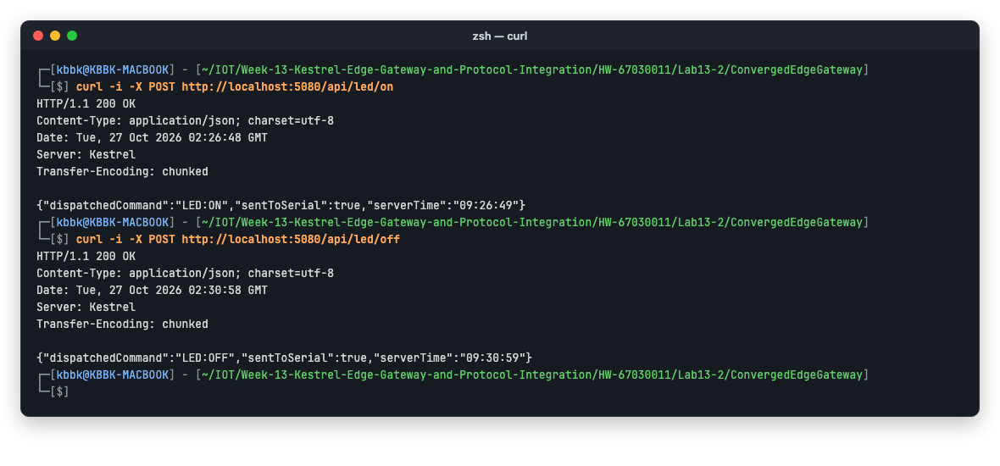
</p>

<p align="center">
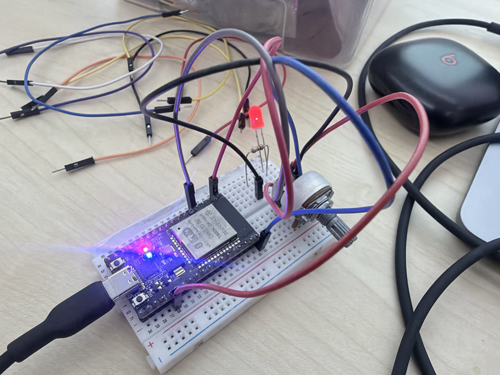
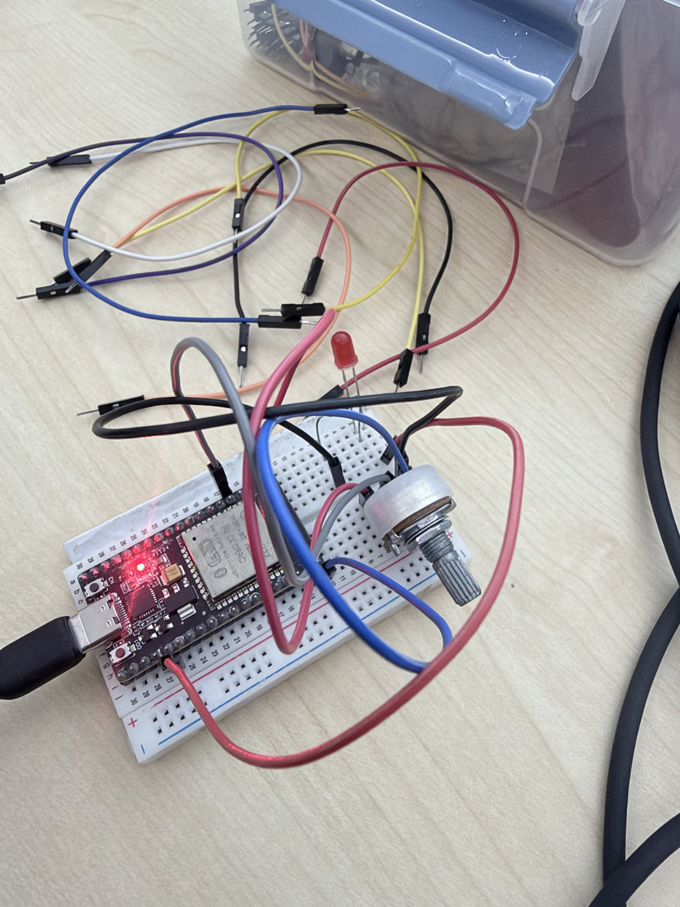
</p>
<p align="center">หลัง <code>LED:ON</code> (ซ้าย) LED สีแดงที่ต่อเพิ่มบน Breadboard และ LED สีฟ้าบนบอร์ด (ทั้งคู่อยู่ที่ GPIO2) ติดพร้อมกัน<br>หลัง <code>LED:OFF</code> (ขวา) ทั้งสองดวงดับ เหลือแค่ไฟสีแดงบนบอร์ดซึ่งเป็นไฟแสดงสถานะไฟเลี้ยง (Power LED)</p>

---

## 4. คำถามท้ายการทดลอง
1. **สถาปัตยกรรมแบบ Serial-to-MQTT Bridge นี้ช่วยให้อุปกรณ์รุ่นเก่า (Legacy Hardware) ที่ไม่มี Wi-Fi สามารถเข้าร่วมระบบนิเวศ IoT สมัยใหม่ได้อย่างไร?**
   * **คำตอบ:**
     * อุปกรณ์รุ่นเก่า เช่น PLC, มิเตอร์ไฟฟ้า หรือเซนเซอร์อุตสาหกรรม ส่วนใหญ่พูดได้แค่ UART/RS-232/RS-485 ไม่มี Wi-Fi ไม่มี TCP/IP stack และไม่รองรับ TLS
     * Serial-to-MQTT Bridge ให้ Gateway ทำหน้าที่ "ล่าม" แทน อุปกรณ์แค่ส่ง Byte stream ตามเดิม ส่วน Gateway ทำ 4 อย่าง:
       1. อ่าน แยกบรรทัด และ Parse ข้อมูล
       2. ตรวจสอบความถูกต้อง แล้วเติมข้อมูลที่ขาด เช่น Timestamp
       3. แปลงเป็น MQTT Topic ที่มีโครงสร้าง (`iot/esp32/telemetry`) และ REST Resource (`/api/telemetry/latest`)
       4. แปลงคำสั่งขาลงจาก REST/MQTT กลับเป็นคำสั่ง Serial (`LED:ON`)
     * ระบบสมัยใหม่ เช่น แอป Flutter, Dashboard, Cloud หรือฐานข้อมูล จึงใช้ข้อมูลผ่าน Protocol มาตรฐานได้เลย โดยไม่ต้องรู้ว่าต้นทางเป็นสาย Serial ความเร็ว 115200 bps
     * อุปกรณ์เดิมไม่ต้องแก้ Firmware หรือเพิ่มโมดูลสื่อสาร และเรื่องความปลอดภัย (TLS, Auth) กับการบัฟเฟอร์ข้อมูลไปรวมอยู่ที่ Gateway ที่เดียว
     * **การทดลองนี้พิสูจน์ได้:**
       * [main.c](Lab13-2/ESP32_ADC_Stream/main/main.c) ไม่มีโค้ด Wi-Fi หรือ MQTT เลยสักบรรทัด มีแค่ `printf` กับ `uart_read_bytes`
       * แต่ค่าจากบอร์ดไปโผล่ที่ MQTT Subscriber และ REST API ได้ทันที และสั่ง LED กลับผ่าน REST ได้ด้วย
     * **ข้อควรระวัง:**
       * Gateway กลายเป็นจุดเดียวที่ทำให้ทั้งระบบล่มได้
       * ต้องเขียน Parser แยกตาม Protocol ของแต่ละอุปกรณ์ เช่น Modbus RTU
       * ระยะสายต้องเหมาะสม: UART/USB ได้แค่ไม่กี่เมตร ถ้าระยะไกลในโรงงานต้องใช้ RS-485
2. **เพราะเหตุใดเราจึงต้องใช้ `BackgroundService` ในการอ่านข้อมูล Serial แทนที่จะเปิดพอร์ตอ่านตรงๆ ภายในฟังก์ชันของ REST API?**
   * **คำตอบ:**
     * **ข้อมูล Serial เป็นสตรีมที่ไหลมาตลอดเวลา** ไม่ได้มาตามจังหวะ HTTP Request
       * ESP32 ส่งทุก 0.5 วินาทีไม่ว่าจะมีใครเรียก API หรือไม่
       * ถ้าไปอ่านใน Handler ของ REST จะอ่านเฉพาะตอนมีคนเรียก ระหว่างนั้นข้อมูลจะกองใน Buffer ของ OS จนล้น แล้วค่าที่ได้จะเป็นค่าเก่าค้างในบัฟเฟอร์ ไม่ใช่ค่าล่าสุด
       * MQTT ก็จะไม่ได้รับข้อมูลเลยถ้าไม่มีคนเรียก REST
     * **พอร์ต Serial เปิดได้แค่โปรแกรมเดียว** (Exclusive resource)
       * ถ้าแต่ละ Request เปิด/ปิดพอร์ตเอง Request ที่เข้ามาพร้อมกันจะแย่งพอร์ตกันจน Error
       * ทุกครั้งที่เปิดพอร์ตบอร์ดจะรีเซ็ตด้วย (เห็นในการทดลองนี้บน Mac)
       * `BackgroundService` ให้มีเจ้าของพอร์ตเพียงหนึ่งเดียว เปิดครั้งเดียวและถือไว้ตลอดอายุของแอป
     * **`ReadLine()` เป็นการรอแบบบล็อก** (มี `ReadTimeout = 1000`)
       * ถ้าอยู่ใน API Handler Request จะค้างนานถึง 1 วินาทีและกินเธรดของ Kestrel
       * Worker แยกงานรอนี้ออกไป แล้วเขียนผลลง `GatewayStateStore` ให้ API อ่านค่าล่าสุดจาก `ConcurrentDictionary` ได้ทันที (ในการทดลองตอบกลับเร็วมาก)
     * **Host จัดการวงจรชีวิตให้:** เริ่มพร้อมแอป, หยุดเมื่อ `stoppingToken` ถูกยกเลิก, `Dispose()` ปิดพอร์ต และมีลูป Reconnect ทุก 3 วินาทีเมื่อถอดหรือเสียบบอร์ดใหม่ ซึ่งเป็นสิ่งที่ API แบบ Request/Response ทำไม่ได้
     * จากปัญหาที่พบในใบงานนี้ งานใน `BackgroundService` ต้องไม่บล็อกก่อนเจอ `await` แรก (จึงต้องใส่ `await Task.Yield()`) ไม่อย่างนั้นแม้จะเป็น Worker ก็ยังขวางการ Start ของทั้ง Host ได้
