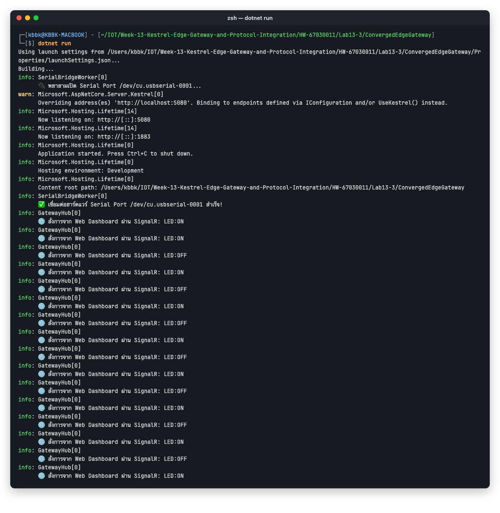
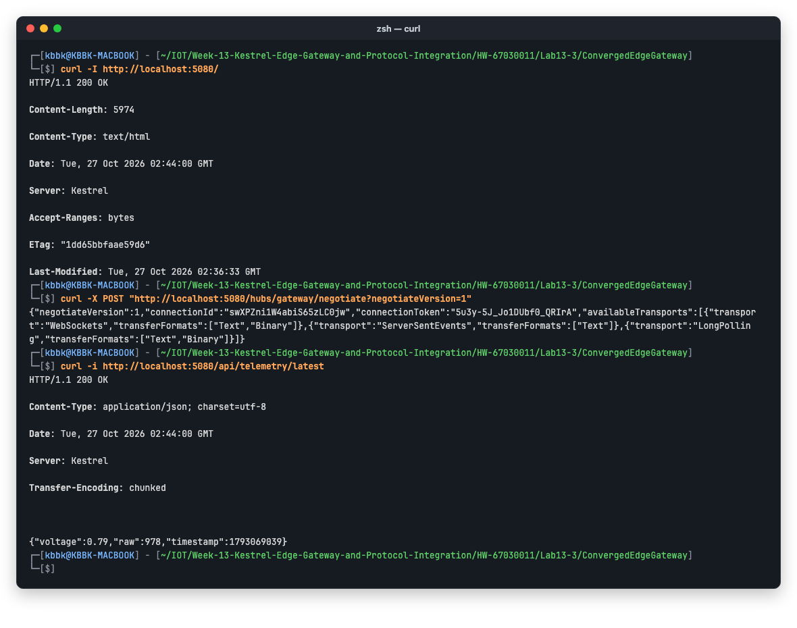
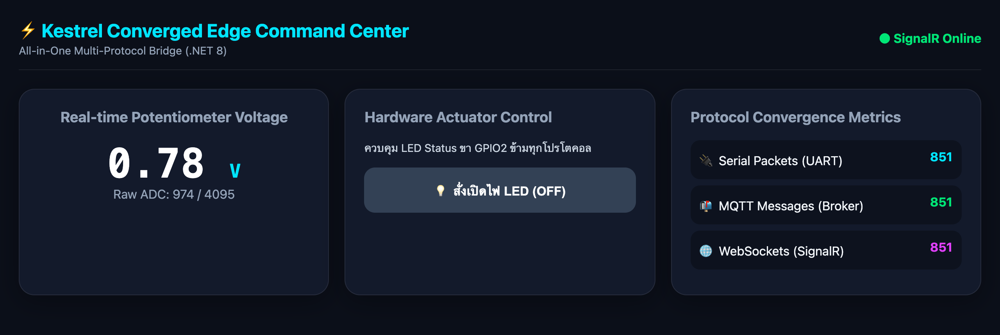
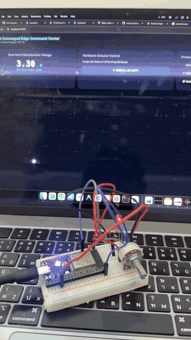
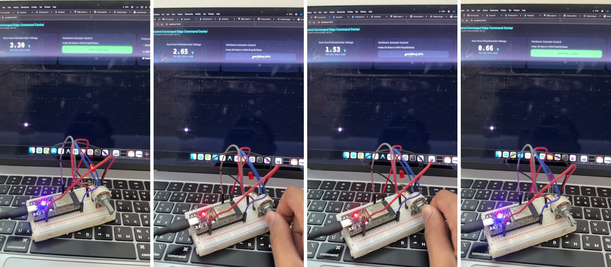
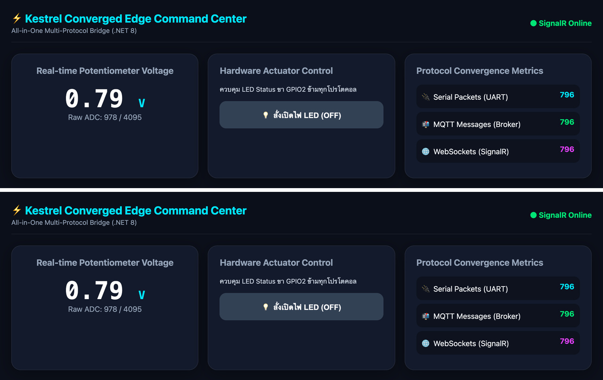
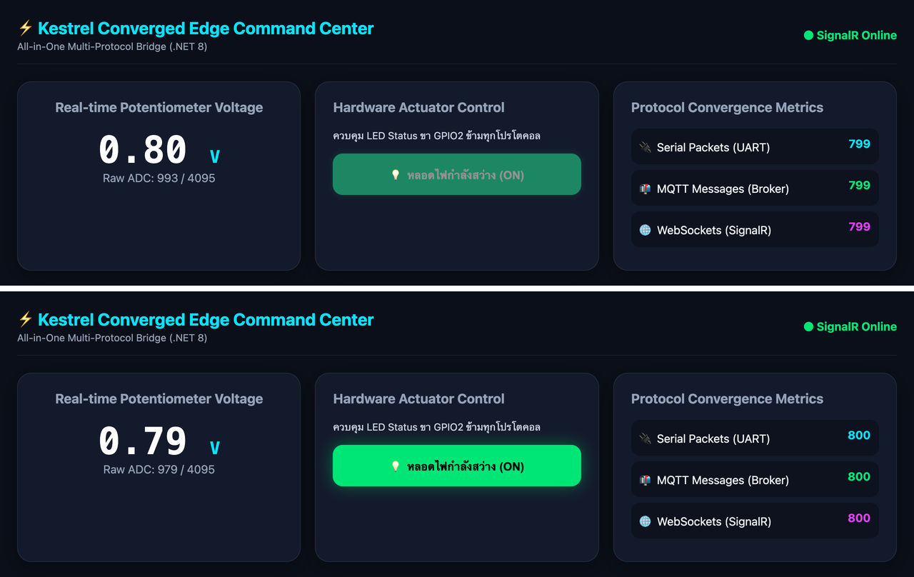

# ใบงานการทดลองที่ 13.3
### การสร้าง SignalR Realtime Hub และเว็บแดชบอร์ดศูนย์บัญชาการ (Converged Web Dashboard) สไตล์ Glassmorphism

> [!NOTE] **คำชี้แจง**
> ในใบงานนี้นักศึกษาจะได้ผสานเทคโนโลยี **ASP.NET Core SignalR (WebSockets)** เข้าสู่ Kestrel Edge Gateway เพื่อส่งผ่านข้อมูลเซนเซอร์ขึ้นสู่หน้าเว็บเบราว์เซอร์แบบสดๆ ในเสี้ยววินาที พร้อมทั้งสร้างหน้าเว็บ **ศูนย์บัญชาการระบบขอบ (Converged Edge Command Center)** สไตล์ Glassmorphism ที่สวยงามทันสมัย โฮสต์อยู่บน Kestrel โดยตรง เพื่อแสดงผลมาตรวัดเข็ม, สถิติทราฟฟิกของทั้ง 4 โปรโตคอล, และแผงควบคุมสวิตช์สั่งการแบบเรียลไทม์

---

## 1. วัตถุประสงค์การทดลอง
1. สามารถติดตั้งและกำหนดค่า SignalR Hub ใน ASP.NET Core (.NET 8) ได้
2. สามารถเขียนโค้ดผลักดันข้อมูลจากงานเบื้องหลัง (`SerialBridgeWorker`) ไปยังหน้าเว็บผ่าน `IHubContext` ได้
3. สามารถพัฒนาเว็บแดชบอร์ด HTML5/JavaScript ที่เชื่อมต่อกับ SignalR เพื่อแสดงผลมาตรวัดเข็มสด และสลับสวิตช์ไฟได้
4. สามารถติดตามและนับสถิติการรับส่งข้อมูลของทั้ง 4 โปรโตคอล (Protocol Traffic Counters) ได้

> [!NOTE] **สภาพแวดล้อมที่ใช้ทำการทดลองจริง (รหัสนักศึกษา 67030011)**
> * macOS 15.5 (Apple Silicon), .NET SDK **9.0.301** (`net9.0`), ASP.NET Core SignalR (มากับ Shared framework จึงไม่ต้องติดตั้งแพ็กเกจเพิ่ม), Google Chrome
> * ฮาร์ดแวร์ชุดเดียวกับใบงาน 13.2: ESP32 ที่ `/dev/cu.usbserial-0001`, Potentiometer ที่ GPIO34 และ LED ที่ GPIO2 ใช้เฟิร์มแวร์ [ESP32_ADC_Stream](Lab13-2/ESP32_ADC_Stream/) ตัวเดิมโดยไม่ต้อง Flash ใหม่
> * เว็บเปิดที่ **`http://localhost:5080`** (ไม่ใช่ 5000 เพราะพอร์ต 5000 บน macOS ถูก AirPlay ใช้อยู่)
> * ต้องรันด้วย `LANG=en_US.UTF-8 LC_ALL=en_US.UTF-8 dotnet run` เพราะเมื่อมีโฟลเดอร์ `wwwroot` .NET SDK 9 จะ Build ไม่ผ่านถ้า Locale ของเครื่องเป็น `en_TH` (ปฏิทินพุทธศักราช)
> * โปรเจกต์: [Lab13-3/ConvergedEdgeGateway/](Lab13-3/ConvergedEdgeGateway/) (ต่อยอดจากใบงาน 13.2) และ Log ดิบอยู่ใน [Lab13-3/logs/](Lab13-3/logs/)

---

## 2. ผังการทำงานของ SignalR Realtime Push

<p align="center"></p>
<p align="center"><b></b>ผังการทำงานของ SignalR Realtime Push</p>

---

## 3. ขั้นตอนการทดลอง (Step-by-Step Activities)

### กิจกรรมที่ 13-3.1: การสร้างคลาส SignalR Hub และตัวนับสถิติ

สร้างไฟล์ `Hubs.cs` ในโปรเจกต์ `ConvergedEdgeGateway`:

```csharp
using Microsoft.AspNetCore.SignalR;

// 1. คลาส SignalR Hub สำหรับการสื่อสารสองทาง
public class GatewayHub : Hub
{
    private readonly SerialBridgeWorker _serialWorker;
    private readonly ILogger<GatewayHub> _logger;

    public GatewayHub(SerialBridgeWorker serialWorker, ILogger<GatewayHub> logger)
    {
        _serialWorker = serialWorker;
        _logger = logger;
    }

    // เมื่อหน้าเว็บกดปุ่มสลับสถานะสวิตช์
    public async Task ToggleLed(bool state)
    {
        string cmd = state ? "LED:ON" : "LED:OFF";
        _logger.LogInformation("🌐 สั่งการจาก Web Dashboard ผ่าน SignalR: {Cmd}", cmd);
        
        // ส่งคำสั่งเข้าสู่พอร์ต Serial
        _serialWorker.SendSerialCommand(cmd);

        // กระจายสถานะใหม่หาทุกหน้าที่เปิดอยู่
        await Clients.All.SendAsync("LedStateUpdated", state);
    }
}

// 2. คลาสนับสถิติทราฟฟิกของแต่ละโปรโตคอล
public class ProtocolMetrics
{
    public long SerialPackets { get; set; } = 0;
    public long MqttMessages { get; set; } = 0;
    public long RestRequests { get; set; } = 0;
    public long SignalRPushes { get; set; } = 0;
}
```

**ผลการทดลอง:** สร้าง [Hubs.cs](Lab13-3/ConvergedEdgeGateway/Hubs.cs) ตามใบงานทุกบรรทัด `GatewayHub` รับ `SerialBridgeWorker` ผ่าน DI ได้ เพราะ `Program.cs` จากใบงาน 13.2 ลงทะเบียน Worker เป็น Singleton ไว้แล้ว

---

### กิจกรรมที่ 13-3.2: ปรับปรุง Worker ให้ผลักข้อมูลเข้าสู่ Hub

ในไฟล์ `Services.cs` ให้เพิ่ม `using Microsoft.AspNetCore.SignalR;` ที่ด้านบนสุดของไฟล์ และปรับปรุงคลาส `SerialBridgeWorker` ให้รับ `IHubContext<GatewayHub>` ผ่าน Dependency Injection:

```csharp
using Microsoft.AspNetCore.SignalR; // เพิ่มด้านบนสุดของ Services.cs

// ... ภายในคลาส SerialBridgeWorker ...
private readonly IHubContext<GatewayHub> _hubContext;
private readonly ProtocolMetrics _metrics;


public SerialBridgeWorker(
    GatewayStateStore store, 
    MqttServer mqttServer, 
    IHubContext<GatewayHub> hubContext,
    ProtocolMetrics metrics,
    ILogger<SerialBridgeWorker> logger)
{
    _store = store;
    _mqttServer = mqttServer;
    _hubContext = hubContext;
    _metrics = metrics;
    _logger = logger;
}

// ในฟังก์ชัน HandleIncomingSerialLine:
private async Task HandleIncomingSerialLine(string line)
{
    try
    {
        using var doc = JsonDocument.Parse(line);
        var root = doc.RootElement;
        double v = root.GetProperty("voltage").GetDouble();
        int r = root.GetProperty("raw").GetInt32();

        _metrics.SerialPackets++;

        // 1. ผลักเข้า MQTT
        _metrics.MqttMessages++;
        var mqttMsg = new MqttApplicationMessageBuilder()
            .WithTopic("iot/esp32/telemetry")
            .WithPayload(line)
            .Build();
        await _mqttServer.InjectApplicationMessage(new InjectedMqttApplicationMessage(mqttMsg));

        // 2. ผลักเข้า SignalR หาหน้าเว็บทันที!
        _metrics.SignalRPushes++;
        await _hubContext.Clients.All.SendAsync("ReceiveTelemetry", new
        {
            voltage = v,
            raw = r,
            metrics = _metrics
        });
    }
    catch { }
}
```

**ผลการทดลอง:** แก้ไข [Services.cs](Lab13-3/ConvergedEdgeGateway/Services.cs) ตามใบงาน (เพิ่ม `using`, Constructor ที่รับ `IHubContext<GatewayHub>` กับ `ProtocolMetrics` และใช้ `HandleIncomingSerialLine` ตัวใหม่) โดยต่างจากใบงาน 1 จุด:
* ฟังก์ชัน `HandleIncomingSerialLine` ในใบงาน (และใน `Example_Codes/ConvergedEdgeGateway_Lab3`) **ไม่มีบรรทัด `_store.Set("latest_telemetry", ...)`** ถ้าใช้ตามนั้น `GET /api/telemetry/latest` จาก 13.2 จะตอบ `404 No telemetry yet` ตลอด จึงใส่บรรทัดนี้กลับเข้าไป REST API ยังทำงานได้ (ดูภาพ `curl` ในกิจกรรม 13-3.4)
* `await Task.Yield()` จากใบงาน 13.2 ยังอยู่ ไม่อย่างนั้น Kestrel จะไม่เปิดพอร์ต

---

### กิจกรรมที่ 13-3.3: การสร้างหน้าเว็บศูนย์บัญชาการ (`wwwroot/index.html`)

สร้างโฟลเดอร์ `wwwroot` และสร้างไฟล์ `index.html` สไตล์ Dark Glassmorphism ที่สมบูรณ์แบบ:

```html
<!DOCTYPE html>
<html lang="th">
<head>
    <meta charset="UTF-8">
    <meta name="viewport" content="width=device-width, initial-scale=1.0">
    <title>Kestrel Converged Edge Command Center</title>
    <script src="https://cdnjs.cloudflare.com/ajax/libs/microsoft-signalr/8.0.0/signalr.min.js"></script>
    <style>
        :root {
            --bg: #0b0f19;
            --card-bg: rgba(22, 30, 49, 0.75);
            --primary: #00E5FF;
            --accent: #00E676;
            --danger: #FF5252;
            --border: rgba(255, 255, 255, 0.08);
        }
        body {
            margin: 0; padding: 24px;
            background: var(--bg);
            color: #f1f5f9;
            font-family: 'Segoe UI', system-ui, sans-serif;
        }
        .header {
            display: flex; justify-content: space-between; align-items: center;
            margin-bottom: 24px; padding-bottom: 16px; border-bottom: 1px solid var(--border);
        }
        .title { font-size: 24px; font-weight: 700; color: var(--primary); }
        .grid {
            display: grid; grid-template-columns: repeat(auto-fit, minmax(280px, 1fr)); gap: 20px;
        }
        .card {
            background: var(--card-bg);
            backdrop-filter: blur(16px);
            border: 1px solid var(--border);
            border-radius: 20px; padding: 24px;
            box-shadow: 0 8px 32px rgba(0, 0, 0, 0.3);
        }
        .gauge-val {
            font-size: 52px; font-weight: 800; font-family: monospace; color: white;
            text-align: center; margin-top: 10px;
        }
        .metric-badge {
            display: flex; justify-content: space-between; padding: 12px;
            background: rgba(0,0,0,0.3); border-radius: 12px; margin-bottom: 8px;
        }
        .btn-toggle {
            width: 100%; padding: 16px; font-size: 16px; font-weight: bold;
            border: none; border-radius: 14px; cursor: pointer; transition: 0.2s;
            background: #334155; color: white; margin-top: 16px;
        }
        .btn-active {
            background: var(--accent); color: black; box-shadow: 0 0 20px rgba(0,230,118,0.4);
        }
    </style>
</head>
<body>
    <div class="header">
        <div>
            <div class="title">⚡ Kestrel Converged Edge Command Center</div>
            <div style="color: #94a3b8; font-size: 14px;">All-in-One Multi-Protocol Bridge (.NET 8)</div>
        </div>
        <div id="connStatus" style="color: var(--accent); font-weight: bold;">● SignalR Online</div>
    </div>

    <div class="grid">
        <!-- การ์ด 1: มาตรวัดเซนเซอร์ -->
        <div class="card" style="text-align: center;">
            <h3 style="margin-top:0; color:#94a3b8;">Real-time Potentiometer Voltage</h3>
            <div class="gauge-val" id="voltageText">0.00 <span style="font-size:24px; color:var(--primary);">V</span></div>
            <div style="color: #94a3b8;" id="rawText">Raw ADC: 0 / 4095</div>
        </div>

        <!-- การ์ด 2: สวิตช์ควบคุมฮาร์ดแวร์ -->
        <div class="card">
            <h3 style="margin-top:0; color:#94a3b8;">Hardware Actuator Control</h3>
            <div style="color: #cbd5e1; font-size: 14px;">ควบคุม LED Status ขา GPIO2 ข้ามทุกโปรโตคอล</div>
            <button id="ledBtn" class="btn-toggle" onclick="toggleLed()">💡 สั่งเปิดไฟ LED (OFF)</button>
        </div>

        <!-- การ์ด 3: ตัวนับทราฟฟิก 4 โปรโตคอล -->
        <div class="card">
            <h3 style="margin-top:0; color:#94a3b8;">Protocol Convergence Metrics</h3>
            <div class="metric-badge"><span>🔌 Serial Packets (UART)</span><b id="mSerial" style="color:var(--primary);">0</b></div>
            <div class="metric-badge"><span>📬 MQTT Messages (Broker)</span><b id="mMqtt" style="color:var(--accent);">0</b></div>
            <div class="metric-badge"><span>🌐 WebSockets (SignalR)</span><b id="mSignalR" style="color:#e040fb;">0</b></div>
        </div>
    </div>

    <script>
        let isLedOn = false;
        const connection = new signalR.HubConnectionBuilder()
            .withUrl("/hubs/gateway")
            .withAutomaticReconnect()
            .build();

        connection.on("ReceiveTelemetry", function (data) {
            document.getElementById("voltageText").innerHTML = data.voltage.toFixed(2) + ' <span style="font-size:24px; color:var(--primary);">V</span>';
            document.getElementById("rawText").innerText = "Raw ADC: " + data.raw + " / 4095";
            if (data.metrics) {
                document.getElementById("mSerial").innerText = data.metrics.serialPackets;
                document.getElementById("mMqtt").innerText = data.metrics.mqttMessages;
                document.getElementById("mSignalR").innerText = data.metrics.signalRPushes;
            }
        });

        connection.on("LedStateUpdated", function (state) {
            isLedOn = state;
            updateLedButton();
        });

        function toggleLed() {
            isLedOn = !isLedOn;
            connection.invoke("ToggleLed", isLedOn);
            updateLedButton();
        }

        function updateLedButton() {
            const btn = document.getElementById("ledBtn");
            if (isLedOn) {
                btn.className = "btn-toggle btn-active";
                btn.innerText = "💡 หลอดไฟกำลังสว่าง (ON)";
            } else {
                btn.className = "btn-toggle";
                btn.innerText = "🌑 หลอดไฟปิดอยู่ (OFF)";
            }
        }

        connection.start().catch(err => {
            document.getElementById("connStatus").innerText = "○ Disconnected";
            document.getElementById("connStatus").style.color = "var(--danger)";
        });
    </script>
</body>
</html>
```

**ผลการทดลอง:** คัดลอก HTML ตามใบงานทุกบรรทัดไปไว้ที่ [wwwroot/index.html](Lab13-3/ConvergedEdgeGateway/wwwroot/index.html) หน้าเว็บโหลดไลบรารี `signalr.min.js` 8.0.0 จาก cdnjs จึงต้องมีอินเทอร์เน็ตตอนเปิดหน้าเว็บ (ประเด็นนี้มีผลกับการทดสอบตัดเน็ตในใบงาน 13.4)

---

### กิจกรรมที่ 13-3.4: ผูก Static Files และ SignalR ใน `Program.cs`

```csharp
builder.Services.AddSignalR();
builder.Services.AddSingleton<ProtocolMetrics>();

var app = builder.Build();

app.UseDefaultFiles();
app.UseStaticFiles(); // ให้บริการไฟล์ใน wwwroot

app.MapHub<GatewayHub>("/hubs/gateway");
```

**ผลการทดลอง:** เพิ่มโค้ดใน [Program.cs](Lab13-3/ConvergedEdgeGateway/Program.cs) ตามใบงาน แล้ว Build ผ่านโดยไม่มี Warning
* `dotnet run` แล้ว Serial เชื่อมต่อสำเร็จ และ Kestrel เปิดพอร์ต 5080/1883 เหมือนใบงาน 13.2
* ทุกครั้งที่กดปุ่มบนเว็บ จะมี Log `GatewayHub[0] 🌐 สั่งการจาก Web Dashboard ผ่าน SignalR: LED:ON/OFF` ภาพนี้มีครบทุกครั้งที่กดระหว่างการทดลอง

<p align="center">

</p>

ตรวจสอบเพิ่มเติมด้วย `curl` ได้ผลดังนี้:
* `GET /` ได้ `index.html` (`Content-Type: text/html`) จาก `UseDefaultFiles()` + `UseStaticFiles()`
* `POST /hubs/gateway/negotiate` คืน `connectionId` และ Transport ที่รองรับ 3 แบบ เรียงตามลำดับ: **WebSockets**, ServerSentEvents, LongPolling (Client จะเลือก WebSockets ก่อน)
* `GET /api/telemetry/latest` ยังได้ JSON ค่าล่าสุดตามปกติ

<p align="center">

</p>

รันเซิร์ฟเวอร์ด้วย `dotnet run` และเปิดเบราว์เซอร์ไปที่ `http://localhost:5000`:
* คุณจะพบหน้าจอศูนย์บัญชาการที่ตัวเลขแรงดันไฟฟ้าวิ่งสดๆ ตามการหมุนตัวต้านทานบนบอร์ด!
* ตัวเลขนับทราฟฟิกของทั้ง Serial, MQTT และ SignalR จะวิ่งขึ้นพร้อมๆ กันในเสี้ยววินาที!
* เมื่อคลิกปุ่มเปิดไฟบนหน้าเว็บ หลอดไฟ LED จริงบนบอร์ด ESP32 จะสว่างขึ้นทันที!

**ผลการทดลอง:** ตรงตามที่ใบงานระบุครบทั้ง 3 ข้อ

**1) หน้าศูนย์บัญชาการ:** เปิด `http://localhost:5080` ใน Chrome แล้วขึ้นหน้า Glassmorphism ครบ 3 การ์ด ค่าแรงดัน (`0.78 V`, Raw ADC `974 / 4095`) อัปเดตเองทุกประมาณ 0.5 วินาทีโดยไม่ต้อง Refresh

<p align="center">

</p>

**2) ตัวเลขวิ่งตามการหมุน Potentiometer:** ถ่ายวิดีโอ 18 วินาทีที่เห็นทั้งจอ Mac และบอร์ดในภาพเดียว ระหว่างหมุน Potentiometer ตัวเลขบนเว็บเปลี่ยนตามทันที คือ 3.30 → 2.65 → 2.32 → 2.06 → 1.53 → 0.79 → 0.66 V และระหว่างนั้นกดปุ่ม LED บนเว็บสลับไปมาด้วย

<p align="center">

</p>
<p align="center">วิดีโอจริง (ย่อเหลือ 6 fps) จอ Mac แสดงหน้าเว็บ และบอร์ด ESP32 อยู่ด้านหน้า</p>

<p align="center">

</p>
<p align="center">ภาพนิ่งจากวิดีโอ (ซ้ายไปขวา):<br>
• 3.30 V ปุ่ม <b>ON</b> สีเขียว — LED สีแดงบน Breadboard และ LED สีฟ้าบนบอร์ดติด<br>
• 2.65 V และ 1.53 V ปุ่ม <b>OFF</b> — LED ทั้งสองดับ<br>
• 0.66 V กดปุ่มเป็น <b>ON</b> อีกครั้ง — LED ติด<br>
(ไฟสีแดงบนบอร์ดที่ติดตลอดคือไฟเลี้ยง)</p>

* ตัวนับทั้ง 3 ช่องเพิ่มขึ้นพร้อมกันเสมอ ระหว่างเก็บภาพหน้าเว็บทุก 3 วินาทีเป็นเวลา 90 วินาที ตัวนับขึ้นจาก 183 เป็น 363 (+180 ใน 90 วินาที หรือประมาณ 2 แพ็กเก็ตต่อวินาที) ตรงกับรอบการส่ง 500 ms ของ ESP32
* ทั้ง 3 ค่าเท่ากันตลอด เพราะ 1 บรรทัด Serial ที่ Parse ผ่าน จะถูกส่งเข้า MQTT 1 ครั้งและ Push ไป SignalR 1 ครั้งเสมอ

**3) คลิกปุ่มแล้ว LED บนบอร์ดเปลี่ยนตาม และหน้าเว็บอื่นเปลี่ยนตามด้วย:** คลิกปุ่มบนเว็บแล้ว LED บนบอร์ดติด/ดับตามทันที (เห็นในวิดีโอด้านบน) และ Log ของ Gateway บันทึกครบทุกครั้ง

ทดสอบ `Clients.All.SendAsync("LedStateUpdated", ...)` เพิ่มเติมด้วย Chrome 2 แท็บ (A บน, B ล่าง):
* ก่อนกด ทั้งคู่แสดง OFF
* หลังกดปุ่มในแท็บ A แท็บ **B ที่ไม่ได้กดอะไรเลยก็เปลี่ยนเป็น ON ด้วย** ภายใน 1 วินาที (ปุ่มของ A ยังจางอยู่เพราะถ่ายตอน Animation ของ CSS ยังไม่จบ)

<p align="center">

</p>

<p align="center">

</p>

**ข้อสังเกต (ข้อจำกัดของโค้ดตามใบงาน):**
* **สถานะ LED ไม่ถูกส่งให้ Client ที่เพิ่งเชื่อมต่อ:** เปิดหน้าใหม่ขณะ LED ติดอยู่ ปุ่มจะขึ้น `(OFF)` เสมอ (เห็นในภาพหน้าศูนย์บัญชาการด้านบน) เพราะ Hub ส่ง `LedStateUpdated` เฉพาะตอนมีคนกด ไม่ได้ส่งสถานะปัจจุบันใน `OnConnectedAsync`
* **สถานะ LED ไม่ซิงก์เมื่อสั่งจากช่องทางอื่น:** ถ้าสั่ง LED ผ่าน REST (`/api/led/on`) หน้าเว็บจะไม่รู้ เพราะ Endpoint นั้นไม่ได้เรียก `IHubContext` (เป็นสิ่งที่ใบงาน 13.4 ข้อ 4 ต้องการ)
* **ป้ายสถานะการเชื่อมต่อไม่ตรงความจริง:** ป้าย `● SignalR Online` เขียนตายตัวใน HTML ตั้งแต่ก่อน `connection.start()` สำเร็จ จะเปลี่ยนเป็น Disconnected เฉพาะเมื่อ `start()` ล้มเหลว ไม่ได้ผูกกับ `onreconnecting` หรือ `onclose`
* **ตัวนับ REST ไม่ทำงาน:** `RestRequests` ไม่ถูกเพิ่มค่าที่ไหนเลยและไม่แสดงบนหน้าเว็บ (หน้าเว็บมีแค่ 3 ตัวนับ)

---

## 4. คำถามท้ายการทดลอง
1. **เพราะเหตุใด SignalR จึงให้ประสบการณ์การใช้งาน (UX) บนหน้าเว็บที่ดีกว่าการใช้คำสั่ง JavaScript `setInterval()` เพื่อทำ HTTP GET Polling ซ้ำๆ ทุก 500 ms?**
   * **คำตอบ:**
     * **ความสดของข้อมูล (Latency):**
       * **Polling** ทุก 500 ms: ค่าที่เห็นบนจอช้ากว่าเหตุการณ์จริงได้ถึง 500 ms + Round-trip และจังหวะ Poll ไม่ตรงกับจังหวะที่ ESP32 ส่ง จึงอาจได้ค่าเดิมซ้ำ หรือข้ามบางค่าไป
       * **SignalR:** Server **Push ทันที** ที่อ่านได้หนึ่งบรรทัดจาก Serial ผ่าน `IHubContext.Clients.All.SendAsync` ข้อมูลจึงไปถึงทุกจอพร้อมกันตามจังหวะจริงของเซนเซอร์ ในวิดีโอ ตัวเลขบนจอเปลี่ยนตามมือที่หมุน Potentiometer แทบทันที
     * **ปริมาณทราฟฟิก (Overhead):**
       * **Polling** ต้องเปิด HTTP Request ใหม่ทุกครั้ง วัดจาก `curl` ในการทดลองนี้ Response มี Header 148 ไบต์และ Body แค่ 49 ไบต์ ยังไม่รวม Request header (เบราว์เซอร์ส่ง Header จริงหลายร้อยไบต์)
       * Polling ทุก 500 ms คือ 2 Request ต่อวินาทีต่อหนึ่งหน้าจอ แม้ค่าจะไม่เปลี่ยนก็ตาม
       * **SignalR** Handshake ครั้งเดียว (`/negotiate` แล้ว Upgrade เป็น **WebSockets** ซึ่งเป็น Transport ลำดับแรกที่ Server เสนอ) จากนั้นแต่ละข้อความเป็น WebSocket frame ที่มี Header แค่ 2–14 ไบต์ ห่อ JSON `ReceiveTelemetry` ประมาณ 167 ไบต์ (รวม Metrics ทั้งชุดแล้ว)
     * **สองทิศทางบนท่อเดียว:**
       * การเชื่อมต่อเดียวกันใช้ได้ทั้งรับข้อมูลและส่งคำสั่ง (`connection.invoke("ToggleLed")`)
       * Server กระจายสถานะให้ทุกหน้าจอได้ทันที จากการทดลองด้วย 2 แท็บ กดที่ A แล้ว B เปลี่ยนเป็น ON เอง
       * ถ้าใช้ Polling, B จะรู้ก็ต่อเมื่อถึงรอบ Poll ถัดไป และต้องมี Endpoint เพิ่มไว้ให้อ่านสถานะ LED
     * **ภาระของ Server และ UX:** Polling ทำให้ Server และเครือข่ายทำงานซ้ำ ๆ ตามจำนวนหน้าจอคูณความถี่ เมื่อเครือข่ายช้า ตัวเลขจะกระตุกเป็นช่วง ส่วน SignalR มี `withAutomaticReconnect()` ต่อใหม่ให้เอง และ UI ลื่นเพราะอัปเดตเฉพาะตอนมีข้อมูลใหม่จริง
2. **การคำนวณและแสดงผล Protocol Convergence Metrics ส่งผลดีต่อการตรวจสอบสุขภาพของระบบเครือข่ายไอโอทีในระดับโรงงานอย่างไร?**
   * **คำตอบ:**
     * **เห็นทั้ง Pipeline ในที่เดียว:**
       * ตัวนับ Serial, MQTT และ SignalR บอกว่าข้อมูลไหลผ่านแต่ละขั้นของ Gateway ได้ครบหรือไม่
       * ในการทดลองนี้ทั้ง 3 ค่า **เท่ากันเสมอ** (เช่น 799/799/799) แปลว่าทุกแพ็กเก็ตจาก UART ถูกส่งต่อไป MQTT และ WebSocket ครบ ไม่มีจุดไหนหาย
       * ถ้าวันหนึ่งตัวเลขเริ่มห่างกัน เช่น Serial เพิ่มแต่ SignalR หยุด ก็ระบุได้ทันทีว่าคอขวดหรือจุดเสียอยู่ขั้นไหน
     * **ตรวจสุขภาพจากอัตรา ไม่ใช่แค่ยอดรวม:**
       * อัตราที่วัดได้คือ +180 ใน 90 วินาที หรือประมาณ 2 แพ็กเก็ตต่อวินาที ตรงกับรอบ 500 ms ของ ESP32
       * ถ้าอัตราตกหรือเป็นศูนย์ แปลว่าสาย USB หลุด, บอร์ดค้าง หรือพอร์ตถูกโปรแกรมอื่นยึด
       * ถ้าอัตราสูงผิดปกติ อาจมีอุปกรณ์ส่งข้อมูลถี่เกินหรือวนลูป ใช้ตั้ง Alarm และ Baseline ของแต่ละสายการผลิตได้
     * **วางแผนความจุและหาต้นตอปัญหา:** ในระดับโรงงานที่มีหลายร้อยเซนเซอร์ ตัวนับแยกตามโปรโตคอลช่วยประเมินว่า Broker หรือ WebSocket รับโหลดไหวหรือไม่ และเมื่อผู้ใช้แจ้งว่าแดชบอร์ดค้าง ทีมจะแยกได้ทันทีว่าปัญหาอยู่ที่ฮาร์ดแวร์ เครือข่าย หรือฝั่งเว็บ
     * **ข้อจำกัดของ Metrics ชุดนี้ที่ควรปรับถ้าจะใช้จริง:**
       * `RestRequests` ไม่ถูกนับเลย
       * `SignalRPushes` นับครั้งที่ Broadcast ไม่ใช่จำนวน Client ที่ได้รับ (ตอนเปิด 2 แท็บ ตัวนับก็ยัง +1 ต่อแพ็กเก็ต)
       * ใช้ `++` กับ `long` ธรรมดา ซึ่งปลอดภัยเพราะตอนนี้มีเธรดเขียนเดียว แต่ถ้ามีหลายเธรดควรใช้ `Interlocked.Increment`
       * ควรมี Error counter (เช่นบรรทัดที่ Parse ไม่ผ่าน) และส่งออกเป็น Prometheus/OpenTelemetry เพื่อดูย้อนหลังได้
