# ใบงานการทดลองที่ 13.4 (The Grand Finale)
### การทดสอบผสานรวมระบบไอโอทีแบบครบวงจร (ESP32 + Kestrel Gateway + Flutter App + Web Command Center)

> [!NOTE] **คำชี้แจง (The Grand Finale Capstone)**
> ยินดีด้วยที่ท่านได้เดินทางมาถึงการทดลองสุดท้ายของรายวิชา! ในใบงานนี้นักศึกษาจะได้นำผลงานที่สร้างขึ้นตลอดทั้งภาคการศึกษามารวมพลังกันเป็น **ระบบนิเวศไอโอทีแบบบูรณาการระดับสมบูรณ์แบบ (The Ultimate Converged IoT Ecosystem)** โดยมี **Kestrel .NET 8 Edge Gateway** ทำหน้าที่เป็นหัวใจบัญชาการ สื่อสารกับ **ฮาร์ดแวร์จริง ESP32**, เชื่อมต่อกับ **แอปมือถือ Flutter**, และประสานข้อมูลสดกับ **เว็บแดชบอร์ด SignalR** อย่างไร้รอยต่อ

---

## 1. วัตถุประสงค์การทดลอง
1. สามารถประกอบและเชื่อมโยงระบบไอโอทีที่ใช้ 4 โปรโตคอล (Serial, MQTT, REST, WebSockets) ให้ทำงานสอดประสานกันได้สมบูรณ์
2. สามารถทดสอบการซิงโครไนซ์สถานะแบบสามประสาน (Hardware <-> Mobile App <-> Web Dashboard) แบบเรียลไทม์ได้
3. สามารถพิสูจน์คุณสมบัติความอยู่รอดในระดับขอบ (Local Survivability) เมื่อตัดการเชื่อมต่ออินเทอร์เน็ตภายนอกได้
4. สามารถวัดความหน่วงเวลาเปรียบเทียบในแต่ละเส้นทางการสื่อสารของระบบได้

> [!NOTE] **สภาพแวดล้อมที่ใช้ทำการทดลองจริง (รหัสนักศึกษา 67030011)**
> * macOS 15.5 (Apple Silicon), .NET SDK **9.0.301**, MQTTnet **4.3.7.1207**, Flutter **3.44.4**, Xcode 16.2, Google Chrome
> * ฮาร์ดแวร์ชุดเดิมจากใบงาน 13.2/13.3: ESP32 ที่ `/dev/cu.usbserial-0001`, Potentiometer ที่ GPIO34, LED ที่ GPIO2 (ทั้ง LED บนบอร์ดและ LED ที่ต่อเพิ่มผ่าน R 220Ω) ใช้เฟิร์มแวร์ [ESP32_ADC_Stream](Lab13-2/ESP32_ADC_Stream/) ตัวเดิม
> * แอป Flutter คือโปรเจกต์ `iot_unified_dashboard` จากใบงาน 12.4 (`Week-12-.../HW-67030011/Lab12-4/iot_unified_dashboard`) **ไม่ได้แก้โค้ดแม้แต่บรรทัดเดียว** รันบน **iOS Simulator (iPhone 16, iOS 18.3)** ซึ่งใช้ Network stack เดียวกับ Mac จึงต่อ Broker ที่ `127.0.0.1:1883` ได้ตรง ๆ และยังทำงานได้แม้ปิด Wi-Fi (เหมาะกับกิจกรรม 13-4.3)
> * เว็บเปิดที่ `http://localhost:5080` (พอร์ต 5000 บน macOS ถูก AirPlay ใช้อยู่)
> * โปรเจกต์ Gateway: [Lab13-4/ConvergedEdgeGateway/](Lab13-4/ConvergedEdgeGateway/), สคริปต์วัดผล: [Lab13-4/](Lab13-4/), Log ดิบ: [Lab13-4/logs/](Lab13-4/logs/)

---

## 2. ผังความเชื่อมโยงระบบสมบูรณ์ (The Grand Ecosystem Topology)

---

## 3. ขั้นตอนการทดลอง (Step-by-Step Activities)

### กิจกรรมที่ 13-4.1: การเตรียมพร้อมทุกระบบ

1. **ฮาร์ดแวร์ ESP32**: ต่อ Potentiometer เข้าขา **GPIO34** (ADC Input) และใช้ขา **GPIO2** สำหรับ LED Status จากนั้นเสียบสาย USB เข้ากับคอมพิวเตอร์ และตรวจสอบว่าเฟิร์มแวร์กำลังพิมพ์ค่า JSON แรงดันออกทาง Serial
2. **Kestrel Edge Gateway**: 
   * ตรวจสอบว่า `Program.cs` รวมบริการทั้ง Embedded MQTT Broker, Serial Bridge, REST APIs, และ SignalR ไว้ครบถ้วน
   * รันคำสั่ง `dotnet run` ในโฟลเดอร์โปรเจกต์
3. **เว็บเบราว์เซอร์**: เปิดหน้าต่างเว็บไปที่ `http://localhost:5000` (ตรวจสอบว่าขึ้น SignalR Online สีเขียว)
4. **แอปมือถือ Flutter**:
   * เปิดโปรเจกต์จากสัปดาห์ที่ 12 (`iot_dashboard_app`)
   * ตั้งค่า Broker IP ให้ชี้มาที่หมายเลข IP ของคอมพิวเตอร์ (พอร์ต 1883)
   * สั่งรันแอปบนมือถือจริง หรือรันบนเครื่องคอมพิวเตอร์ผ่าน `flutter run`

**ผลการเตรียมระบบ:** ทั้ง 4 ส่วนพร้อมใช้งาน แต่ก่อนเริ่มทดสอบตามตาราง ต้องแก้ Gateway จากใบงาน 13.3 ก่อน เพราะ Gateway ของ 13.3 **ยังไม่รองรับการทดสอบข้อ 2–4**:
* Gateway ไม่ได้ฟังหัวข้อ `iot/esp32/control` ที่แอป Flutter ใช้ส่งคำสั่ง
* REST กับ SignalR ไม่ได้แจ้งสถานะให้กันและกัน
* แอปจะยอมให้กดสวิตช์เฉพาะเมื่อได้ `iot/esp32/status = online` และจะเปลี่ยนสวิตช์ตามข้อความใน `iot/esp32/led_ack` (สัญญาที่กำหนดไว้ตั้งแต่สัปดาห์ที่ 12) แต่ Gateway ของ 13.3 ไม่เคยส่งทั้งสองหัวข้อนี้

**สิ่งที่เพิ่มในใบงาน 13.4** (ต่อยอดจาก [Lab13-3](Lab13-3/ConvergedEdgeGateway/)):

| ไฟล์ | สิ่งที่เปลี่ยน |
| :--- | :--- |
| [LedController.cs](Lab13-4/ConvergedEdgeGateway/LedController.cs) (ใหม่) | **จุดเดียวที่เปลี่ยนสถานะ LED** ไม่ว่าคำสั่งจะมาจากโปรโตคอลไหน ทำงานตามลำดับ: (1) เขียน `LED:ON/OFF` ลง Serial (2) เก็บสถานะใน `GatewayStateStore` (3) Push `LedStateUpdated` ให้ทุกหน้าเว็บ (4) Publish `iot/esp32/led_ack` `{"led_state":true,"source":"..."}` แบบ **Retained** ให้แอป ถ้าเขียน Serial ไม่ได้จะไม่ส่ง ACK แอปจึงแจ้งว่า "ไม่ได้รับการยืนยัน" ได้ถูกต้อง |
| [Program.cs](Lab13-4/ConvergedEdgeGateway/Program.cs) | `InterceptingPublishAsync` ดักหัวข้อ `iot/esp32/control` แล้วเรียก `LedController` ส่วน `POST /api/led/{state}` เรียก `LedController` แทนการเขียน Serial เอง เพิ่ม `GET /api/led` สำหรับอ่านสถานะ และนับ `RestRequests` |
| [Hubs.cs](Lab13-4/ConvergedEdgeGateway/Hubs.cs) | `ToggleLed` เรียก `LedController` และ `OnConnectedAsync` ส่งสถานะ LED ปัจจุบันให้หน้าที่เพิ่งเปิด (แก้ปัญหาปุ่มขึ้น OFF ทั้งที่ไฟติดจากใบงาน 13.3) ส่วน `ProtocolMetrics` เปลี่ยนเป็น `Interlocked` เพราะตอนนี้มีหลายเธรดเขียนพร้อมกัน |
| [Services.cs](Lab13-4/ConvergedEdgeGateway/Services.cs) | Publish `iot/esp32/status` = `online`/`offline` แบบ Retained ตามการเปิด/หลุดของพอร์ต Serial เป็นหัวข้อเดียวกับ LWT ในสัปดาห์ที่ 12 แอปจึงรู้ว่าบอร์ดพร้อมหรือไม่ |
| [wwwroot/index.html](Lab13-4/ConvergedEdgeGateway/wwwroot/index.html) | โหลด `signalr.min.js` จาก [wwwroot/lib/](Lab13-4/ConvergedEdgeGateway/wwwroot/lib/) บน Kestrel เอง แทน cdnjs เพื่อให้เปิดได้ตอนไม่มีอินเทอร์เน็ต, ป้ายสถานะเปลี่ยนตาม `onreconnecting`/`onclose` จริง, เพิ่มตัวนับ HTTP REST และปุ่มรอการยืนยันจาก Server ก่อนเปลี่ยนสี |

ผลการรัน Gateway:
* **หน้าต่างบน:** Serial เชื่อมต่อแล้วขึ้น `📡 iot/esp32/status = online`
* **หน้าต่างล่าง** (ทดสอบด้วย CLI):
  * Client ที่เพิ่ง Subscribe ได้ Retained `status online` ทันที
  * Publish `{"led":"ON"}` ไปที่ `iot/esp32/control` → `💡 MQTT (chk3) → LED:ON (sentToSerial=True)`
  * เรียก REST แล้วได้ `💡 REST → LED:OFF`

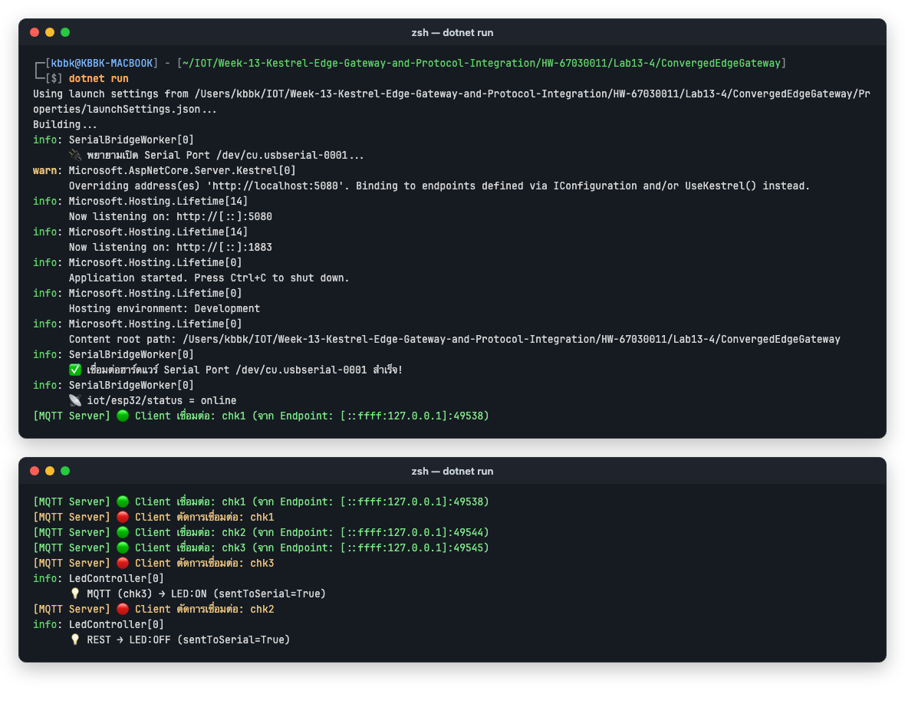

แอป Flutter รันบน iOS Simulator ด้วย `flutter run` (Xcode build 10.8s) แท็บ Telemetry Gauge แสดงค่าจาก `iot/esp32/telemetry` ของ Kestrel ทันที บรรทัดสุดท้ายของ Log คือ RTT ที่แอปวัดได้ระหว่างการทดสอบข้อ 2

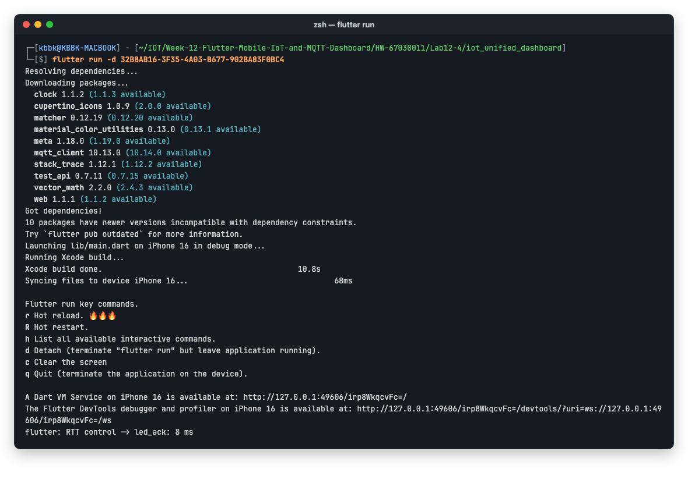

---

### กิจกรรมที่ 13-4.2: การทดสอบ 4 มหาการทดลอง (The Grand Verification Matrix)

ให้นักศึกษาทำการทดสอบและบันทึกผลการทำงานลงในตาราง:

| มิติการทดสอบ | การกระทำเชิงปฏิบัติการ | ปรากฏการณ์ที่เกิดขึ้นจริงในระบบ | ผลการทดลอง (ผ่าน/ไม่ผ่าน) |
| :--- | :--- | :--- | :--- |
| **1. Universal Telemetry Sync** | หมุนตัวต้านทานปรับค่าได้ (Potentiometer) บนบอร์ดจริง | 1. ค่าแรงดันวิ่งผ่านสาย Serial เข้า Kestrel 2. ตัวเลขบนเว็บแดชบอร์ดวิ่งสดทันที 3. เข็ม Radial Gauge บน Flutter หมุนตามทันทีพร้อมกัน || ✅ ผ่าน |
| **2. Mobile-to-Web Actuation** | แตะสวิตช์เปิดไฟบนแอป Flutter (ส่งผ่าน MQTT) | 1. หลอดไฟ LED จริงบนบอร์ด ESP32 ติดสว่างขึ้น 2. ปุ่มสวิตช์บนหน้าเว็บเปลี่ยนเป็นสีเขียว "ON" อัตโนมัติ || ✅ ผ่าน |
| **3. Web-to-Mobile Actuation** | คลิกปุ่มปิดไฟบนหน้าเว็บ (ส่งผ่าน SignalR) | 1. หลอดไฟ LED จริงบนบอร์ด ESP32 ดับลงทันที 2. สวิตช์บนแอปมือถือ Flutter สลับเป็น "OFF" ทันที || ✅ ผ่าน |
| **4. Third-Party REST Override** | ยิงคำสั่งผ่าน cURL หรือ Postman: `curl -X POST http://localhost:5000/api/led/on` | 1. หลอดไฟ LED สว่างขึ้น 2. ทั้งหน้าเว็บและแอปมือถืออัปเดตสถานะเป็น "ON" พร้อมกัน || ✅ ผ่าน |

**ผลการทดลอง:** ผ่านครบทั้ง 4 ข้อ ทุกภาพด้านล่างคือหน้าเว็บ (ซ้าย, Chrome) กับแอป Flutter (ขวา, iOS Simulator) ที่ **ถ่ายพร้อมกันในวินาทีเดียวกัน** และหน้าเว็บในแต่ละภาพเป็นหน้าที่เพิ่งเปิดใหม่ จึงพิสูจน์ด้วยว่า `OnConnectedAsync` ส่งสถานะปัจจุบันให้ถูกต้อง

**ข้อ 1 Universal Telemetry Sync:** เว็บแสดง `0.79 V` (Raw 978) และเกจในแอปแสดง `0.79` V (Raw 979) ค่า Raw ต่างกันแค่ 1 เพราะสองจออาจรับแพ็กเก็ตต่างรอบกัน (ห่างกัน 0.5 วินาที) เพราะทั้งคู่มาจากบรรทัด Serial ชุดเดียวกันที่ Gateway กระจายไปทั้ง SignalR และ MQTT ส่วนการหมุน Potentiometer แล้วค่าวิ่งพร้อมกันทั้งสองจอ ดูได้จากภาพ `off5` และวิดีโอในกิจกรรม 13-4.3

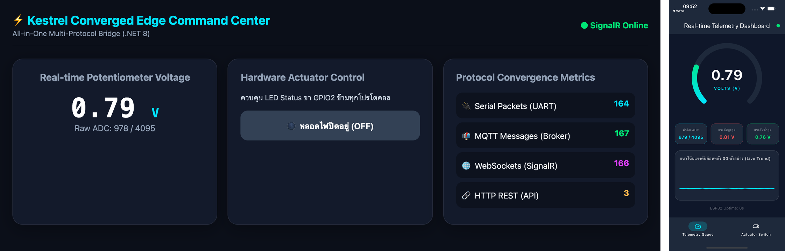

**ข้อ 2 Mobile-to-Web:** แตะสวิตช์ในแอป แล้วแอป Publish `{"led":"ON"}` ไปที่ `iot/esp32/control`
* Gateway Log: `💡 MQTT (Flutter_Switch_1793069514422) → LED:ON (sentToSerial=True)`
* LED บนบอร์ดติด และปุ่มบนเว็บเปลี่ยนเป็นสีเขียว `หลอดไฟกำลังสว่าง (ON)` เอง
* แอปวัด RTT จากการกดถึงได้ `led_ack` กลับมาได้ **8 ms**

**ข้อ 3 Web-to-Mobile:** คลิกปุ่มบนเว็บ (`toggleLed()` → SignalR `ToggleLed(false)`)
* Gateway Log: `🌐 สั่งการจาก Web Dashboard ผ่าน SignalR: LED:OFF` และ `💡 SignalR (Web) → LED:OFF`
* LED ดับ และสวิตช์ในแอปเลื่อนกลับเป็น `ปิดการทำงาน (Standby)` เอง เพราะได้ `led_ack {"led_state":false}`

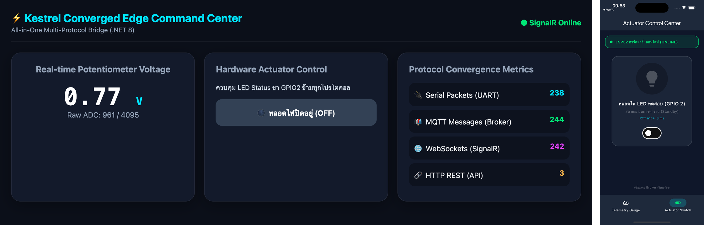

**ข้อ 4 Third-Party REST Override:** `curl -X POST http://localhost:5080/api/led/on` ได้ `sentToSerial: true` LED ติด และ **ทั้งเว็บและแอปเปลี่ยนเป็น ON พร้อมกัน** (ไอคอนหลอดไฟในแอปเป็นสีเขียว `เปิดสว่าง (Active)`) ส่วนตัวนับ HTTP REST บนเว็บเพิ่มขึ้นเป็น 4

ตรวจสอบสถานะที่เก็บไว้ใน Broker ด้วย CLI หลังการทดสอบ:
* Client ใหม่ที่ Subscribe ได้ Retained `iot/esp32/status online` และ `iot/esp32/led_ack {"led_state":true,"source":"SignalR (Web)"}` ทันที
* `GET /api/led` ได้ `{"ledState":true}` ตรงกัน
* แปลว่าแอปที่เปิดทีหลังหรือต่อใหม่หลังเน็ตหลุด จะได้สถานะจริงทันทีโดยไม่ต้องรอใครกด

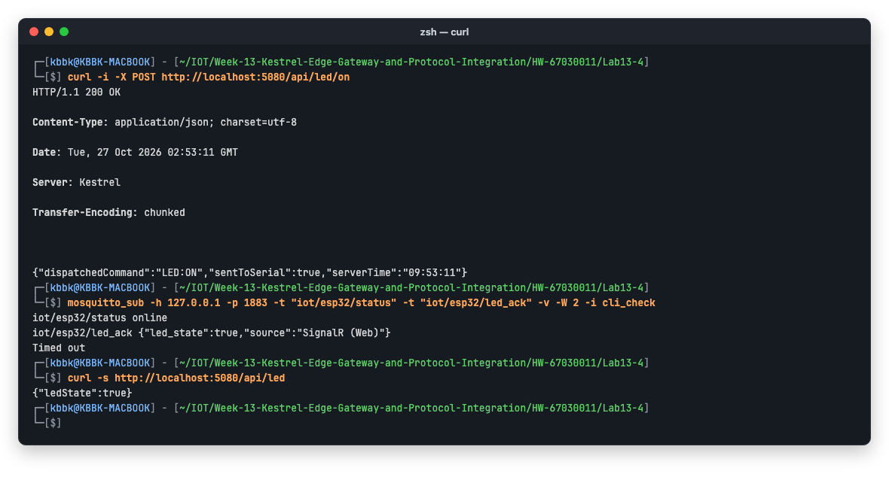

#### การวัดความหน่วงเวลาของแต่ละเส้นทาง (วัตถุประสงค์ข้อ 4)

วัด Round-trip ของการสั่ง LED 20 รอบต่อเส้นทาง (สลับ ON/OFF ทุก 150 ms) จาก "ส่งคำสั่ง" ถึง "ได้สถานะใหม่กลับมา" โดยผ่าน `LedController` ตัวเดียวกันทั้งหมด:
* **REST:** [latency_rest.sh](Lab13-4/latency_rest.sh) ใช้ `curl -w %{time_total}`
* **MQTT:** [latency_mqtt.py](Lab13-4/latency_mqtt.py) เป็น MQTT Client แบบ Raw socket เพื่อไม่ให้เวลา Spawn โปรเซสของ `mosquitto_pub` ปนในผลวัด
* **SignalR:** [latency_signalr.js](Lab13-4/latency_signalr.js) รันในหน้าเว็บจริงผ่าน [cdpeval.mjs](Lab13-4/cdpeval.mjs)

| เส้นทาง | min | median | mean | max (ms) |
| :--- | ---: | ---: | ---: | ---: |
| SignalR `invoke("ToggleLed")` → `LedStateUpdated` | 1.10 | **2.05** | 2.19 | 4.90 |
| HTTP REST `POST /api/led/{state}` → Response | 1.20 | **3.26** | 3.51 | 13.83 |
| MQTT `iot/esp32/control` → `iot/esp32/led_ack` | 1.31 | **3.58** | 3.89 | 8.37 |
| แอป Flutter (MQTT) กดสวิตช์ → ได้ ACK (วัดในแอป) | | 8 | | |

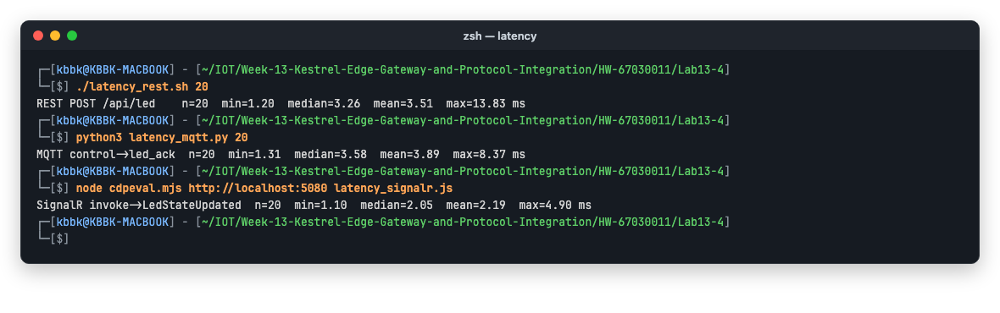

* **SignalR เร็วที่สุด** เพราะ WebSocket ที่เปิดค้างไว้ไม่ต้องเปิด TCP หรือส่ง HTTP Header ใหม่ทุกครั้ง
* **REST** ต้องสร้าง Request/Response เต็มรูปแบบทุกครั้ง (`curl` เปิด Connection ใหม่ทุกรอบ)
* **MQTT** ช้ากว่าเล็กน้อยเพราะ Gateway ต้อง Inject ข้อความ ACK กลับเข้า Broker แล้ว Broker จึงส่งต่อให้ Subscriber แต่ยังอยู่ในระดับไม่กี่มิลลิวินาที
* ค่าของแอป Flutter สูงกว่าเพราะรวมเวลาของ Dart event loop และ UI ด้วย
* ทุกเส้นทางอยู่ในระดับ **มิลลิวินาทีหลักเดียว** สอดคล้องกับตารางเปรียบเทียบใน README (SignalR 1–5 ms, MQTT 2–10 ms, REST 10–50 ms; REST ในการทดลองนี้เร็วกว่าตารางเพราะเป็น localhost)
* **ข้อสังเกต:** ตัวเลขเหล่านี้วัดถึงตอนที่ Gateway เขียนลง Serial เสร็จ แต่หลอดไฟจริงจะเปลี่ยนในรอบถัดไปของเฟิร์มแวร์ที่เรียก `uart_read_bytes` (รอบละประมาณ 500 ms) **คอขวดของ End-to-end จึงอยู่ที่ฝั่ง ESP32 ไม่ใช่ที่โปรโตคอล** ถ้าต้องการเร็วขึ้น ควรแยก Task อ่าน UART ที่บล็อกรอข้อมูลออกจาก Task ส่ง ADC

---

### กิจกรรมที่ 13-4.3: การทดสอบความทนทานในสภาวะตัดเน็ต (Local Survivability Challenge)

1. ทำการ **ถอดสาย LAN หรือปิดการเชื่อมต่ออินเทอร์เน็ตภายนอก** ของเครื่องคอมพิวเตอร์และมือถือ (คงไว้เฉพาะเครือข่าย Wi-Fi วงแลนท้องถิ่นที่ไม่มีเน็ต)
2. สังเกตการทำงาน:
   * บอร์ด ESP32 ยังคงส่งข้อมูลได้หรือไม่?
   * แอปมือถือ Flutter และเว็บแดชบอร์ดยังสามารถเปิดดูค่าและสั่งงานหลอดไฟได้หรือไม่?
3. **สรุปผล**: ระบบที่ออกแบบด้วยสถาปัตยกรรม **Converged Edge Gateway** มีความสามารถในการอยู่รอด (Survivability) อย่างสมบูรณ์แบบ 100% โดยไม่ล่มสลายตามสัญญาณอินเทอร์เน็ตภายนอก

**ผลการทดลอง:** ระบบทำงานต่อได้ครบทุกเส้นทางตลอดช่วงตัดเน็ต
* **สคริปต์ทดสอบ:** ใช้ [survivability_test.sh](Lab13-4/survivability_test.sh) ซึ่งรอจนอินเทอร์เน็ตหลุดจริง แล้วทดสอบทุกเส้นทางบน localhost พร้อมเก็บภาพหน้าเว็บและแอปทุกขั้น
* **วิธีตัดเน็ต:** ปิด Wi-Fi ของ Mac เอง ซึ่งเป็นช่องทางออกอินเทอร์เน็ตทางเดียวของเครื่อง
* **ยืนยันว่าออฟไลน์จริง** ตั้งแต่ `09:56:48` ถึง `09:57:17`:
  * `Wi-Fi Power (en0): Off`
  * `en0: inactive` ไม่มี IP
  * `curl https://www.google.com` ได้ `Could not resolve host`

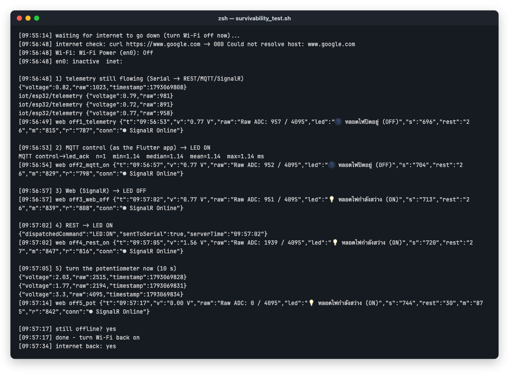

* **บอร์ด ESP32 ยังส่งข้อมูลได้หรือไม่? → ได้:**
  * ESP32 ต่อกับ Gateway ทางสาย USB-Serial ซึ่งไม่เกี่ยวกับเครือข่ายเลย
  * ระหว่างออฟไลน์ `GET /api/telemetry/latest` และ `mosquitto_sub iot/esp32/telemetry` ยังได้ค่าใหม่ตลอด
  * ตัวนับ Serial บนเว็บเพิ่มจาก 696 เป็น 744 ในเวลา 24 วินาที (ประมาณ 2 แพ็กเก็ต/วินาทีเท่าเดิม)
* **แอปมือถือและเว็บยังดูค่าและสั่งงานหลอดไฟได้หรือไม่? → ได้ทุกเส้นทาง:**
  * **MQTT:** สั่ง ON ได้ `led_ack` ใน **1.14 ms**
  * **SignalR (เว็บ)** และ **REST** ได้ `sentToSerial: true` และ LED ติด/ดับตามคำสั่ง
  * ป้ายบนเว็บเป็น `● SignalR Online` ตลอด และแอปแสดง `ESP32: ONLINE` กับ `เชื่อมต่อ Broker เรียบร้อย` ตลอด
  * ระหว่างนั้นกดสวิตช์ในแอปบน Simulator เองด้วย Gateway Log มีคำสั่ง `💡 MQTT (Flutter_Switch_1793069514422) → LED:ON/OFF` แทรกอยู่ระหว่างคำสั่งของสคริปต์ จึงยืนยันได้ว่าแอปสั่งงานได้ตอนออฟไลน์
  * เพราะการกดในแอปแทรกเข้ามาพอดี ปุ่มบนเว็บในภาพ `off2` จึงเป็น OFF (แอปสั่ง OFF ทันทีหลังสคริปต์สั่ง ON) และการ Toggle ของเว็บในขั้น `off3` จึงกลายเป็น ON ทุกขั้นสอดคล้องกับ Log
  * **หน้าเว็บทุกภาพเป็นหน้าที่เพิ่งเปิดใหม่ตอนออฟไลน์** เปิดได้เพราะใบงานนี้ย้าย `signalr.min.js` มาโหลดจาก Kestrel แทน cdnjs ถ้าใช้ HTML ตามใบงาน 13.3 หน้าเว็บจะโหลดไลบรารี SignalR ไม่ได้และจะไม่มีข้อมูลขึ้นเลย
* **หมุน Potentiometer ระหว่างออฟไลน์:** ค่าเปลี่ยนจาก 2.03 → 1.77 → 3.30 → 0.00 V ทั้งบน REST, เว็บ และแอป

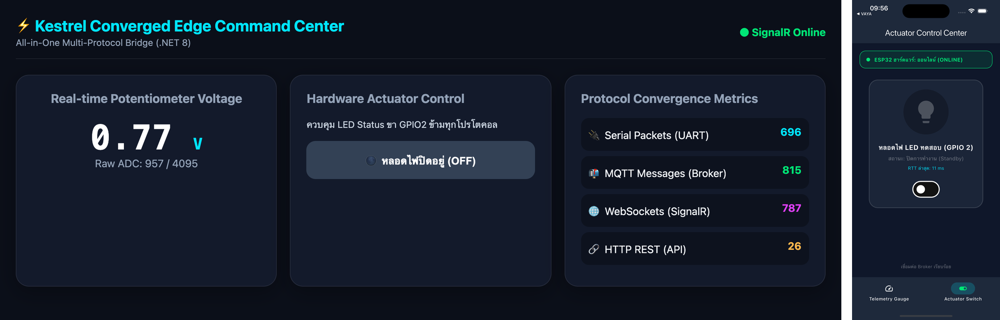

ออฟไลน์ขั้น 1: Telemetry ยังเข้าทั้งเว็บและแอป

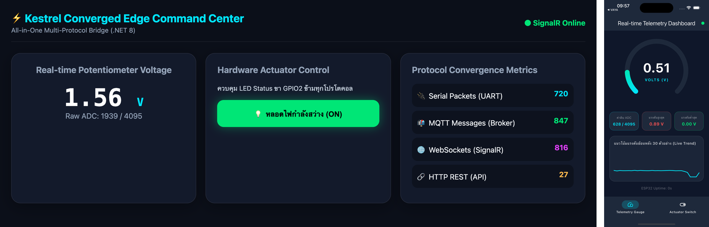

ออฟไลน์ขั้น 4: REST สั่ง ON แล้วเว็บและแอปเป็น ON ทั้งคู่

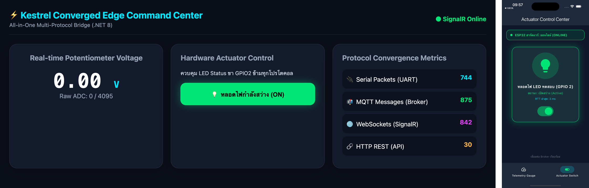

ออฟไลน์ขั้น 5: หมุน Potentiometer ไปสุด (0.00 V) และตัวนับ HTTP REST เพิ่มเป็น 30

ภาพของขั้น 2 และ 3 อยู่ที่ [lab13-4-off2-mqtt-on.png](Images/lab13-4-off2-mqtt-on.png) และ [lab13-4-off3-web-off.png](Images/lab13-4-off3-web-off.png)

**วิดีโอจริงช่วงตัดเน็ต (13 วินาที เริ่ม 09:56:43):**
* ช่วงแรกเปิดเมนู Wi-Fi บนแถบเมนูของ Mac เพื่อปิด Wi-Fi สคริปต์ตรวจพบว่าเน็ตหลุดตอน 09:56:48
* จากนั้นแตะสวิตช์ในแอป Flutter บน Simulator สลับไปมา LED สีแดงบน Breadboard และ LED สีฟ้าบนบอร์ด ติด/ดับตามสวิตช์ทุกครั้ง และปุ่มบนหน้าเว็บด้านหลังก็เปลี่ยนสีตามไปด้วย
* ทั้งหมดเกิดขึ้นตอนที่เครื่องไม่มีอินเทอร์เน็ต ตรงกับคำสั่ง `💡 MQTT (Flutter_Switch_...)` ใน Gateway Log ช่วงเวลาเดียวกัน

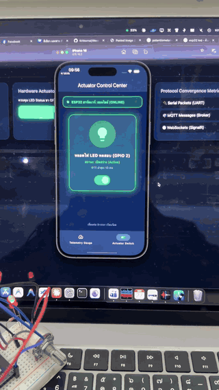

วิดีโอจริง (ย่อเหลือ 6 fps)

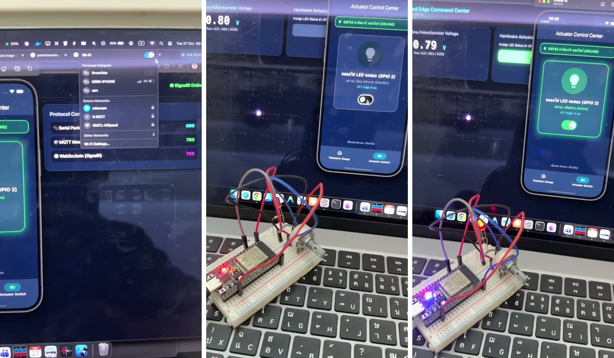

ภาพนิ่งจากวิดีโอ (ซ้ายไปขวา): 
• เปิดเมนู Wi-Fi เพื่อปิด — ตอนนั้นตัวนับบนเว็บอยู่ที่ Serial 680 / MQTT 793 / SignalR 768 
• ในแอปสวิตช์เป็น OFF (Standby) ปุ่มบนเว็บเป็นสีเทา และ LED บนบอร์ดดับ 
• แตะสวิตช์ในแอปเป็น ON (Active) ปุ่มบนเว็บกลายเป็นสีเขียว และ LED สีแดงกับ LED สีฟ้าบนบอร์ดติด

**สรุปผล:** ยืนยันตามใบงาน ทุกเส้นทางระหว่าง ESP32, Gateway, เว็บ และแอปทำงานบนเครื่องเดียว (Serial, `localhost:1883`, `localhost:5080`) ไม่ต้องพึ่ง DNS หรือ Cloud ภายนอก ระบบจึงอยู่รอดได้ 100% เมื่ออินเทอร์เน็ตล่ม
* **เงื่อนไขที่ 1:** ไฟล์ทุกอย่างที่หน้าเว็บต้องใช้ต้องโฮสต์อยู่บน Gateway เอง (กรณี `signalr.min.js` ข้างบน)
* **เงื่อนไขที่ 2:** ถ้าแอปอยู่บนมือถือจริง มือถือกับ Gateway ต้องอยู่ใน **LAN วงเดียวกัน** ที่ยังทำงานอยู่ (Router หรือ Access Point เปิดอยู่ แต่สาย WAN ขาด) ในการทดลองนี้ใช้ Simulator ที่อยู่บนเครื่องเดียวกับ Gateway จึงปิด Wi-Fi ได้ทั้งหมด

---

## 4. บทสรุปและคำถามส่งท้ายภาคการศึกษา (Capstone Retrospective)

1. **ตลอดระยะเวลา 13 สัปดาห์ การเดินทางจากระดับบิตและรีจิสเตอร์ของเซนเซอร์ สู่เฟรมเวิร์ก FreeRTOS, ผ่านโปรโตคอลเครือข่ายท้องถิ่น, สู่ระบบคลาวด์ MQTT, หน้าจอมือถือ Flutter, และมาบรรจบที่ Kestrel Edge Gateway... สถาปัตยกรรมชิ้นใดที่ท่านคิดว่ามีความท้าทายเชิงวิศวกรรมมากที่สุด? เพราะเหตุใด?**
   * **คำตอบ:**
     * ผมคิดว่า **Kestrel Converged Edge Gateway ในสัปดาห์นี้** ท้าทายที่สุด เพราะเป็นชิ้นเดียวที่ต้องให้ทุกอย่างจาก 12 สัปดาห์ก่อนทำงานร่วมกันในโปรเซสเดียว และปัญหาที่เจอไม่ได้อยู่ที่โปรโตคอลใดโปรโตคอลหนึ่ง แต่อยู่ที่ **รอยต่อระหว่างโปรโตคอล**
     * **Concurrency และวงจรชีวิตของ Host:**
       * `SerialBridgeWorker` ตามใบงานบล็อกการ Start ของ Host บน .NET 8/9 จน Kestrel ไม่เปิดพอร์ต (ใบงาน 13.2)
       * ดูจาก Log แล้วไม่เห็น Error ใด ๆ ต้องเข้าใจว่า `BackgroundService.ExecuteAsync` รันแบบ synchronous จนถึง `await` แรก จึงแก้ได้ด้วย `Task.Yield()` บรรทัดเดียว
     * **ความสอดคล้องของสถานะ (State Consistency):** มี 3 ช่องทางที่สั่ง LED ได้ และมีผู้ดู 2 แบบที่ต้องเห็นสถานะเดียวกัน
       * ถ้าแต่ละ Endpoint เขียน Serial เอง สถานะจะไม่ตรงกัน (เห็นในใบงาน 13.3: REST สั่งแล้วเว็บไม่รู้ และหน้าเว็บที่เพิ่งเปิดขึ้น OFF ทั้งที่ไฟติด)
       * ทางแก้คือรวมการเปลี่ยนสถานะไว้ที่ `LedController` จุดเดียว และใช้ Retained message กับ `OnConnectedAsync` ให้ Client ที่มาทีหลังได้สถานะจริง
     * **สัญญาข้ามระบบ (Interface Contract):**
       * แอป Flutter จากสัปดาห์ที่ 12 คาดหวังทั้งรูปแบบหัวข้อ (`control`, `led_ack`, `status`) และรูปแบบ JSON ที่ตายตัว
       * Gateway ต้องเลียนแบบ "บอร์ดที่มี Wi-Fi" ให้แอปเห็นแทนบอร์ดที่ต่อแค่ Serial
       * สุดท้ายแอปทำงานได้โดยไม่ต้องแก้โค้ดเลย ซึ่งแสดงคุณค่าของ Gateway ในการเชื่อมระบบที่ไม่ได้ออกแบบมาด้วยกัน
     * อันดับรองลงมาคือ **MQTTS/mTLS ในสัปดาห์ที่ 11** ที่ต้องทำ PKI ให้ถูกทั้งโซ่ เช่น Certificate ของ CA ที่ OpenSSL รุ่นใหม่สร้างออกมาโดยไม่มี `basicConstraints CA:TRUE` ทำให้ตรวจสอบไม่ผ่าน ปัญหาด้านความปลอดภัยแบบนี้หาสาเหตุยากเพราะข้อความ Error กว้างมาก
2. **หากท่านต้องนำระบบนี้ไปติดตั้งในโรงงานอุตสาหกรรมจริง สิ่งใดคือ 3 ปัจจัยแรกที่ต้องดำเนินการเพิ่มเติมเพื่อความปลอดภัยและความมั่นคงระดับองค์กร?**
   * **คำตอบ:**
     1. **ความปลอดภัยของทุกช่องทางเข้า (Security & Access Control):**
        * ตอนนี้ใครก็ตามที่อยู่ใน LAN เดียวกันเปิดไฟได้ด้วย `curl` บรรทัดเดียว หรือต่อ MQTT 1883 แบบ Anonymous ได้
        * ต้องเปิด **MQTTS (8883) + mTLS** ตามแบบสัปดาห์ที่ 11 พร้อม Username/ACL แยกสิทธิ์ราย Topic (แอปสั่ง `control` ได้แต่ Publish `telemetry` ไม่ได้)
        * REST และ SignalR ต้องเป็น **HTTPS** พร้อม Authentication (JWT/API Key) และ Authorization แยกบทบาท (ดูอย่างเดียว / สั่งงานได้)
        * ใส่ **Rate Limiting** และ Validation ของ Payload ที่ขอบ (แบบ `InterceptingPublishAsync` ในใบงาน 13.1)
        * แยกเครือข่าย OT ออกจาก IT ด้วย VLAN/Firewall
     2. **ความเสถียรและการกู้คืนอัตโนมัติ (Reliability & Resilience):**
        * รัน Gateway เป็น Service ของระบบ (systemd / Windows Service) ที่ Restart เองเมื่อล่ม และมี Watchdog/Health check
        * เก็บข้อมูลแบบ **Store-and-Forward** (เช่น SQLite/บัฟเฟอร์บนดิสก์) ให้ข้อมูลไม่หายตอน Cloud หรือ Gateway ดับ
        * ใช้ Persistent session หรือ Retained message ที่อยู่รอดข้ามการ Restart
        * เพิ่ม Circuit Breaker ฝั่ง Upstream
        * ฝั่งฮาร์ดแวร์ใช้ **RS-485 แบบ Isolated** แทน USB ที่ยาวได้ไม่กี่เมตรและไวต่อสัญญาณรบกวนจากมอเตอร์ในโรงงาน
        * จ่ายไฟ Gateway ผ่าน UPS
        * ถ้าเป็นจุดสำคัญ ควรมี Gateway สำรอง เพราะตอนนี้ Gateway เป็น Single point of failure
     3. **การมองเห็นและการบริหารจัดการ (Observability & Lifecycle Management):**
        * ส่ง Log, Metrics และ Trace ออกไปเก็บรวมศูนย์ (OpenTelemetry/Prometheus) และขยาย `ProtocolMetrics` ให้มี Error rate กับ Latency พร้อม Alert เมื่ออัตราแพ็กเก็ตผิดปกติ
        * มีกระบวนการ **อัปเดต Firmware/Gateway แบบปลอดภัย** (Signed OTA, Rollback ได้) และเก็บ Configuration (ชื่อพอร์ต, หัวข้อ, Credential) ใน Config หรือ Secret store แทนการ Hard-code อย่าง `_portName`
        * มี Audit log ว่าใครสั่งงานอุปกรณ์เมื่อไร `LedController` บันทึก `source` ของทุกคำสั่งไว้แล้ว ซึ่งเป็นจุดเริ่มต้นที่ดี
3. **ขอแสดงความยินดีกับนักศึกษาทุกท่านที่สำเร็จการฝึกอบรมการพัฒนาแอปพลิเคชันไอโอทีระดับมืออาชีพอย่างสมบูรณ์แบบ! 🎉**
   * **คำตอบ:** ขอบคุณครับ ผลงานทั้งภาคการศึกษาอยู่ในโฟลเดอร์ `HW-67030011` ของแต่ละสัปดาห์ ใบงานนี้ปิดท้ายด้วยการเอาแอป Flutter จากสัปดาห์ที่ 12 มาต่อกับ Gateway ของสัปดาห์นี้โดยไม่ต้องแก้แอปเลย 🎉
