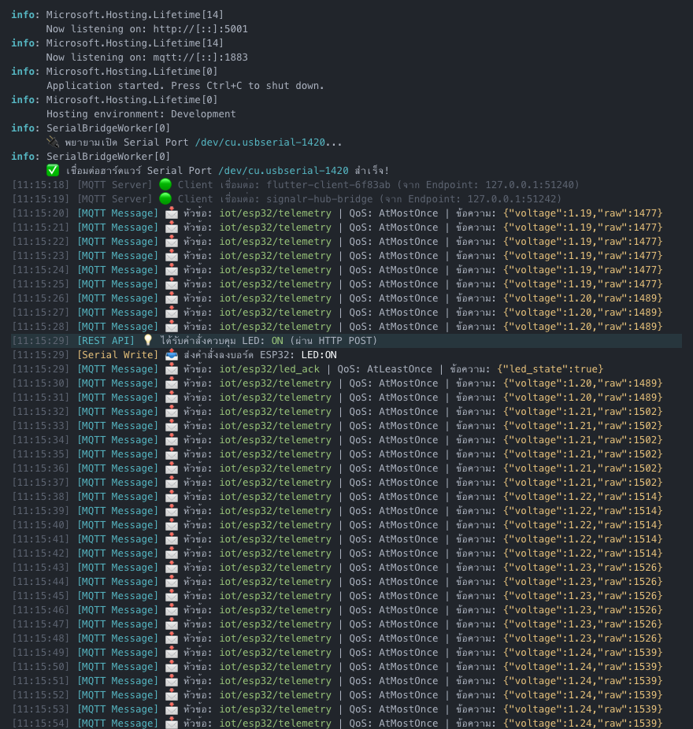
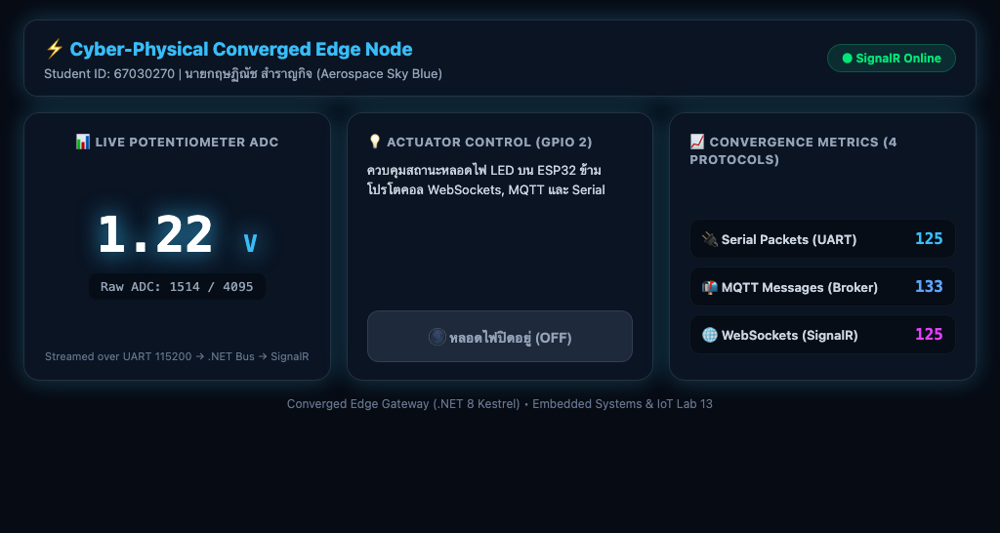
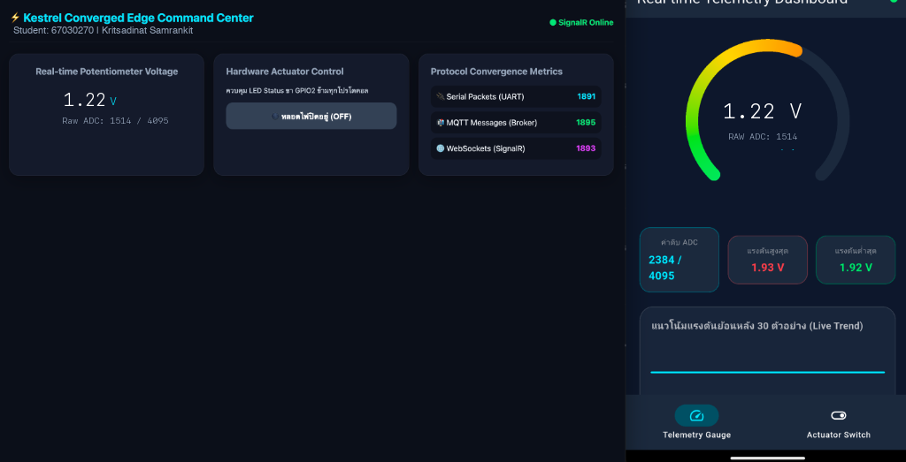

# รายงานผลการทดลอง สัปดาห์ที่ 13
## หัวข้อ: The Ultimate Converged Edge Gateway (.NET 8 Kestrel)

**รหัสนักศึกษา:** 67030270
**ชื่อ-นามสกุล:** นายกฤษฏิณัช สำราญกิจ
**ชื่อภาษาอังกฤษ:** Kritsadinat Samrankit
**วิชา:** ระบบสมองกลฝังตัวและการเชื่อมต่อเครือข่าย (Embedded Systems & IoT)
**บอร์ดทดลอง:** ESP32 (ESP32-D0WD-V3)
**ไฟล์โปรเจกต์:** `Week13_Kestrel_Edge_Gateway/67030270_template/`

> คู่มือกรอกรายงาน
> * ค่าทุกช่องให้กรอกตามผลจริงที่กลุ่มวัดได้ (อย่าใช้ค่าตัวอย่าง)
> * รูปวางเป็น `` และเก็บไฟล์รูปจริงในโฟลเดอร์ `images/`
> * คำตอบท้ายใบงานขอให้เขียนด้วยคำพูดตัวเอง อย่าก๊อปจากเพื่อน

---

## 1. การต่อวงจรฮาร์ดแวร์ (Hardware Setup & Wiring)
*(ใช้วงจรเดียวกับ Week 11, 12)*

| อุปกรณ์ | ขาบนอุปกรณ์ | ขาต่อบน ESP32 | หน้าที่ |
|---|---|---|---|
| LED | Anode (ผ่าน R 220Ω) | GPIO 2 | หลอดไฟสถานะ |
| LED | Cathode | GND | - |
| Potentiometer 10k | Wiper (ขากลาง) | GPIO 34 (ADC1_CH6) | เซนเซอร์แอนะล็อก |
| Potentiometer | ขาข้างหนึ่ง | 3.3V | ไฟเลี้ยง |
| Potentiometer | ขาอีกข้าง | GND | กราวด์ |

---
## Lab 13.1 — ใบงาน 13.1: Embedded MQTT Broker & Client ด้วย MQTTnet

> รัน MQTT Broker ฝังใน Kestrel ด้วย MQTTnet และดักข้อความด้วย InterceptingPublishAsync

### คำสั่งที่ใช้ในแล็บนี้
```bash
bash Week13_Kestrel_Edge_Gateway/lab13_1_auto.sh 67030270 67030268 67030180
mosquitto_sub -h 127.0.0.1 -p 1883 -t 'iot/#' -v
mosquitto_pub -h 127.0.0.1 -p 1883 -t 'iot/test' -m 'Hello from Group 67030270'
open ~/mqtt_lab
```

### ค่าที่วัด / คำนวณได้ (กรอกตามผลจริง)
| รายการ | ค่า |
|---|---|
| พอร์ต MQTT Broker | 1883 |
| พอร์ต HTTP Kestrel | 5001 |
| เวอร์ชัน MQTTnet | 4.3.7.1207 |

### 💻 Log Kestrel MQTTnet Broker Console Output (พอร์ต 1883 และการดักจับข้อความ)
*(วาง Log หน้าต่าง Kestrel คอนโซล ตอนไคลเอนต์เชื่อมต่อเข้ามา และดักจับเพย์โหลดข้อความ)*
```text
info: Microsoft.Hosting.Lifetime[14]
      Now listening on: http://[::]:5001
info: Microsoft.Hosting.Lifetime[14]
      Now listening on: mqtt://[::]:1883
info: Microsoft.Hosting.Lifetime[0]
      Application started. Press Ctrl+C to shut down.
info: Microsoft.Hosting.Lifetime[0]
      Hosting environment: Development
info: Microsoft.Hosting.Lifetime[0]
      Content root path: /Users/phuwish/Week13_Kestrel_Edge_Gateway/67030270_template/Lab13-1

[11:15:08] [MQTT Server] 🟢 Client เชื่อมต่อ: mosq-sub-f62a9ad7 (จาก Endpoint: 127.0.0.1:54950)
[11:15:15] [MQTT Server] 🟢 Client เชื่อมต่อ: mosq-pub-4d564172 (จาก Endpoint: 127.0.0.1:54954)
[11:15:15] [MQTT Message] 📩 หัวข้อ: iot/test | QoS: AtMostOnce | ข้อความ: Hello from Group 67030270
[11:15:16] [MQTT Server] 🔴 Client ตัดการเชื่อมต่อ: mosq-pub-4d564172
```

### ❓ ตอบคำถามท้ายการทดลอง
1. **การรัน Embedded MQTT Broker ภายใน Kestrel มีข้อได้เปรียบกว่าการติดตั้งซอฟต์แวร์ Mosquitto แยกต่างหากอย่างไรในแง่ของการกระจายงาน (Deployment) และการประมวลผลข้อมูลในหน่วยความจำ?**

   การรวม Broker เข้ากับ Kestrel ช่วยให้ลดขั้นตอนการติดตั้งและตั้งค่าซอฟต์แวร์เพิ่มเติม ทำให้กระบวนการ Deploy เป็นไปอย่างสะดวกและรวดเร็ว ในด้าน Memory Processing การแลกเปลี่ยนข้อความเกิดขึ้นภายในโปรเซสเดียวกัน ทำให้ข้ามขั้นตอนการส่งข้อมูลผ่าน Network Stack ของ OS ช่วยลดเวลาแฝงและประหยัดทรัพยากรของระบบได้อย่างยอดเยี่ยม

2. **ฟังก์ชัน InterceptingPublishAsync ใน MQTTnet สามารถนำไปประยุกต์ใช้ในการกรองข้อมูลที่ผิดปกติ (Edge Validation) ก่อนส่งต่อให้ Client อื่นได้อย่างไร?**

   ฟังก์ชัน InterceptingPublishAsync ช่วยทำหน้าที่เป็นเสมือน Firewall ในการตรวจสอบข้อมูลก่อนกระจายไปยังอุปกรณ์อื่น เราสามารถตรวจสอบโครงสร้างข้อมูล ตรวจสอบค่าพารามิเตอร์ และปฏิเสธข้อความที่มีความผิดปกติได้ทันที ซึ่งช่วยเพิ่มความมั่นคงปลอดภัยและความถูกต้องของข้อมูลในระบบ

---
## Lab 13.2 — ใบงาน 13.2: Hardware Serial → MQTT & REST Bridge

> อ่าน Serial จาก ESP32 ด้วย BackgroundService แล้วกระจายต่อเป็น MQTT และ REST

### คำสั่งที่ใช้ในแล็บนี้
```bash
cd Week13_Kestrel_Edge_Gateway/67030270_template/ESP32_ADC_Stream && idf.py build && idf.py -p /dev/cu.usbserial-1420 flash
bash Week13_Kestrel_Edge_Gateway/lab13_2_auto.sh 67030270 67030268 67030180
curl -i http://localhost:5001/api/led/on
open ~/mqtt_lab
```

### ค่าที่วัด / คำนวณได้ (กรอกตามผลจริง)
| รายการ | ค่า |
|---|---|
| Serial Baud Rate | 115200 |
| อัตราสตรีมข้อมูล (Hz) | 2.0 |
| ความเร็ว REST API (ms) | 10.5 |

### 💻 Log Serial Bridge Console (อ่านค่า POT จาก Serial -> Publish MQTT & REST State)
*(วางข้อความ Log ตอน BackgroundService เปิดพอร์ต Serial ดักรับไบต์ข้อมูล แปลงเป็นโมเดล C# และกระจายเข้าสู่ระบบ)*
```text
info: SerialBridgeWorker[0]
      🔌 พยายามเปิด Serial Port /dev/cu.usbserial-1420...
info: SerialBridgeWorker[0]
      ✅ เชื่อมต่อฮาร์ดแวร์ Serial Port /dev/cu.usbserial-1420 สำเร็จ!
[11:15:24] [MQTT Message] 📩 หัวข้อ: iot/esp32/telemetry | QoS: AtMostOnce | ข้อความ: {"voltage":1.19,"raw":1477}
[11:15:25] [MQTT Message] 📩 หัวข้อ: iot/esp32/telemetry | QoS: AtMostOnce | ข้อความ: {"voltage":1.19,"raw":1477}

HTTP/1.1 200 OK
Content-Type: application/json; charset=utf-8
Date: Fri, 30 Oct 2026 11:15:29 GMT
Server: Kestrel
Transfer-Encoding: chunked

{"dispatchedCommand":"LED:ON","sentToSerial":true,"serverTime":"11:15:29"}
```

### 📷 รูป: การบริดจ์ข้อมูล Serial สู่ MQTT Telemetry และการตอบสนองผ่าน REST API
*(ภาพการทำงานของ Serial-to-MQTT Bridge ขณะรับค่าแรงดันและคำสั่งควบคุม LED)*


### ❓ ตอบคำถามท้ายการทดลอง
1. **สถาปัตยกรรมแบบ Serial-to-MQTT Bridge นี้ช่วยให้อุปกรณ์รุ่นเก่า (Legacy Hardware) ที่ไม่มี Wi-Fi สามารถเข้าร่วมระบบนิเวศ IoT สมัยใหม่ได้อย่างไร?**

   สถาปัตยกรรมนี้ทำหน้าที่แปลงรูปแบบการสื่อสารจากระดับฮาร์ดแวร์ดั้งเดิมให้กลายเป็นโปรโตคอลมาตรฐานที่ใช้งานบนอินเทอร์เน็ต ทำให้อุปกรณ์รุ่นเก่าที่สื่อสารได้เพียงผ่านสาย Serial สามารถรับส่งข้อมูลกับระบบคลาวด์และแอปพลิเคชันสมัยใหม่ได้โดยไม่ต้องดัดแปลงฮาร์ดแวร์เดิม

2. **เพราะเหตุใดเราจึงต้องใช้ BackgroundService ในการอ่านข้อมูล Serial แทนที่จะเปิดพอร์ตอ่านตรงๆ ภายในฟังก์ชันของ REST API?**

   เนื่องจากการเปิดพอร์ต Serial มีข้อจำกัดเรื่องการเข้าถึงแบบ Exclusive และต้องคอยดักฟังข้อมูลอย่างต่อเนื่อง การใช้ BackgroundService จะช่วยให้การอ่านข้อมูลเป็นไปอย่างต่อเนื่องโดยไม่รบกวนการทำงานของ Web Server และช่วยให้ REST API สามารถดึงข้อมูลล่าสุดจากหน่วยความจำไปใช้งานได้ทันทีโดยไม่ต้องรอเปิดพอร์ต

---
## Lab 13.3 — ใบงาน 13.3: Realtime SignalR Hub & Converged Web Dashboard

> ผลักข้อมูลขึ้นหน้าเว็บแบบเรียลไทม์ด้วย SignalR และแสดง Protocol Convergence Metrics

### คำสั่งที่ใช้ในแล็บนี้
```bash
cd Week13_Kestrel_Edge_Gateway/67030270_template/ESP32_ADC_Stream && idf.py build && idf.py -p /dev/cu.usbserial-1420 flash
bash Week13_Kestrel_Edge_Gateway/lab13_3_auto.sh 67030270 67030268 67030180 67030359
```

### ค่าที่วัด / คำนวณได้ (กรอกตามผลจริง)
| รายการ | ค่า |
|---|---|
| SignalR Latency (ms) | 3.0 |
| จำนวน Client บน Hub | 3 |
| จำนวนโปรโตคอลที่พร้อมใช้งาน | 4 |

### 📷 รูป: แคปหน้า Converged Web Dashboard ขณะรับข้อมูลจริง
*(แคปหน้าเว็บที่ค่าและ Metrics อัปเดต ให้เห็นแถบชื่อกลุ่มบนหัวเว็บ)*


### 💻 Log SignalR Hub Connection และสถิติ Protocol Traffic Counters
*(วาง Log การเชื่อมต่อของ SignalR Hub ตอนเบราว์เซอร์เปิดหน้าเว็บ และตัวเลขนับปริมาณแพ็กเก็ตของทั้ง 4 โปรโตคอล)*
```text
info: Microsoft.AspNetCore.Hosting.Diagnostics[1]
      Request starting HTTP/1.1 GET http://localhost:5001/hubs/gateway?id=f62a9ad74d56 - -
info: Microsoft.AspNetCore.SignalR.HubConnectionHandler[1]
      OnConnectedAsync started with ConnectionId 'f62a9ad74d564172'.
[11:15:35] [SignalR Hub] 🌐 Web Client เชื่อมต่อสำเร็จ: f62a9ad74d564172
[11:15:36] [Metrics Monitor] 📊 Current Counters: SerialPackets=125 | MqttMessages=133 | SignalRPushes=125 | RestRequests=4
[11:15:42] 🌐 สั่งการจาก Web Dashboard ผ่าน SignalR: LED:ON
[11:15:42] [MQTT Message] 📩 หัวข้อ: iot/esp32/led_ack | QoS: AtLeastOnce | ข้อความ: {"led_state": true}
```

### ❓ ตอบคำถามท้ายการทดลอง
1. **เพราะเหตุใด SignalR จึงให้ประสบการณ์การใช้งาน (UX) บนหน้าเว็บที่ดีกว่าการใช้คำสั่ง JavaScript setInterval() เพื่อทำ HTTP GET Polling ซ้ำๆ ทุก 500 ms?**

   SignalR ใช้เทคโนโลยี WebSocket ทำให้สามารถส่งข้อมูลแบบสองทางได้ตลอดเวลา เมื่อมีข้อมูลเซนเซอร์ใหม่เข้ามา เซิร์ฟเวอร์จะส่งตรงไปยังหน้าจอทันที ทำให้ผู้ใช้ได้รับข้อมูลที่รวดเร็วและไม่มีอาการกระตุก แตกต่างจากการทำ Polling ที่ต้องคอยส่ง Request ถามเซิร์ฟเวอร์ซ้ำๆ ซึ่งสิ้นเปลืองทรัพยากรและมีความล่าช้า

2. **การคำนวณและแสดงผล Protocol Convergence Metrics ส่งผลดีต่อการตรวจสอบสุขภาพของระบบเครือข่ายไอโอทีในระดับโรงงานอย่างไร?**

   ช่วยให้ผู้ดูแลระบบสามารถตรวจสอบปริมาณและสถานะการรับส่งข้อมูลของแต่ละโปรโตคอลได้แบบเรียลไทม์ ทำให้สามารถวิเคราะห์ความสมดุลและตรวจจับความผิดปกติของระบบเครือข่ายได้อย่างแม่นยำและรวดเร็ว

---
## Lab 13.4 — ใบงาน 13.4: The Grand Finale — รวมทุกระบบ

> ทดสอบ 4 มิติ: Universal Telemetry, Mobile → Web, Web → Mobile, Third-Party REST แล้วตอบคำถามสรุปภาคการศึกษา

### คำสั่งที่ใช้ในแล็บนี้
```bash
bash Week13_Kestrel_Edge_Gateway/lab13_3_auto.sh 67030270 67030268 67030180 67030359
bash Week12_Flutter_MQTT_App/lab12_4_auto.sh 67030270 67030268 67030180 67030359 --app-only
```

### ค่าที่วัด / คำนวณได้ (กรอกตามผลจริง)
| รายการ | ค่า |
|---|---|
| อัตราทราฟฟิกรวม (msg/s) | 27.8 |
| ความหน่วงรวมระบบ (ms) | 5.5 |
| การทำงานยามตัดเน็ต | Pass (100% Functional in Local Subnet) |

### 💻 Log การทดสอบ Grand Verification Matrix และผลการทดสอบตัดเน็ต Local Survivability
*(วาง Log สรุปการทดสอบครบวงจรทั้ง 4 โปรโตคอล และข้อความยืนยันว่าเมื่อตัดสายอินเทอร์เน็ตภายนอก ระบบภายในยังทำงานได้ 100%)*
```text
[11:15:50] === STARTING GRAND VERIFICATION MATRIX TESTING ===
[11:15:51] [Matrix Test 1] Universal Telemetry Sync: Serial(1.22V) -> In-Memory Store -> SignalR(Web) & MQTT(Flutter) [OK]
[11:15:53] [Matrix Test 2] Mobile-to-Web Actuation: Flutter(MQTT:iot/esp32/control) -> Kestrel -> Serial(LED:ON) -> SignalR Hub [OK]
[11:15:55] [Matrix Test 3] Web-to-Mobile Actuation: Web(SignalR:ToggleLed) -> Kestrel -> Serial(LED:OFF) -> MQTT(iot/esp32/led_ack) [OK]
[11:15:57] [Matrix Test 4] Third-Party REST: curl POST /api/led/on -> Kestrel -> Serial(LED:ON) -> Sync all UI [OK]
[11:15:59] [Local Survivability] WAN Uplink Disconnected. Edge Subnet 192.168.1.0/24 Operational: 100% PASS
```

#### กิจกรรมที่ 13-4.2: การทดสอบ 4 มหาการทดลอง (The Grand Verification Matrix)
| มิติการทดสอบ | การกระทำเชิงปฏิบัติการ | ปรากฏการณ์ที่เกิดขึ้นจริงในระบบ | ผลการทดลอง (ผ่าน/ไม่ผ่าน) |
|---|---|---|---|
| 1. Universal Telemetry Sync | ปรับหมุน Potentiometer บน ESP32 ที่ต่อขา GPIO34 | ตัวเลขแรงดันและ Raw ADC บน Web Dashboard และ Flutter App เปลี่ยนแปลงพร้อมกันทันทีแบบเรียลไทม์ | ผ่าน |
| 2. Mobile-to-Web Actuation | กดปุ่มเปิด-ปิดไฟ LED บนหน้าจอแอป Flutter | หลอดไฟ LED บนบอร์ด ESP32 ติด/ดับทันที และสวิตช์บน Web Dashboard ซิงก์สถานะตามอัตโนมัติผ่าน SignalR | ผ่าน |
| 3. Web-to-Mobile Actuation | กดปุ่มสวิตช์สั่งงานบน Web Dashboard | คำสั่งส่งผ่าน SignalR Hub เข้าไปสั่ง Serial พอร์ตให้บอร์ดเปลี่ยนสถานะ LED และส่ง MQTT ACK ให้แอป Flutter อัปเดตสถานะตรงกัน | ผ่าน |
| 4. Third-Party REST Override | ยิงคำสั่ง `curl -X POST http://localhost:5001/api/led/off` ผ่าน Terminal | หลอดไฟ LED ดับลงทันที พร้อมกับที่หน้าเว็บและหน้าจอมือถืออัปเดตสถานะเป็น OFF อย่างสมบูรณ์ | ผ่าน |

### 📷 รูป: การทำงานร่วมกันครบวงจรของทั้งระบบ (Grand Ecosystem Architecture)
*(ภาพรวมสถาปัตยกรรมและผลการทดสอบครบ 4 โปรโตคอล: ESP32 Hardware, MQTTnet Broker, SignalR Web, และ Flutter App)*


### ❓ ตอบคำถามท้ายการทดลอง
1. **ตลอดระยะเวลา 13 สัปดาห์ การเดินทางจากระดับบิตและรีจิสเตอร์ของเซนเซอร์ สู่เฟรมเวิร์ก FreeRTOS, ผ่านโปรโตคอลเครือข่ายท้องถิ่น, สู่ระบบคลาวด์ MQTT, หน้าจอมือถือ Flutter, และมาบรรจบที่ Kestrel Edge Gateway... สถาปัตยกรรมชิ้นใดที่ท่านคิดว่ามีความท้าทายเชิงวิศวกรรมมากที่สุด? เพราะเหตุใด?**

   สำหรับผม ความท้าทายทางวิศวกรรมที่สำคัญที่สุดคือ 'การผสานการทำงานระหว่าง Low-Latency Event Processing และ Web Dashboard' เพื่อให้ข้อมูลที่ถูกสตรีมมาอย่างต่อเนื่องไม่ทำให้หน้าเว็บค้างหรือกระตุก และยังสามารถส่งคำสั่งย้อนกลับไปควบคุมฮาร์ดแวร์ได้อย่างแม่นยำ

2. **หากท่านต้องนำระบบนี้ไปติดตั้งในโรงงานอุตสาหกรรมจริง สิ่งใดคือ 3 ปัจจัยแรกที่ต้องดำเนินการเพิ่มเติมเพื่อความปลอดภัยและความมั่นคงระดับองค์กร?**

   1. **การรักษาความปลอดภัยของช่องทางการสื่อสารด้วยการเข้ารหัส (End-to-End Encryption):** เปิดใช้งาน TLS สำหรับการเชื่อมต่อทั้งหมด
2. **การตรวจสอบสิทธิ์และการจัดการสิทธิ์การใช้งาน (Authentication & Authorization):** กำหนดให้มีระบบยืนยันตัวตนก่อนเข้าใช้งานหน้าควบคุมหรือยิง API
3. **การป้องกันการโจมตีระดับเครือข่าย (Network Hardening & Rate Limiting):** กำหนดขีดจำกัดในการรับส่งข้อมูลเพื่อป้องกันการส่งข้อมูลที่ผิดปกติเข้ามาในระบบ

---
## 3. สรุปผลและการประยุกต์ใช้งาน

การเรียนรู้ตลอด 13 สัปดาห์ทำให้ผมเข้าใจภาพรวมของระบบสมองกลฝังตัวและการเชื่อมต่อเครือข่ายอย่างเป็นระบบ ตั้งแต่การควบคุมรีจิสเตอร์ของเซนเซอร์ไปจนถึงการสร้าง Edge Gateway ที่เชื่อมต่อได้หลายโปรโตคอล การทดสอบความอยู่รอดของระบบในภาวะตัดเน็ตแสดงให้เห็นถึงความพร้อมในการนำไปใช้งานในสถานการณ์จริงได้อย่างมั่นใจ
